# Lab 01: Design stateful agentic loops with Microsoft Foundry Agent Service

## Overview

**Scenario.** Contoso Capital needs an investment-research agent that keeps multi-turn context, reviews its own answer within a fixed budget, reports completion explicitly, and can explore an alternate "what-if" research path without changing the main conversation. Conversation text must never be written to logs.

**What you build.** You migrate a legacy Agents v1 loop (threads, runs, status polling) to Microsoft Foundry Agents v2 using `azure-ai-projects` 2.x. The finished application:

- creates a versioned prompt agent named `contoso-investment-researcher`,
- runs a bounded reflection loop inside one conversation (at most `MAX_LOOP_ITERATIONS` = 3 turns),
- stops when the model returns `STATUS: COMPLETE`,
- forks an alternate branch with `previous_response_id` (a 250-basis-point refinancing-cost scenario) without touching the conversation,
- prints the IDs and visible summaries as evidence.

**Duration.** About 45 minutes.

> **Note:** The model deployment, Application Insights ingestion, and Log Analytics retention are billable. Use only the synthetic request in `assets/research-request.json`, and delete the resource group when you finish (see Clean up).

**Architecture**

| Component | Resource / file | Purpose |
|---|---|---|
| Foundry account | `Microsoft.CognitiveServices/accounts` (kind `AIServices`, name `fdry<suffix>`) | Hosts the project and the model deployment; public network access enabled for the lab |
| Foundry project | `accounts/projects` (name `lab01-<env>`) | Holds agents, agent versions, conversations, and traces |
| Model deployment | `gpt-5.4-mini` version `2026-03-17`, GlobalStandard, capacity 10 | Model used by the prompt agent |
| Log Analytics workspace | `log-lab01-<suffix>` | Storage for Application Insights telemetry (30-day retention) |
| Application Insights | `appi-lab01-<suffix>` | Receives server-side agent traces through a project connection |
| Project connection | `AppInsights` connection on the project | Lets Foundry write traces without putting the connection string in `.env` |
| `src/main.py` | Python application | Agent definition, bounded reflection loop, response branch |
| `assets/agents-v1-loop.py.txt` | Legacy v1 sample | Comparison only. Do not execute |

---

## Prerequisites

Install these tools before you start:

| Tool | Install link | Check command |
|---|---|---|
| Python 3.11 or later | [python.org/downloads](https://www.python.org/downloads/) | `python --version` |
| Azure CLI with Bicep | [Install Azure CLI](https://learn.microsoft.com/cli/azure/install-azure-cli), [Install Bicep](https://learn.microsoft.com/azure/azure-resource-manager/bicep/install) | `az version`, `az bicep version` |
| Git | [git-scm.com/downloads](https://git-scm.com/downloads) | `git --version` |
| Visual Studio Code | [code.visualstudio.com/download](https://code.visualstudio.com/download) | - |

You also need:

- An Azure subscription with `gpt-5.4-mini` GlobalStandard quota (at least 10K TPM) in the region you choose. This guide uses `eastus2`.
- **Contributor** and **User Access Administrator** (or **Owner**) on the subscription or target resource group, so you can create resources and grant yourself the Foundry data-plane roles.

> **Note:** This guide provisions with the Azure CLI (`az deployment group create`). You do not need the Azure Developer CLI (`azd`) that the official lab mentions.

---

## Task 1: Prepare the lab

**Clone and open the repository**

1. Open a terminal and clone the lab repository:

```powershell
git clone https://github.com/MicrosoftLearning/mslearn-ai-multi-agents.git
cd mslearn-ai-multi-agents
code .
```

2. In Visual Studio Code, open a PowerShell terminal (**Terminal** > **New Terminal**) and change to the lab folder. Every command in this guide runs from this folder.

```powershell
cd Allfiles\01-contoso-capital-stateful-agentic-loops
```

**Verify tools and sign in**

3. Run the tool checks:

```powershell
az version
az bicep version
python --version
```

4. Sign in to Azure and select the subscription you want to use:

```powershell
az login
az account set --subscription "<your-subscription-id>"
az account show --output table
```

**Expected result:** `python --version` reports 3.11 or later, and `az account show` displays the subscription you intend to use.

**Architecture checkpoint**

5. Open these files and locate the items listed. You will change only `src/main.py` and add one new file.

| File | What to locate |
|---|---|
| `infra/main.bicep` | Foundry account and project, model deployment, Application Insights, and the `AppInsights` project connection |
| `src/main.py` | `build_agent_definition`, `run_reflection_cycle`, and `fork_with_previous_response` (each contains a `LAB PLACEHOLDER` comment) |
| `assets/agents-v1-loop.py.txt` | The legacy v1 thread/run loop. Read it, do not run it |
| `assets/research-request.json` | The synthetic `research_request` and `branch_request` |

---

## Task 2: Build the virtual environment

1. Create the virtual environment and install the pinned packages (`azure-ai-projects` 2.x, `azure-identity`, `openai`, `python-dotenv`):

```powershell
./scripts/setup.ps1
. ./.venv/Scripts/Activate.ps1
```

> **Note:** On macOS or Linux run `bash scripts/setup.sh` and then `source .venv/bin/activate`. If PowerShell blocks the script, run `Set-ExecutionPolicy -Scope Process -ExecutionPolicy Bypass` first.

2. Confirm the environment is active:

```powershell
python -c "import sys; print(sys.prefix)"
```

**Expected result:** The prompt starts with `(.venv)`, the setup script ends with `Setup complete`, and the printed prefix ends in `\.venv`.

---

## Task 3: Deploy the Azure resources

The template `infra/main.bicep` takes five parameters: `location`, `environmentName`, `modelDeploymentName`, `modelName`, and `modelVersion`. You pass them directly to `az deployment group create`.

**Provision the infrastructure**

1. Run the following block in the lab folder. It creates a uniquely named resource group, deploys the template, grants you the data-plane roles, and writes `.env` from the deployment outputs.

```powershell
$azureRegion = 'eastus2'
$suffix = (New-Guid).Guid.Substring(0, 8)
$resourceGroupName = "rg-lab01-$suffix"
$envName = "lab01-$suffix"
az group create --name $resourceGroupName --location $azureRegion --output none
az bicep build --file infra/main.bicep
az deployment group create --resource-group $resourceGroupName --name lab01-main `
  --template-file infra/main.bicep `
  --parameters location=$azureRegion environmentName=$envName modelDeploymentName=gpt-5.4-mini modelName=gpt-5.4-mini modelVersion=2026-03-17 `
  --output none
# Grant yourself data-plane access (Foundry agents + model calls)
$me = az ad signed-in-user show --query id -o tsv
$rgId = az group show --name $resourceGroupName --query id -o tsv
foreach ($role in 'Azure AI User','Cognitive Services OpenAI User','Azure AI Developer') {
  az role assignment create --assignee-object-id $me --assignee-principal-type User --role $role --scope $rgId --output none
}
# Write .env from the deployment outputs
$outputs = az deployment group show --resource-group $resourceGroupName --name lab01-main --query properties.outputs -o json | ConvertFrom-Json
$lines = @("AZURE_RESOURCE_GROUP=`"$resourceGroupName`"", "AZURE_LOCATION=`"$azureRegion`"", "AZURE_ENV_NAME=`"$envName`"",
  "AZURE_SUBSCRIPTION_ID=`"$(az account show --query id -o tsv)`"",
  "FOUNDRY_MODEL_CATALOG_NAME=`"gpt-5.4-mini`"", "FOUNDRY_MODEL_VERSION=`"2026-03-17`"", "MAX_LOOP_ITERATIONS=`"3`"")
$outputs.PSObject.Properties | ForEach-Object { $lines += "$($_.Name.ToUpper())=`"$($_.Value.value)`"" }
$lines | Out-File .env -Encoding utf8
Get-Content .env
```

> **Note:** The deployment takes about 3 to 5 minutes. Role assignments can take 1 to 5 minutes to apply. Wait a few minutes before running the application in Task 5, or you may get a `PermissionDenied` (401/403) error.

2. If the deployment fails with a quota or model-availability error, delete the empty resource group, set `$azureRegion` to another region that offers `gpt-5.4-mini` (for example `swedencentral`), and run the block again.

**Verify the generated environment**

3. Confirm that `.env` contains these keys (the values come from your deployment):

```text
AZURE_RESOURCE_GROUP="rg-lab01-<suffix>"
AZURE_LOCATION="eastus2"
AZURE_ENV_NAME="lab01-<suffix>"
AZURE_SUBSCRIPTION_ID="<your-subscription-id>"
FOUNDRY_MODEL_CATALOG_NAME="gpt-5.4-mini"
FOUNDRY_MODEL_VERSION="2026-03-17"
MAX_LOOP_ITERATIONS="3"
FOUNDRY_PROJECT_ENDPOINT="https://fdry<suffix>.services.ai.azure.com/api/projects/lab01-lab01-<suffix>"
FOUNDRY_PROJECT_ID="/subscriptions/<sub>/resourceGroups/rg-lab01-<suffix>/providers/Microsoft.CognitiveServices/accounts/fdry<suffix>/projects/lab01-lab01-<suffix>"
FOUNDRY_ACCOUNT_NAME="fdry<suffix>"
FOUNDRY_MODEL_NAME="gpt-5.4-mini"
APPLICATIONINSIGHTS_RESOURCE_ID="/subscriptions/<sub>/resourceGroups/rg-lab01-<suffix>/providers/Microsoft.Insights/components/appi-lab01-<suffix>"
LOG_ANALYTICS_WORKSPACE_ID="<workspace-guid>"
```

The Application Insights connection string is stored in the Foundry project connection and is not written to `.env`. Do not add keys or tokens to `.env`; the application authenticates with your Azure CLI sign-in through `DefaultAzureCredential`.

4. List the deployed resources:

```powershell
az resource list --resource-group $resourceGroupName --query "[].{name:name, type:type}" --output table
```

**Expected result:** Five resources: the Foundry account, the Foundry project, the Log Analytics workspace, Application Insights, and a `Failure Anomalies` smart detector alert rule.

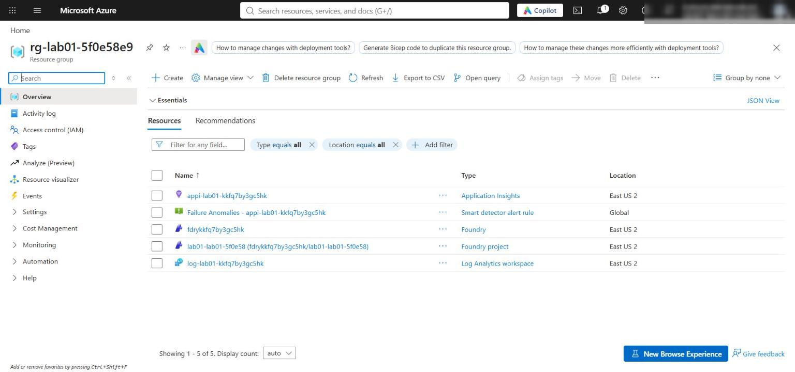

*Figure 1: Resource group overview with the Foundry account, project, Application Insights, and Log Analytics workspace*

**Check network access and the model deployment**

5. In the [Azure portal](https://portal.azure.com), open the Foundry account `fdry<suffix>` and select **Resource Management** > **Networking**. Confirm that **All networks** is selected. The template enables public access with default action **Allow** so your local application can reach the project endpoint; Microsoft Entra authentication and Azure RBAC are still required. Production environments should use selected networks or private endpoints.

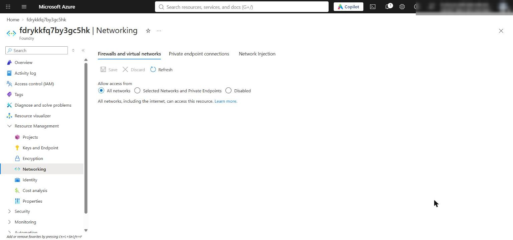

*Figure 2: Foundry account Networking page showing public access from all networks*

6. Confirm the model deployment from the CLI:

```powershell
$account = az resource list -g $resourceGroupName --resource-type Microsoft.CognitiveServices/accounts --query "[0].name" -o tsv
az cognitiveservices account deployment list -g $resourceGroupName -n $account --query "[].{name:name, model:properties.model.name, version:properties.model.version, sku:sku.name, capacity:sku.capacity}" -o table
```

**Expected result:** One deployment named `gpt-5.4-mini`, version `2026-03-17`, SKU `GlobalStandard`, capacity `10`.

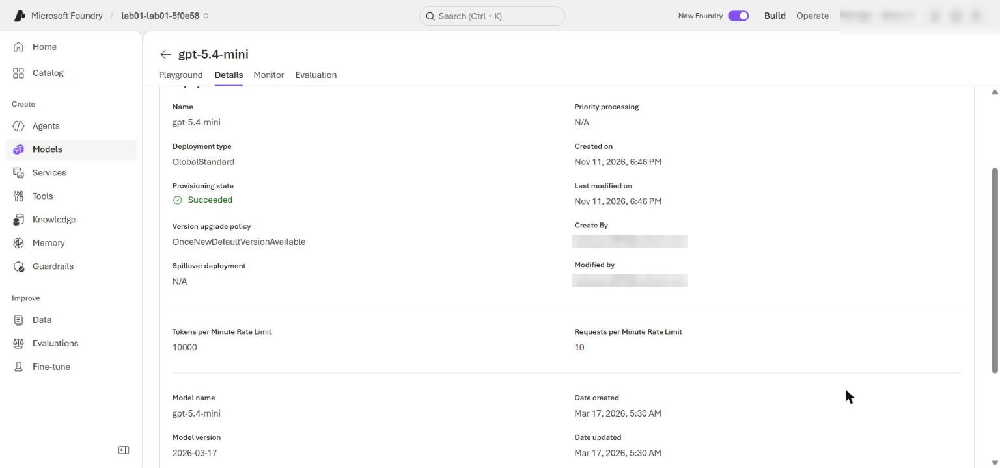

*Figure 3: Model deployment gpt-5.4-mini in the Foundry portal*

7. Confirm your role assignments:

```powershell
az role assignment list --assignee $me --scope $rgId --query "[].roleDefinitionName" -o tsv
```

**Expected result:** `Azure AI User`, `Cognitive Services OpenAI User`, and `Azure AI Developer` are listed.

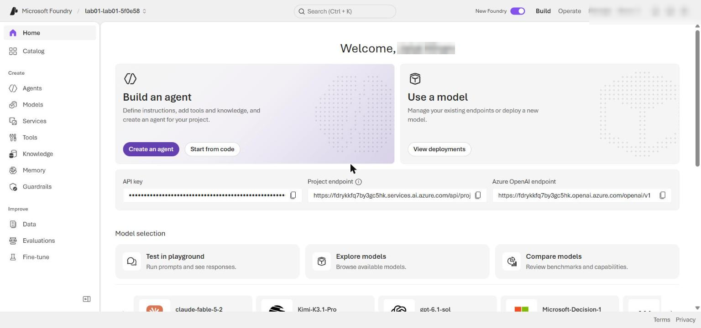

*Figure 4: Foundry project overview in the Foundry portal*

---

## Task 4: Implement the solution

Each placeholder marks incomplete code. For each one, keep the `# LAB PLACEHOLDER` comment line, delete the `raise NotImplementedError(...)` line under it, and paste the replacement code in its place. All replacement code below is already indented with 4 spaces for the function body.

**Placeholder 1: Define the prompt agent**

1. Open `src/main.py` and find this code in `build_agent_definition`:

```python
    # LAB PLACEHOLDER 1: Replace this line with the Task 1 sample.
    raise NotImplementedError("Complete build_agent_definition in Task 1")
```

2. Replace the `raise NotImplementedError(...)` line with:

```python
    return PromptAgentDefinition(
        model=config.model_deployment,
        instructions=(
            "You are Contoso Capital's investment research agent. Use only the "
            "evidence provided in the request and conversation. Do not invent facts, "
            "recommend trades, or reveal hidden chain-of-thought. Return concise, "
            "visible planning and review summaries using exactly these headings:\n"
            "PLAN: <brief approach>\n"
            "REFLECTION: <evidence gaps or checks performed>\n"
            "STATUS: <COMPLETE or CONTINUE>\n"
            "ANSWER: <evidence-based answer or the next information needed>\n"
            "Use COMPLETE only when the request is fully answered from supplied "
            "evidence. Otherwise use CONTINUE."
        ),
    )
```

This definition binds the agent to the deployed model and asks for visible summaries plus a stable completion signal (`STATUS:`). The iteration limit stays in application code.

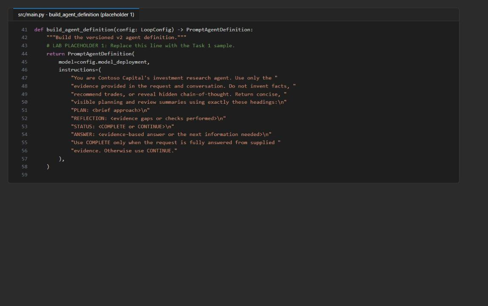

*Figure 5: build_agent_definition after placeholder 1 is completed*

**Placeholder 2: Implement the bounded reflection cycle**

3. In `run_reflection_cycle`, find:

```python
    # LAB PLACEHOLDER 2: Replace this line with the Task 2 sample.
    raise NotImplementedError("Complete run_reflection_cycle in Task 2")
```

4. Replace the `raise NotImplementedError(...)` line with:

```python
    if max_iterations <= 0:
        raise ValueError("max_iterations must be greater than zero")

    iterations: list[dict[str, Any]] = []
    next_input = request
    last_response_id = ""

    for iteration_number in range(1, max_iterations + 1):
        response = openai_client.responses.create(
            conversation=conversation_id,
            input=next_input,
        )
        visible_text = extract_text(response).strip()
        status = "MISSING"

        for line in visible_text.splitlines():
            label, separator, value = line.partition(":")
            if separator and label.strip().strip("*").upper() == "STATUS":
                status = value.strip().strip("* .").upper()
                break

        last_response_id = response.id
        iterations.append(
            {
                "iteration": iteration_number,
                "response_id": response.id,
                "status": status,
                "visible_summary": visible_text,
            }
        )
        LOGGER.info(
            "Iteration completed iteration=%d response_id=%s status=%s",
            iteration_number,
            response.id,
            status,
        )

        if status == "COMPLETE":
            return {
                "iterations": iterations,
                "last_response_id": last_response_id,
            }

        next_input = (
            "Review the previous visible answer for unsupported claims, missing "
            "evidence, and incomplete coverage. Return a revised response with the "
            "required PLAN, REFLECTION, STATUS, and ANSWER headings."
        )

    raise RuntimeError(
        f"Reflection cycle exhausted its {max_iterations}-iteration budget "
        "without STATUS: COMPLETE"
    )
```

Every iteration uses the same `conversation_id`, so the model sees the full history. The loop records each response ID and visible summary, logs only the iteration number, response ID, and status (never the text), and raises an error if the budget runs out without `STATUS: COMPLETE`.

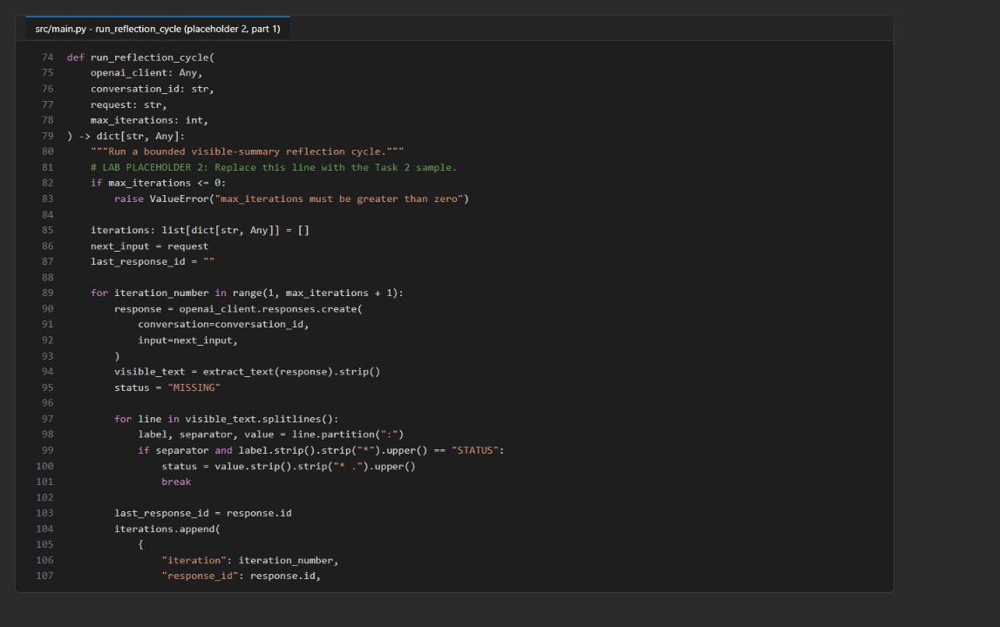

*Figure 6: run_reflection_cycle, first part of placeholder 2*

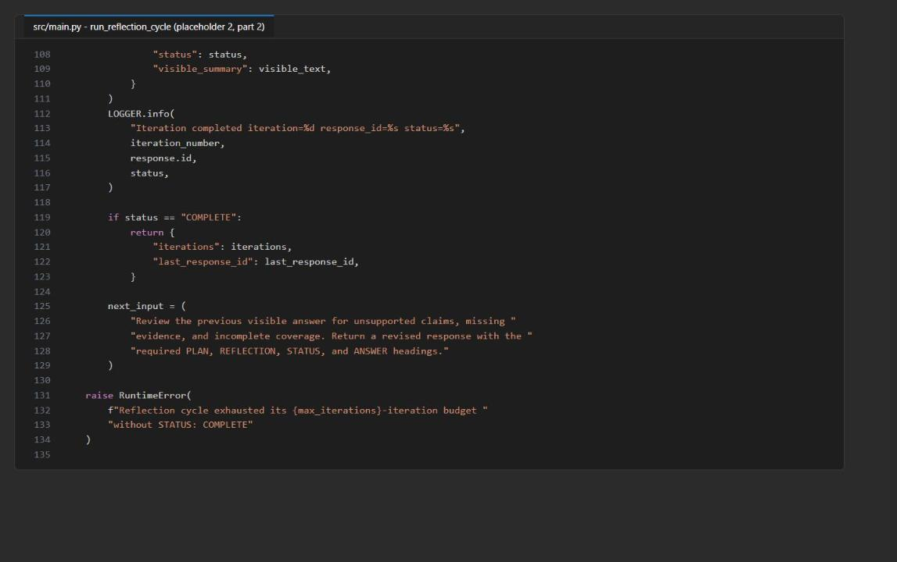

*Figure 7: run_reflection_cycle, second part of placeholder 2*

**Placeholder 3: Create an alternate response branch**

5. In `fork_with_previous_response`, find:

```python
    # LAB PLACEHOLDER 3: Replace this line with the Task 3 sample.
    raise NotImplementedError("Complete fork_with_previous_response in Task 3")
```

6. Replace the `raise NotImplementedError(...)` line with:

```python
    if not previous_response_id:
        raise ValueError("previous_response_id is required")

    return openai_client.responses.create(
        previous_response_id=previous_response_id,
        input=branch_request,
    )
```

Because this call passes `previous_response_id` and omits `conversation`, it creates a separate branch that reuses the earlier context without adding items to the original conversation.

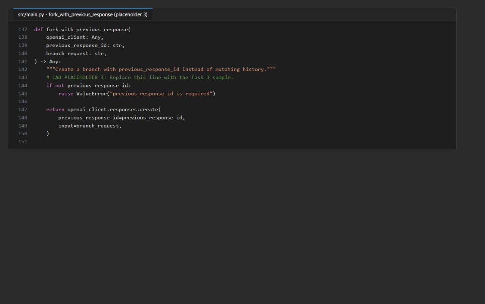

*Figure 8: fork_with_previous_response after placeholder 3 is completed*

7. Save `src/main.py`.

**Record the v1-to-v2 migration**

8. Create a new file named `migration-notes.md` in the lab folder (next to `requirements.txt`) and paste this content:

```markdown
# Agents v1 to v2 migration notes

| Agents v1 construct | Agents v2 replacement |
|---|---|
| `AgentsClient` | `AIProjectClient` plus `get_openai_client(agent_name=agent.name)` |
| Shared project OpenAI endpoint plus `extra_body.agent_reference` | Agent-bound OpenAI client using the agent's dedicated endpoint |
| Thread | A project OpenAI `conversation` |
| Run creation and status polling | Synchronous `responses.create()` calls bounded by application code |
| `requires_action` run state | Typed response output items and tool-call handling when tools are configured |
| GUID agent ID | Stable agent name plus an immutable agent version |
| New thread for an alternate path | `previous_response_id` without a conversation ID |

The migration changes both the client API and the state model. Conversations retain
multi-turn history, while response chaining creates an auditable alternate branch.
Application code, rather than the model, owns the maximum iteration count.
```

You can also create the file from the terminal: run `New-Item migration-notes.md`, open it in VS Code, paste the content, and save.

9. Open `assets/agents-v1-loop.py.txt` and compare it with the table: the v1 thread becomes a conversation, the run-polling loop becomes `responses.create()` calls bounded by `max_iterations`, and the GUID agent ID becomes a named, versioned agent. Do not execute the legacy file.

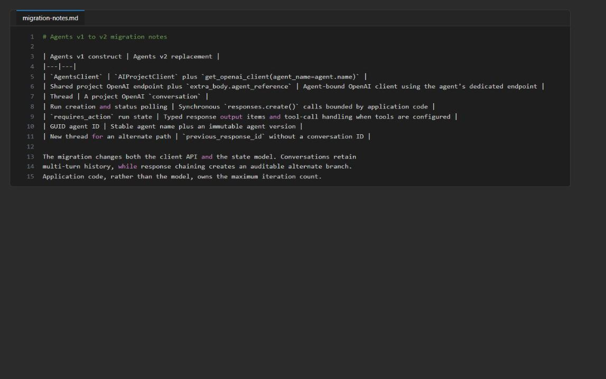

*Figure 9: migration-notes.md in the lab folder*

**Check the completed code**

10. Run the local, non-billable checks:

```powershell
python -m py_compile src/main.py scripts/preflight.py
python scripts/preflight.py
Select-String -Path src/main.py -Pattern 'LAB PLACEHOLDER|NotImplementedError'
```

**Expected result:** `py_compile` prints nothing, preflight prints `READY (local)`, and `Select-String` shows the three `LAB PLACEHOLDER` lines and no `NotImplementedError` line.

> **Note:** Preflight shows `INFO endpoint_configured` and `INFO model_configured` because it does not read `.env`. That is expected; the application loads `.env` itself.

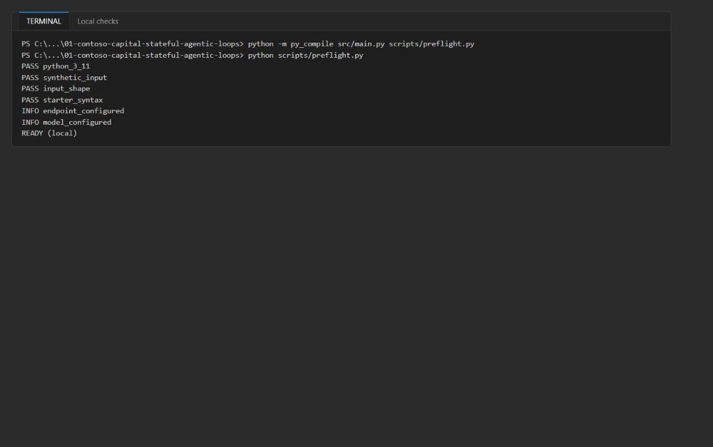

*Figure 10: Local compile and preflight checks report READY (local)*

---

## Task 5: Run the solution

1. Run the application once and save its console output to `artifacts-lab01.txt`:

```powershell
python -m src.main --input assets/research-request.json --retain-resources 2>&1 | Tee-Object -FilePath artifacts-lab01.txt
```

The synthetic scenario contains revenue, EBITDA, debt, liquidity, maturity, contracted-revenue, and permitting facts plus explicit evidence gaps. The branch request adds a 250-basis-point refinancing-cost assumption, so you can see whether the alternate path reuses the original evidence without changing the conversation history.

2. Review the log lines at the top of the output.

**Expected result:**

- `DefaultAzureCredential acquired a token from AzureCliCredential` (messages about unavailable credential types before this line are expected).
- A `POST .../agents/contoso-investment-researcher/versions` request with `Response status: 200`, followed by HTTP header logging (expected at `INFO` level).
- `POST .../conversations` and one or more `POST .../responses` requests with `200 OK`.
- `Iteration completed iteration=1 response_id=resp_... status=COMPLETE` (the reference run completed in one iteration; up to three is valid).
- `Retained conversation=conv_... and agent=contoso-investment-researcher version=1 for inspection`.

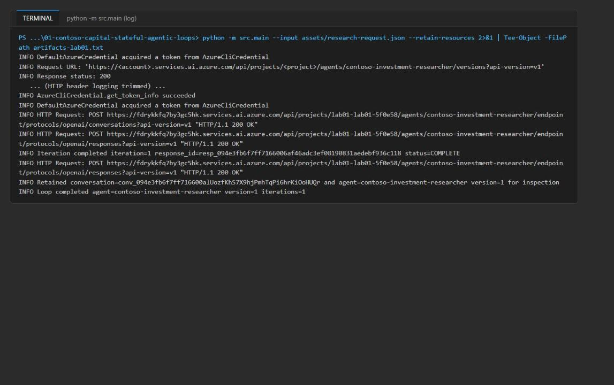

*Figure 11: Console log for the run, with HTTP header logging trimmed*

3. Scroll to the JSON result at the end of the output.

**Expected result:** A JSON object with `agent_name`, `agent_version`, `conversation_id` (starts with `conv_`), `resources_retained: true`, an `iterations` array, `branch_response_id` (starts with `resp_`), and `branch_text`. The `visible_summary` contains the `PLAN:`, `REFLECTION:`, `STATUS:`, and `ANSWER:` headings.

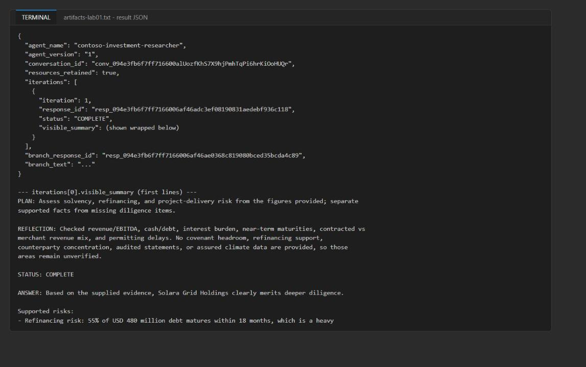

*Figure 12: Result JSON with the iteration record and its visible summary*

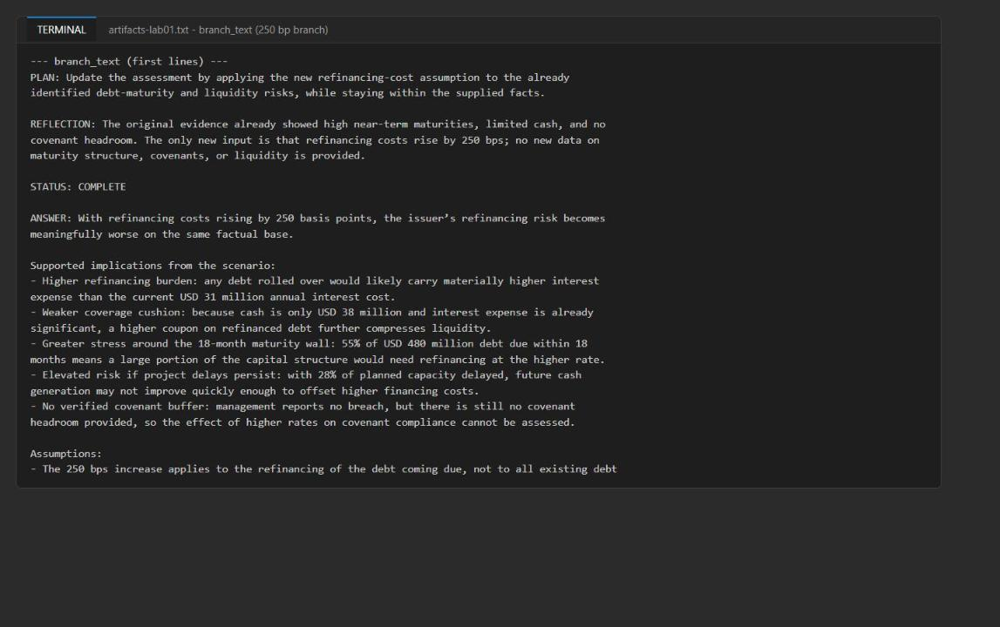

*Figure 13: The branch_text answer for the 250-basis-point refinancing assumption*

> **Note:** `--retain-resources` (the default) keeps the conversation and the exact agent version so you can inspect them in the Foundry portal. If you do not need portal inspection, run with `--cleanup-resources` instead; the application then deletes the conversation and the agent version it created in a `finally` block, even when a response call fails.

---

## Task 6: Validate the implementation

**Validate the captured output**

1. Locate the identifiers and iteration records:

```powershell
Select-String -Path artifacts-lab01.txt -Pattern 'agent_version|conversation_id|branch_response_id|iterations'
```

2. Confirm that all four fields are present. Then run this check, which parses the JSON at the end of the file and tests each acceptance criterion (paste the whole block, including the `@'` and `'@` lines):

```powershell
@'
import codecs, json, pathlib
raw = pathlib.Path("artifacts-lab01.txt").read_bytes()
text = raw.decode("utf-16") if raw.startswith(codecs.BOM_UTF16_LE) else raw.decode("utf-8-sig", errors="ignore")
start = text.rindex("{", 0, text.rindex('"agent_name"'))
d = json.loads(text[start:])
ids = [i["response_id"] for i in d["iterations"]]
print("agent:", d["agent_name"], "version", d["agent_version"])
print("conversation starts conv_:", d["conversation_id"].startswith("conv_"))
print("resources_retained:", d["resources_retained"])
print("1-3 iterations:", 1 <= len(ids) <= 3)
print("unique resp_ ids:", len(set(ids)) == len(ids) and all(i.startswith("resp_") for i in ids))
print("headings present:", all(all(h in i["visible_summary"] for h in ("PLAN:", "REFLECTION:", "STATUS:", "ANSWER:")) for i in d["iterations"]))
print("final COMPLETE:", d["iterations"][-1]["status"] == "COMPLETE")
print("branch resp_ and distinct:", d["branch_response_id"].startswith("resp_") and d["branch_response_id"] not in ids)
print("branch mentions 250 bp:", "250" in d["branch_text"])
'@ | python -
```

**Expected result:** The first line shows `agent: contoso-investment-researcher version <n>` and every other line ends in `True`.

3. Compare your output with the acceptance criteria:

| Field | Acceptance criteria | Reference run |
|---|---|---|
| `agent_name` and `agent_version` | Identify the named agent and its immutable Foundry version | `contoso-investment-researcher`, version `1` |
| `conversation_id` | Starts with `conv_`; all reflection iterations use this conversation | `conv_...` |
| `resources_retained` | `true` for the inspection run | `true` |
| `iterations` | One to three entries, each with a unique `resp_` ID, a top-level status, and a summary containing `PLAN:`, `REFLECTION:`, `STATUS:`, and `ANSWER:`; final status `COMPLETE` | 1 iteration, `COMPLETE` |
| `branch_response_id` | Starts with `resp_` and differs from every iteration response ID | Distinct `resp_...` |
| `branch_text` | Addresses the 250-basis-point assumption without inventing missing debt or cash-flow data | Discusses higher refinancing burden and lists evidence gaps |

`STATUS: COMPLETE` means the bounded review finished; it does not prove that the investment question had enough evidence. The application-owned iteration limit prevents an unbounded loop.

**Validate the agent version in Foundry**

4. Open the [Foundry portal](https://ai.azure.com) and select the project named at the end of `FOUNDRY_PROJECT_ENDPOINT` in `.env` (`lab01-lab01-<suffix>`).

5. Select **Agents** > **contoso-investment-researcher** and open its version history.

6. Confirm that the `agent_version` from your output is present and inspect its definition (model `gpt-5.4-mini` and the PLAN/REFLECTION/STATUS/ANSWER instructions).

You can also list the versions from the CLI-authenticated Python environment:

```powershell
python -c "import os; from dotenv import load_dotenv; load_dotenv('.env'); from azure.identity import DefaultAzureCredential; from azure.ai.projects import AIProjectClient; p=AIProjectClient(endpoint=os.environ['FOUNDRY_PROJECT_ENDPOINT'], credential=DefaultAzureCredential()); [print(v.name, v.version) for v in p.agents.list_versions(agent_name='contoso-investment-researcher')]"
```

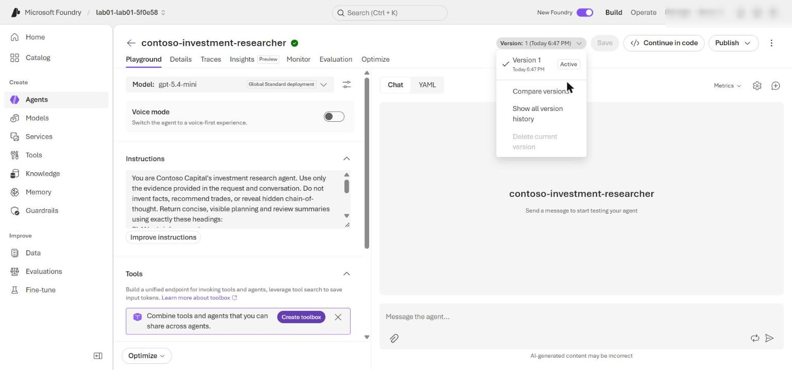

*Figure 14: Agent contoso-investment-researcher and its version history in the Foundry portal*

> **Note:** Version numbers can be greater than `1` after repeated runs. `--cleanup-resources` deletes only the version created by that run, not versions retained by earlier runs.

**Validate the response traces**

7. In the Foundry portal, select **Agents** > **Traces** (or the **Traces** tab of the agent) and set the time range to include your run. Trace ingestion can take several minutes.

8. Search for each iteration `response_id` and for the `branch_response_id`.

9. Confirm that:

- Each trace shows the agent name, agent version, response ID, timestamp, and a successful response operation.
- Iteration responses use the recorded `conversation_id` where conversation metadata is shown.
- The branch response chains from the final iteration response without joining the conversation.

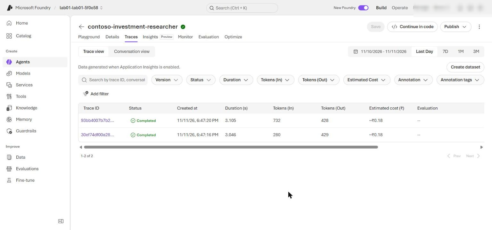

*Figure 15: Foundry Traces showing the iteration and branch responses*

10. Optional: query the same telemetry in Application Insights. In the Azure portal open `appi-lab01-<suffix>` > **Monitoring** > **Logs**, switch to **KQL mode**, and run:

```kql
union dependencies, requests
| where timestamp > ago(1d)
| where tostring(customDimensions) has "contoso-investment-researcher" or name has "responses"
| project timestamp, itemType, name, operation_Id, success, duration
| order by timestamp desc
| take 50
```

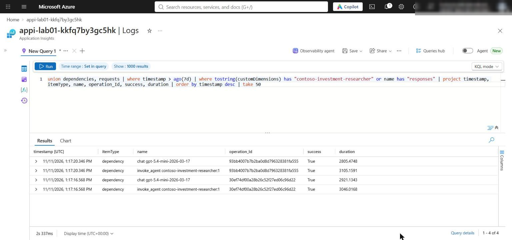

*Figure 16: Application Insights Logs query listing the agent response operations*

The traces prove the Foundry calls. `artifacts-lab01.txt` proves the application-owned iteration limit and the branch decision.

**Optional challenge: verify branch isolation**

11. Create a second fork from the same parent response, give the two forks different synthetic follow-up facts, and compare their answers. Save this as `branch_check.py` in the lab folder, replace `<last-iteration-response-id>` with the last `response_id` from `artifacts-lab01.txt`, and run it with `python branch_check.py`:

```python
import os

from azure.ai.projects import AIProjectClient
from azure.identity import DefaultAzureCredential
from dotenv import load_dotenv

load_dotenv(".env")
PARENT = "<last-iteration-response-id>"

project = AIProjectClient(
    endpoint=os.environ["FOUNDRY_PROJECT_ENDPOINT"],
    credential=DefaultAzureCredential(),
)
client = project.get_openai_client(agent_name="contoso-investment-researcher")

fork_a = client.responses.create(
    previous_response_id=PARENT,
    input="New synthetic fact: a lender has committed a USD 150 million refinancing facility. Which fact did you just receive?",
)
fork_b = client.responses.create(
    previous_response_id=PARENT,
    input="New synthetic fact: one delayed project has received its permit. Which fact did you just receive?",
)
print("parent:", PARENT)
print("fork_a:", fork_a.id, "\n", fork_a.output_text[:600])
print("fork_b:", fork_b.id, "\n", fork_b.output_text[:600])
```

**Expected result:** Fork A mentions only the refinancing facility, fork B mentions only the permit, neither mentions the other fork's fact, and both fork IDs differ from the parent. Record the parent and fork response IDs as evidence.

---

## Task 7: Review the design

1. Answer the review questions at the end of this guide (see **Review questions**) and compare your answers with the model answers.

---

## Validate

Use this table as a final checklist.

| # | Acceptance criterion | How to check (CLI) | How to check (portal) |
|---|---|---|---|
| 1 | Three placeholders completed, no `NotImplementedError` | `Select-String -Path src/main.py -Pattern 'NotImplementedError'` returns nothing | - |
| 2 | Preflight passes | `python scripts/preflight.py` prints `READY (local)` | - |
| 3 | `migration-notes.md` exists with the v1-to-v2 table | `Get-Content migration-notes.md` | - |
| 4 | Agent and immutable version recorded | `Select-String -Path artifacts-lab01.txt -Pattern 'agent_version'` | Foundry portal > Agents > contoso-investment-researcher > versions |
| 5 | One conversation for all iterations | `conversation_id` starts with `conv_` | Traces show the same conversation ID |
| 6 | 1-3 iterations, unique `resp_` IDs, headings, final `COMPLETE` | Validation script in Task 6 step 2 | Traces list each response ID |
| 7 | Branch is distinct and outside the conversation | `branch_response_id` differs from all iteration IDs | Trace of the branch response has no conversation metadata |
| 8 | Branch addresses the 250 bp assumption | Read `branch_text` | - |
| 9 | Resources retained for inspection | `"resources_retained": true` | Agent version visible in Foundry |

---

## Troubleshooting

| Symptom | Cause | Fix |
|---|---|---|
| `PermissionDenied` or HTTP 401/403 when creating the agent version or calling responses | The data-plane role assignments have not propagated yet, or were not created | Wait 1 to 5 minutes and rerun. Confirm the roles with `az role assignment list --assignee $me --scope $rgId -o table`. You need **Azure AI User** (agents) and **Cognitive Services OpenAI User** (model calls) |
| Deployment fails with `InsufficientQuota` or model/SKU not available | No `gpt-5.4-mini` GlobalStandard quota in the region | Delete the resource group, set `$azureRegion` to a region with quota, and rerun Task 3 |
| Several `EnvironmentCredential` / `ManagedIdentityCredential` unavailable messages | `DefaultAzureCredential` tries other credential types before the Azure CLI | Expected. Make sure `az login` is current; the line `acquired a token from AzureCliCredential` confirms success |
| Long blocks of `Request headers` / `Response headers` in the output | Azure SDK HTTP logging at `INFO` level | Expected. The relevant lines are `Iteration completed`, `Retained conversation`, and the final JSON |
| `KeyError: 'FOUNDRY_PROJECT_ENDPOINT'` | `.env` is missing or was written in another folder | Run Task 3 step 1 from the lab folder, or check `Get-Content .env` |
| `error: unrecognized arguments: --retain-resources` | An older copy of `src/main.py` without the retain/cleanup options | Pull the latest repository version (`git pull`); the current code accepts `--retain-resources` and `--cleanup-resources` |
| `RuntimeError: Reflection cycle exhausted its 3-iteration budget` | The model never returned `STATUS: COMPLETE` | This is the bounded loop working as designed. Check that placeholder 1 instructions were pasted completely, then rerun |
| Preflight shows `INFO endpoint_configured` | Preflight does not load `.env` | Expected; only `READY (local)` matters |
| No traces in Foundry | Trace ingestion delay | Wait 5 to 10 minutes and widen the time range |

---

## Review questions

1. **When is a conversation preferable to `previous_response_id` chaining?**

Use a conversation when one durable, multi-turn thread must accumulate history that later turns (and auditors) read as one context. Use `previous_response_id` chaining for short-lived "what-if" branches that must not change the main thread.

2. **Which completion signal belongs in model instructions, and which limit must remain application-owned?**

The `STATUS: COMPLETE|CONTINUE` signal belongs in the model instructions. The maximum iteration count (`MAX_LOOP_ITERATIONS`) must stay in application code so a misbehaving model cannot loop forever.

3. **How would you migrate historical v1 thread state when the migration tool moves code but not data?**

Export the v1 thread messages with the v1 SDK, then replay them as items into new v2 conversations (or store a summary as the first item). Keep a mapping table from v1 thread ID to v2 conversation ID and validate message counts.

4. **Which branch metadata should be retained for audit without retaining sensitive prompt text?**

The parent response ID, branch response ID, conversation ID, agent name and version, timestamps, status, and a hash or label of the branch assumption. Do not keep the raw prompt or answer text.

---

## Clean up (optional)

Do this when you no longer need the resources. Deleting the resource group stops all charges for this lab.

1. Optional: if you want to keep the resource group but remove the retained conversation and agent version, delete them in the Foundry portal (**Agents** > **contoso-investment-researcher** > delete the version), or rerun future tests with `--cleanup-resources`.

2. Delete the resource group (replace the name if you opened a new terminal):

```powershell
$resourceGroupName = 'rg-lab01-<suffix>'
$account = az resource list -g $resourceGroupName --resource-type Microsoft.CognitiveServices/accounts --query "[0].name" -o tsv
az group delete --name $resourceGroupName --yes --no-wait
```

3. Optional: after the group is deleted (a few minutes), purge the soft-deleted Foundry account so the name and quota are released:

```powershell
az cognitiveservices account purge --location eastus2 --resource-group $resourceGroupName --name $account
az group exists --name $resourceGroupName
```

**Expected result:** `az group exists` returns `false`.

4. Remove the local generated files and deactivate the virtual environment:

```powershell
Remove-Item .env, artifacts-lab01.txt -ErrorAction SilentlyContinue
deactivate
```

## Summary

You migrated a stateful loop from Agents v1 to Agents v2, implemented bounded reflection inside a conversation, created an isolated response branch with `previous_response_id`, and validated the behavior against a live Foundry project.

