# Lab 02: Implement advanced multi-agent orchestration patterns in Microsoft Foundry

## Overview

**Scenario.** Contoso Capital needs market, risk, and compliance specialists to contribute to one investment brief. Independent work should run concurrently, dependent work must stay ordered, and a failed optional specialist must not silently invalidate the report.

**What you'll build.** You complete a hub-and-spoke orchestrator in Python. It creates four versioned Foundry Agents v2 prompt agents, fans out live response calls to three specialist "spokes" in parallel, applies a quorum rule in code, and sends only the accepted evidence to a supervisor agent. You run it twice: once with all spokes healthy and once with the optional compliance spoke marked as failed, and you compare the results with the service traces.

**Duration.** About 45 minutes.

> **Note:** Model calls, Application Insights ingestion, and 30-day Log Analytics retention are billable. Concurrent model calls consume quota faster than sequential calls. Use only the synthetic portfolio request in `assets`, and delete the resource group when you finish (see Clean up).

**Agents in this lab**

| Agent | Contribution | Quorum policy |
|---|---|---|
| `market-spoke` | Market assumptions, uncertainties, and evidence gaps | Required |
| `risk-spoke` | Risk drivers, exposure limits, and uncertainty, without investment advice | Required |
| `compliance-spoke` | Disclosures, policy caveats, and limits on use of the research | Optional; missing evidence must be disclosed |
| `research-supervisor` | One brief from the request, accepted spoke evidence, and the missing-agent list | Runs only after both required spokes succeed |

**Architecture components**

| Component | Purpose |
|---|---|
| Microsoft Foundry account (`fdry<suffix>`, kind AIServices) | Hosts the project and the model deployment; public network access enabled for the lab |
| Foundry project (`lab02-<env>`) | Holds the four prompt agents, their versions, and traces |
| Model deployment `gpt-5.4-mini` (GlobalStandard, capacity 10) | Model used by every agent |
| Log Analytics workspace (`log-lab02-<suffix>`) | Stores telemetry (30-day retention) |
| Application Insights (`appi-lab02-<suffix>`) | Receives server-side agent traces through a project connection |
| `infra/main.bicep` | Deploys all of the above |
| `assets/portfolio-request.json` | Defines the request, the three spokes, required agents, and the supervisor |
| `src/main.py` | The orchestrator: creates agent versions, fans out with `asyncio.gather` behind a semaphore, evaluates quorum, calls the supervisor |

## Prerequisites

- [Python 3.11 or later](https://www.python.org/downloads/)
- [Azure CLI](https://learn.microsoft.com/cli/azure/install-azure-cli) with [Bicep](https://learn.microsoft.com/azure/azure-resource-manager/bicep/install) (`az bicep install`)
- [Visual Studio Code](https://code.visualstudio.com/download)
- [Git](https://git-scm.com/downloads)
- An Azure subscription with quota for `gpt-5.4-mini` (GlobalStandard) in your chosen region, enough for three concurrent calls
- **Owner**, or **Contributor** plus **User Access Administrator**, on the subscription or target resource group (you create role assignments for yourself)

This guide provisions with the Azure CLI instead of `azd provision`, so the Azure Developer CLI is not required.

1. Sign in to Azure and select the subscription you want to use:

```powershell
az login
az account set --subscription "<your-subscription-id>"
az account show --output table
```

**Expected result:** `az account show` lists the subscription you intend to use.

---

## Task 1: Prepare the lab

1. Clone the lab repository (skip if you already have it):

```powershell
git clone https://github.com/MicrosoftLearning/mslearn-ai-multi-agents.git
```

2. Open the cloned `mslearn-ai-multi-agents` folder in Visual Studio Code.

3. Open a PowerShell terminal in VS Code (**Terminal** > **New Terminal**) and check the tools:

```powershell
cd Allfiles\02-contoso-capital-advanced-orchestration
az version
python --version
az account show --output table
```

**Expected result:** each command succeeds, Python reports 3.11 or later, and the correct subscription is shown.

4. Architecture checkpoint. Open `infra/main.bicep`, `assets/portfolio-request.json`, and `src/main.py` and confirm that:

- the portfolio asset defines each specialist's `assignment`, and `required_agents` lists only `market-spoke` and `risk-spoke`;
- `compliance-spoke` is therefore optional;
- `run()` in `src/main.py` creates one agent-bound client per agent so the three spoke calls can run concurrently;
- deterministic code (`evaluate_quorum`) decides quorum before the supervisor is called.

---

## Task 2: Build the virtual environment

1. From the lab folder, create the virtual environment and install the requirements, then activate it:

```powershell
./scripts/setup.ps1
. ./.venv/Scripts/Activate.ps1
```

On macOS or Linux, run these instead:

```bash
bash scripts/setup.sh
source .venv/bin/activate
```

**Expected result:** `(.venv)` appears at the start of the terminal prompt, and `pip` installed `azure-ai-projects` 2.x, `azure-identity`, `openai`, and `python-dotenv`.

---

## Task 3: Deploy the Azure resources

The Bicep template takes `location`, `environmentName`, `modelDeploymentName`, `modelName`, `modelVersion`, and `enableSandboxPublicNetworkAccess` (default `true`). It does not assign any data-plane roles, so the script below grants them to you.

1. In the same terminal (still in `Allfiles\02-contoso-capital-advanced-orchestration`), run the whole block. Change `$azureRegion` if `gpt-5.4-mini` isn't available to you in `eastus2`.

```powershell
$azureRegion = 'eastus2'
$suffix = (New-Guid).Guid.Substring(0, 8)
$resourceGroupName = "rg-lab02-$suffix"
$envName = "lab02-$suffix"
az group create --name $resourceGroupName --location $azureRegion --output none
az bicep build --file infra/main.bicep
az deployment group create --resource-group $resourceGroupName --name lab02-main `
  --template-file infra/main.bicep `
  --parameters location=$azureRegion environmentName=$envName modelDeploymentName=gpt-5.4-mini modelName=gpt-5.4-mini modelVersion=2026-03-17 enableSandboxPublicNetworkAccess=true `
  --output none
# Grant yourself data-plane access (Foundry agents + model calls)
$me = az ad signed-in-user show --query id -o tsv
$rgId = az group show --name $resourceGroupName --query id -o tsv
foreach ($role in 'Azure AI User','Cognitive Services OpenAI User','Azure AI Developer') {
  az role assignment create --assignee-object-id $me --assignee-principal-type User --role $role --scope $rgId --output none
}
# Write .env from the deployment outputs
$outputs = az deployment group show --resource-group $resourceGroupName --name lab02-main --query properties.outputs -o json | ConvertFrom-Json
$lines = @("AZURE_RESOURCE_GROUP=`"$resourceGroupName`"", "AZURE_LOCATION=`"$azureRegion`"", "AZURE_ENV_NAME=`"$envName`"",
  "AZURE_SUBSCRIPTION_ID=`"$(az account show --query id -o tsv)`"")
$outputs.PSObject.Properties | ForEach-Object { $lines += "$($_.Name.ToUpper())=`"$($_.Value.value)`"" }
$lines | Out-File .env -Encoding utf8
Get-Content .env
```

Deployment takes about 3-6 minutes. Role assignments can take 1-5 minutes to apply; wait a few minutes before running the app in Task 5.

> **Note:** The repository can contain an old `.env` in this folder that points at somebody else's subscription. The `Out-File .env` line above overwrites it. Always run the app with the `.env` that this script wrote.

**Expected result:** `.env` contains `AZURE_RESOURCE_GROUP`, `AZURE_LOCATION`, `AZURE_ENV_NAME`, `AZURE_SUBSCRIPTION_ID`, `FOUNDRY_PROJECT_ENDPOINT` (`https://fdry<suffix>.services.ai.azure.com/api/projects/lab02-lab02-<suffix>`), `FOUNDRY_PROJECT_ID`, `FOUNDRY_MODEL_NAME` (`gpt-5.4-mini`), `APPLICATIONINSIGHTS_RESOURCE_ID`, and `LOG_ANALYTICS_WORKSPACE_ID`. It contains no keys or tokens. The Application Insights connection string is stored in the Foundry project connection, not in `.env`.

2. (Optional) The orchestrator reads two tuning values with defaults: `MAX_CONCURRENCY` (default `3`) and `AGENT_TIMEOUT_SECONDS` (default `45`). Keep the defaults for this lab. Do not add keys or tokens to `.env`.

3. In the [Azure portal](https://portal.azure.com), open the resource group `rg-lab02-<suffix>` and confirm the resources.

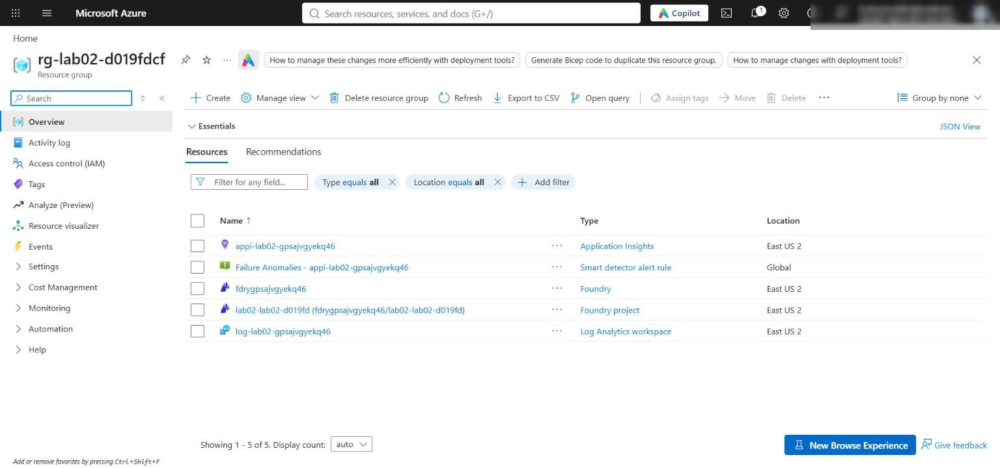

*Figure 1: Resource group with the Foundry account, project, Log Analytics workspace, and Application Insights*

4. Verify the network settings. The template enables public network access and sets the default action to **Allow** so your local app can reach the project endpoint (Microsoft Entra ID and RBAC are still required). Check from the CLI:

```powershell
$account = az cognitiveservices account list -g $resourceGroupName --query "[0].name" -o tsv
az cognitiveservices account show -g $resourceGroupName -n $account --query "{publicNetworkAccess:properties.publicNetworkAccess, defaultAction:properties.networkAcls.defaultAction}" -o table
```

**Expected result:** `Enabled` and `Allow`. In the portal, open the Foundry account > **Resource Management** > **Networking** to see the same setting. Production environments should use selected networks or private endpoints.

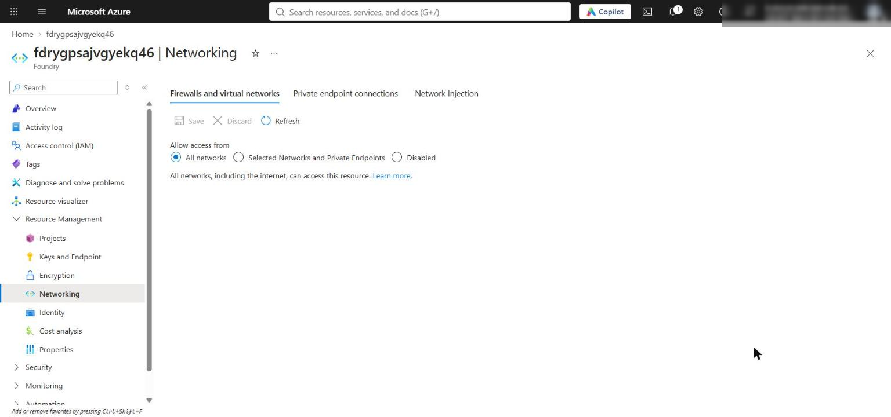

*Figure 2: Foundry account Networking page showing public access from all networks*

5. Confirm the model deployment exists:

```powershell
az cognitiveservices account deployment list -g $resourceGroupName -n $account --query "[].{name:name, model:properties.model.name, version:properties.model.version, sku:sku.name}" -o table
```

**Expected result:** one deployment `gpt-5.4-mini`, version `2026-03-17`, SKU `GlobalStandard`.

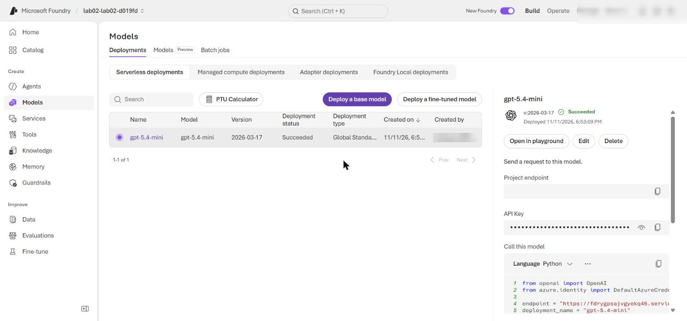

*Figure 3: The gpt-5.4-mini model deployment in the Foundry project*

---

## Task 4: Implement the solution

Open `src/main.py`. Each placeholder is a `# LAB PLACEHOLDER n` comment followed by a `raise NotImplementedError(...)` line. Keep the comment, replace only the `raise` line with the code below, and keep the 4-space indentation of the function body.

### Placeholder 1: select a safe execution pattern

1. In `select_execution_pattern`, find:

```python
    # LAB PLACEHOLDER 1: Replace this line with the Task 1 sample.
    raise NotImplementedError("Complete select_execution_pattern in Task 1")
```

2. Replace it so the function reads:

```python
def select_execution_pattern(tasks: list[dict[str, Any]]) -> str:
    """Learner task: return parallel only when this batch has no dependencies."""
    # LAB PLACEHOLDER 1: Replace this line with the Task 1 sample.
    task_names = {task["name"] for task in tasks}
    has_in_round_dependency = any(
        task_names.intersection(task.get("depends_on", []))
        for task in tasks
    )
    return "sequential" if has_in_round_dependency else "parallel"
```

A dependency on another spoke in the same batch selects sequential execution; independent spokes stay eligible for parallel fan-out.

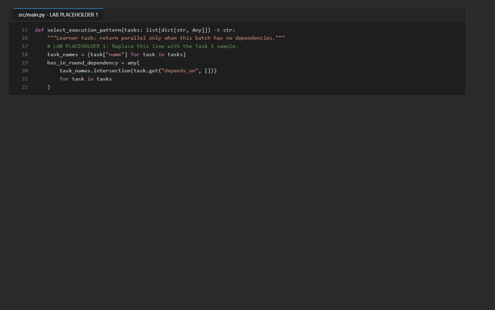

*Figure 4: Placeholder 1 completed in select_execution_pattern*

### Placeholder 2: enforce critical-agent quorum

1. In `evaluate_quorum`, find:

```python
    # LAB PLACEHOLDER 2: Replace this line with the Task 2 sample.
    raise NotImplementedError("Complete evaluate_quorum in Task 2")
```

2. Replace it so the function reads:

```python
def evaluate_quorum(results: list[dict[str, Any]], required: list[str]) -> dict[str, Any]:
    """Learner task: enforce critical-agent quorum and normalize evidence."""
    # LAB PLACEHOLDER 2: Replace this line with the Task 2 sample.
    successful = {
        result["agent"]: result
        for result in results
        if isinstance(result, dict) and result.get("status") == "success"
    }
    all_agents = [
        result.get("agent", "unknown")
        for result in results
        if isinstance(result, dict)
    ]
    missing_agents = [name for name in all_agents if name not in successful]
    missing_required = [name for name in required if name not in successful]
    accepted_evidence = [
        {
            "agent": name,
            "response_id": result["response_id"],
            "text": result["text"],
            "elapsed_ms": result["elapsed_ms"],
        }
        for name, result in successful.items()
    ]
    return {
        "status": "ready" if not missing_required else "insufficient_quorum",
        "required_agents": required,
        "successful_count": len(successful),
        "missing_agents": missing_agents,
        "missing_required": missing_required,
        "accepted_evidence": accepted_evidence,
    }
```

Quorum separates optional omissions (`missing_agents`) from missing required evidence (`missing_required`). Only normalized successful results become evidence; exceptions, credentials, and endpoints never reach the supervisor payload.

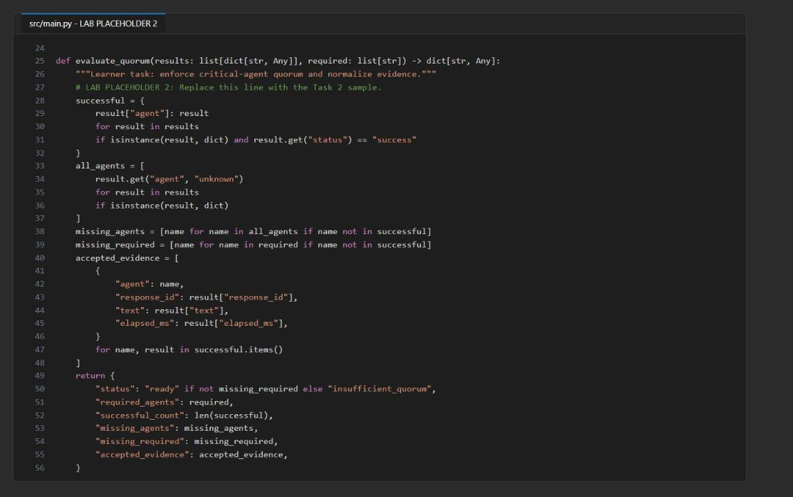

*Figure 5: Placeholder 2 completed in evaluate_quorum*

### Placeholder 3: synthesize accepted evidence

1. In `synthesize`, find:

```python
    # LAB PLACEHOLDER 3: Replace this line with the Task 3 sample.
    raise NotImplementedError("Complete synthesize in Task 3")
```

2. Replace it so the function reads:

```python
def synthesize(openai: Any, request: str, quorum: dict[str, Any]) -> Any:
    """Learner task: invoke the supervisor with accepted evidence and caveats."""
    # LAB PLACEHOLDER 3: Replace this line with the Task 3 sample.
    if quorum["status"] != "ready":
        missing = ", ".join(quorum["missing_required"])
        raise RuntimeError(f"Critical quorum was not met: {missing}")

    payload = {
        "request": request,
        "accepted_evidence": quorum["accepted_evidence"],
        "missing_agents": quorum["missing_agents"],
    }
    return openai.responses.create(
        input=(
            "Synthesize the supplied specialist evidence. State a caveat for "
            "every missing agent, do not invent facts, and do not provide "
            "investment advice.\n"
            + json.dumps(payload)
        ),
    )
```

This fan-in boundary fails closed when quorum is not met and asks the supervisor for an explicit caveat for every missing agent.

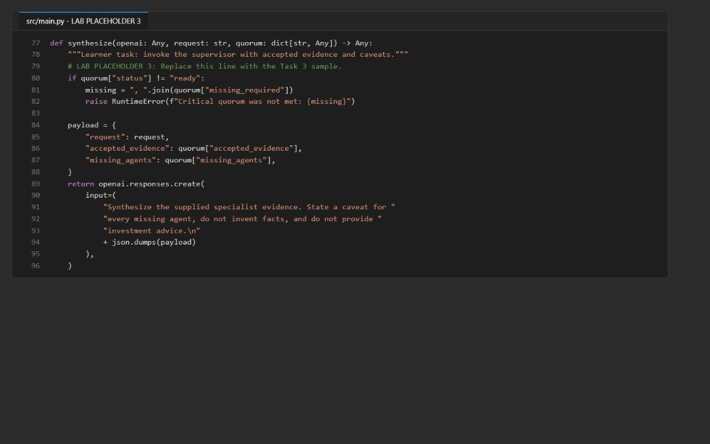

*Figure 6: Placeholder 3 completed in synthesize*

### Check the supplied concurrency and failure handling

1. Read (do not change) `invoke` and `run` in `src/main.py`:

- Independent spokes run with `asyncio.gather(...)`; dependent spokes are awaited one after another.
- `invoke` catches every spoke exception and returns the same normalized shape (`agent`, `status`, `response_id`, `text`, `elapsed_ms`), so raw exceptions never enter `evaluate_quorum`.
- An `asyncio.Semaphore` (size `MAX_CONCURRENCY`) bounds parallel calls, and each `asyncio.wait_for` timeout includes the time spent waiting for capacity.

### Run the local checks

1. Save `src/main.py` and run the local, non-billable checks:

```powershell
python -m py_compile src/main.py scripts/preflight.py
python scripts/preflight.py
(Select-String -Path src/main.py -Pattern 'LAB PLACEHOLDER').Count
(Select-String -Path src/main.py -Pattern 'NotImplementedError').Count
```

**Expected result:** four `PASS` lines (`python_3_11`, `three_spokes`, `required_subset`, `starter_syntax`), `3` placeholder markers, and `0 NotImplementedError`.

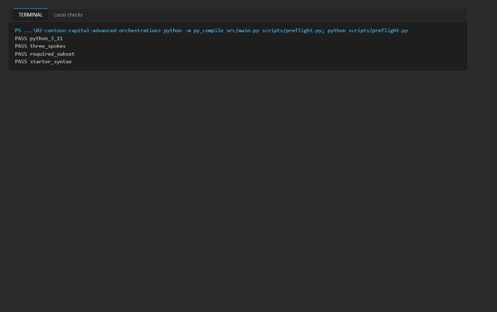

*Figure 7: py_compile and preflight report four PASS lines*

---

## Task 5: Run the solution

1. Run the normal input and save the output:

```powershell
python -m src.main --input assets/portfolio-request.json *> artifacts-normal.txt
Select-String artifacts-normal.txt -Pattern 'pattern|quorum|elapsed_ms|missing_agents|supervisor_response_id'
```

The file starts with Azure SDK HTTP logging (`INFO Request URL ...`, `INFO HTTP Request: POST ...`); the JSON result is at the end. `DefaultAzureCredential acquired a token from AzureCliCredential` is expected.

**Expected result:** `"pattern": "parallel"`, `"status": "ready"`, `"successful_count": 3`, empty `missing_agents` and `missing_required`, three spokes with `"status": "success"`, and a `supervisor_response_id` that starts with `resp_`.

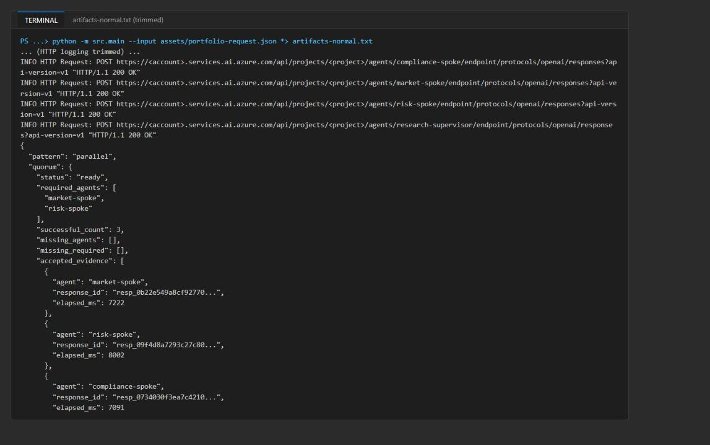

*Figure 8: Normal run - parallel pattern, quorum ready, three accepted spokes (output trimmed)*

2. Run the optional-failure input and save its output separately:

```powershell
python -m src.main --input assets/portfolio-request-optional-failure.json *> artifacts-optional-failure.txt
```

The two inputs differ only in `"simulate_optional_failure": true`. The code marks the last spoke (`compliance-spoke`) as failed **after** its live call; it does not simulate an Azure outage. Do not edit the normal input.

3. Display the orchestration fields from both runs:

```powershell
Select-String -Path artifacts-normal.txt,artifacts-optional-failure.txt -Pattern 'pattern|"agent"|"status"|missing_agents|missing_required|accepted_evidence|supervisor_response_id'
```

**Expected result (optional-failure run):** `"pattern": "parallel"`, quorum `"status": "ready"`, `"successful_count": 2`, `"missing_agents": ["compliance-spoke"]`, `"missing_required": []`, and `compliance-spoke` with `"status": "failed"` and `"text": null`.

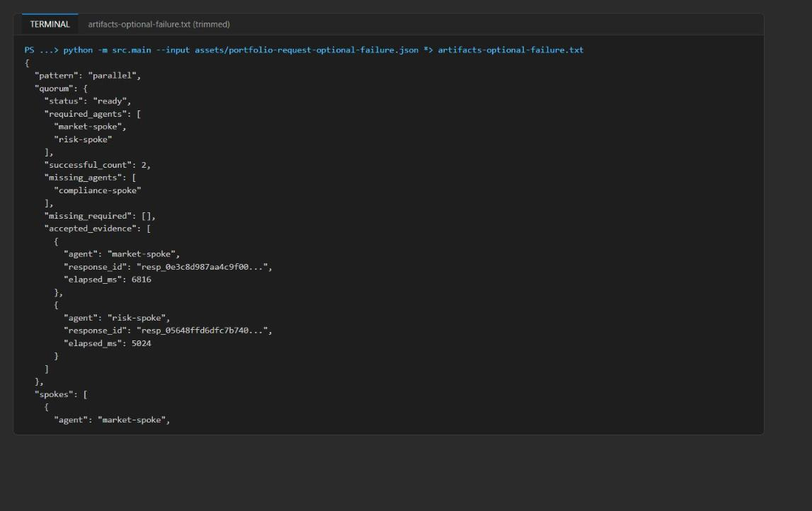

*Figure 9: Optional-failure run - compliance-spoke failed, quorum still ready (output trimmed)*

4. Keep both artifact files and their response IDs; you use them for trace validation. IDs, wording, and timing vary between live runs.

---

## Task 6: Validate the implementation

### Compare orchestration outcomes

1. Compare the two outputs against the acceptance criteria:

| Field | Normal input | Optional-failure input |
|---|---|---|
| `pattern` | `parallel` | `parallel` |
| `compliance-spoke.status` | `success` | `failed`; market and risk still `success` |
| `quorum.status` | `ready` | `ready` |
| `quorum.missing_agents` | Empty | Contains `compliance-spoke` |
| `quorum.missing_required` | Empty | Empty |
| `quorum.accepted_evidence` | Three spoke results | Only market and risk |
| `supervisor_response_id` | Present | Present |
| Supervisor answer | Uses accepted evidence only | Explicitly states compliance evidence is missing |

2. Show the supervisor's answer for the optional-failure run and look for the compliance caveat:

```powershell
$raw = Get-Content artifacts-optional-failure.txt -Raw
($raw.Substring($raw.IndexOf("`n{") + 1) | ConvertFrom-Json).answer
```

**Expected result:** the answer contains a caveat such as "Compliance-spoke is missing: no compliance-specific review was provided...".

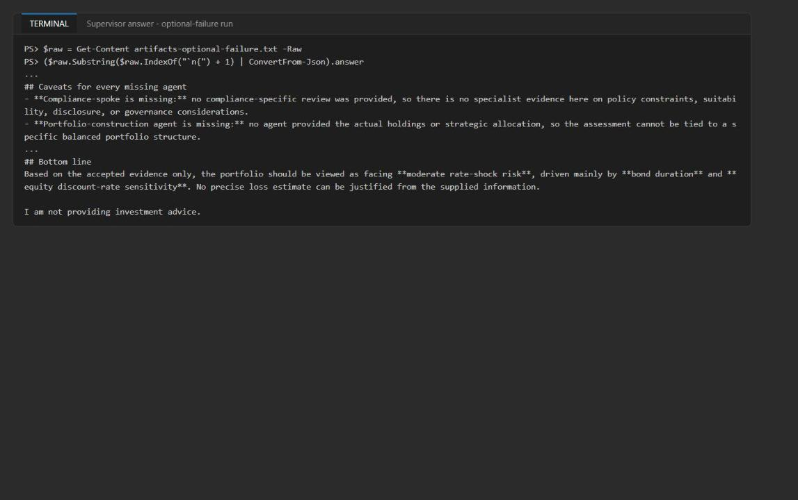

*Figure 10: Supervisor answer discloses the missing compliance evidence*

3. In the normal output, confirm that `spokes` has three successful results with response IDs, text, and `elapsed_ms`, plus a separate supervisor response ID.

4. Compare the overall `elapsed_ms` with the sum of the spoke durations. In the reference run the overall value was 15554 ms against a spoke sum of 22315 ms (7222 + 8002 + 7091): the barrier waits only for the slowest spoke (about 8 s), then the supervisor runs. That is consistent with concurrent calls; traces confirm it below.

5. Review the required-failure path in code: if `market-spoke` or `risk-spoke` fails, `evaluate_quorum` returns `insufficient_quorum` and `synthesize` raises `RuntimeError` before any supervisor call. The optional-failure run does not exercise this path.

### Validate agent definitions and role behavior in the Foundry portal

1. Get the project name (the last segment of `FOUNDRY_PROJECT_ENDPOINT`):

```powershell
(Select-String .env -Pattern '^FOUNDRY_PROJECT_ENDPOINT=').Line.Split('/')[-1].Trim('"')
```

2. Open the [Microsoft Foundry portal](https://ai.azure.com), turn on **New Foundry** (toggle at the top), and select that project.

3. Select **Build** > **Agents**. Confirm that `market-spoke`, `risk-spoke`, `compliance-spoke`, and `research-supervisor` exist as prompt agents.

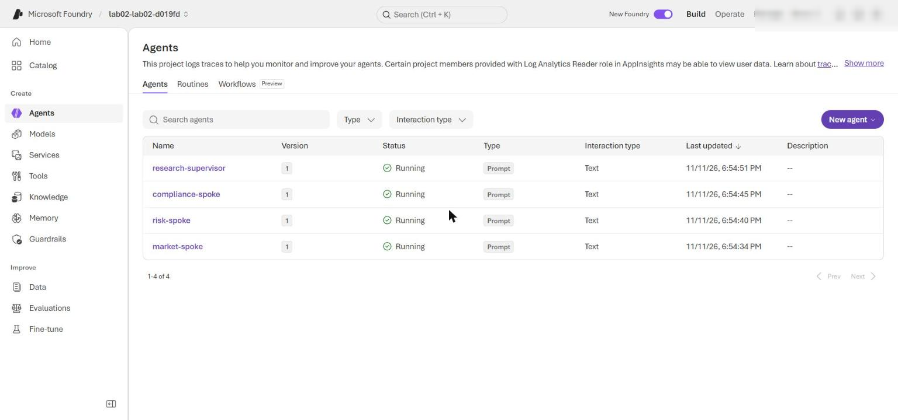

*Figure 11: The four prompt agents in the Foundry project*

4. Open each agent's newest version and confirm that its model is `gpt-5.4-mini` and its instructions match `assets/portfolio-request.json`. Each run calls `create_version`; when the definition is unchanged the service can keep version `1`, so do not worry if the version number did not increase.

5. Open `market-spoke` in the **Playground** and submit:

```text
Request: Assess a synthetic balanced portfolio under a fictional rate shock.
Assignment: Return market assumptions and evidence gaps.
```

6. Open `risk-spoke` in the **Playground** and submit:

```text
Request: Assess a synthetic balanced portfolio under a fictional rate shock.
Assignment: Return risk drivers and limits.
```

7. Open `compliance-spoke` in the **Playground** and submit:

```text
Request: Assess a synthetic balanced portfolio under a fictional rate shock.
Assignment: Return compliance caveats.
```

8. Verify the role boundaries: `market-spoke` returns assumptions and missing market evidence; `risk-spoke` returns risk drivers and limits without investment advice; `compliance-spoke` returns only policy caveats.

9. Open `research-supervisor` in the **Playground** and submit this synthetic fan-in payload:

```json
{
  "request": "Assess a synthetic balanced portfolio under a fictional rate shock.",
  "accepted_evidence": [
    {
      "agent": "market-spoke",
      "response_id": "playground-market-001",
      "text": "Assumption: the fictional scenario includes a rate increase. Evidence gaps: no holdings, duration, rate-shock magnitude, or market data were supplied.",
      "elapsed_ms": 0
    },
    {
      "agent": "risk-spoke",
      "response_id": "playground-risk-001",
      "text": "Potential drivers include duration and concentration, but exposure cannot be quantified without portfolio data. This is risk analysis, not investment advice.",
      "elapsed_ms": 0
    }
  ],
  "missing_agents": [
    "compliance-spoke"
  ]
}
```

**Expected result:** the supervisor uses only the two evidence records, states that compliance evidence is missing (for example "Compliance review input from the missing `compliance-spoke`"), and does not invent a compliance conclusion, holdings, exposure values, or a rate-shock magnitude.

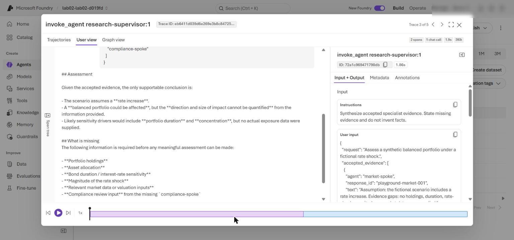

*Figure 12: research-supervisor reply to the Playground fan-in payload (trace User view), disclosing the missing compliance-spoke evidence*

Playground calls test each agent on its own. They don't reproduce the parallel orchestration.

### Correlate service traces with application evidence

1. In the Foundry portal, select **Agents**, open an agent (for example **research-supervisor**), and select its **Traces** tab; set the time range to cover your runs, and search for the response IDs saved in `artifacts-normal.txt`. Allow several minutes for ingestion.

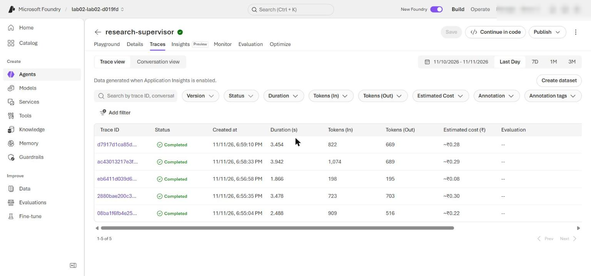

*Figure 13: Foundry Traces tab of research-supervisor listing its invoke_agent traces (open each spoke's Traces tab for its spans)*

2. Alternatively, query the spans from the CLI. Install the Application Insights extension once, then run the KQL query:

```powershell
az extension add --name application-insights --upgrade --only-show-errors
$appInsightsId = (Select-String .env -Pattern '^APPLICATIONINSIGHTS_RESOURCE_ID=').Line.Split('=', 2)[1].Trim('"')
$kql = @'
union isfuzzy=true dependencies, requests
| where timestamp > ago(2h)
| where name startswith "invoke_agent"
| extend response_id = tostring(customDimensions["gen_ai.response.id"])
| project start = timestamp, finish = timestamp + duration * 1ms, name, duration, response_id
| order by start asc
'@
az monitor app-insights query --ids $appInsightsId --analytics-query $kql --output table
```

The same query also works in the portal: open the Application Insights resource > **Monitoring** > **Logs**, switch to KQL mode, paste the query (the part between `@'` and `'@`), and select **Run**.

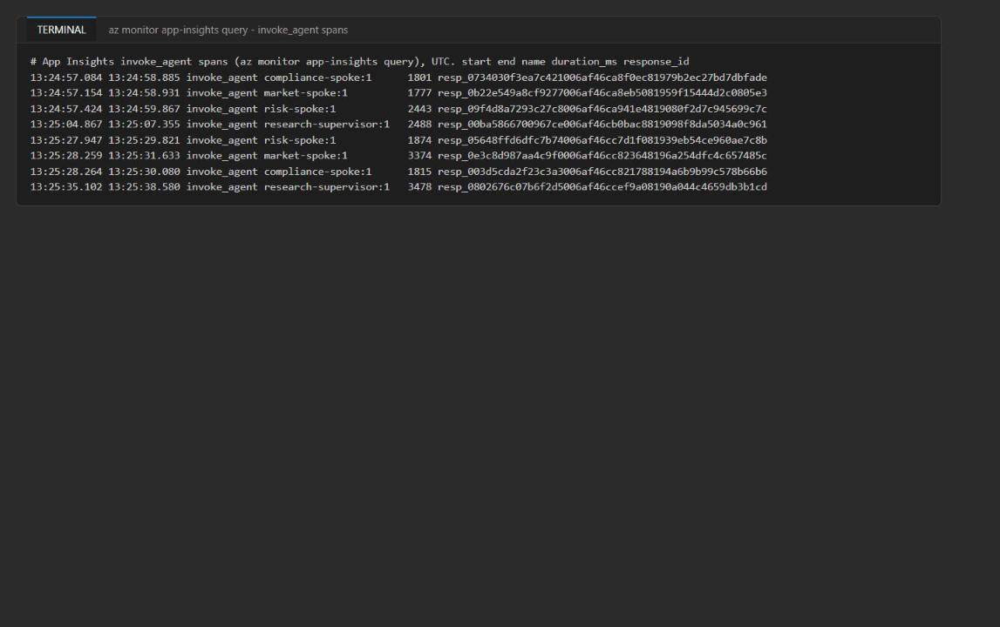

*Figure 14: invoke_agent spans - the three spokes overlap and the supervisor starts after them*

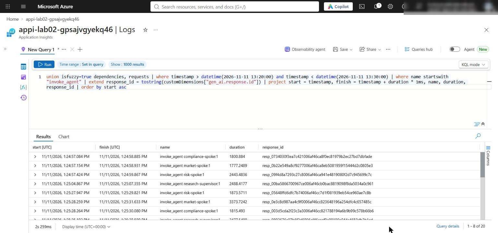

*Figure 15: The same KQL query in Application Insights Logs*

3. In the normal run, the three spoke spans start within a fraction of a second of each other and overlap (reference run: all three started between 13:24:57.08 and 13:24:57.42 UTC). The `research-supervisor` span starts after all spokes finish. Overlap proves concurrent calls.

4. Repeat for the optional-failure run. A `compliance-spoke` trace still exists, because the failure is injected after the live call. Use the saved JSON to confirm that it was excluded from accepted evidence and that the supervisor added a caveat.

Service traces show the Foundry calls and their timing, not the Python semaphore, `asyncio.gather`, fault injection, or quorum code. Correlate them with the saved JSON; there is no single end-to-end parent span. Client-side instrumentation is covered in Lab 13.

---

## Task 7: Review the design

1. Record brief answers to these questions (model answers are in Review questions at the end of this guide):

- Why does `pattern` remain `parallel` in both runs?
- Why must optional failure leave quorum ready while removing compliance evidence and adding a caveat?
- Which decisions belong in deterministic code rather than agent judgment?
- When would these specialists justify their coordination cost over a single agent, and what measurements would support that decision?

---

## Optional challenge: Add a guarded route

Add a synthetic high-risk request that selects sequential execution and requires the compliance spoke to run before the other spokes.

1. Create `assets/portfolio-request-high-risk.json` with this content (market and risk now declare `depends_on: ["compliance-spoke"]`, and compliance is listed first):

```json
{
  "route": "guarded-high-risk",
  "request": "Assess a synthetic balanced portfolio under a fictional severe rate shock flagged as high risk. Compliance caveats must be established before market and risk analysis.",
  "required_agents": [
    "market-spoke",
    "risk-spoke"
  ],
  "simulate_optional_failure": false,
  "agents": [
    {
      "name": "compliance-spoke",
      "assignment": "Return compliance caveats that must gate the remaining analysis.",
      "instructions": "Identify policy caveats in the synthetic scenario. Return concise JSON."
    },
    {
      "name": "market-spoke",
      "assignment": "Return market assumptions and evidence gaps.",
      "instructions": "Analyze only the supplied synthetic scenario. Return concise JSON.",
      "depends_on": [
        "compliance-spoke"
      ]
    },
    {
      "name": "risk-spoke",
      "assignment": "Return risk drivers and limits.",
      "instructions": "Assess risk without investment advice. Return concise JSON.",
      "depends_on": [
        "compliance-spoke"
      ]
    }
  ],
  "supervisor": {
    "name": "research-supervisor",
    "instructions": "Synthesize accepted specialist evidence. State missing evidence and do not invent facts."
  }
}
```

2. Create `assets/portfolio-request-high-risk-failure.json` for the failure investigation. It is identical to the file above plus one extra top-level field that forces `compliance-spoke` to fail:

```json
{
  "route": "guarded-high-risk",
  "request": "Assess a synthetic balanced portfolio under a fictional severe rate shock flagged as high risk. Compliance caveats must be established before market and risk analysis.",
  "required_agents": [
    "market-spoke",
    "risk-spoke"
  ],
  "simulate_optional_failure": false,
  "agents": [
    {
      "name": "compliance-spoke",
      "assignment": "Return compliance caveats that must gate the remaining analysis.",
      "instructions": "Identify policy caveats in the synthetic scenario. Return concise JSON."
    },
    {
      "name": "market-spoke",
      "assignment": "Return market assumptions and evidence gaps.",
      "instructions": "Analyze only the supplied synthetic scenario. Return concise JSON.",
      "depends_on": [
        "compliance-spoke"
      ]
    },
    {
      "name": "risk-spoke",
      "assignment": "Return risk drivers and limits.",
      "instructions": "Assess risk without investment advice. Return concise JSON.",
      "depends_on": [
        "compliance-spoke"
      ]
    }
  ],
  "supervisor": {
    "name": "research-supervisor",
    "instructions": "Synthesize accepted specialist evidence. State missing evidence and do not invent facts."
  },
  "simulate_failure_agent": "compliance-spoke"
}
```

3. In `src/main.py`, inside `run()`, find these lines near the end of the function:

```python
    if data.get("simulate_optional_failure"):
        results[-1] = {**results[-1], "status": "failed", "text": None}
    quorum = evaluate_quorum(results, data["required_agents"])
    supervisor = synthesize(clients[data["supervisor"]["name"]], data["request"], quorum)
    return {"pattern": pattern, "quorum": quorum, "spokes": results, "supervisor_response_id": supervisor.id, "answer": text_from_response(supervisor), "elapsed_ms": round((time.perf_counter()-started)*1000)}
```

4. Replace them with the following. It adds a named-spoke fault injection and a `route` field (default `standard`) to the output:

```python
    if data.get("simulate_optional_failure"):
        results[-1] = {**results[-1], "status": "failed", "text": None}
    # Optional challenge: force a named spoke to fail after its live call.
    if data.get("simulate_failure_agent"):
        results = [{**r, "status": "failed", "text": None} if r["agent"] == data["simulate_failure_agent"] else r for r in results]
    quorum = evaluate_quorum(results, data["required_agents"])
    supervisor = synthesize(clients[data["supervisor"]["name"]], data["request"], quorum)
    return {"route": data.get("route", "standard"), "pattern": pattern, "quorum": quorum, "spokes": results, "supervisor_response_id": supervisor.id, "answer": text_from_response(supervisor), "elapsed_ms": round((time.perf_counter()-started)*1000)}
```

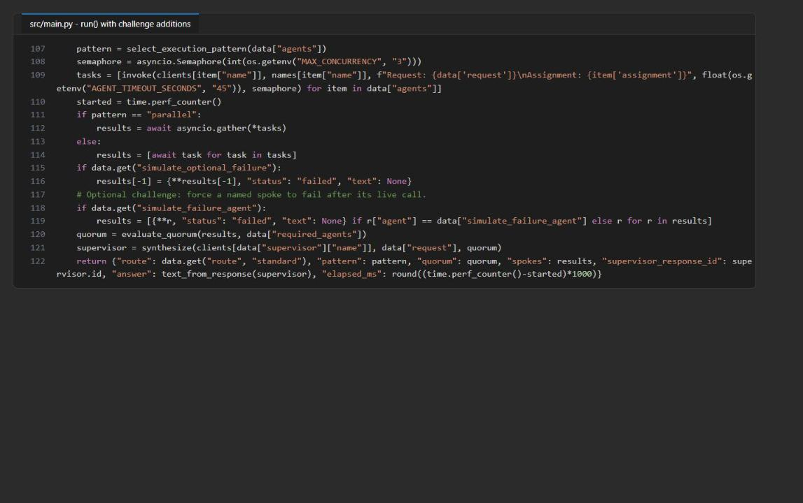

*Figure 16: run() with the challenge additions*

5. Run both challenge inputs:

```powershell
python -m src.main --input assets/portfolio-request-high-risk.json *> artifacts-challenge-high-risk.txt
python -m src.main --input assets/portfolio-request-high-risk-failure.json *> artifacts-challenge-high-risk-failure.txt
Select-String -Path artifacts-challenge-high-risk.txt,artifacts-challenge-high-risk-failure.txt -Pattern '"route"|"pattern"|"status"|missing_agents|missing_required|"elapsed_ms"'
```

**Expected result (guarded route):** `"route": "guarded-high-risk"`, `"pattern": "sequential"`, compliance completes before market starts, the overall `elapsed_ms` is roughly the sum of the spoke durations (reference: 25342 ms), and the supervisor answer opens with the compliance caveats.

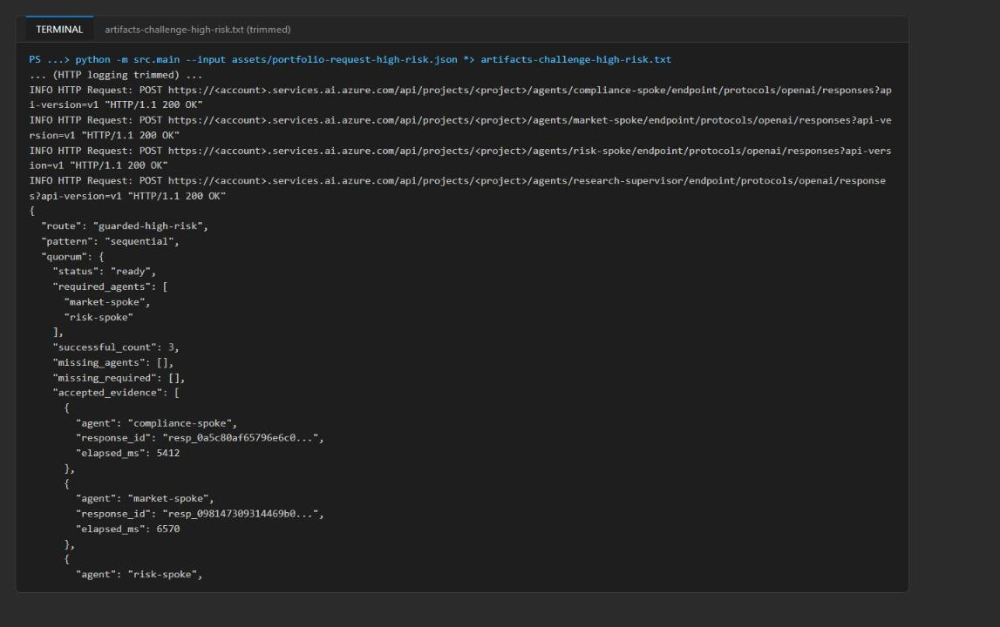

*Figure 17: Guarded route - sequential pattern with compliance first (output trimmed)*

**Expected result (failure investigation):** quorum `ready`, `missing_agents` = `["compliance-spoke"]`, `missing_required` = `[]`. The orchestrator **continued**: it did not fall back or fail closed, and the supervisor disclosed the missing compliance evidence. Note that market and risk still ran even though their prerequisite failed: the runner orders the calls but does not gate them on dependency success. A production guarded route should make `compliance-spoke` required for that route (fail closed) or skip dependents when a prerequisite fails.

---

## Validate

| Acceptance criterion | How to check (CLI) | How to check (portal) |
|---|---|---|
| Preflight passes, 3 markers remain, no `NotImplementedError` | `python scripts/preflight.py`; the two `Select-String ... .Count` commands in Task 4 | n/a |
| Normal run: `pattern` = `parallel`, quorum `ready`, 3 accepted spokes, supervisor ID present | Task 5 step 3 `Select-String` command on `artifacts-normal.txt` | n/a |
| Optional-failure run: compliance `failed`, quorum `ready`, `missing_agents` = compliance, `missing_required` empty | Task 5 step 3 `Select-String` command on `artifacts-optional-failure.txt` | n/a |
| Supervisor discloses missing compliance evidence | Task 6 step 2 command | Playground test of `research-supervisor` |
| Four prompt agents with model `gpt-5.4-mini` and instructions from the asset | `az cognitiveservices account deployment list ...` (model) | Foundry > **Build** > **Agents** |
| Role boundaries hold | n/a | Playground tests of the three spokes |
| Spoke calls overlap; supervisor starts after the spokes | KQL query in Task 6 step 16 | Foundry **Traces**, or Application Insights **Logs** |

## Troubleshooting

| Symptom | Cause | Fix |
|---|---|---|
| App calls a Foundry endpoint in a subscription you don't own, or returns 401/403/404 right away | A stale `.env` from the repository points at another subscription | Re-run the `.env` part of the Task 3 script so `.env` is rewritten from your deployment outputs |
| `PermissionDenied` / 403 when creating agent versions or calling responses | Data-plane roles not assigned or not propagated yet | Make sure the role loop in Task 3 ran (Azure AI User, Cognitive Services OpenAI User, Azure AI Developer), then wait 1-5 minutes and retry |
| `DefaultAzureCredential failed to retrieve a token` | Not signed in with the Azure CLI in this terminal | Run `az login`, then `az account set --subscription <your-subscription-id>` |
| Deployment fails with a quota or `InvalidResourceProperties` model error | `gpt-5.4-mini` version `2026-03-17` or GlobalStandard quota not available in the region | Pick another region in `$azureRegion` and re-run Task 3 with a new suffix |
| A spoke shows `"status": "failed"` in the normal run | Timeout or throttling (429) under concurrency; the warning line `Spoke failed agent=... category=...` names the exception type | Increase `AGENT_TIMEOUT_SECONDS` or lower `MAX_CONCURRENCY` in `.env`, or raise the deployment capacity |
| `RuntimeError: Critical quorum was not met` | A required spoke (market or risk) failed | Expected fail-closed behavior; fix the underlying spoke failure and rerun |
| Traces for the latest run are missing | Ingestion lag | Wait 5-10 minutes and widen the time range |
| Version number in the portal stays at 1 | The definition did not change, so the service reused the version | Expected; not an error |

## Review questions

1. **Why does `pattern` remain `parallel` in both runs?** `select_execution_pattern` looks only at the dependency graph. None of the three spokes declares a `depends_on` on another spoke, and the optional-failure flag is applied after the live calls, so failure handling doesn't change the graph.

2. **Why must optional failure leave quorum ready while removing compliance evidence and adding a caveat?** Quorum is defined by the required set (market and risk), and both succeeded, so a brief can still be produced. Failed output isn't evidence, so it's excluded; listing `compliance-spoke` in `missing_agents` forces the supervisor to disclose the gap so the brief doesn't look complete when it isn't.

3. **Which decisions belong in deterministic code rather than agent judgment?** Choosing parallel or sequential from declared dependencies; the concurrency bound and timeouts; normalizing failures into one shape; which agents are required and whether quorum is met; failing closed when required evidence is missing; and what goes into the supervisor payload. Agents own only analysis and synthesis wording.

4. **When do the specialists justify their coordination cost, and what would you measure?** When specialties need separate instructions, tools, data access, or owners; when parallel work saves real wall-clock time; and when each contribution needs its own audit trail. Compare against a single-agent baseline on quality (rubric scores, omission and hallucination rates), p50/p95 latency, cost (tokens, calls, price per brief), per-spoke failure and timeout rates, and quorum-failure and 429 frequency under load.

## Clean up (optional)

Do this only when you no longer need the resources.

1. Delete the resource group (this removes the Foundry account, project, agents, workspace, and Application Insights):

```powershell
$resourceGroupName = (Select-String .env -Pattern '^AZURE_RESOURCE_GROUP=').Line.Split('=', 2)[1].Trim('"')
$azureRegion = (Select-String .env -Pattern '^AZURE_LOCATION=').Line.Split('=', 2)[1].Trim('"')
$account = az cognitiveservices account list -g $resourceGroupName --query "[0].name" -o tsv
az group delete --name $resourceGroupName --yes --no-wait
```

2. After the deletion finishes (a few minutes), purge the soft-deleted Foundry account so its name and quota are released:

```powershell
az cognitiveservices account purge --location $azureRegion --resource-group $resourceGroupName --name $account
az group exists --name $resourceGroupName
```

**Expected result:** `az group exists` returns `false`.

3. Remove the generated local files and deactivate the virtual environment:

```powershell
Remove-Item .env, artifacts-normal.txt, artifacts-optional-failure.txt, artifacts-challenge-*.txt -ErrorAction SilentlyContinue
deactivate
```

Confirm that `(.venv)` no longer appears in the prompt before you move to another lab.

