# Lab 03: Apply task decomposition and agent collaboration strategies in Microsoft Foundry

## Overview

**Scenario.** Contoso Capital receives research questions that range from simple lookups to multi-source investment analyses. A fixed chain of agents over-processes simple questions and misses dependencies in complex ones. The firm wants a meta-agent (a planner) that proposes a task plan, with application code that validates the plan, runs the specialists in dependency order, passes bounded context between them, and measures the coordination overhead.

**What you'll build.** You complete an Agents v2 planner/executor in `src/main.py`:

- A `research-planner` agent returns a JSON task DAG (directed acyclic graph).
- `validate_plan` checks the DAG in code before any specialist is called.
- `ready_tasks` dispatches only tasks whose prerequisites succeeded and detects deadlocks.
- `build_handoff` builds a size-bounded handoff envelope that keeps source response IDs.
- `should_replan` raises at most one evidence-driven replan signal.

You then run the solution with a complex and a simple query, and verify the agents and traces in the Foundry portal and Application Insights.

**Duration.** About 45 minutes.

> **Note:** Cost warning. The model deployment (planner plus every specialist call), Application Insights ingestion and 30-day Log Analytics retention are billable. Use only the synthetic input in `assets/research-query.json` and delete the resource group when you finish.

**Architecture**

| Component | Resource / file | Purpose |
|---|---|---|
| Foundry account | `Microsoft.CognitiveServices/accounts` (kind AIServices, `fdry<suffix>`) | Hosts the project and the model deployment; public network access with default action Allow |
| Foundry project | `lab03-<env-name>` | Holds the five prompt agents and their versions |
| Model deployment | `gpt-5.4-mini` (version 2026-03-17, GlobalStandard, capacity 10) | Model used by the planner and all specialists |
| Application Insights + Log Analytics | `appi-lab03-<suffix>`, `log-lab03-<suffix>` | Receive server-side agent traces through a project connection |
| Planner agent | `research-planner` | Returns the JSON task DAG |
| Specialist agents | `financial-data`, `macro-risk`, `compliance-review`, `thesis-synthesis` | Registry in `assets/research-query.json` |
| Application | `src/main.py` | Validates the plan, dispatches specialists, builds handoffs, prints metrics |

---

## Prerequisites

Install these tools before you start:

- [Python 3.11 or later](https://www.python.org/downloads/)
- [Azure CLI](https://learn.microsoft.com/cli/azure/install-azure-cli) with [Bicep](https://learn.microsoft.com/azure/azure-resource-manager/bicep/install) (`az bicep install`)
- [Visual Studio Code](https://code.visualstudio.com/download) with the Python extension
- [Git](https://git-scm.com/downloads)
- [PowerShell 7](https://learn.microsoft.com/powershell/scripting/install/installing-powershell) (recommended; the commands below are PowerShell)

Azure requirements:

- An Azure subscription with `gpt-5.4-mini` (GlobalStandard) quota in the region you choose (this guide uses `eastus2`).
- **Contributor** and **User Access Administrator** (or **Owner**) on the subscription or resource group, so you can create resources and grant yourself data-plane roles.

> **Note:** This guide provisions with the Azure CLI (`az deployment group create`) instead of `azd provision`. The result is the same set of resources; the CLI path avoids `azd` environment issues and lets you grant the data-plane roles explicitly.

---

## Task 1: Prepare the lab

**Clone and open the repository**

1. Open a terminal and clone the lab repository:

```powershell
git clone https://github.com/MicrosoftLearning/mslearn-ai-multi-agents.git
```

2. Open the cloned `mslearn-ai-multi-agents` folder in Visual Studio Code (**File** > **Open Folder**).

**Verify tools and authentication**

3. In VS Code, open a PowerShell terminal (**Terminal** > **New Terminal**) and run:

```powershell
cd Allfiles\03-contoso-capital-task-decomposition
az version
python --version
az account show --output table
```

4. If `az account show` fails or shows the wrong subscription, sign in and select the subscription:

```powershell
az login
az account set --subscription "<your-subscription-id>"
az account show --output table
```

Expected result: `az version` prints the CLI version, `python --version` prints 3.11 or later, and `az account show` displays the subscription you intend to use.

**Architecture checkpoint**

5. Open these files and locate the listed items before you edit anything:

| File | What to locate |
|---|---|
| `infra/main.bicep` | Foundry account, project, `gpt-5.4-mini` deployment, Application Insights, and the `AppInsights` project connection used for traces |
| `assets/research-query.json` | The `query`, the `complexity_hint` (`complex`) and the specialist `registry` (capability list for the planner) |
| `src/main.py` | `validate_plan` (DAG validation), `ready_tasks` (dependency-ready scheduling), `build_handoff` (bounded envelope), `should_replan` (replan signal), and `run` (planner call, dispatch loop, final synthesis) |

---

## Task 2: Build the virtual environment

1. From the lab folder, create the virtual environment, install the requirements and activate it:

```powershell
./scripts/setup.ps1
. ./.venv/Scripts/Activate.ps1
```

> **Note:** On macOS/Linux run `bash scripts/setup.sh` and then `source .venv/bin/activate`.

2. Confirm that `(.venv)` appears at the start of the terminal prompt.

3. In VS Code, press **Ctrl+Shift+P**, run **Python: Select Interpreter**, and choose the interpreter in `.venv`.

Expected result: `pip` installs `azure-ai-projects` 2.x, `azure-identity`, `openai` and `python-dotenv` without errors.

---

## Task 3: Deploy the Azure resources

**Provision with the Azure CLI**

1. Make sure the terminal is in `Allfiles\03-contoso-capital-task-decomposition` with `(.venv)` active. Change `eastus2` if your `gpt-5.4-mini` quota is in another region, then run the whole block:

```powershell
$azureRegion = 'eastus2'
$suffix = (New-Guid).Guid.Substring(0, 8)
$resourceGroupName = "rg-lab03-$suffix"
$envName = "lab03-$suffix"
az group create --name $resourceGroupName --location $azureRegion --output none
az bicep build --file infra/main.bicep
az deployment group create --resource-group $resourceGroupName --name lab03-main `
  --template-file infra/main.bicep `
  --parameters location=$azureRegion environmentName=$envName modelDeploymentName=gpt-5.4-mini modelName=gpt-5.4-mini modelVersion=2026-03-17 `
  --output none
```

> **Note:** If your lab environment provides a precreated resource group, set `$resourceGroupName` to its name and skip the `az group create` line. The deployment takes about 3-5 minutes.

2. Grant yourself data-plane access to the Foundry project (agents and model calls). The template does not create these role assignments:

```powershell
$me = az ad signed-in-user show --query id -o tsv
$rgId = az group show --name $resourceGroupName --query id -o tsv
foreach ($role in 'Azure AI User','Cognitive Services OpenAI User','Azure AI Developer') {
  az role assignment create --assignee-object-id $me --assignee-principal-type User --role $role --scope $rgId --output none
}
```

> **Note:** Role assignments can take 1-5 minutes to apply. If the first run returns `401` or `403 PermissionDenied`, wait a few minutes and run it again.

**Write the .env file**

3. Write `.env` from the deployment outputs:

```powershell
$outputs = az deployment group show --resource-group $resourceGroupName --name lab03-main --query properties.outputs -o json | ConvertFrom-Json
$lines = @("AZURE_RESOURCE_GROUP=`"$resourceGroupName`"", "AZURE_LOCATION=`"$azureRegion`"", "AZURE_ENV_NAME=`"$envName`"",
  "AZURE_SUBSCRIPTION_ID=`"$(az account show --query id -o tsv)`"")
$outputs.PSObject.Properties | ForEach-Object { $lines += "$($_.Name.ToUpper())=`"$($_.Value.value)`"" }
$lines | Out-File .env -Encoding utf8
Get-Content .env
```

4. Confirm that `.env` contains `FOUNDRY_PROJECT_ENDPOINT`, `FOUNDRY_PROJECT_ID`, `FOUNDRY_MODEL_NAME`, `APPLICATIONINSIGHTS_RESOURCE_ID` and `LOG_ANALYTICS_WORKSPACE_ID`. Do not add keys or tokens to `.env`; the app authenticates with your Azure CLI sign-in. The Application Insights connection string lives in the Foundry project connection and is not written to `.env`.

Expected result (values differ):

```text
AZURE_RESOURCE_GROUP="rg-lab03-<suffix>"
AZURE_LOCATION="eastus2"
AZURE_ENV_NAME="lab03-<suffix>"
AZURE_SUBSCRIPTION_ID="<subscription-id>"
FOUNDRY_PROJECT_ENDPOINT="https://fdry<id>.services.ai.azure.com/api/projects/lab03-lab03-<suffix>"
FOUNDRY_PROJECT_ID="/subscriptions/<subscription-id>/resourceGroups/rg-lab03-<suffix>/providers/Microsoft.CognitiveServices/accounts/fdry<id>/projects/lab03-lab03-<suffix>"
FOUNDRY_MODEL_NAME="gpt-5.4-mini"
APPLICATIONINSIGHTS_RESOURCE_ID="/subscriptions/<subscription-id>/resourceGroups/rg-lab03-<suffix>/providers/Microsoft.Insights/components/appi-lab03-<id>"
LOG_ANALYTICS_WORKSPACE_ID="<workspace-guid>"
```

**Verify the resources**

5. List the deployed resources:

```powershell
az resource list --resource-group $resourceGroupName --query "[].{name:name, type:type}" -o table
```

Expected result: a Log Analytics workspace, a Foundry account (`Microsoft.CognitiveServices/accounts`), its project, an Application Insights component and its Failure Anomalies alert rule.

6. In the [Azure portal](https://portal.azure.com), open the resource group `rg-lab03-<suffix>` to see the same resources.

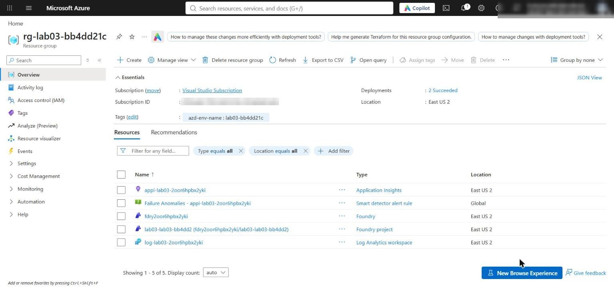

*Figure 1: The lab 03 resource group with the Foundry account, project, Application Insights and Log Analytics workspace*

7. Confirm the network settings of the Foundry account. Run the command below, or open the Foundry account in the portal and select **Resource Management** > **Networking**:

```powershell
az cognitiveservices account list --resource-group $resourceGroupName --query "[].{name:name, publicNetworkAccess:properties.publicNetworkAccess, defaultAction:properties.networkAcls.defaultAction}" -o table
```

Expected result: `publicNetworkAccess` is `Enabled` and `defaultAction` is `Allow`. The template allows public access so your local app can reach the project endpoint; Microsoft Entra authentication and RBAC are still required. Production environments should use selected networks or private endpoints.

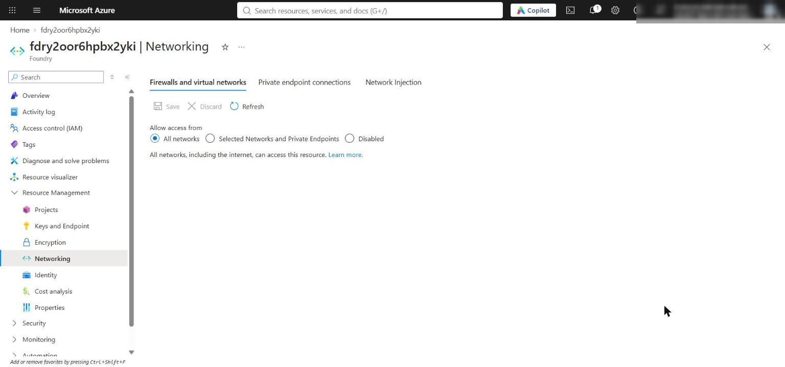

*Figure 2: Foundry account Networking page showing public access from all networks*

8. Confirm the model deployment:

```powershell
$account = az cognitiveservices account list --resource-group $resourceGroupName --query "[0].name" -o tsv
az cognitiveservices account deployment list --resource-group $resourceGroupName --name $account --query "[].{name:name, model:properties.model.name, version:properties.model.version, sku:sku.name, state:properties.provisioningState}" -o table
```

Expected result: `gpt-5.4-mini`, version `2026-03-17`, SKU `GlobalStandard`, state `Succeeded`.

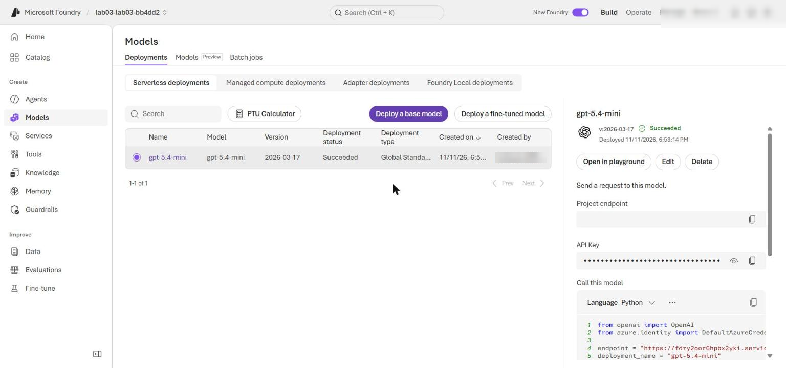

*Figure 3: The gpt-5.4-mini model deployment in the Foundry project*

---

## Task 4: Implement the solution

Each placeholder in `src/main.py` is a `# LAB PLACEHOLDER n` comment followed by a `raise NotImplementedError(...)` line. Keep the comment, replace only the `raise NotImplementedError(...)` line with the code given, and keep the 4-space indentation of the function body (every line below is already indented for pasting directly under the comment).

**Placeholder 1: validate the model-generated task DAG**

1. Open `src/main.py` and find this in `validate_plan`:

```python
    # LAB PLACEHOLDER 1: Replace this line with the Task 1 sample.
    raise NotImplementedError("Complete validate_plan in Task 1")
```

2. Replace the `raise NotImplementedError("Complete validate_plan in Task 1")` line with:

```python
    tasks = plan.get("tasks")
    if not isinstance(tasks, list) or not 1 <= len(tasks) <= 6:
        raise ValueError("Plan must contain between 1 and 6 tasks")

    task_ids = [task.get("id") for task in tasks]
    if any(not isinstance(task_id, str) or not task_id for task_id in task_ids):
        raise ValueError("Every task requires a nonempty string ID")
    if len(task_ids) != len(set(task_ids)):
        raise ValueError("Task IDs must be unique")

    known_ids = set(task_ids)
    for task in tasks:
        if task.get("agent") not in registry:
            raise ValueError(f"Unknown agent for task {task['id']}")
        dependencies = task.get("depends_on", [])
        if not isinstance(dependencies, list):
            raise ValueError(f"depends_on must be a list for task {task['id']}")
        if task["id"] in dependencies or not set(dependencies) <= known_ids:
            raise ValueError(f"Invalid dependency for task {task['id']}")

    remaining = {
        task["id"]: set(task.get("depends_on", []))
        for task in tasks
    }
    resolved: set[str] = set()
    while remaining:
        ready = {
            task_id
            for task_id, dependencies in remaining.items()
            if dependencies <= resolved
        }
        if not ready:
            raise ValueError("Plan dependencies contain a cycle")
        resolved.update(ready)
        remaining = {
            task_id: dependencies
            for task_id, dependencies in remaining.items()
            if task_id not in ready
        }

    synthesis_tasks = [
        task for task in tasks if task["agent"] == "thesis-synthesis"
    ]
    if len(synthesis_tasks) != 1:
        raise ValueError("The plan must contain exactly one thesis-synthesis task")
    synthesis = synthesis_tasks[0]
    non_synthesis_dependency_ids = {
        dependency
        for task in tasks
        if task["id"] != synthesis["id"]
        for dependency in task.get("depends_on", [])
    }
    terminal_evidence_ids = {
        task["id"]
        for task in tasks
        if task["id"] not in non_synthesis_dependency_ids and task["id"] != synthesis["id"]
    }
    if set(synthesis.get("depends_on", [])) != terminal_evidence_ids:
        raise ValueError(
            "The thesis-synthesis task must depend on every terminal evidence task"
        )
    if any(synthesis["id"] in task.get("depends_on", []) for task in tasks):
        raise ValueError("No task can depend on the thesis-synthesis task")
```

The application validates the proposed graph before any specialist is called: 1-6 tasks, unique IDs, known agents only, valid and acyclic dependencies, and exactly one `thesis-synthesis` task that consumes every terminal evidence branch and has no consumers.

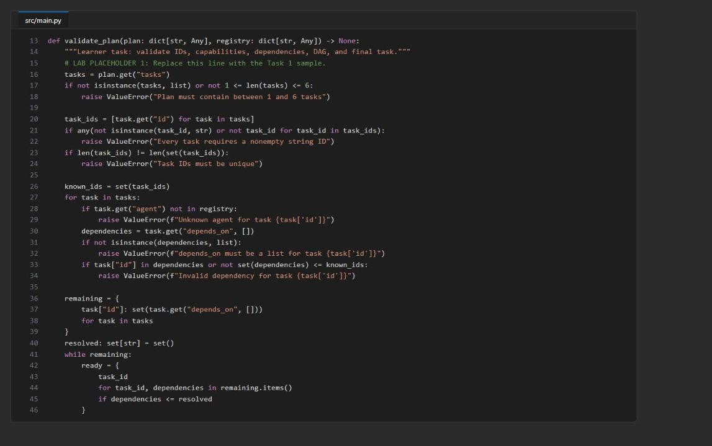

*Figure 4: validate_plan after Placeholder 1 (first part: IDs, agents, dependencies, cycle check)*

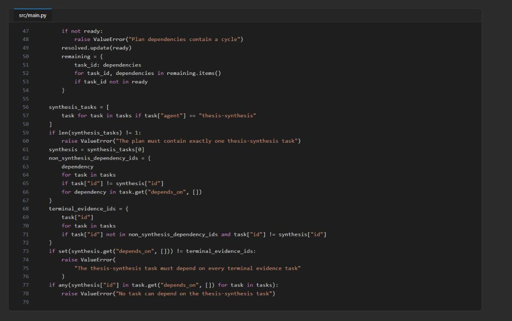

*Figure 5: validate_plan after Placeholder 1 (second part: synthesis-task checks)*

**Placeholder 2: select dependency-ready tasks**

3. Find this in `ready_tasks`:

```python
    # LAB PLACEHOLDER 2: Replace this line with the Task 2 sample.
    raise NotImplementedError("Complete ready_tasks in Task 2")
```

4. Replace the `raise NotImplementedError("Complete ready_tasks in Task 2")` line with:

```python
    unfinished = [task for task in tasks if task["id"] not in completed]
    ready = [
        task
        for task in unfinished
        if all(
            completed.get(dependency, {}).get("status") == "success"
            for dependency in task.get("depends_on", [])
        )
    ]
    if unfinished and not ready:
        blocked = ", ".join(task["id"] for task in unfinished)
        raise RuntimeError(f"Plan deadlock: blocked tasks: {blocked}")
    return ready
```

Only successful prerequisites unlock a task. A blocked graph raises an error instead of looping forever.

**Placeholder 3: build a bounded handoff envelope**

5. Find this in `build_handoff`:

```python
    # LAB PLACEHOLDER 3: Replace this line with the Task 3 sample.
    raise NotImplementedError("Complete build_handoff in Task 3")
```

6. Replace the `raise NotImplementedError("Complete build_handoff in Task 3")` line with:

```python
    max_chars = int(os.getenv("MAX_HANDOFF_CHARS", "6000"))
    dependencies = task.get("depends_on", [])
    summary_limit = max(256, max_chars // max(2, len(dependencies) + 1))
    dependency_context = [
        {
            "task_id": dependency,
            "response_id": completed[dependency]["response_id"],
            "summary": completed[dependency]["summary"][:summary_limit],
        }
        for dependency in dependencies
    ]
    envelope = {
        "task_id": task["id"],
        "objective": task["objective"],
        "dependency_context": dependency_context,
        "source_response_ids": [
            item["response_id"] for item in dependency_context
        ],
        "expected_schema": task["expected_schema"],
        "deadline_seconds": int(os.getenv("HANDOFF_DEADLINE_SECONDS", "45")),
        "correlation_id": correlation_id,
    }
    if len(json.dumps(envelope)) > max_chars:
        raise ValueError("Handoff envelope exceeds MAX_HANDOFF_CHARS")
    return envelope
```

The envelope separates the objective from the dependency evidence, keeps the source response IDs, and caps the context size (`MAX_HANDOFF_CHARS`, default 6000). The correlation ID links the tasks without logging research content.

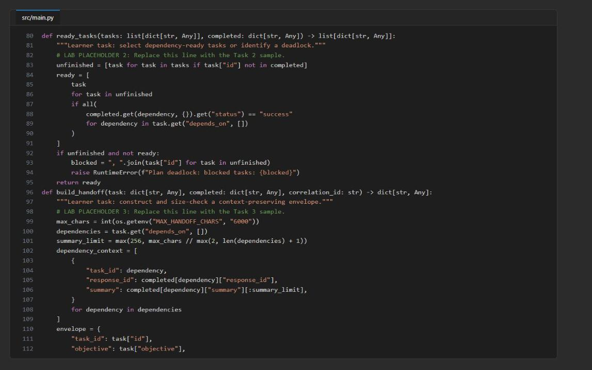

*Figure 6: ready_tasks (Placeholder 2) and the start of build_handoff (Placeholder 3)*

**Placeholder 4: signal one evidence-driven replan**

7. Find this in `should_replan`:

```python
    # LAB PLACEHOLDER 4: Replace this line with the Task 4 sample.
    raise NotImplementedError("Complete should_replan in Task 4")
```

8. Replace the `raise NotImplementedError("Complete should_replan in Task 4")` line with:

```python
    if replan_count >= 1:
        return False
    if result.get("status") != "success":
        return True

    try:
        payload = json.loads(result.get("summary", "{}"))
    except json.JSONDecodeError:
        return False

    status = str(payload.get("status", "")).lower()
    confidence = payload.get("confidence")
    low_confidence = isinstance(confidence, (int, float)) and confidence < 0.5
    return (
        status in {"missing_evidence", "capability_unavailable"}
        or bool(payload.get("missing_evidence"))
        or low_confidence
    )
```

The policy records at most one evidence-driven signal in `replan_count`; it does not execute a replan. A production coordinator would send the evidence back to the planner and validate a replacement for only the remaining part of the DAG.

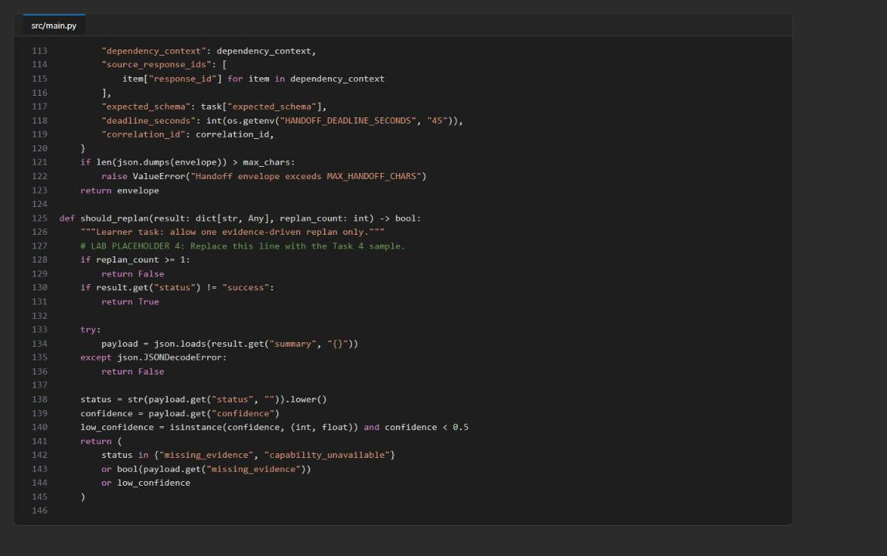

*Figure 7: The end of build_handoff (Placeholder 3) and should_replan (Placeholder 4)*

9. Save `src/main.py` (**Ctrl+S**).

**Check the completed code**

10. Run the local checks before making billable model calls:

```powershell
python -m py_compile src/main.py scripts/preflight.py
python scripts/preflight.py
```

11. Confirm that the four `LAB PLACEHOLDER` markers remain and no `NotImplementedError` remains:

```powershell
(Select-String -Path src/main.py -Pattern 'LAB PLACEHOLDER').Count
(Select-String -Path src/main.py -Pattern 'NotImplementedError').Count
```

Expected result: `py_compile` prints nothing, preflight prints four `PASS` lines, and the two counts are `4` and `0`.

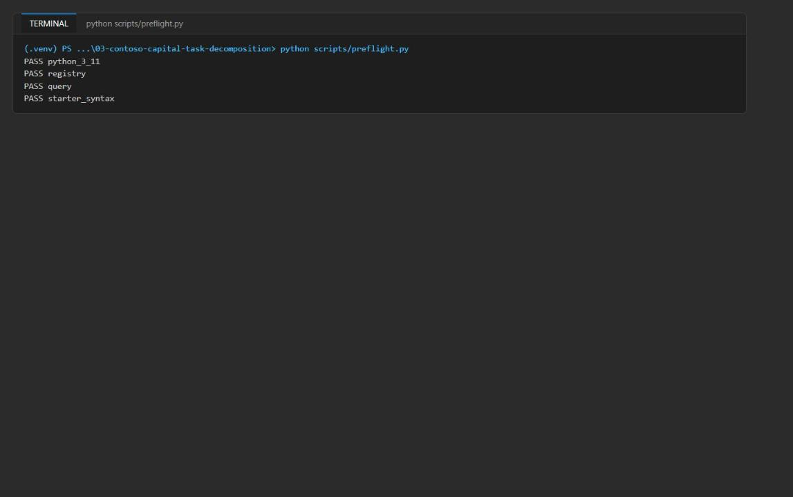

*Figure 8: Preflight reports four PASS lines*

---

## Task 5: Run the solution

**Run the complex query**

1. Confirm that `assets/research-query.json` still has `"complexity_hint":"complex"`, then run the application:

```powershell
python -m src.main --input assets/research-query.json
```

The app creates (or adds a new version to) five prompt agents, calls `research-planner` once, validates the returned DAG, and then calls each specialist in dependency order. The run takes about 1-2 minutes. Authentication and HTTP log lines (`INFO HTTP Request: POST ... "HTTP/1.1 200 OK"`) appear before the JSON result; that is expected.

Expected result: a JSON document with a 3-6 task plan whose last task is `thesis-synthesis` and depends on all evidence tasks, for example `T1 financial-data`, `T2 macro-risk`, `T3 compliance-review`, `T4 thesis-synthesis [T1, T2, T3]`, with `task_count` 4, `handoff_count` 4 and every result `status success`.

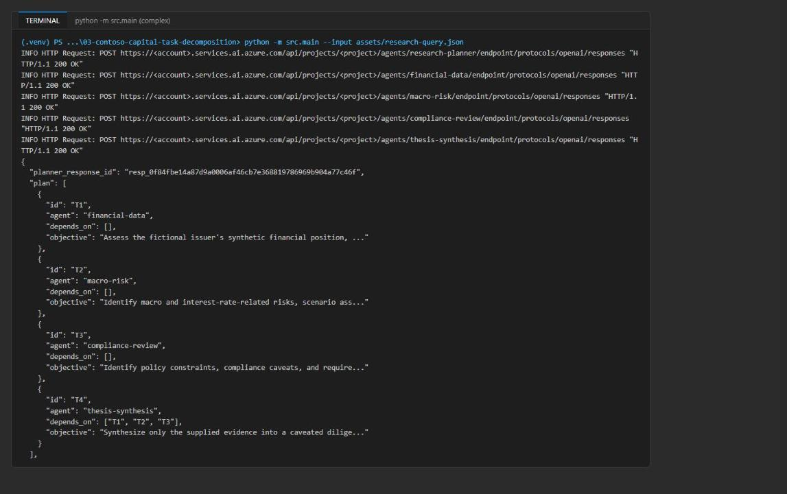

*Figure 9: Complex run: one call per agent and the validated four-task plan*

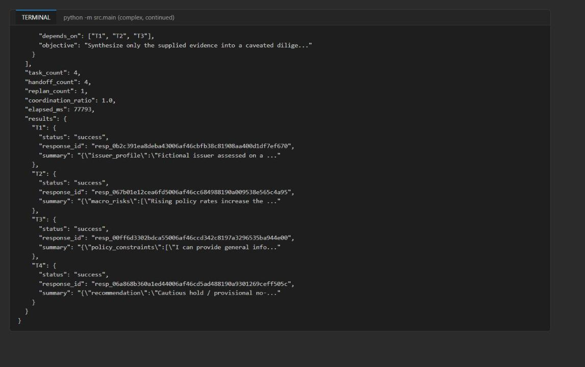

*Figure 10: Complex run: metrics and per-task results with live response IDs*

**Run the simple query**

2. Open `assets/research-query.json`, change `"complexity_hint":"complex"` to `"complexity_hint":"simple"`, and save the file. Alternatively, run:

```powershell
$q = 'assets/research-query.json'
(Get-Content $q -Raw) -replace '"complexity_hint"\s*:\s*"\w+"', '"complexity_hint":"simple"' | Set-Content $q -NoNewline -Encoding utf8
Select-String -Path $q -Pattern 'complexity_hint":"\w+"' | ForEach-Object { $_.Matches.Value }
```

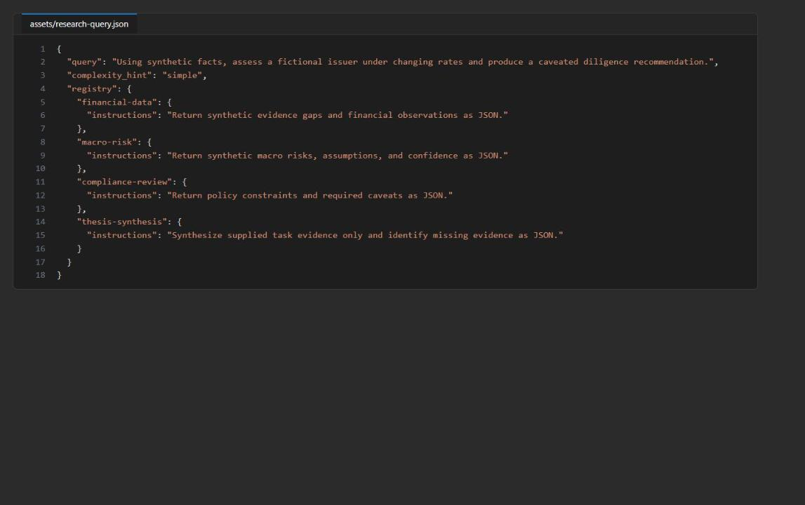

*Figure 11: research-query.json with complexity_hint set to simple*

3. Run the application again:

```powershell
python -m src.main --input assets/research-query.json
```

Expected result: the planner reduces the plan depth to exactly two tasks (one evidence task, typically `financial-data`, and `thesis-synthesis` depending on it), `task_count` 2, `handoff_count` 2, and the run finishes in about 20-25 seconds instead of about 75 seconds.

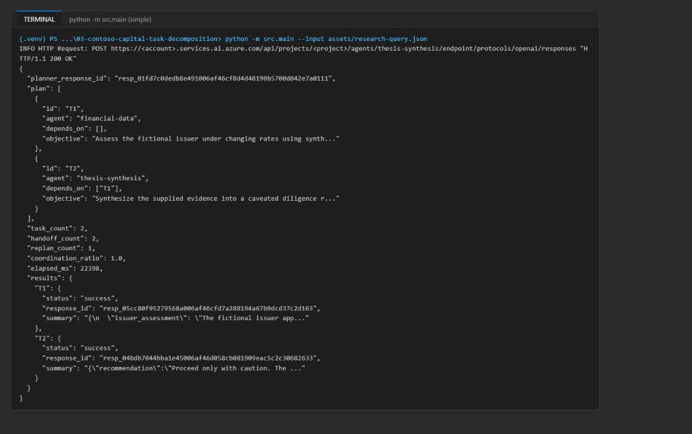

*Figure 12: Simple run: a two-task plan with the final synthesis task preserved*

**Understand the output**

| Field | What it reflects |
|---|---|
| `planner_response_id` | The live structured plan returned by the planner agent |
| `plan` | The validated task IDs, owners, objectives, schemas and dependencies used for dispatch |
| `task_count` | Validated plan depth, bounded to 1-6 tasks |
| `handoff_count` | Number of specialist envelopes created |
| `replan_count` | 0 or 1 evidence-driven signal for an outer replanning coordinator |
| `coordination_ratio` | Handoffs divided by completed tasks; compare with quality and latency, not as a score |
| `elapsed_ms` | End-to-end wall-clock time for planner, validation, specialists and synthesis |
| `results` | Per-task status, live response ID and visible structured summary |

> **Note:** `replan_count` is `1` in both runs. The query is synthetic, so the specialists report `missing_evidence`; the single-signal budget fires once and is then capped. That is the expected behavior.

---

## Task 6: Validate the implementation

**Capture both runs in one artifact**

1. Capture the complex and the simple run in `artifacts-lab03.txt`. This block sets the hint, runs each case and appends the output:

```powershell
python -m py_compile src/main.py scripts/preflight.py
$q = 'assets/research-query.json'
"===== COMPLEX RUN (complexity_hint=complex) =====" | Out-File artifacts-lab03.txt -Encoding utf8
(Get-Content $q -Raw) -replace '"complexity_hint"\s*:\s*"\w+"', '"complexity_hint":"complex"' | Set-Content $q -NoNewline -Encoding utf8
python -m src.main --input $q *>> artifacts-lab03.txt
"===== SIMPLE RUN (complexity_hint=simple) =====" | Out-File artifacts-lab03.txt -Append -Encoding utf8
(Get-Content $q -Raw) -replace '"complexity_hint"\s*:\s*"\w+"', '"complexity_hint":"simple"' | Set-Content $q -NoNewline -Encoding utf8
python -m src.main --input $q *>> artifacts-lab03.txt
Select-String artifacts-lab03.txt -Pattern 'planner_response_id|task_count|handoff_count|replan_count|coordination_ratio'
```

Expected result: two sets of metrics: the complex run with `task_count` 3-6 and the simple run with `task_count` 2.

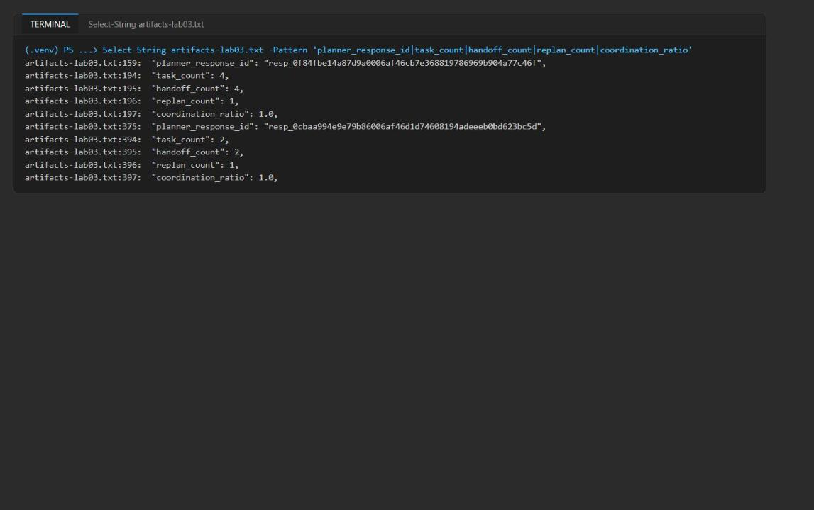

*Figure 13: Select-String shows the planner response IDs and metrics for both runs*

2. Open `artifacts-lab03.txt` and check the acceptance criteria:

| Criterion | How to check |
|---|---|
| Every dependency refers to an earlier completed task | In `results`, each task appears after the tasks in its `depends_on`; `thesis-synthesis` is the last entry |
| Every specialist exists in the registry | Every `agent` in `plan` is one of `financial-data`, `macro-risk`, `compliance-review`, `thesis-synthesis` (otherwise `validate_plan` would have raised) |
| All task results have live Foundry response IDs | Every `results.<id>.response_id` starts with `resp_` |
| One simple and one complex plan | Simple run: 2 tasks (1 evidence + synthesis). Complex run: 3-6 tasks |

> **Note:** Offline DAG checks alone do not satisfy this lab. The response IDs must come from live Foundry calls.

**Validate the agents in Foundry**

3. Open the [Foundry portal](https://ai.azure.com) and select the project named in `FOUNDRY_PROJECT_ENDPOINT` (`lab03-lab03-<suffix>`).

4. Select **Agents**. Confirm that `research-planner`, `financial-data`, `macro-risk`, `compliance-review` and `thesis-synthesis` are listed.

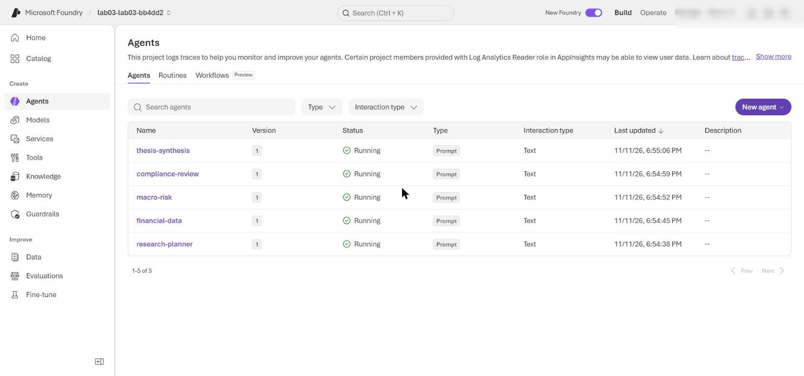

*Figure 14: The Agents page lists the planner and the four specialists*

5. Open `research-planner` and confirm its current version, model `gpt-5.4-mini` and the instructions that contain the registry. Version numbers increase each time you run the app.

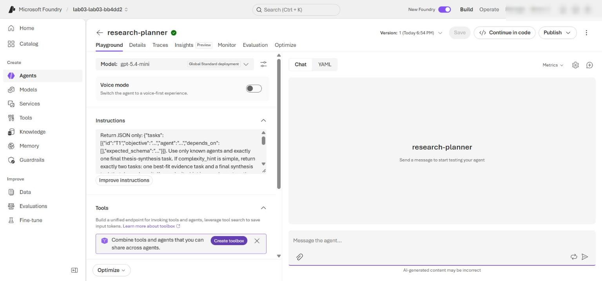

*Figure 15: research-planner agent version and instructions*

You can also list the agents from the command line:

```powershell
$endpoint = (Select-String -Path .env -Pattern '^FOUNDRY_PROJECT_ENDPOINT=').Line.Split('=',2)[1].Trim('"')
$token = az account get-access-token --resource https://ai.azure.com --query accessToken -o tsv
(Invoke-RestMethod -Uri "$endpoint/agents?api-version=v1" -Headers @{ Authorization = "Bearer $token" }).data | Select-Object -ExpandProperty name
```

**Validate the response traces**

6. In the Foundry portal, select **Agents**, open **research-planner**, and select its **Traces** tab (each agent has its own Traces tab); set the time range to include your runs. Trace ingestion can take several minutes.

7. Search for the complex run's `planner_response_id`. Open the trace and confirm the agent name `research-planner`, the version, a successful response operation and the timestamp.

8. Search for each `response_id` in the complex run's `results`. Confirm that `thesis-synthesis` starts only after the `financial-data`, `macro-risk` and `compliance-review` traces have completed.

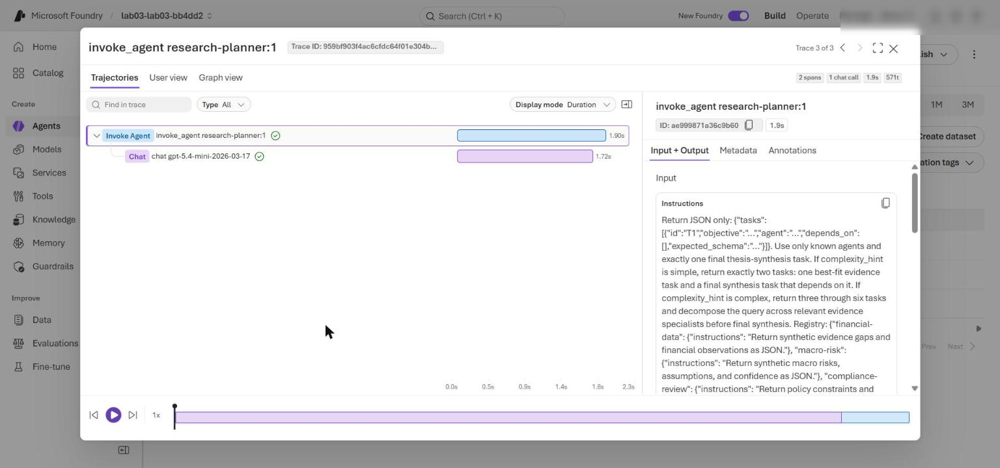

*Figure 16: The complex-run research-planner trace (invoke_agent research-planner:1) opened from the agent's Traces tab*

9. Repeat the search for the simple run and compare: the simple run has 2 specialist traces, the complex run has 4.

10. Optionally, query the same spans in Application Insights. In the Azure portal open `appi-lab03-<suffix>` > **Monitoring** > **Logs**, and run:

```kql
dependencies
| where timestamp > ago(1d)
| where name startswith "invoke_agent"
| project timestamp, end_time = timestamp + duration * 1ms, name, success,
          response_id = tostring(customDimensions["gen_ai.response.id"])
| order by timestamp asc
```

Expected result: one `invoke_agent research-planner:<version>` span per run, followed by one span per specialist task, all with `success` = `True`. Each specialist that consumes a dependency starts after the prerequisite spans end.

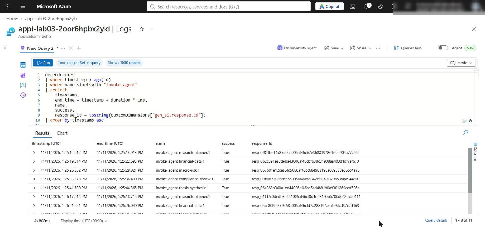

*Figure 17: Application Insights Logs query of the invoke_agent spans*

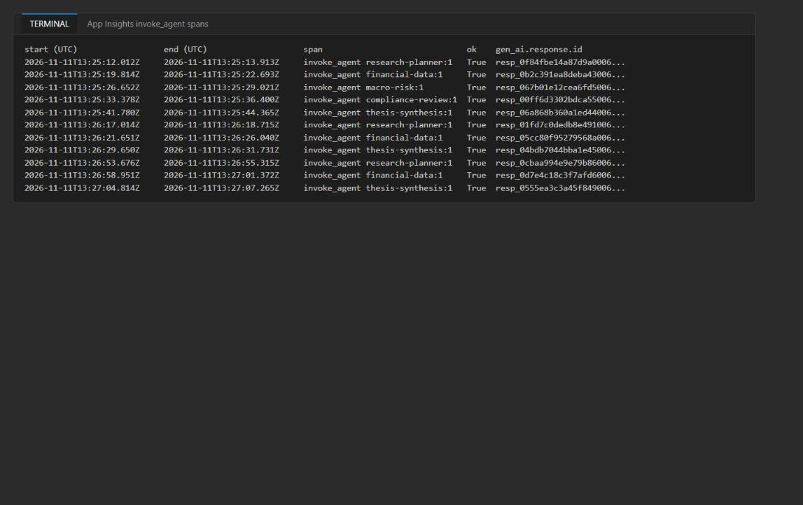

*Figure 18: Span timeline: complex run (planner + 4 specialists), then two simple runs (planner + 2 specialists)*

---

## Optional challenge: Compare two decompositions

Create a coarse-grained and a fine-grained DAG for the same query, select one against explicit constraints, and then shrink the handoff limit until an envelope is rejected. The script below runs offline (no model calls). It reuses the lab's own `validate_plan`, `ready_tasks` and `build_handoff`, and uses the real specialist summaries from the complex run in `artifacts-lab03.txt` as realistic artifact sizes.

1. In the lab folder, create `optional_challenge.py` with this content:

```python
"""Optional challenge: compare a coarse and a fine-grained DAG for the same synthetic query.

Offline only (no model calls). Uses the lab's own validate_plan / ready_tasks / build_handoff,
with real specialist summaries captured in artifacts-lab03.txt (complex run) as dependency artifacts.
Run: python optional_challenge.py > challenge-output.txt
"""
from __future__ import annotations
import json, os
from pathlib import Path
from src.main import validate_plan, ready_tasks, build_handoff

ROOT = Path(__file__).resolve().parent
data = json.loads((ROOT / "assets/research-query.json").read_text(encoding="utf-8"))
registry = data["registry"]

# Real summaries from the complex live run (used as realistic artifact sizes).
text = (ROOT / "artifacts-lab03.txt").read_text(encoding="utf-8").split("===== SIMPLE RUN")[0]
live, _ = json.JSONDecoder().raw_decode(text[text.index("\n{\n") + 1:])
live_summaries = [v["summary"] for v in live["results"].values()]

S = '{"findings":["string"],"confidence":0.0,"missing_evidence":["string"]}'
coarse = {"tasks": [
    {"id": "E1", "agent": "financial-data", "objective": "Collect financial, rate-sensitivity and caveat evidence for the issuer.", "depends_on": [], "expected_schema": S},
    {"id": "S1", "agent": "thesis-synthesis", "objective": "Synthesize a caveated diligence recommendation.", "depends_on": ["E1"], "expected_schema": S},
]}
fine = {"tasks": [
    {"id": "F1", "agent": "financial-data", "objective": "Leverage, coverage and liquidity observations.", "depends_on": [], "expected_schema": S},
    {"id": "M1", "agent": "macro-risk", "objective": "Rate scenarios and transmission channels.", "depends_on": [], "expected_schema": S},
    {"id": "F2", "agent": "financial-data", "objective": "Stress coverage under M1 scenarios.", "depends_on": ["F1", "M1"], "expected_schema": S},
    {"id": "C1", "agent": "compliance-review", "objective": "Required caveats and diligence boundaries.", "depends_on": [], "expected_schema": S},
    {"id": "C2", "agent": "compliance-review", "objective": "Check stressed findings against policy caveats.", "depends_on": ["F2", "C1"], "expected_schema": S},
    {"id": "S1", "agent": "thesis-synthesis", "objective": "Synthesize a caveated diligence recommendation.", "depends_on": ["C2"], "expected_schema": S},
]}

def simulate(name: str, plan: dict, max_chars: int) -> dict:
    os.environ["MAX_HANDOFF_CHARS"] = str(max_chars)
    validate_plan(plan, registry)
    completed: dict = {}; envelopes = []; waves = 0; i = 0
    while len(completed) < len(plan["tasks"]):
        batch = ready_tasks(plan["tasks"], completed); waves += 1
        for task in batch:
            env = build_handoff(task, completed, "challenge-corr-id")
            envelopes.append(len(json.dumps(env)))
            completed[task["id"]] = {"status": "success", "response_id": f"sim_{task['id']}",
                                     "summary": live_summaries[i % len(live_summaries)]}
            i += 1
    return {"plan": name, "tasks": len(plan["tasks"]), "handoffs": len(envelopes),
            "sequential_waves": waves, "max_envelope_chars": max(envelopes),
            "total_handoff_chars": sum(envelopes)}

print("== Valid DAG comparison (MAX_HANDOFF_CHARS=6000) ==")
results = [simulate("coarse", coarse, 6000), simulate("fine", fine, 6000)]
for r in results: print(json.dumps(r))
for name, plan in (("coarse", coarse), ("fine", fine)):
    print(name, [(t["id"], t["agent"], t["depends_on"]) for t in plan["tasks"]])

print("\n== Selection (constraints: latency <= 4 sequential waves, envelope <= 6000 chars, >= 3 specialists for a complex query) ==")
for r, plan in zip(results, (coarse, fine)):
    agents = {t["agent"] for t in plan["tasks"]} - {"thesis-synthesis"}
    ok = r["sequential_waves"] <= 4 and r["max_envelope_chars"] <= 6000 and len(agents) >= 3
    print(f"{r['plan']}: waves={r['sequential_waves']} specialists={len(agents)} max_env={r['max_envelope_chars']} -> {'meets' if ok else 'fails'} constraints")
print("Selected: fine-grained plan. It is the only one meeting the quality constraint (financial, macro and compliance"
      " evidence all reach synthesis) within the 4-wave latency and 6000-char envelope budgets; the coarse plan is cheaper"
      " (2 handoffs, ~3.7k handoff chars vs 6 / ~12.7k) but drops macro and compliance evidence. Preserved artifacts:"
      " every envelope carries source_response_ids for its dependencies; S1 depends on C2, the single terminal evidence branch.")

print("\n== Failure investigation: shrink MAX_HANDOFF_CHARS until an envelope is rejected (fine plan) ==")
for limit in (6000, 4000, 3000, 2000, 1500, 1200, 1000, 800):
    try:
        r = simulate("fine", fine, limit); print(f"limit={limit}: OK max_envelope={r['max_envelope_chars']}")
    except ValueError as exc:
        print(f"limit={limit}: REJECTED -> {exc}")
        print("Classification: dispatch validation caught it; root cause is decomposition granularity"
              " (a fan-in task C2/F2 carries several dependency summaries, each floored at 256 chars plus"
              " objective/schema/IDs overhead), not a single oversized artifact.")
        break
```

> **Note:** The script reads the complex run from `artifacts-lab03.txt` (the part before the `===== SIMPLE RUN` line), so run Task 6 step 1 first.

2. Run it and save the output:

```powershell
python optional_challenge.py | Tee-Object -FilePath challenge-output.txt
```

Expected result: both DAGs pass `validate_plan`; the coarse plan (2 tasks, 2 waves) fails the "at least 3 specialists" quality constraint, the fine plan (6 tasks, 4 waves, largest envelope about 4.3k characters) meets all constraints and is selected; with the fine plan, envelopes still pass at a 1500-character limit and are rejected at 1200 with `Handoff envelope exceeds MAX_HANDOFF_CHARS`. The rejection is caught by dispatch validation; the root cause is decomposition granularity (fan-in tasks carry several dependency summaries).

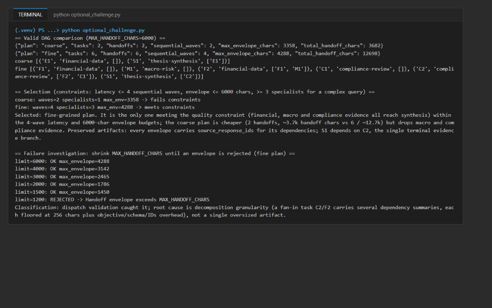

*Figure 19: Optional challenge output: DAG comparison, selection and the envelope-size failure investigation*

---

## Task 7: Review the design

Answer the review questions in the **Review questions** section at the end of this guide.

---

## Task 8: Clean up

**Restore the input file (optional)**

1. If you want to rerun the lab later with the default input, set the hint back to `complex`:

```powershell
$q = 'assets/research-query.json'
(Get-Content $q -Raw) -replace '"complexity_hint"\s*:\s*"\w+"', '"complexity_hint":"complex"' | Set-Content $q -NoNewline -Encoding utf8
```

**Remove the Azure resources (optional, recommended)**

2. Delete the resource group (use the name from `.env` if you opened a new terminal):

```powershell
$resourceGroupName = (Select-String -Path .env -Pattern '^AZURE_RESOURCE_GROUP=').Line.Split('=',2)[1].Trim('"')
az group delete --name $resourceGroupName --yes --no-wait
```

3. After the deletion completes (a few minutes), purge the soft-deleted Foundry account so its name and quota are released:

```powershell
az cognitiveservices account list-deleted --query "[].{name:name, location:location}" -o table
az cognitiveservices account purge --name <foundry-account-name> --resource-group $resourceGroupName --location eastus2
```

4. Confirm the resource group is gone:

```powershell
az group exists --name $resourceGroupName
```

Expected result: `false`.

**Remove local files and deactivate the environment**

5. Remove generated files and deactivate the virtual environment in every terminal that shows `(.venv)`:

```powershell
Remove-Item .env, artifacts-lab03.txt, challenge-output.txt -ErrorAction SilentlyContinue
deactivate
```

---

## Validate

| Acceptance criterion | How to check (CLI) | How to check (portal) |
|---|---|---|
| Preflight: four `PASS`, four `LAB PLACEHOLDER` markers, no `NotImplementedError` | `python scripts/preflight.py`; `Select-String` counts 4 and 0 (Task 4) | n/a |
| `.env` has the five required values | `Get-Content .env` | Deployment outputs on the resource group **Deployments** page |
| Foundry account allows public network access (lab only) | `az cognitiveservices account list ...` shows `Enabled` / `Allow` | Foundry account > **Networking** |
| Complex plan has 3-6 tasks and synthesis last | `Select-String artifacts-lab03.txt -Pattern task_count` | n/a |
| Simple plan has exactly 2 tasks | Same, second `task_count` is 2 | n/a |
| Every dependency precedes its consumer; all agents in the registry | Read `plan` and `results` in `artifacts-lab03.txt` | n/a |
| All results have live `resp_` response IDs | `Select-String artifacts-lab03.txt -Pattern 'response_id'` | Search each ID in **Traces** |
| `research-planner` and four specialists exist | REST agents list (Task 6) | Foundry portal **Agents** |
| Planner trace has name, version, success and timestamp | KQL query (Task 6) | Foundry portal **Traces** |
| Dependent specialists start after prerequisites end; simple run has fewer specialist traces | KQL `timestamp` / `end_time` columns | Foundry portal **Traces** timeline |

---

## Troubleshooting

| Symptom | Cause | Fix |
|---|---|---|
| `401` / `403 PermissionDenied` when creating agents or calling responses | Data-plane roles missing or not yet applied (the Bicep template does not assign them) | Run Task 3 step 2 to grant **Azure AI User**, **Cognitive Services OpenAI User** and **Azure AI Developer**; wait 1-5 minutes and run again |
| `DefaultAzureCredential failed to retrieve a token` | Not signed in to the Azure CLI, or wrong tenant | Run `az login` (add `--tenant <tenant-id>` if needed) and `az account set --subscription <subscription-id>` |
| Deployment fails with `InsufficientQuota` or model/version not available | No `gpt-5.4-mini` GlobalStandard quota in the region | Choose another region with quota, delete the failed resource group, and rerun Task 3 with the new `$azureRegion` |
| `KeyError: 'FOUNDRY_PROJECT_ENDPOINT'` | `.env` missing or written in the wrong folder | Run Task 3 step 3 from the lab folder; confirm `Get-Content .env` shows the endpoint |
| `ValueError: The thesis-synthesis task must depend on every terminal evidence task` (or another `validate_plan` error) | The model returned a plan that breaks an invariant | This is the validator working as designed. Rerun the command; the planner usually returns a valid plan |
| `json.decoder.JSONDecodeError` right after the planner call | The planner returned non-JSON text | Rerun the command |
| `IndentationError` after pasting | Snippet pasted with the wrong indentation | Every line of the replacement code must start with at least 4 spaces (function body level), exactly as shown in Task 4 |
| `replan_count` is `1` in every run | Expected: specialists report `missing_evidence` on the synthetic query; the budget caps the signal at one | No action needed |
| Simple run still returns 3+ tasks | `complexity_hint` is still `complex` | Check the file shows `"complexity_hint":"simple"` and that you saved it |
| No traces in Foundry or Application Insights | Ingestion delay | Wait 5-10 minutes and widen the time range |
| Rerun after the lab shows only 2 tasks | The lab leaves `assets/research-query.json` at `simple` | Restore `complex` (Task 8 step 1) |

---

## Review questions

1. **Which plan invariants must never be delegated to a model?**

Everything that `validate_plan` and the dispatcher enforce in code: a bounded task count (1-6), unique non-empty IDs, only registry-known agents, dependencies that exist and are not self-references, an acyclic graph, exactly one `thesis-synthesis` task that depends on every terminal evidence branch with nothing depending on it, dispatch only after every prerequisite succeeds, a deadlock error instead of an endless loop, a size cap on each handoff envelope, and a replan budget of one. The model proposes a plan; code decides whether it is admissible.

2. **When is a fixed chain cheaper and safer?**

When the query shape is known and stable, such as a simple lookup or a fixed "one evidence source, then synthesis" path. A fixed chain skips the planner call (about 1.7-1.9 seconds and one extra response per run in this lab), has no plan-validation failure mode, and produces the same trace shape every time, which simplifies auditing. Dynamic decomposition pays off only when queries vary enough that a fixed chain would over-process simple work or miss dependencies in complex work.

3. **What context can be summarized without breaking downstream evidence?**

Narrative reasoning, restated assumptions and verbose observations can be truncated to the per-dependency `summary_limit`. Keep verbatim: the `task_id`, the `response_id` / `source_response_ids` that trace each claim to a live response, the objective and `expected_schema`, the correlation ID, and explicit `missing_evidence` and confidence fields. Truncating a JSON summary can cut off trailing `missing_evidence` keys, so specialists should put gaps and confidence first.

4. **Which signal justifies the single replan budget?**

An evidence-driven signal from a completed specialist: a non-success status, a structured `status` of `missing_evidence` or `capability_unavailable`, a non-empty `missing_evidence` field, or a numeric confidence below 0.5. Style or length does not justify a replan. A replan should cover only the remaining DAG and must pass `validate_plan` again. In this lab both runs raised the signal once (`replan_count: 1`), showing the budget caps it instead of letting it loop.

---

## Clean up

This step is optional but recommended to stop charges. If you did not already do it in Task 8, delete the resource group and purge the Foundry account:

```powershell
az group delete --name rg-lab03-<suffix> --yes --no-wait
az cognitiveservices account purge --name <foundry-account-name> --resource-group rg-lab03-<suffix> --location eastus2
```

Then run `deactivate` in every terminal that shows `(.venv)`.

