# Lab 04: Design enterprise-scale agent communication with A2A in Azure

## Overview

**Scenario.** Contoso Capital must connect independently deployed research agents without hardcoded endpoints. Discovery must be based on capabilities, tenant context must never cross tenant boundaries, shared task state must survive process restarts, and contradictory recommendations from different agents need a durable record of how the conflict was resolved.

**What you will build.** You complete a small A2A-compatible agent server that runs on your computer and talks to Azure:

- An agent card endpoint (`/.well-known/agent-card.json`) and a JSON-RPC 2.0 `message/send` endpoint (`/a2a`).
- A discovery registry in Azure Cosmos DB, partitioned by tenant, that routes by tenant, capability, health and heartbeat freshness.
- Shared task state that is protected by ETags (optimistic concurrency).
- A deterministic conflict resolver that writes every decision to a durable audit container.
- A Foundry prompt agent (`contoso-risk-agent`) that answers accepted A2A requests and produces a server-side trace.

**Duration.** About 45-60 minutes.

> **Note:** Cosmos DB, the model deployment, Application Insights and Log Analytics are billable. Do the clean-up task at the end when you are finished. A2A capabilities may be in preview; the lab uses local HTTP endpoints and synthetic data only.

| Component | Azure resource / file | Purpose |
|---|---|---|
| Foundry account + project | `fdry<suffix>` / `lab04-<env>` | Hosts the `gpt-5.4-mini` deployment and the `contoso-risk-agent` prompt agent |
| Model deployment | `gpt-5.4-mini` (2026-03-17, GlobalStandard) | Model used by the agent |
| Cosmos DB (NoSQL) | `cosmos<suffix>`, database `agent-ecosystem` | `registry` (TTL 300 s), `tasks` (TTL -1), `audit` (TTL -1); partition key `/tenantId`; local auth disabled |
| Application Insights + Log Analytics | `appi-lab04-<suffix>`, `log-lab04-<suffix>` | Server-side Foundry traces (30-day retention) |
| A2A server (local) | `src/a2a_server.py` (FastAPI + Uvicorn on port 8000) | Agent card, readiness and JSON-RPC endpoint |
| Registry logic (local) | `src/registry.py` | Register, discover, ETag task updates, conflict audit |
| CLI (local) | `src/main.py` | `register`, `discover` and `send` commands |

## Prerequisites

Install these tools before you start:

- [Python 3.11 or later](https://www.python.org/downloads/)
- [Azure CLI](https://learn.microsoft.com/cli/azure/install-azure-cli) with [Bicep](https://learn.microsoft.com/azure/azure-resource-manager/bicep/install) (`az bicep install`)
- [Visual Studio Code](https://code.visualstudio.com/download) and [Git](https://git-scm.com/downloads)
- PowerShell 7 (the commands in this guide are PowerShell)

Azure permissions: you need an Azure subscription where you can create resource groups, Foundry (Azure AI Services), Cosmos DB and Application Insights resources, and create role assignments (Owner, or Contributor plus User Access Administrator / Role Based Access Control Administrator).

1. Sign in to Azure and select the subscription you want to use:

```powershell
az login
az account set --subscription "<your-subscription-id>"
az account show --output table
```

---

## Task 1: Prepare the lab

1. If you haven't already, clone the lab repository:

```powershell
git clone https://github.com/MicrosoftLearning/mslearn-ai-multi-agents.git
```

2. Open the cloned `mslearn-ai-multi-agents` folder in Visual Studio Code.

3. Open a terminal in VS Code (**Terminal** > **New Terminal**), change to the lab folder and check the tools:

```powershell
cd Allfiles\04-contoso-capital-a2a-communication
az version
az bicep version
python --version
az account show --output table
```

**Expected result:** Azure CLI and Bicep print their versions, Python is 3.11 or later, and `az account show` shows the subscription you want to use.

4. Review the architecture before you change any code. Open `infra/main.bicep`, `src/a2a_server.py`, `src/registry.py` and the files in `assets/`, and confirm that:

- All three Cosmos DB containers use the partition key `/tenantId`, and the tenant value comes from the trusted caller, not from the agent card.
- The `registry` container has a default TTL of 300 seconds (stale cards disappear), while `tasks` and `audit` use TTL `-1` (durable).
- Task updates in `update_task` are protected by ETags (`MatchConditions.IfNotModified`).
- An accepted A2A request reaches the Foundry agent and produces a server-side trace.

---

## Task 2: Build the virtual environment

1. From the lab folder, create the virtual environment, install the packages and activate it:

```powershell
./scripts/setup.ps1
. ./.venv/Scripts/Activate.ps1
```

> **Note:** On macOS/Linux, run `bash scripts/setup.sh` and then `source .venv/bin/activate`.

**Expected result:** pip installs `azure-ai-projects`, `azure-cosmos`, `fastapi`, `uvicorn`, `httpx` and the other packages, and the prompt starts with `(.venv)`.

---

## Task 3: Deploy the Azure resources

You deploy the Bicep template with the Azure CLI (no `azd` needed). The template creates Foundry, the model deployment, Cosmos DB with its three containers, Application Insights and Log Analytics. It also gives your user the Cosmos DB **Built-in Data Contributor** data-plane role, so you pass your own object ID as `principalId`.

1. Choose a region that offers `gpt-5.4-mini` GlobalStandard and Cosmos DB (the lab was tested in `eastus2`).

2. In the lab folder (with `(.venv)` active), run the whole block below. It creates a uniquely named resource group, deploys the template, grants your user the Foundry data-plane roles and writes `.env` from the deployment outputs:

```powershell
$azureRegion = 'eastus2'
$suffix = (New-Guid).Guid.Substring(0, 8)
$resourceGroupName = "rg-lab04-$suffix"
$envName = "lab04-$suffix"
$me = az ad signed-in-user show --query id -o tsv
az group create --name $resourceGroupName --location $azureRegion --output none
az bicep build --file infra/main.bicep
az deployment group create --resource-group $resourceGroupName --name lab04-main `
  --template-file infra/main.bicep `
  --parameters location=$azureRegion environmentName=$envName modelDeploymentName=gpt-5.4-mini modelName=gpt-5.4-mini modelVersion=2026-03-17 principalId=$me `
  --output none
# Grant yourself data-plane access (Foundry agents + model calls)
$rgId = az group show --name $resourceGroupName --query id -o tsv
foreach ($role in 'Azure AI User','Cognitive Services OpenAI User','Azure AI Developer') {
  az role assignment create --assignee-object-id $me --assignee-principal-type User --role $role --scope $rgId --output none
}
# Write .env from the deployment outputs
$outputs = az deployment group show --resource-group $resourceGroupName --name lab04-main --query properties.outputs -o json | ConvertFrom-Json
$lines = @("AZURE_RESOURCE_GROUP=`"$resourceGroupName`"", "AZURE_LOCATION=`"$azureRegion`"", "AZURE_ENV_NAME=`"$envName`"",
  "AZURE_SUBSCRIPTION_ID=`"$(az account show --query id -o tsv)`"", "AZURE_PRINCIPAL_ID=`"$me`"")
$outputs.PSObject.Properties | ForEach-Object { $lines += "$($_.Name.ToUpper())=`"$($_.Value.value)`"" }
$lines | Out-File .env -Encoding utf8
Get-Content .env
```

The deployment takes about 5-10 minutes.

> **Note:** Role assignments can take 1-5 minutes to apply. If a later command returns `403 Forbidden` or `PermissionDenied`, wait a few minutes and run it again.

3. If the deployment fails, read the first error in the output. Common causes are model or region availability, Cosmos DB capacity in the region, quota, or missing permission to create role assignments. Fix the cause (for example, choose another region) and run the block again with a new `$suffix`.

**Expected result:** `.env` contains `COSMOS_ENDPOINT`, `COSMOS_DATABASE_NAME`, `FOUNDRY_PROJECT_ENDPOINT`, `FOUNDRY_PROJECT_ID`, `FOUNDRY_MODEL_NAME`, `APPLICATIONINSIGHTS_RESOURCE_ID` and `LOG_ANALYTICS_WORKSPACE_ID`. It contains no keys or connection strings: the Application Insights connection string is stored only in the Foundry project connection. Do not add a Cosmos key, connection string or token to `.env`.

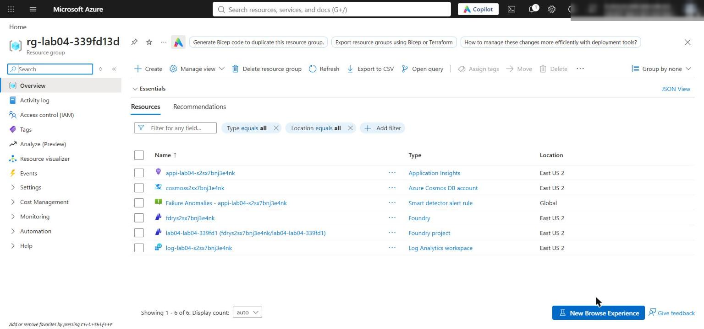

*Figure 1: The lab 04 resource group with Foundry, Cosmos DB, Application Insights and Log Analytics*

4. In the Azure portal, open the Foundry resource (`fdry...`) and confirm that the `gpt-5.4-mini` deployment exists (Foundry portal > **Models + endpoints**, or Azure portal > resource > **Model deployments**).

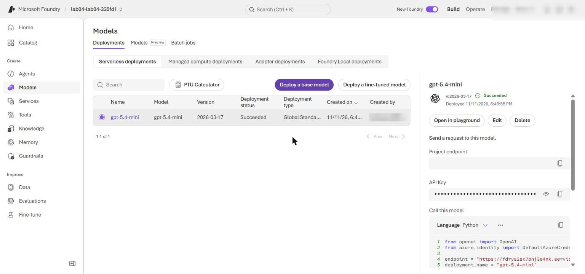

*Figure 2: The gpt-5.4-mini model deployment in the Foundry project*

5. Check the network settings. The template enables public network access on Foundry and Cosmos DB so the local app can reach both data-plane endpoints. Microsoft Entra ID authentication and RBAC are still required (Cosmos DB local key auth is disabled). Run:

```powershell
$foundry = az cognitiveservices account list -g $resourceGroupName --query "[0].name" -o tsv
$cosmos = az cosmosdb list -g $resourceGroupName --query "[0].name" -o tsv
az cognitiveservices account show -g $resourceGroupName -n $foundry --query "{public:properties.publicNetworkAccess, defaultAction:properties.networkAcls.defaultAction}" -o table
az cosmosdb show -g $resourceGroupName -n $cosmos --query "{public:publicNetworkAccess, disableLocalAuth:disableLocalAuth}" -o table
```

**Expected result:** Foundry shows `Enabled` and `Allow`; Cosmos DB shows `Enabled` and `disableLocalAuth True`. Production environments should use selected networks or private endpoints instead.

6. In the Azure portal, open the Cosmos DB account and select **Data Explorer**. Expand `agent-ecosystem` and confirm the `registry`, `tasks` and `audit` containers.

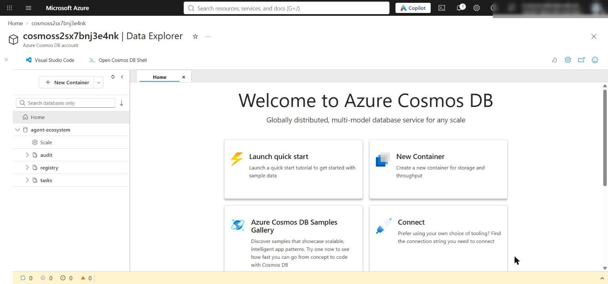

*Figure 3: Cosmos DB Data Explorer with the agent-ecosystem database and its three containers*

---

## Task 4: Implement the solution

Each `LAB PLACEHOLDER` comment marks incomplete code. Keep the `# LAB PLACEHOLDER` comment line, and replace only the `raise NotImplementedError(...)` line under it. Select the whole `raise` line including its leading spaces, then paste the code below. The code blocks are already indented for their position in the file (8 spaces inside the `Registry` methods, 4 spaces inside `handle_message`).

### Placeholder 1: Register a tenant-owned agent card

1. Open `src/registry.py` and find **LAB PLACEHOLDER 1** in `Registry.register`:

```python
        # LAB PLACEHOLDER 1: Replace this line with the Task 1 sample.
        raise NotImplementedError("Complete Registry.register in Task 1")
```

2. Replace the `raise NotImplementedError` line with:

```python
        required_fields = ("id", "url", "capabilities")
        if any(not card.get(field) for field in required_fields):
            raise ValueError("Agent card requires id, url, and capabilities")
        if not isinstance(card["capabilities"], list):
            raise ValueError("Agent card capabilities must be a list")

        entry = {
            **card,
            "tenantId": tenant_id,
            "health": "healthy",
            "heartbeat": int(time.time()),
            "ttl": int(os.getenv("REGISTRY_TTL_SECONDS", "300")),
        }
        return self.registry.upsert_item(entry)
```

The trusted caller supplies `tenant_id`; a card cannot choose its own partition. The health and heartbeat fields let discovery skip stale instances before the container TTL removes abandoned registrations.

### Placeholder 2: Discover a fresh, healthy agent

1. Find **LAB PLACEHOLDER 2** in `Registry.discover`:

```python
        # LAB PLACEHOLDER 2: Replace this line with the Task 2 sample.
        raise NotImplementedError("Complete Registry.discover in Task 2")
```

2. Replace the `raise NotImplementedError` line with:

```python
        cutoff = int(time.time()) - int(os.getenv("HEARTBEAT_MAX_AGE_SECONDS", "120"))
        query = """
        SELECT * FROM c
        WHERE c.tenantId = @tenant
            AND ARRAY_CONTAINS(c.capabilities, @capability)
            AND c.health = "healthy"
            AND c.heartbeat >= @cutoff
        """
        parameters = [
            {"name": "@tenant", "value": tenant_id},
            {"name": "@capability", "value": capability},
            {"name": "@cutoff", "value": cutoff},
        ]
        candidates = list(
            self.registry.query_items(
                query=query,
                parameters=parameters,
                partition_key=tenant_id,
                enable_cross_partition_query=False,
            )
        )
        return sorted(candidates, key=lambda item: float(item.get("load", 1.0)))[:1]
```

The query is parameterized and scoped to one tenant partition. It filters by capability, health and heartbeat freshness (120 seconds), then returns the eligible agent with the lowest load.

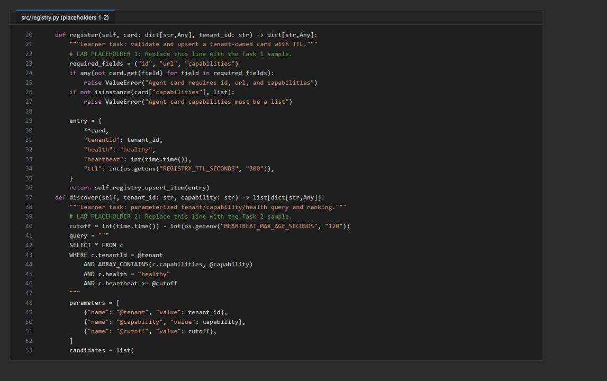

*Figure 4: registry.py after placeholders 1 and 2*

### Placeholder 3: Update shared task state with ETags

1. Find **LAB PLACEHOLDER 3** in `Registry.update_task`:

```python
        # LAB PLACEHOLDER 3: Replace this line with the Task 3 sample.
        raise NotImplementedError("Complete Registry.update_task in Task 3")
```

2. Replace the `raise NotImplementedError` line with:

```python
        for _ in range(3):
            try:
                current = self.tasks.read_item(item=task_id, partition_key=tenant_id)
            except exceptions.CosmosResourceNotFoundError:
                initial = {
                    "id": task_id,
                    "tenantId": tenant_id,
                    "contributions": {agent_id: contribution},
                    "updatedAt": int(time.time()),
                }
                try:
                    return self.tasks.create_item(initial)
                except exceptions.CosmosResourceExistsError:
                    continue

            current.setdefault("contributions", {})[agent_id] = contribution
            current["updatedAt"] = int(time.time())
            try:
                return self.tasks.replace_item(
                    item=current["id"],
                    body=current,
                    etag=current["_etag"],
                    match_condition=MatchConditions.IfNotModified,
                )
            except exceptions.CosmosHttpResponseError as exc:
                if exc.status_code != 412:
                    raise

        raise RuntimeError("Task update failed after three ETag attempts")
```

Creation handles competing writers without overwriting them. Updates are conditional on the ETag that was read; an HTTP 412 triggers a fresh read and reapplies only this agent's contribution, up to three attempts.

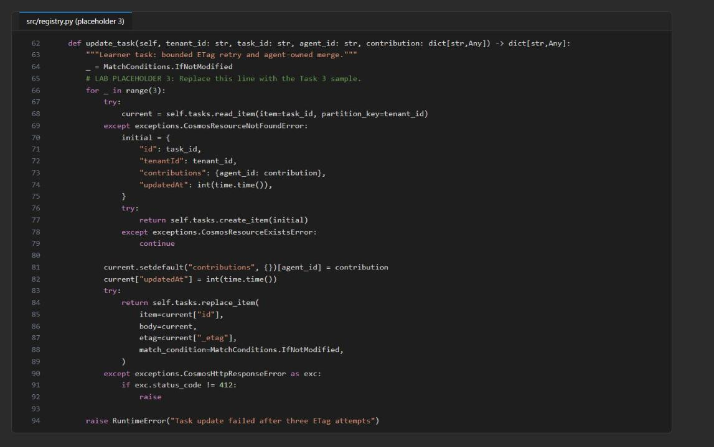

*Figure 5: registry.py after placeholder 3 (ETag-protected update)*

### Placeholder 4: Resolve and audit conflicting outputs

1. Find **LAB PLACEHOLDER 4** in `Registry.resolve_and_audit`:

```python
        # LAB PLACEHOLDER 4: Replace this line with the Task 4 sample.
        raise NotImplementedError("Complete resolve_and_audit in Task 4")
```

2. Replace the `raise NotImplementedError` line with:

```python
        candidates = conflict.get("candidates", [])
        if len(candidates) < 2:
            raise ValueError("A conflict requires at least two candidates")

        priority = {"compliance": 3, "risk": 2, "analysis": 1}
        highest = max(priority.get(item.get("role", ""), 0) for item in candidates)
        winners = [
            item
            for item in candidates
            if priority.get(item.get("role", ""), 0) == highest
        ]
        if highest == 0 or len(winners) != 1:
            resolution = "escalated"
            chosen_agent = None
        else:
            resolution = "priority"
            chosen_agent = winners[0]["agent_id"]

        audit_record = {
            "id": str(uuid.uuid4()),
            "tenantId": tenant_id,
            "taskId": conflict["task_id"],
            "timestamp": int(time.time()),
            "resolution": resolution,
            "chosenAgent": chosen_agent,
            "candidates": [
                {"agent_id": item["agent_id"], "role": item["role"]}
                for item in candidates
            ],
        }
        self.audit.create_item(audit_record)
        return {
            "status": resolution,
            "chosen_agent": chosen_agent,
            "audit_id": audit_record["id"],
        }
```

Compliance outranks risk, which outranks analysis. A tie, or no recognized role, escalates. The audit record keeps the participants and the decision, not model content, endpoints or credentials.

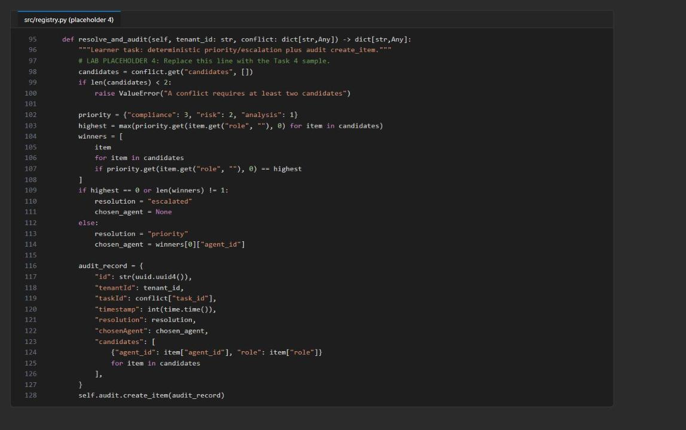

*Figure 6: registry.py after placeholder 4 (deterministic resolution and audit)*

### Placeholder 5: Handle a tenant-scoped JSON-RPC message

1. Open `src/a2a_server.py` and find **LAB PLACEHOLDER 5** in `handle_message`:

```python
    # LAB PLACEHOLDER 5: Replace this line with the Task 5 sample.
    raise NotImplementedError("Complete handle_message in Task 5")
```

2. Replace the `raise NotImplementedError` line with (4-space indentation, because `handle_message` is a module-level function):

```python
    if payload.get("jsonrpc") != "2.0" or payload.get("method") != "message/send":
        raise ValueError("Expected JSON-RPC 2.0 method message/send")
    if "id" not in payload:
        raise ValueError("JSON-RPC request id is required")

    params = payload.get("params", {})
    tenant_id = params.get("tenantId")
    trusted_tenant = os.getenv("A2A_TENANT_ID", "contoso")
    if tenant_id != trusted_tenant:
        raise ValueError("Tenant is unavailable")

    parts = params.get("message", {}).get("parts", [])
    text = "\n".join(
        str(part.get("text", ""))
        for part in parts
        if part.get("kind") == "text" and part.get("text")
    ).strip()
    if not text:
        raise ValueError("At least one text message part is required")

    project = AIProjectClient(
        endpoint=os.environ["FOUNDRY_PROJECT_ENDPOINT"],
        credential=DefaultAzureCredential(),
    )
    agent = project.agents.create_version(
        agent_name=CARD["name"],
        definition=PromptAgentDefinition(
            model=os.environ["FOUNDRY_MODEL_NAME"],
            instructions=(
                "Analyze only synthetic portfolio risk. State assumptions, "
                "identify missing evidence, and do not provide investment advice."
            ),
        ),
    )
    openai = project.get_openai_client(agent_name=agent.name)
    response = openai.responses.create(
        input=text,
    )
    return {
        "jsonrpc": "2.0",
        "id": payload["id"],
        "result": {
            "tenantId": tenant_id,
            "response_id": response.id,
            "text": extract_text(response),
        },
    }
```

The endpoint validates the protocol shape and the tenant before it makes any model call. The agent-bound OpenAI client uses the agent's own endpoint. In production, authenticated middleware would derive the tenant from verified identity claims instead of request JSON.

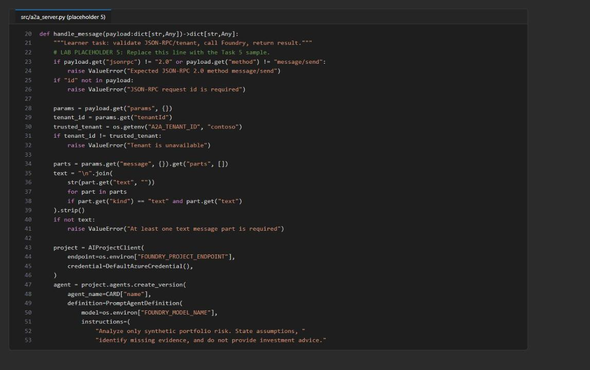

*Figure 7: a2a_server.py after placeholder 5*

### Check the completed code

1. Save both files, then run the side-effect-free checks (no server and no Azure calls):

```powershell
python -m py_compile src/main.py src/registry.py src/a2a_server.py scripts/preflight.py
python scripts/preflight.py
(Select-String -Path src/registry.py,src/a2a_server.py -Pattern 'LAB PLACEHOLDER').Count
(Select-String -Path src/registry.py,src/a2a_server.py -Pattern 'NotImplementedError').Count
```

**Expected result:** `py_compile` prints nothing, preflight prints four `PASS` lines (`python_3_11`, `card_shape`, `jsonrpc`, `syntax`), there are `5` placeholder markers, and `0 NotImplementedError` lines.

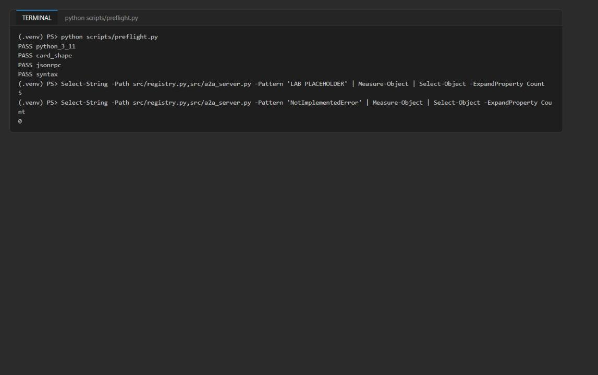

*Figure 8: Preflight checks pass and all five placeholder markers are kept*

---

## Task 5: Run the solution

Use two terminals at the lab folder, both with the virtual environment active. **Terminal 1** runs Uvicorn; **Terminal 2** runs the clients and validation. Environment variables set with `$env:` apply only to the terminal where you set them. Keep Uvicorn running until the clean-up task.

### Start the A2A server

1. In **Terminal 1**, register the agent card and start the server:

```powershell
. ./.venv/Scripts/Activate.ps1
$port = 8000
$env:A2A_TENANT_ID = 'contoso'
$env:A2A_BASE_URL = "http://127.0.0.1:$port"
python -m src.main register --card assets/risk-agent-card.json
python -m uvicorn src.a2a_server:app --host 127.0.0.1 --port $port
```

**Expected result:** `register` prints the stored card with `id: risk-east-v1`, `tenantId: contoso`, `health: healthy`, `ttl: 300` and a recent integer `heartbeat` (Cosmos system fields such as `_etag` vary). Then Uvicorn prints `Uvicorn running on http://127.0.0.1:8000`.

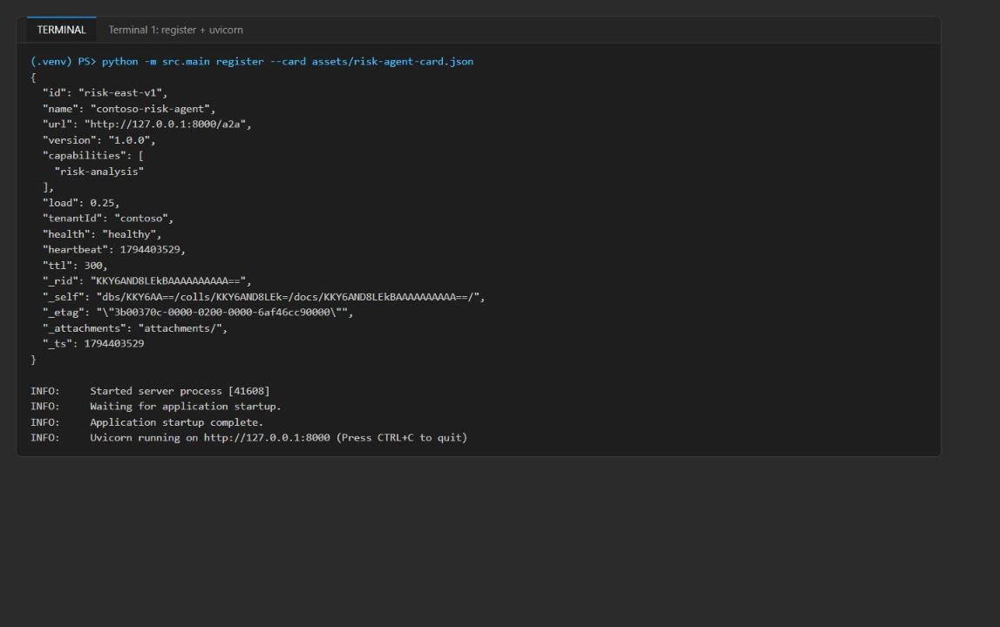

*Figure 9: The card is registered in Cosmos DB and Uvicorn is running*

> **Note:** If port 8000 is in use, choose another port in `$port` and use it in every URL below.

### Run the A2A client commands

1. Open **Terminal 2** (the **+** button in the VS Code terminal panel) and go to the lab folder:

```powershell
cd Allfiles\04-contoso-capital-a2a-communication
. ./.venv/Scripts/Activate.ps1
```

2. Run the client commands:

```powershell
Invoke-RestMethod http://127.0.0.1:8000/
Invoke-RestMethod http://127.0.0.1:8000/.well-known/agent-card.json
python -m src.main discover --tenant contoso --capability risk-analysis
python -m src.main send --url http://127.0.0.1:8000/a2a --message assets/a2a-request.json
```

3. Compare the output with these criteria:

| Operation | Expected evidence |
|---|---|
| HTTP access log (Terminal 1) | `/`, `/.well-known/agent-card.json` and `/a2a` return `200 OK` |
| Readiness | `status: ready` and the agent-card and message endpoint paths |
| Agent card | `name: contoso-risk-agent` and `url: http://127.0.0.1:8000/a2a`; no Cosmos or Foundry endpoint, key or token |
| Discovery | One document for `contoso` with `health: healthy` and capability `risk-analysis` |
| Send | JSON-RPC `2.0`, `id: request-001`, `result.tenantId: contoso`, a populated `result.response_id` and synthetic portfolio-risk text |

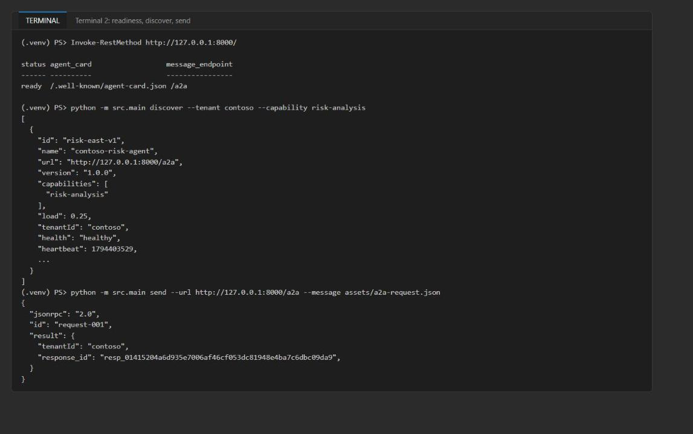

*Figure 10: Readiness, discovery and a JSON-RPC send with a Foundry response_id*

4. Copy the `response_id` value (it starts with `resp_`); you use it to find the trace in Task 6.

> **Note:** If `discover` returns an empty array `[]`, the registration is older than 120 seconds (heartbeat cut-off). Run `python -m src.main register --card assets/risk-agent-card.json` in Terminal 2 and run `discover` again immediately.

5. In the [Foundry portal](https://ai.azure.com), open your project, select **Agents** and confirm that `contoso-risk-agent` exists with a current version (version 1). The version stays at 1 on later sends because the agent definition does not change.

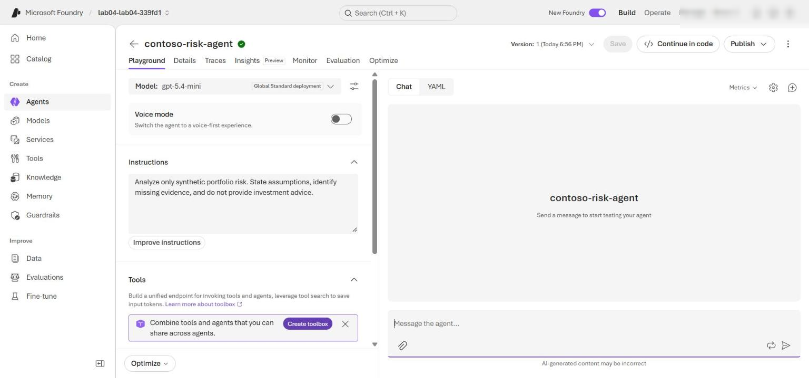

*Figure 11: The contoso-risk-agent version created by the A2A server*

---

## Task 6: Validate the implementation

Keep Uvicorn running in Terminal 1 and run every command in this task in **Terminal 2** with `(.venv)` in the prompt.

### Check the protocol endpoints

1. Run the syntax check and two calls to the server:

```powershell
python -m py_compile src/main.py src/registry.py src/a2a_server.py scripts/preflight.py
Invoke-RestMethod http://127.0.0.1:8000/.well-known/agent-card.json
python -m src.main send --url http://127.0.0.1:8000/a2a --message assets/a2a-request.json
```

**Expected result:** the syntax check returns without an error, the card shows `contoso-risk-agent`, and `send` returns JSON-RPC `2.0`, `id: "request-001"` and a new `result.response_id`.

### Exercise durable shared state and the conflict audit

1. Confirm that `.env` has the Cosmos values and that you are signed in with the account that deployed the lab:

```powershell
Test-Path .env
Get-Content .env | Select-String '^COSMOS_(ENDPOINT|DATABASE_NAME)='
az account show --output table
```

**Expected result:** `True`, then populated `COSMOS_ENDPOINT` and `COSMOS_DATABASE_NAME` lines, then your subscription.

2. Run this whole block, including the first `@'` line and the last `'@ | python -` line. It sends the Python script to the active environment. The script talks to Cosmos DB directly with `DefaultAzureCredential` (not through Uvicorn): it captures a task version, advances the document with a second writer, proves Cosmos DB rejects the stale conditional write with HTTP 412, recovers through the normal `update_task` merge path, and writes the conflict decision to `audit`.

```powershell
@'
import os
from pathlib import Path

from azure.core import MatchConditions
from azure.cosmos import exceptions
from dotenv import load_dotenv
from src.registry import Registry

load_dotenv(Path.cwd() / ".env")
if not os.getenv("COSMOS_ENDPOINT"):
    raise RuntimeError("COSMOS_ENDPOINT is missing from the lab-root .env file")

registry = Registry()
first = registry.update_task("contoso", "task-001", "risk-agent", {"status": "review"})
stale = registry.tasks.read_item(item="task-001", partition_key="contoso")
second = registry.update_task("contoso", "task-001", "compliance-agent", {"status": "hold"})
stale["stale_writer"] = "must-not-persist"
try:
    registry.tasks.replace_item(
        item=stale["id"],
        body=stale,
        etag=stale["_etag"],
        match_condition=MatchConditions.IfNotModified,
    )
    raise AssertionError("The stale ETag write unexpectedly succeeded")
except exceptions.CosmosAccessConditionFailedError as exc:
    print("stale_write_rejected:", exc.status_code)
recovered = registry.update_task(
    "contoso", "task-001", "supervisor-agent", {"status": "conflict-observed"}
)
decision = registry.resolve_and_audit("contoso", {
    "task_id": "task-001",
    "candidates": [
        {"agent_id": "risk-agent", "role": "risk"},
        {"agent_id": "compliance-agent", "role": "compliance"},
    ],
})
print("first_etag:", first["_etag"])
print("second_etag:", second["_etag"])
print("recovered_etag:", recovered["_etag"])
print("decision:", decision)
'@ | python -
```

**Expected result:** `stale_write_rejected: 412`; `first_etag`, `second_etag` and `recovered_etag` are populated and all different; `decision` contains `'status': 'priority'`, `'chosen_agent': 'compliance-agent'` and an `audit_id` UUID. Copy the `audit_id` for the portal check.

3. Read the task back from a new Python process to prove that the state persisted:

```powershell
@'
import os
from pathlib import Path

from dotenv import load_dotenv
from src.registry import Registry

load_dotenv(Path.cwd() / ".env")
if not os.getenv("COSMOS_ENDPOINT"):
    raise RuntimeError("COSMOS_ENDPOINT is missing from the lab-root .env file")

registry = Registry()
task = registry.tasks.read_item(item="task-001", partition_key="contoso")
print("task_id:", task["id"])
print("tenant_id:", task["tenantId"])
print("contributions:", task["contributions"])
print("current_etag:", task["_etag"])
print("stale_writer_present:", "stale_writer" in task)
'@ | python -
```

**Expected result:** `task_id: task-001`, `tenant_id: contoso`, `contributions` contains `risk-agent`, `compliance-agent` and `supervisor-agent`, `current_etag` equals `recovered_etag`, and `stale_writer_present: False`.

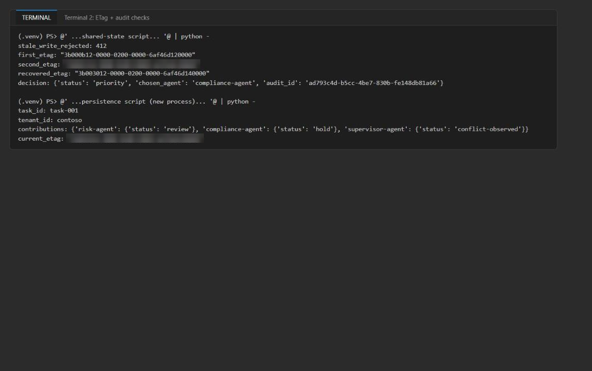

*Figure 12: Stale write rejected with 412, priority decision audited, and the task persisted across processes*

### Check the trace in Foundry

1. In the [Foundry portal](https://ai.azure.com), open your project and select **Agents** > **Traces** (or open `contoso-risk-agent` and select the **Traces** tab).

2. Set the time range to include your requests and search for the `response_id` printed by `send`.

3. Open the matching trace and confirm the agent name (`contoso-risk-agent`), version (`1`), a successful `invoke_agent` / `chat gpt-5.4-mini` operation and its duration (about 1-2 seconds). Allow a few minutes for trace ingestion.

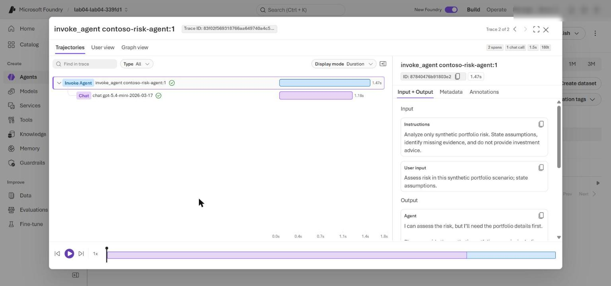

*Figure 13: The Foundry trace for the accepted A2A request*

### Check the Cosmos DB documents in Data Explorer

1. In the Azure portal, open the Cosmos DB account and select **Data Explorer** > **agent-ecosystem** > **registry** > **Items**. The registry deletes inactive cards 5 minutes after the last registration (TTL 300). If **Items** is empty, run this in Terminal 2 and select **Refresh** immediately:

```powershell
python -m src.main register --card assets/risk-agent-card.json
```

2. Open `risk-east-v1` and confirm `tenantId: contoso`, `health: healthy`, the `heartbeat`, `ttl: 300` and the A2A `url`.

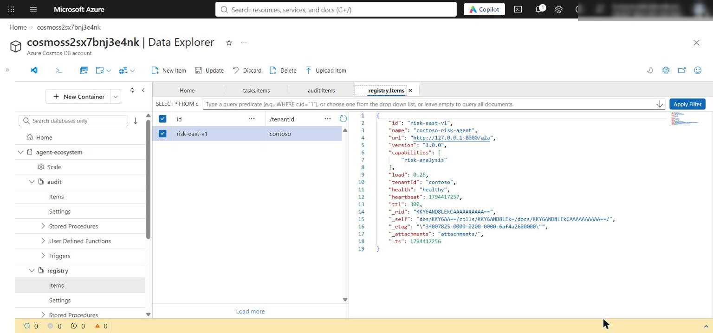

*Figure 14: The tenant-owned registry item with health, heartbeat and TTL*

3. Select **tasks** > **Items** and open `task-001`. Confirm that `contributions` contains `risk-agent`, `compliance-agent` and `supervisor-agent`, that there is no `stale_writer` field, and that `_etag` matches `recovered_etag`.

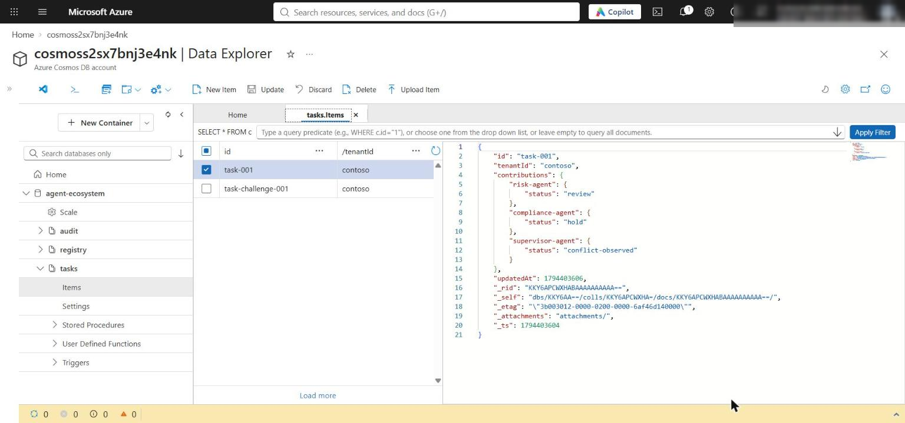

*Figure 15: task-001 keeps all three contributions and no stale_writer field*

4. Select **audit** > **Items** and open the item whose `id` matches your `audit_id`. Confirm `resolution: priority` and `chosenAgent: compliance-agent`. The `tasks` and `audit` containers use TTL `-1`, so these documents stay until you delete them.

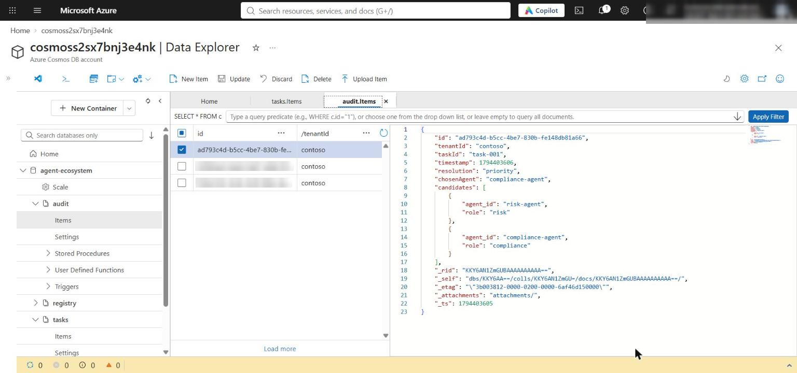

*Figure 16: The durable audit record of the conflict decision*

### Test cross-tenant rejection

1. In Terminal 2, make a temporary copy of the request for tenant `fabrikam` and send it:

```powershell
$request = Get-Content assets/a2a-request.json -Raw | ConvertFrom-Json
$request.id = 'request-fabrikam-001'
$request.params.tenantId = 'fabrikam'
$request | ConvertTo-Json -Depth 10 | Set-Content artifacts-a2a-request-fabrikam.json -Encoding utf8
python -m src.main send --url http://127.0.0.1:8000/a2a --message artifacts-a2a-request-fabrikam.json
```

**Expected result:** Terminal 2 prints the error body below and no `response_id`, and Terminal 1 logs `"POST /a2a HTTP/1.1" 400 Bad Request`.

```json
{
  "detail": "Tenant is unavailable"
}
```

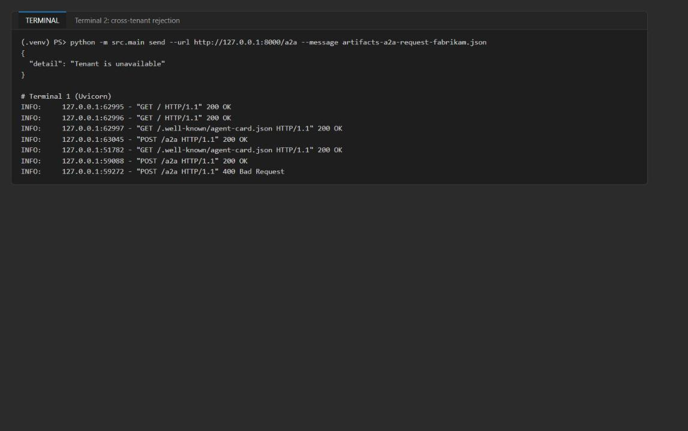

*Figure 17: The fabrikam request is rejected before any model call*

2. Confirm that the rejected request created no Foundry trace (only your accepted `contoso` requests appear in **Traces**) and no `fabrikam` data in Cosmos DB.

3. Remove the temporary request file:

```powershell
Remove-Item artifacts-a2a-request-fabrikam.json
```

Foundry traces prove accepted model calls only. Discovery, JSON-RPC validation, tenant checks, ETag updates and conflict resolution are proven with the HTTP and Cosmos DB evidence above.

### Optional: query the traces with KQL

1. In the Azure portal, open the Application Insights resource (`appi-lab04-...`), select **Logs**, and run this query. You get one `invoke_agent` span (plus one `chat` span) per accepted request, and none for the rejected `fabrikam` request:

```kql
dependencies
| where timestamp > ago(1d)
| where name startswith "invoke_agent" or name startswith "chat"
| project timestamp, name, success, duration,
    responseId = tostring(customDimensions["gen_ai.response.id"]),
    agent = tostring(customDimensions["gen_ai.agent.name"])
| order by timestamp asc
```

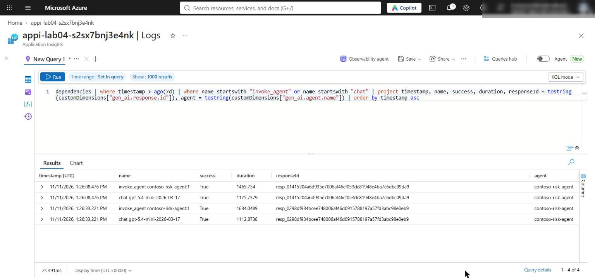

*Figure 18: invoke_agent and chat spans in Application Insights*

### Optional challenge: resolve a concurrent update

1. Two agents propose different values from the same starting ETag. Exactly one write wins, the other gets HTTP 412, the conflict is resolved deterministically, and a second audit item records both proposals (the lab's `resolve_and_audit` stores only agent IDs and roles). Run in Terminal 2:

```powershell
@'
import time
import uuid
from pathlib import Path

from azure.core import MatchConditions
from azure.cosmos import exceptions
from dotenv import load_dotenv
from src.registry import Registry

load_dotenv(Path.cwd() / ".env")
registry = Registry()
tenant, task_id = "contoso", "task-challenge-001"
registry.update_task(tenant, task_id, "analysis-agent", {"status": "draft"})
start = registry.tasks.read_item(item=task_id, partition_key=tenant)
print("starting_etag:", start["_etag"])

proposals = [
    ("risk-agent", "risk", {"limit": "reduce-exposure"}),
    ("compliance-agent", "compliance", {"limit": "hold-pending-review"}),
]
outcomes = []
for agent_id, role, proposed in proposals:
    body = dict(start)
    body["contributions"] = {**start.get("contributions", {}), agent_id: proposed}
    try:
        saved = registry.tasks.replace_item(
            item=task_id,
            body=body,
            etag=start["_etag"],
            match_condition=MatchConditions.IfNotModified,
        )
        print(f"{agent_id}: succeeded new_etag={saved['_etag']}")
        outcomes.append({"agent_id": agent_id, "role": role, "proposed": proposed, "outcome": "succeeded"})
    except exceptions.CosmosAccessConditionFailedError as exc:
        print(f"{agent_id}: rejected status={exc.status_code} (stale ETag)")
        outcomes.append({"agent_id": agent_id, "role": role, "proposed": proposed, "outcome": "rejected 412"})

decision = registry.resolve_and_audit(tenant, {
    "task_id": task_id,
    "candidates": [{"agent_id": a, "role": r} for a, r, _ in proposals],
})
print("decision:", decision)

proposal_audit = {
    "id": str(uuid.uuid4()),
    "tenantId": tenant,
    "taskId": task_id,
    "type": "concurrent-proposals",
    "timestamp": int(time.time()),
    "decisionAuditId": decision["audit_id"],
    "proposals": outcomes,
}
registry.audit.create_item(proposal_audit)
print("proposal_audit_id:", proposal_audit["id"])

leak = list(registry.audit.query_items(
    query="SELECT c.id FROM c WHERE c.taskId = @task",
    parameters=[{"name": "@task", "value": task_id}],
    partition_key="fabrikam",
))
print("cross-tenant leakage check (fabrikam audit docs):", leak)

try:
    registry.tasks.replace_item(
        item=task_id, body=start, etag=start["_etag"],
        match_condition=MatchConditions.IfNotModified,
    )
except exceptions.CosmosAccessConditionFailedError as exc:
    print("stale_etag_resubmit_rejected:", exc.status_code)
'@ | python -
```

**Expected result:** `risk-agent: succeeded`, `compliance-agent: rejected status=412 (stale ETag)`, a `priority` decision for `compliance-agent`, a `proposal_audit_id`, an empty `fabrikam` leakage list `[]`, and `stale_etag_resubmit_rejected: 412`. To investigate a failure, trace the stale ETag through protocol validation, state access (`replace_item`), conflict handling (`resolve_and_audit`) and audit logging (`audit` container).

---

## Task 7: Review the design

Record brief answers to the four review questions. Model answers are in the **Review questions** section at the end of this guide.

---

## Task 8: Clean up

1. In Terminal 1, stop Uvicorn with **Ctrl+C**.

2. Run `deactivate` in Terminal 1 and Terminal 2, and confirm `(.venv)` is gone from both prompts.

3. Optional (recommended when you are finished): delete the Azure resources. See **Clean up** at the end of this guide.

## Validate

| Acceptance criterion | How to check (CLI) | How to check (portal) |
|---|---|---|
| `register` returns id, tenant, health, TTL and heartbeat | Terminal 1 output: `risk-east-v1`, `contoso`, `healthy`, `ttl: 300` | Data Explorer > registry > `risk-east-v1` |
| `/`, agent card and `/a2a` return 200 | Uvicorn access log in Terminal 1 | - |
| Agent card hides Cosmos/Foundry endpoints and secrets | `Invoke-RestMethod .../.well-known/agent-card.json` | - |
| Discovery returns one fresh healthy `risk-analysis` card for `contoso` | `python -m src.main discover ...` | - |
| Send returns JSON-RPC 2.0, `request-001`, tenant `contoso`, `response_id` and risk text | `python -m src.main send ...` | Foundry **Traces**, search the `response_id` |
| Agent version exists | - | Foundry **Agents** > `contoso-risk-agent` |
| Stale write rejected with 412; three different ETags | Shared-state script output | - |
| Decision `priority` / `compliance-agent` with `audit_id` | Shared-state script output | Data Explorer > audit > item `audit_id` |
| Task persisted with three contributions and no `stale_writer` | Persistence script output | Data Explorer > tasks > `task-001` |
| Cross-tenant request rejected with 400, no `response_id`, no trace | `send` with the fabrikam file; Terminal 1 log | Traces show only accepted requests |

## Troubleshooting

- **`discover` returns `[]`.** The card's heartbeat is older than 120 seconds, or the registry item expired (TTL 300 s). Run `python -m src.main register --card assets/risk-agent-card.json` again and retry immediately.
- **Data Explorer shows no registry items.** Same cause: the `registry` container deletes cards 5 minutes after the last registration. Register again and select **Refresh**.
- **`403 Forbidden` from Cosmos DB or Foundry.** Role assignments take 1-5 minutes to apply. Cosmos DB has local (key) auth disabled, so your user needs the Cosmos DB Built-in Data Contributor role from the Bicep (`principalId` parameter) and the Foundry roles from the deployment block. Confirm you passed `principalId=$me` and that `az account show` shows the deploying account.
- **`COSMOS_ENDPOINT is missing from the lab-root .env file`.** Run the scripts from the lab folder. Recreate `.env` with the last part of the Task 3 block (from `$outputs = ...`) if needed.
- **The `@' ... '@ | python -` block does not run.** Make sure you copied the whole block, that `'@` is at the start of its line, and that `(.venv)` is active. As an alternative, save the Python text as `check_state.py` in the lab folder and run `python check_state.py` (then delete the file).
- **Traces do not show up yet.** Ingestion can take several minutes; widen the time range. You can also check with the KQL query in Task 6.
- **Agent version stays at 1.** Expected: `create_version` reuses the version when the definition does not change.

## Review questions

**Why does tenant ownership come from the trusted caller rather than the agent card?** The card is self-declared by the agent being registered. If it could set `tenantId`, any agent could place itself in another tenant's partition and be discovered for that tenant's requests. `register` overwrites `tenantId` with the trusted caller's value (in production, from verified identity claims), and `/a2a` checks against `A2A_TENANT_ID` for the same reason.

**Why can the discovery registry expire while the audit container remains durable?** Registry entries describe live, routable instances; a card without a recent heartbeat must stop receiving traffic, so the 120-second heartbeat filter and the 300-second TTL clean up abandoned registrations. Audit records are evidence of decisions and are needed long after the agents are gone, so `tasks` and `audit` use TTL -1.

**How do ETags prevent one agent from silently overwriting another agent's contribution?** Each replace is conditional on the `_etag` that was read (`IfNotModified`). If another agent wrote in between, Cosmos DB returns HTTP 412 instead of last-writer-wins. `update_task` then rereads and reapplies only its own `contributions[agent_id]` entry, up to three attempts, so other agents' entries are kept.

**Which conflict decisions must remain deterministic rather than being delegated to an agent?** Role precedence (compliance > risk > analysis), escalation on ties or unknown roles, tenant boundary enforcement and what goes into the audit record. These must be reproducible, explainable and safe from prompt injection and model variance; agents supply candidates, code applies the policy.

## Clean up (optional)

Delete the resource group when you no longer need the lab. This removes Foundry, Cosmos DB, Application Insights and Log Analytics:

```powershell
az group delete --name <rg-lab04-xxxxxxxx> --yes --no-wait
```

The Foundry (Cognitive Services) account is soft-deleted. To free the name and quota immediately, purge it after the resource group is gone:

```powershell
az cognitiveservices account list-deleted --query "[].{name:name, location:location}" -o table
az cognitiveservices account purge --name <fdry-account-name> --resource-group <rg-lab04-xxxxxxxx> --location eastus2
```

