# Lab 06: Build an enterprise MCP tool ecosystem

## Overview

**Scenario.** Northwind Health is replacing agent-specific integrations with a governed clinical tool catalog. The first release exposes synthetic drug-interaction and appointment-capacity tools through the Model Context Protocol (MCP), records correlation-safe telemetry, and gives clients a reliable fallback when a dependency is unavailable.

**What you will build.** As the Python developer who owns the MCP boundary, you:

- Complete a FastMCP server with two versioned tools, structured `not_found` results and scrubbed telemetry.
- Implement an MCP client that initializes a real MCP session, discovers tools at runtime and invokes the selected tool.
- Select a compatible tool from catalog metadata (lifecycle, major version, latency).
- Validate tool results against the catalog's output schema and route failures to a governed fallback.
- Deploy the server to Azure Container Apps behind Microsoft Entra authentication and call it remotely.

The request path is: **MCP discovery -> catalog selection -> tool invocation -> result validation -> governed fallback**.

**Duration.** About 60 minutes.

> **Note:** Azure Container Apps, Azure Container Registry (Basic) and Log Analytics are billable. Do the local tasks first, and clean up as soon as you are finished. The server uses synthetic data only and must not be used for clinical decisions.

> **Note:** This guide does **not** need Docker. The official lab builds the image locally with `azd deploy`; here the image is built in the cloud with `az acr build` and pushed to an Azure Container Registry that you create.

| Component | Azure resource / file | Purpose |
|---|---|---|
| Entra app registration | `lab06-mcp-api-<n>` (`api://<appId>`, scope `access_as_user`) | Protects the MCP API; Azure CLI is pre-authorized for the scope |
| Container Apps environment | `cae-<env>-<suffix>` | Hosts the MCP server, logs to Log Analytics |
| Container App | `mcp-<env>-<suffix>` | External HTTPS ingress on port 8000, Entra auth (`Return401`), system-assigned identity |
| Container registry | `cr<env>` (Basic) | Holds the `mcp:v1` image built with `az acr build` |
| Log Analytics | `log-<env>-<suffix>` | Container logs (30-day retention) |
| `src/server.py` | FastMCP server | `lookup_drug_interaction`, `get_appointment_capacity` |
| `src/client.py` | MCP client | Session init, `tools/list`, `tools/call`, bearer token for remote URLs |
| `src/catalog.py`, `assets/tool-catalog.json` | Catalog | Version, lifecycle, latency, output schema and fallback per tool |
| `src/result_validation.py` | Validator | JSON Schema check, else the catalog fallback |

## Prerequisites

- [Python 3.11 or later](https://www.python.org/downloads/)
- [Git](https://git-scm.com/downloads) and [Visual Studio Code](https://code.visualstudio.com/download) with the [Python](https://marketplace.visualstudio.com/items?itemName=ms-python.python) and [Bicep](https://marketplace.visualstudio.com/items?itemName=ms-azuretools.vscode-bicep) extensions
- [Azure CLI](https://learn.microsoft.com/cli/azure/install-azure-cli) with Bicep (`az bicep install`); the `containerapp` extension installs automatically the first time you use it
- PowerShell 7 and `curl.exe` (included in Windows 10/11)

Azure and Entra permissions: you need to create a resource group, Log Analytics, a Container Apps environment and app, a container registry and an `AcrPull` role assignment (Owner, or Contributor plus User Access Administrator), and you must be able to create an app registration in Microsoft Entra ID (allowed for users by default in most tenants).

1. Sign in and select your subscription:

```powershell
az login
az account set --subscription "<your-subscription-id>"
az account show --output table
```

---

## Task 1: Prepare the lab

1. If you haven't already, clone the lab repository:

```powershell
git clone https://github.com/MicrosoftLearning/mslearn-ai-multi-agents.git
```

2. Open the `mslearn-ai-multi-agents` folder in Visual Studio Code.

3. Open a terminal, go to the lab folder and check the tools:

```powershell
cd Allfiles\06-northwind-health-mcp-tools
az version
az bicep version
python --version
az account show --output table
```

4. Review `infra/main.bicep`, `infra/resources.bicep`, the JSON files in `assets/` and the four files you will complete:

| File | What you implement |
|---|---|
| `src/server.py` | Both MCP tool handlers and their safe `not_found` responses |
| `src/client.py` | MCP session initialization, tool discovery and invocation of the selected tool |
| `src/catalog.py` | Filter discovered tools by active lifecycle and matching major version |
| `src/result_validation.py` | Validate structured content against the catalog schema |

5. Note the two kinds of checks in this lab: local checks against `http://127.0.0.1:8000/mcp` (no token), and remote checks against the Container App, where every client request carries an Entra access token from `DefaultAzureCredential`. The client allows a missing token only for `localhost` and `127.0.0.1`. Never put API keys, passwords, patient identifiers or tokens in `.env`.

---

## Task 2: Build the virtual environment

1. From the lab folder, create and activate the virtual environment:

```powershell
./scripts/setup.ps1
. ./.venv/Scripts/Activate.ps1
```

> **Note:** On macOS/Linux, run `bash scripts/setup.sh` and then `source .venv/bin/activate`.

**Expected result:** `mcp`, `httpx`, `jsonschema`, `azure-identity` and the other packages install, and the prompt starts with `(.venv)`.

---

## Task 3: Implement the solution

Each `LAB PLACEHOLDER` comment marks incomplete code. Keep the comment line, select the `raise NotImplementedError(...)` line below it (including its leading spaces) and paste the replacement. The code below is indented with 4 spaces per level, matching the files. After each paste, check that the first line lines up with the `# LAB PLACEHOLDER` comment above it.

### Placeholder 1: Drug-interaction lookup

1. Open `src/server.py` and find:

```python
    # LAB PLACEHOLDER 1: Replace this line with the Task 1 sample.
```

2. Replace the `raise NotImplementedError` line under it with:

```python
    requested_pair = sorted((drug_a.strip().casefold(), drug_b.strip().casefold()))
    for record in _load_json("drug_interactions.json"):
        stored_pair = sorted(str(drug).casefold() for drug in record["drugs"])
        if requested_pair == stored_pair:
            _log_invocation("lookup_drug_interaction", correlation_id, "ok")
            return {
                "status": "ok",
                "severity": record["severity"],
                "guidance": record["guidance"],
            }
    _log_invocation("lookup_drug_interaction", correlation_id, "not_found")
    return {"status": "not_found", "reason": "pair_not_in_synthetic_catalog"}
```

Sorting makes the pair order-independent. The tool logs no medication values, and an unknown pair returns `not_found` instead of invented guidance.

### Placeholder 2: Capacity lookup

1. In `src/server.py`, find `# LAB PLACEHOLDER 2: Replace this line with the Task 2 sample.` and replace the `raise NotImplementedError` line under it with:

```python
    normalized_site = site.strip().casefold()
    for record in _load_json("appointment_capacity.json"):
        if str(record["site"]).casefold() == normalized_site and record["date"] == date:
            _log_invocation("get_appointment_capacity", correlation_id, "ok")
            return {"status": "ok", **record}
    _log_invocation("get_appointment_capacity", correlation_id, "not_found")
    return {"status": "not_found", "reason": "capacity_not_in_synthetic_catalog"}
```

The tool signature has no patient identifier, so patient data stays outside the protocol boundary.

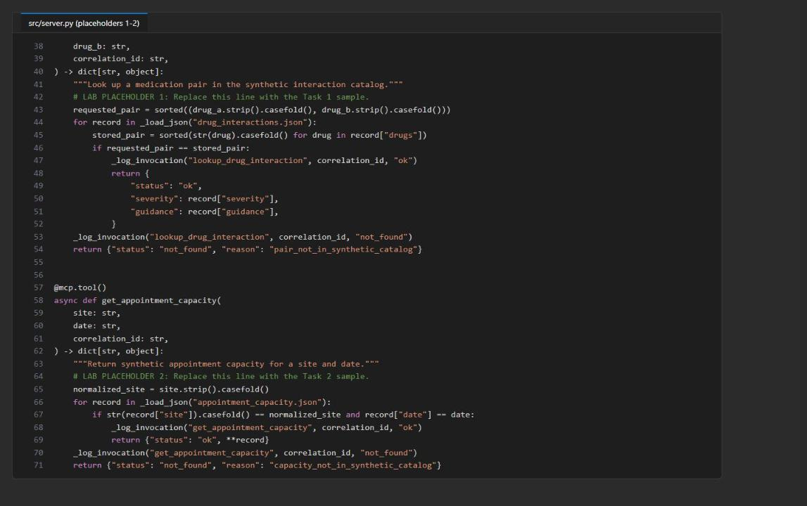

*Figure 1: server.py with both tool handlers completed*

### Placeholder 3: Select a governed tool

1. Open `src/catalog.py`, find `# LAB PLACEHOLDER 3: Replace this line with the Task 3 sample.` and replace the `raise NotImplementedError` line under it with:

```python
    candidates = [
        entry
        for entry in load_catalog()["tools"]
        if entry["name"] == requested_name
        and entry["name"] in discovered_names
        and entry["lifecycle"] == "active"
        and int(entry["version"].split(".", maxsplit=1)[0]) == required_major
    ]
    if not candidates:
        raise ValueError(
            f"No active discovered {requested_name!r} tool supports major {required_major}"
        )
    return min(candidates, key=lambda entry: entry["p95_latency_ms"])
```

Protocol discovery proves that a tool is available; the catalog adds lifecycle, compatibility and latency policy.

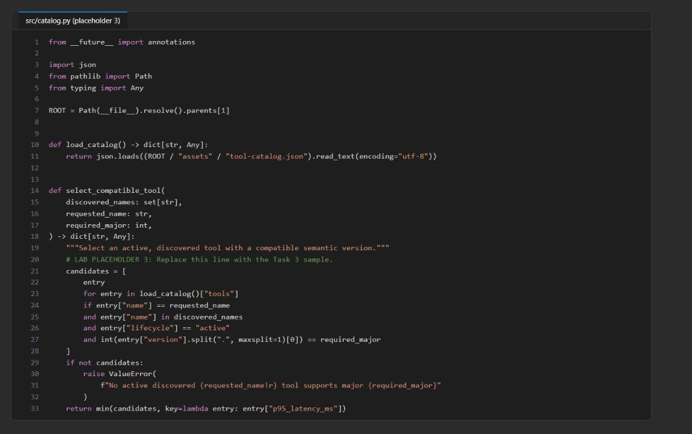

*Figure 2: select_compatible_tool after placeholder 3*

### Placeholder 4: Discover tools through MCP

1. Open `src/client.py`, find `# LAB PLACEHOLDER 4: Replace this line with the Task 4 sample.` (in `discover_tools`) and replace the `raise NotImplementedError` line under it with:

```python
    async with streamablehttp_client(server_url, headers=headers) as (read, write, _):
        async with ClientSession(read, write) as session:
            await session.initialize()
            discovered = await session.list_tools()
            return [
                {
                    "name": tool.name,
                    "description": tool.description,
                    "inputSchema": tool.inputSchema,
                }
                for tool in discovered.tools
            ]
```

`initialize()` negotiates the MCP session before `tools/list`, and the returned protocol schemas keep discovery observable.

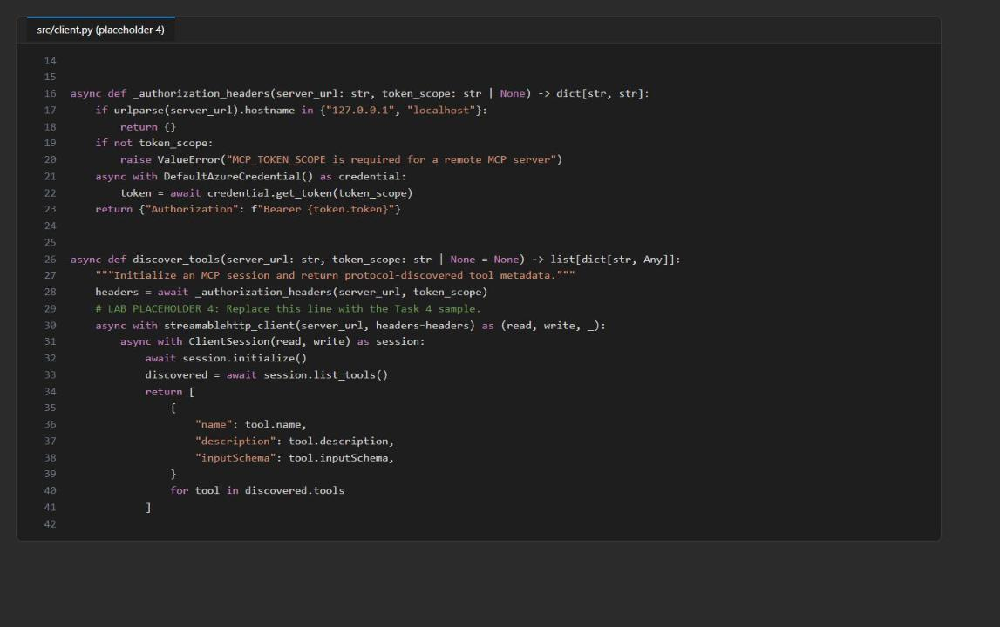

*Figure 3: discover_tools after placeholder 4*

### Placeholder 5: Invoke the selected tool

1. In `src/client.py`, find `# LAB PLACEHOLDER 5: Replace this line with the Task 5 sample.` (in `call_catalog_tool`) and replace the `raise NotImplementedError` line under it with:

```python
    async with streamablehttp_client(server_url, headers=headers) as (read, write, _):
        async with ClientSession(read, write) as session:
            await session.initialize()
            discovered = await session.list_tools()
            catalog_entry = select_compatible_tool(
                {tool.name for tool in discovered.tools},
                request["tool"],
                int(request["required_major"]),
            )
            try:
                tool_result = await session.call_tool(
                    catalog_entry["name"], arguments=request["arguments"]
                )
            except httpx.HTTPError:
                return dict(catalog_entry["fallback"])

            structured = getattr(tool_result, "structuredContent", None)
            if structured is None:
                structured = getattr(tool_result, "structured_content", None)
            if structured is None and tool_result.content:
                structured = json.loads(tool_result.content[0].text)
            if not isinstance(structured, dict):
                return dict(catalog_entry["fallback"])
            return validate_or_fallback(structured, catalog_entry)
```

The client prefers structured MCP content, accepts both SDK field spellings, and decodes text content only as a compatibility fallback.

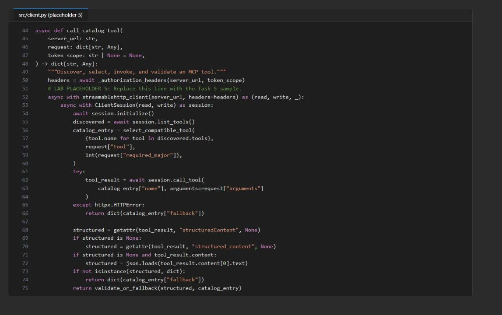

*Figure 4: call_catalog_tool after placeholder 5*

### Placeholder 6: Enforce the output contract

1. Open `src/result_validation.py`, find `# LAB PLACEHOLDER 6: Replace this line with the Task 6 sample.` and replace the `raise NotImplementedError` line under it with:

```python
    try:
        validate(instance=result, schema=catalog_entry["output_schema"])
    except ValidationError:
        return dict(catalog_entry["fallback"])
    return result
```

Only schema violations become the governed fallback; programming and configuration errors stay visible.

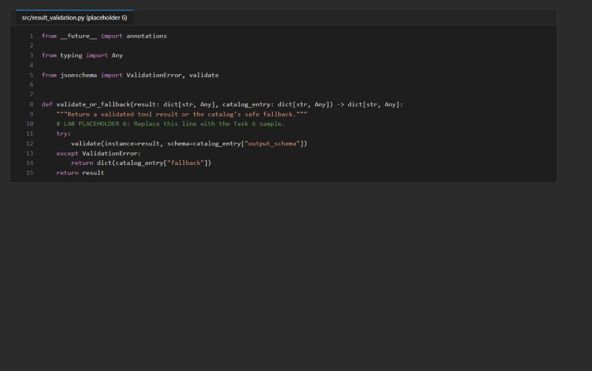

*Figure 5: validate_or_fallback after placeholder 6*

2. Save all files and check the syntax:

```powershell
Get-ChildItem src,scripts -Filter *.py -Recurse | ForEach-Object { python -m py_compile $_.FullName }
```

**Expected result:** no output (no syntax or indentation errors).

---

## Task 4: Run the solution

1. In **Terminal 1** (with `(.venv)` active), start the MCP server and keep a copy of its log for the telemetry check in Task 5:

```powershell
python -m src.server 2>&1 | Tee-Object -FilePath server-local.log
```

**Expected result:** `StreamableHTTP session manager started` and `Uvicorn running on http://0.0.0.0:8000`. Keep this terminal running during all local tasks.

2. Open **Terminal 2** (the **+** button in the terminal panel), go to the lab folder, activate the environment and discover the tools:

```powershell
cd Allfiles\06-northwind-health-mcp-tools
. ./.venv/Scripts/Activate.ps1
python -m src.main discover --server-url http://127.0.0.1:8000/mcp
```

**Expected result:** `lookup_drug_interaction` and `get_appointment_capacity`, each with `name`, `description` and `inputSchema` (`drug_a`, `drug_b`, `correlation_id` and `site`, `date`, `correlation_id`). These contracts come from an initialized MCP session, not from the local catalog file.

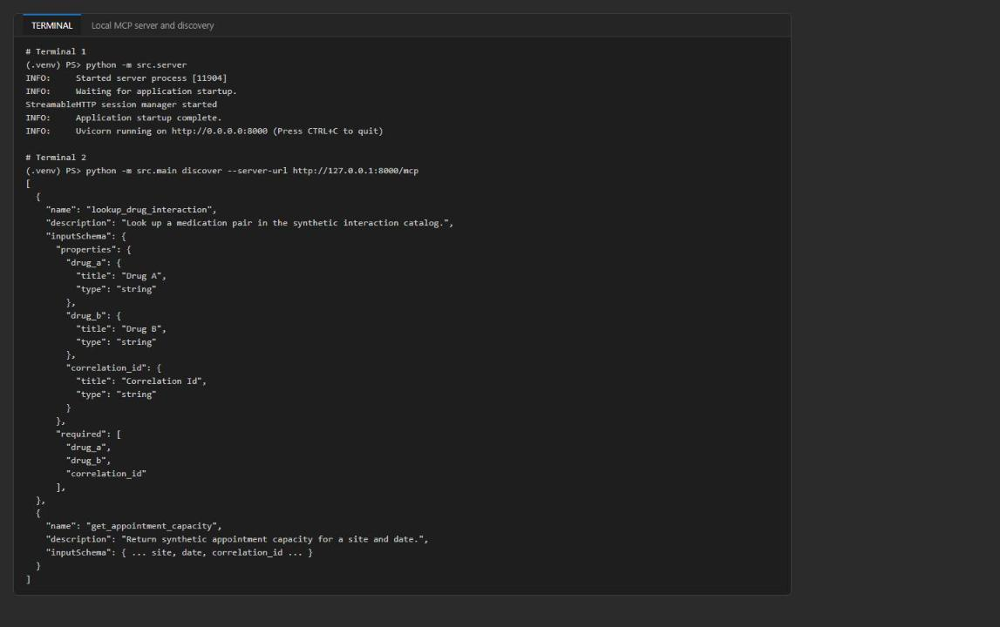

*Figure 6: The local MCP server and runtime tool discovery*

3. Invoke each tool through the MCP client:

```powershell
python -m src.main call --server-url http://127.0.0.1:8000/mcp --request assets/request-drug.json
python -m src.main call --server-url http://127.0.0.1:8000/mcp --request assets/request-capacity.json
```

**Expected result:** the drug request selects active major version 1, looks up the synthetic atorvastatin/clarithromycin pair and passes the catalog `output_schema`:

```json
{
  "status": "ok",
  "severity": "high",
  "guidance": "Synthetic record: pause automated workflow and consult a pharmacist."
}
```

The capacity request uses the same governed path (no appointment is reserved and no scheduling system is called):

```json
{
  "status": "ok",
  "site": "northwind-central",
  "date": "2026-09-28",
  "available_slots": 4
}
```

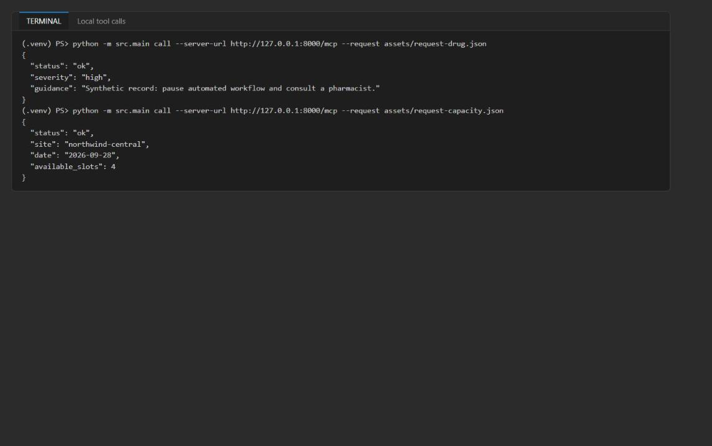

*Figure 7: Both tools return schema-valid synthetic results*

`ok` means a catalog match passed the schema, not clinical approval. The response does not echo the medication arguments or the correlation ID.

---

## Task 5: Validate the local implementation

1. With the server still running, run the local checks in Terminal 2:

```powershell
python scripts/preflight.py
python -m src.main discover --server-url http://127.0.0.1:8000/mcp
python -m src.main call --server-url http://127.0.0.1:8000/mcp --request assets/request-drug.json
```

**Expected result:** preflight ends with `Preflight passed.` and discovery and the drug call match Task 4. (Before deployment, preflight shows `Local MCP URL configured: False` and `Remote token scope configured: False`; that is expected.)

2. Test the governed fallback with an unknown drug. This temporarily changes `drug_a` in `assets/request-drug.json`, runs the call, and restores the file:

```powershell
$requestPath = 'assets/request-drug.json'
$original = Get-Content $requestPath -Raw
$request = $original | ConvertFrom-Json
$request.arguments.drug_a = 'synthetic-unknown-drug'
$request | ConvertTo-Json -Depth 10 | Set-Content $requestPath -Encoding utf8
python -m src.main call --server-url http://127.0.0.1:8000/mcp --request $requestPath
Set-Content $requestPath -Value $original -NoNewline -Encoding utf8
(Get-Content $requestPath -Raw | ConvertFrom-Json).arguments.drug_a
```

**Expected result:** the handler returns `not_found`, which fails the success schema and becomes the governed fallback; the last line shows that `drug_a` is back to `atorvastatin`:

```json
{
  "status": "unavailable",
  "reason": "result_validation_failed",
  "fallback": "consult_pharmacist"
}
```

The capacity tool uses `contact_scheduling_desk` as its corresponding fallback. The client must never treat missing or invalid data as clinical evidence.

3. Check the scrubbed telemetry. Terminal 1 logs one `mcp_tool_invocation` event per call with only `event`, `tool_name`, `correlation_id` and `status`. Confirm that no medication value reached the log:

```powershell
Select-String -Path server-local.log -Pattern '"event"'
(Select-String -Path server-local.log -Pattern 'atorvastatin|clarithromycin|synthetic-unknown-drug').Count
```

**Expected result:** the invocation events (`ok`, `ok`, `not_found` ...) and a count of `0`.

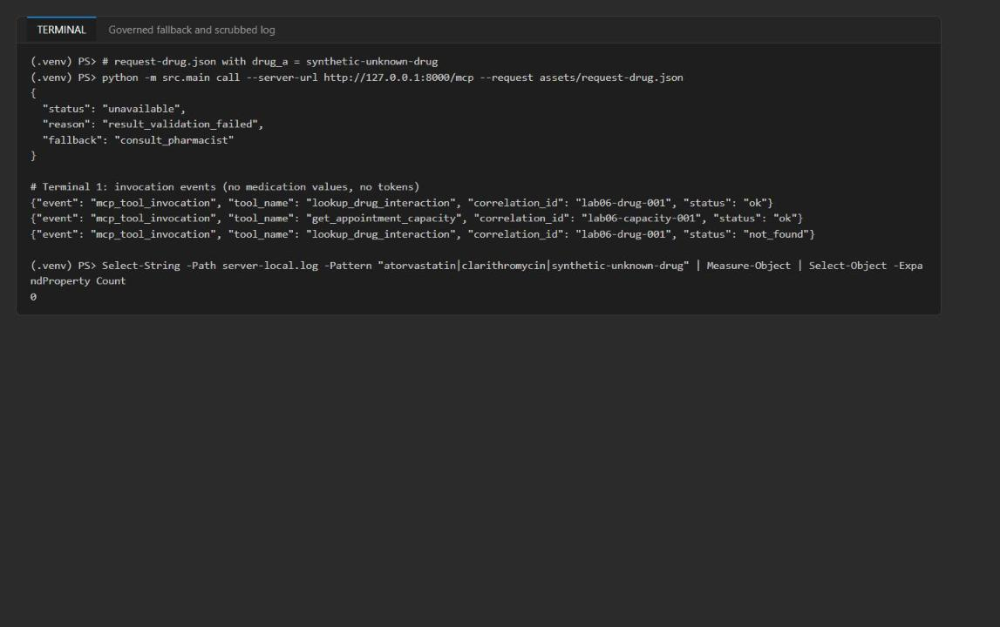

*Figure 8: The unknown pair becomes the governed fallback and the log holds no medication values*

4. Stop the local server in Terminal 1 with **Ctrl+C** when you are done with local validation.

---

## Task 6: Deploy the Azure resources

You deploy with the Azure CLI only: an Entra app registration that protects the API, the Bicep template (Log Analytics, Container Apps environment, Container App with Entra authentication), and then a container registry where the image is built in the cloud. Run all steps in **Terminal 2**, in the lab folder, in the same PowerShell session (later steps reuse the variables).

### Set the deployment values and create the resource group

1. Choose a region that offers Azure Container Apps (the lab was tested in `eastus2`) and run:

```powershell
$azureRegion = 'eastus2'
$suffix = (New-Guid).Guid.Substring(0, 8)
$resourceGroupName = "rg-lab06-$suffix"
$envName = "lab06-$suffix"
$tenantId = az account show --query tenantId -o tsv
az group create --name $resourceGroupName --location $azureRegion --output none
```

### Create the Entra API app registration and its scope

1. Create the app registration and give it the identifier URI `api://<appId>` and a delegated scope `access_as_user`:

```powershell
$app = az ad app create --display-name "lab06-mcp-api-$(Get-Random)" | ConvertFrom-Json
$scopeId = [guid]::NewGuid().ToString()
$body = @{ identifierUris = @("api://$($app.appId)"); api = @{ oauth2PermissionScopes = @(@{ adminConsentDescription = 'Call the Northwind MCP lab API'; adminConsentDisplayName = 'Call Northwind MCP API'; id = $scopeId; isEnabled = $true; type = 'User'; userConsentDescription = 'Call the Northwind MCP lab API'; userConsentDisplayName = 'Call Northwind MCP API'; value = 'access_as_user' }) } } | ConvertTo-Json -Depth 8 -Compress
$manifestPath = Join-Path $PWD '.lab06-app-manifest.json'
$body | Set-Content $manifestPath -Encoding utf8
try {
  az rest --method PATCH --url "https://graph.microsoft.com/v1.0/applications/$($app.id)" --headers Content-Type=application/json --body "@$manifestPath"
} finally {
  Remove-Item $manifestPath -ErrorAction SilentlyContinue
}
"App (client) ID: $($app.appId)"
"App object ID:   $($app.id)"
```

### Pre-authorize the Azure CLI for the API scope

1. The remote client gets its token through `DefaultAzureCredential`, which uses your Azure CLI sign-in. Without consent, the token request fails with `AADSTS65001: The user or administrator has not consented to use the application with ID '04b07795-8ddb-461a-bbee-02f9e1bf7b46' named 'Microsoft Azure CLI'`. Instead of waiting for an administrator to grant consent, pre-authorize the Azure CLI client application (`04b07795-8ddb-461a-bbee-02f9e1bf7b46`) for the `access_as_user` scope on your own app registration:

```powershell
$azureCliAppId = '04b07795-8ddb-461a-bbee-02f9e1bf7b46'
$preAuth = @{ api = @{ preAuthorizedApplications = @(@{ appId = $azureCliAppId; delegatedPermissionIds = @($scopeId) }) } } | ConvertTo-Json -Depth 8 -Compress
$preAuthPath = Join-Path $PWD '.lab06-preauth.json'
$preAuth | Set-Content $preAuthPath -Encoding utf8
try {
  az rest --method PATCH --url "https://graph.microsoft.com/v1.0/applications/$($app.id)" --headers Content-Type=application/json --body "@$preAuthPath"
} finally {
  Remove-Item $preAuthPath -ErrorAction SilentlyContinue
}
az ad app show --id $app.id --query "{uri:identifierUris[0], scopes:api.oauth2PermissionScopes[].value, preAuthorized:api.preAuthorizedApplications[].appId}" -o json
```

**Expected result:** `uri` is `api://<appId>`, `scopes` is `["access_as_user"]` and `preAuthorized` contains `04b07795-8ddb-461a-bbee-02f9e1bf7b46`. In the Azure portal you see the same under **Microsoft Entra ID** > **App registrations** > your app > **Expose an API** (scope and **Authorized client applications**).

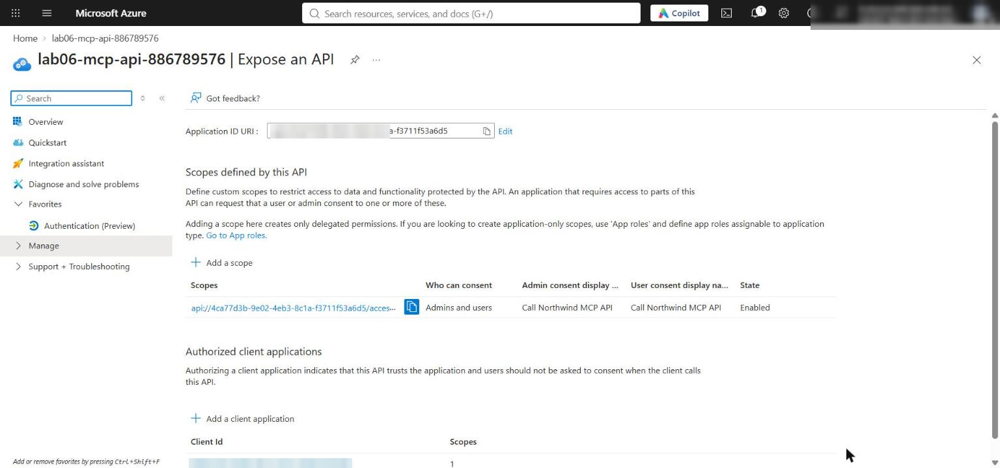

*Figure 9: The API scope access_as_user with the Azure CLI as an authorized client application*

> **Note:** Pre-authorization applies only to the Azure CLI client. If your organization requires administrator consent, ask an administrator to grant consent for the `access_as_user` scope instead. Never paste or print tokens.

### Deploy the infrastructure

1. Build and deploy the Bicep template. It takes about 3-5 minutes:

```powershell
az bicep build --file infra/main.bicep
az deployment group create --resource-group $resourceGroupName --name lab06-main `
  --template-file infra/main.bicep `
  --parameters environmentName=$envName location=$azureRegion mcpEntraClientId=$($app.appId) mcpEntraTenantId=$tenantId `
  --output none
```

2. Write `.env` from the deployment outputs, adding the tenant ID and the app object ID (needed for clean-up):

```powershell
$outputs = az deployment group show --resource-group $resourceGroupName --name lab06-main --query properties.outputs -o json | ConvertFrom-Json
$lines = @("AZURE_RESOURCE_GROUP=`"$resourceGroupName`"", "AZURE_LOCATION=`"$azureRegion`"", "AZURE_ENV_NAME=`"$envName`"",
  "AZURE_SUBSCRIPTION_ID=`"$(az account show --query id -o tsv)`"",
  "MCP_ENTRA_TENANT_ID=`"$tenantId`"", "MCP_ENTRA_APP_OBJECT_ID=`"$($app.id)`"")
$outputs.PSObject.Properties | ForEach-Object { $lines += "$($_.Name.ToUpper())=`"$($_.Value.value)`"" }
$lines | Out-File .env -Encoding utf8
Get-Content .env
$containerAppName = $outputs.AZURE_CONTAINER_APP_NAME.value
$mcpServerUrl = $outputs.MCP_SERVER_URL.value
$mcpTokenScope = $outputs.MCP_TOKEN_SCOPE.value
```

**Expected result:** `.env` contains `MCP_ENTRA_CLIENT_ID`, `MCP_ENTRA_TENANT_ID`, `MCP_SERVER_URL` (`https://mcp-...azurecontainerapps.io/mcp`), `MCP_TOKEN_SCOPE` (`api://<appId>/.default`), `AZURE_CONTAINER_APP_NAME` and `MANAGED_IDENTITY_PRINCIPAL_ID`. It contains no keys, passwords or tokens.

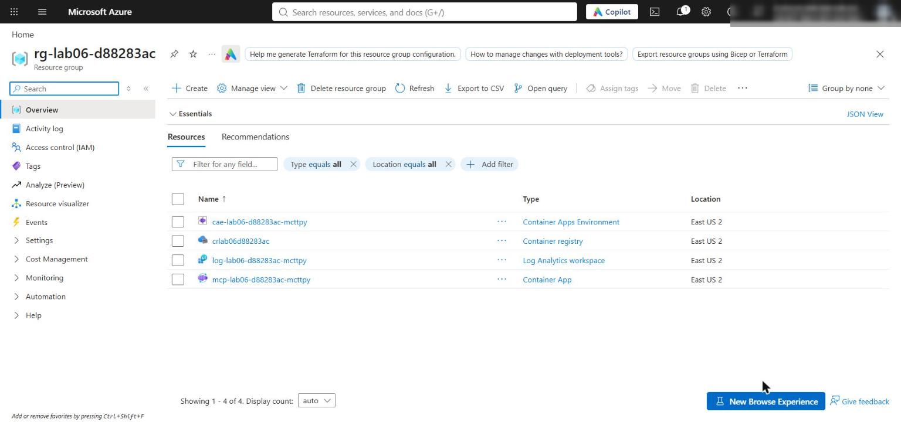

*Figure 10: The lab 06 resource group after deployment*

3. If the deployment fails, read the first error. Container Apps availability in the region, missing permission to create role assignments or app registrations, or an empty `mcpEntraClientId` are the usual causes. Fix it and rerun step 4.

> **Note:** The Container App has native external ingress so your local client can reach it. Microsoft Entra authentication still protects every request. Production environments should use a private access path where required.

### Build the image in Azure Container Registry (no Docker needed)

The template has no container registry, and the official lab's `azd deploy` needs a local Docker engine. Instead, create a Basic registry and let ACR build the image from the lab's `Dockerfile` in the cloud.

1. Create a `.dockerignore` so the build context does not upload `.venv`, `.env` or local logs (the `Dockerfile` only copies `src/` and `assets/`, but without this file the whole folder is uploaded):

```powershell
@'
.venv
.env
.env.*
__pycache__
*.log
artifacts-*
.vscode
'@ | Set-Content .dockerignore -Encoding utf8
```

2. Create the registry and build the image `mcp:v1`. The build takes about 1-3 minutes:

```powershell
$acrName = "cr$($envName -replace '-','')"
az acr create --resource-group $resourceGroupName --name $acrName --sku Basic --location $azureRegion --output none
az acr build --registry $acrName --image mcp:v1 .
```

**Expected result:** the build log ends with `Run ID: ... was successful` and the image `<acrName>.azurecr.io/mcp:v1` is pushed.

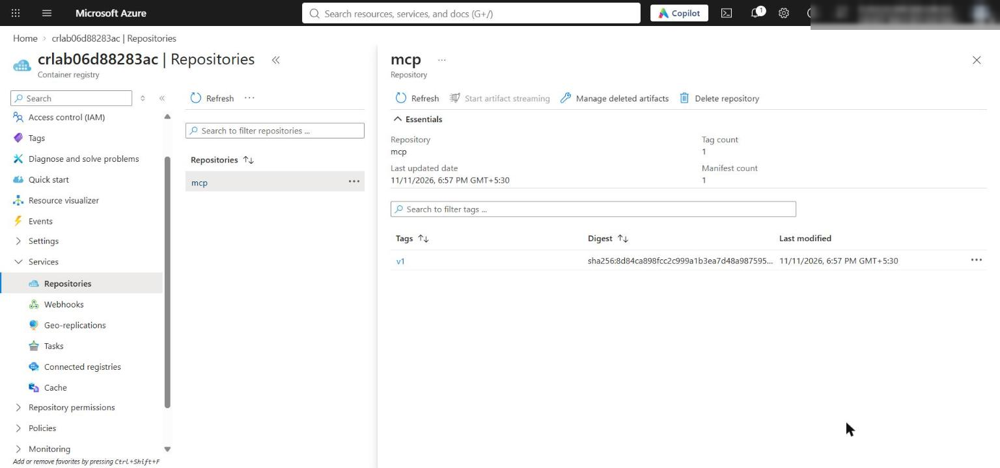

*Figure 11: The mcp repository with tag v1 in the container registry*

3. Let the Container App pull from the registry with its system-assigned managed identity (no registry passwords), point ingress at the MCP server's port 8000 and deploy the image:

```powershell
$acrId = az acr show --name $acrName --query id -o tsv
$principalId = az containerapp identity show --name $containerAppName --resource-group $resourceGroupName --query principalId -o tsv
az role assignment create --assignee-object-id $principalId --assignee-principal-type ServicePrincipal --role AcrPull --scope $acrId --output none
az containerapp registry set --name $containerAppName --resource-group $resourceGroupName --server "$acrName.azurecr.io" --identity system --output none
az containerapp ingress update --name $containerAppName --resource-group $resourceGroupName --target-port 8000 --output none
az containerapp update --name $containerAppName --resource-group $resourceGroupName --image "$acrName.azurecr.io/mcp:v1" --output none
az containerapp revision list --name $containerAppName --resource-group $resourceGroupName --query "[].{name:name, active:properties.active, health:properties.healthState, running:properties.runningState, image:properties.template.containers[0].image}" -o table
```

**Expected result:** the latest revision uses `<acrName>.azurecr.io/mcp:v1` and is `Healthy` / `Running` (it can show `Activating` for a minute; rerun the last command).

> **Note:** The `AcrPull` role can take 1-5 minutes to apply. If `az containerapp update` fails with an image-pull or `UNAUTHORIZED` error, wait a few minutes and run the `az containerapp update` command again.

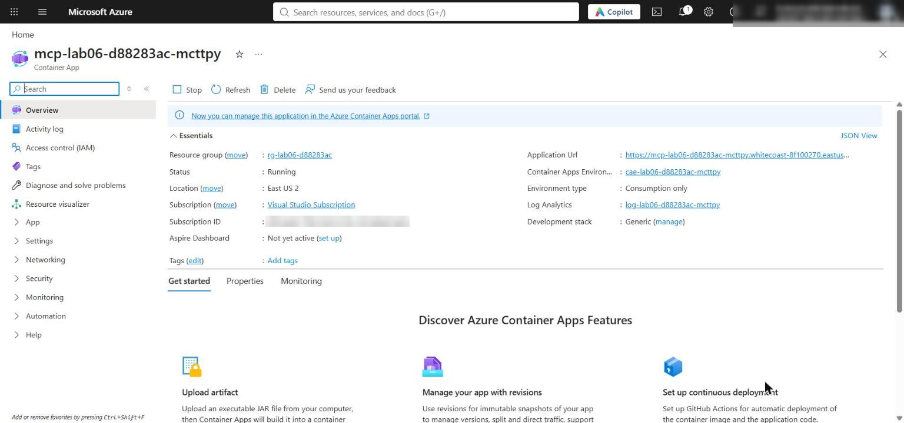

*Figure 12: The Container App running the mcp:v1 image*

---

## Task 7: Validate the deployed MCP server

Remote validation exercises the same protocol contracts as the local tasks. All commands run in **Terminal 2** with `(.venv)` active and the variables from Task 6.

1. Load the remote endpoint and token scope for this terminal:

```powershell
$env:MCP_SERVER_URL = $mcpServerUrl
$env:MCP_TOKEN_SCOPE = $mcpTokenScope
$env:MCP_SERVER_URL
$env:MCP_TOKEN_SCOPE
```

2. Verify the authentication and identity boundaries before sending an authenticated request. The first request after the app scales to zero can return `504` while the container cold-starts, so the anonymous check retries a few times:

```powershell
$anonymousStatus = ''
foreach ($attempt in 1..6) {
  $anonymousStatus = curl.exe -s -o NUL -w "%{http_code}" $env:MCP_SERVER_URL
  if ($anonymousStatus -eq '401') { break }
  "Attempt $($attempt): HTTP $anonymousStatus (cold start?), retrying in 15 s"
  Start-Sleep -Seconds 15
}
if ($anonymousStatus -ne '401') { throw "Anonymous request was not rejected: HTTP $anonymousStatus" }
$auth = az containerapp auth show --name $containerAppName --resource-group $resourceGroupName | ConvertFrom-Json
$expectedAudience = "api://$($outputs.MCP_ENTRA_CLIENT_ID.value)"
if ($auth.globalValidation.unauthenticatedClientAction -ne 'Return401') { throw 'Anonymous requests are not configured for HTTP 401 rejection' }
if ($auth.identityProviders.azureActiveDirectory.validation.allowedAudiences -notcontains $expectedAudience) { throw 'The configured token audience is incorrect' }
if ($env:MCP_TOKEN_SCOPE -ne "$expectedAudience/.default") { throw 'MCP_TOKEN_SCOPE does not match the protected API audience' }
$managedIdentityPrincipalId = az containerapp identity show --name $containerAppName --resource-group $resourceGroupName --query principalId -o tsv
if ([string]::IsNullOrWhiteSpace($managedIdentityPrincipalId)) { throw 'The Container App managed identity is missing' }
'REMOTE_BOUNDARIES_VALIDATED'
```

**Expected result:** `REMOTE_BOUNDARIES_VALIDATED`. This proves anonymous rejection (HTTP 401), the allowed token audience `api://<appId>`, the requested scope and the presence of the workload managed identity. It does not prove that a private network path exists.

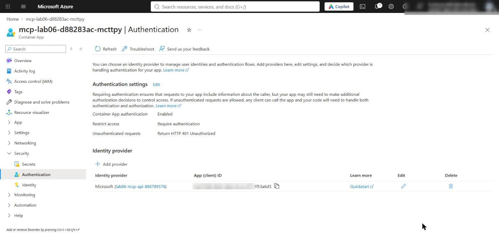

*Figure 13: Container App authentication with Microsoft Entra ID and Return401 for anonymous requests*

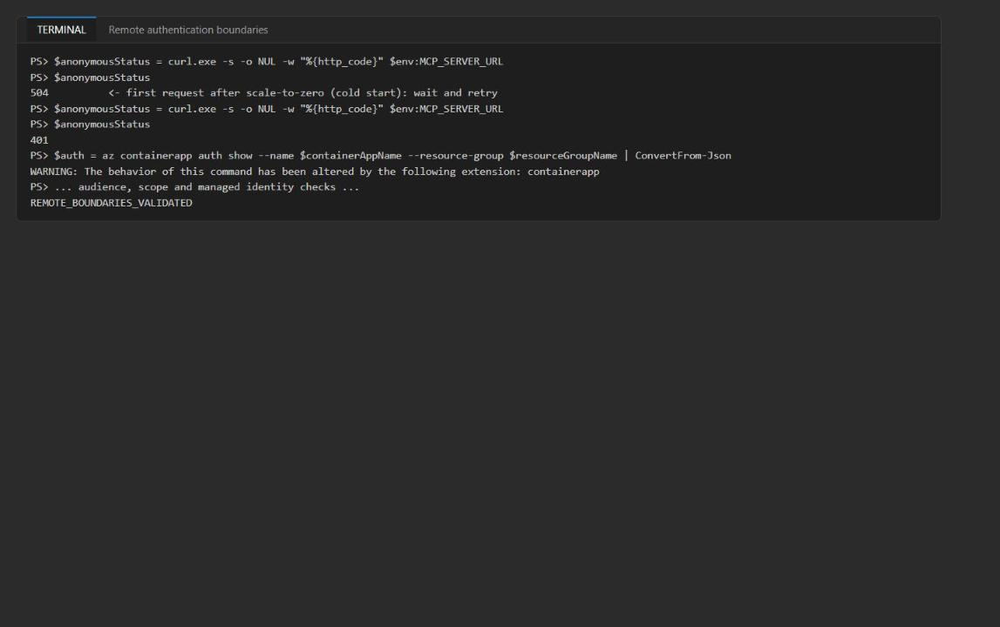

*Figure 14: Anonymous requests are rejected and the boundaries are validated*

3. Run discovery and both tool requests against the remote endpoint. Do not acquire, paste or print a token yourself; the client gets it with `DefaultAzureCredential` and `MCP_TOKEN_SCOPE`:

```powershell
python -m src.main discover --server-url $env:MCP_SERVER_URL
python -m src.main call --server-url $env:MCP_SERVER_URL --request assets/request-drug.json
python -m src.main call --server-url $env:MCP_SERVER_URL --request assets/request-capacity.json
```

**Expected result:** discovery returns both tools with `name`, `description` and `inputSchema`, and the drug and capacity calls return exactly the same synthetic results as in Task 4 (`ok` / `high` / `Synthetic record: pause automated workflow and consult a pharmacist.` and `ok` / `northwind-central` / `2026-09-28` / `4`).

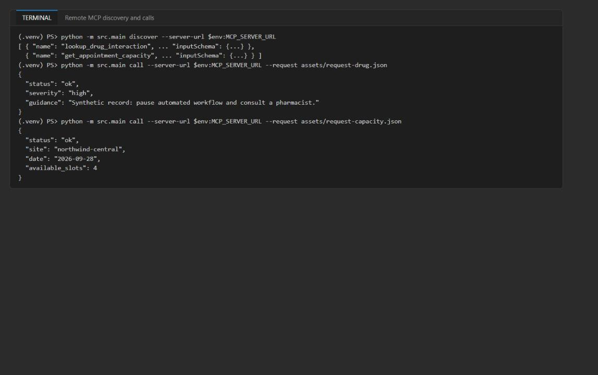

*Figure 15: Authenticated remote MCP discovery and tool calls*

4. If the client fails with `AADSTS65001` (no consent for the Azure CLI), check that step 3 of Task 6 pre-authorized `04b07795-8ddb-461a-bbee-02f9e1bf7b46` for the `access_as_user` scope, then run the commands again. If `MCP_TOKEN_SCOPE` is empty for a non-local URL, the client stops with `MCP_TOKEN_SCOPE is required for a remote MCP server` before it opens an HTTP session.

### Run the final checks

1. Run the side-effect-free final checks:

```powershell
python scripts/preflight.py
Get-ChildItem src,scripts -Filter *.py -Recurse | ForEach-Object { python -m py_compile $_.FullName; "py_compile OK $($_.Name)" }
az bicep build --file infra/main.bicep; "bicep exit=$LASTEXITCODE"
```

**Expected result:** preflight shows `Local MCP URL configured: True`, `Remote token scope configured: True` and `Preflight passed.`; every file prints `py_compile OK`; Bicep exits with 0 (one `BCP187` warning is fine).

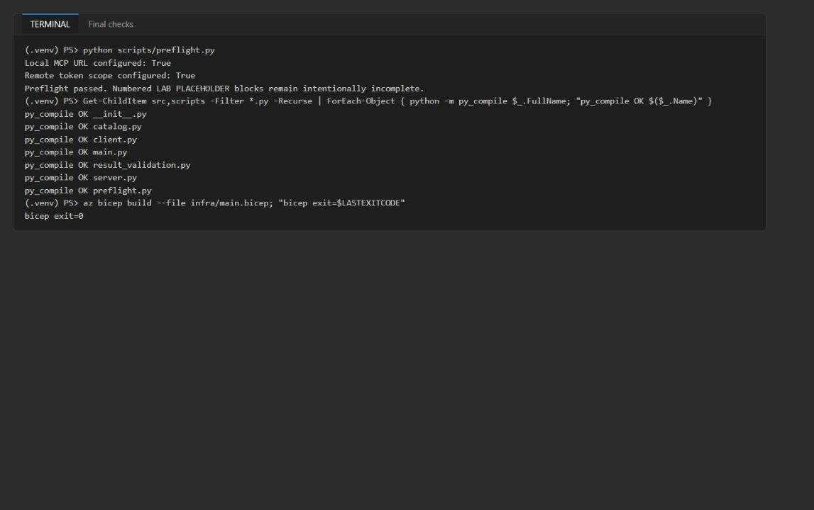

*Figure 16: Preflight, Python and Bicep checks pass*

### Optional challenge: reject an incompatible tool version

1. Create a file `challenge_incompatible.py` in the lab folder with the following code. It adds an incompatible v2.0.0 catalog entry in memory only (`assets/tool-catalog.json` is unchanged), shows that selection rejects it without invoking a tool, and then simulates a dependency timeout with bounded retries and backoff:

```python
"""Optional challenge: reject an incompatible tool version; bounded retry on dependency timeout.

Runs offline. Adds an incompatible catalog entry in memory only (assets/tool-catalog.json is unchanged).
"""
from __future__ import annotations

import asyncio
import copy
import json
from unittest import mock

from src import catalog
from src.client import discover_tools

base = catalog.load_catalog()
incompatible = copy.deepcopy(base["tools"][0])
incompatible.update(version="2.0.0", protocol="mcp-2026-draft", lifecycle="active")
patched = copy.deepcopy(base)
# Replace the v1 entry so only the incompatible v2 entry is a candidate.
patched["tools"] = [incompatible] + base["tools"][1:]

def compatibility_reasons(entry: dict, required_major: int) -> list[str]:
    reasons = []
    if entry["lifecycle"] != "active":
        reasons.append(f"lifecycle={entry['lifecycle']}")
    major = int(entry["version"].split(".", 1)[0])
    if major != required_major:
        reasons.append(f"major {major} != required {required_major}")
    return reasons

invoked = []
with mock.patch.object(catalog, "load_catalog", return_value=patched):
    print("Reasons:", compatibility_reasons(incompatible, 1))
    try:
        catalog.select_compatible_tool({"lookup_drug_interaction"}, "lookup_drug_interaction", 1)
        invoked.append("lookup_drug_interaction")
        print("UNEXPECTED: incompatible entry selected")
    except ValueError as error:
        print("Selection rejected:", error)
print("Tool invocations:", invoked)

async def bounded_retry(url: str, attempts: int = 3, timeout_s: float = 2.0) -> dict:
    for attempt in range(1, attempts + 1):
        try:
            return {"status": "ok", "tools": await asyncio.wait_for(discover_tools(url), timeout_s)}
        except Exception as error:  # noqa: BLE001 - simulated dependency failure
            print(f"attempt {attempt}/{attempts} failed: {type(error).__name__}")
            await asyncio.sleep(0.2 * 2 ** (attempt - 1))
    return {"status": "unavailable", "reason": "dependency_timeout", "fallback": "consult_pharmacist"}

# Port 8999 has nothing listening, which simulates the dependency being down.
print(json.dumps(asyncio.run(bounded_retry("http://127.0.0.1:8999/mcp")), indent=2))
```

2. Run it:

```powershell
python challenge_incompatible.py
```

**Expected result:** `Reasons: ['major 2 != required 1']`, `Selection rejected: No active discovered 'lookup_drug_interaction' tool supports major 1`, `Tool invocations: []`, three failed attempts, and the structured `unavailable` / `dependency_timeout` / `consult_pharmacist` result: no fabricated success. (The exception name can be `TimeoutError` or a connection error, depending on how quickly the closed port refuses.)

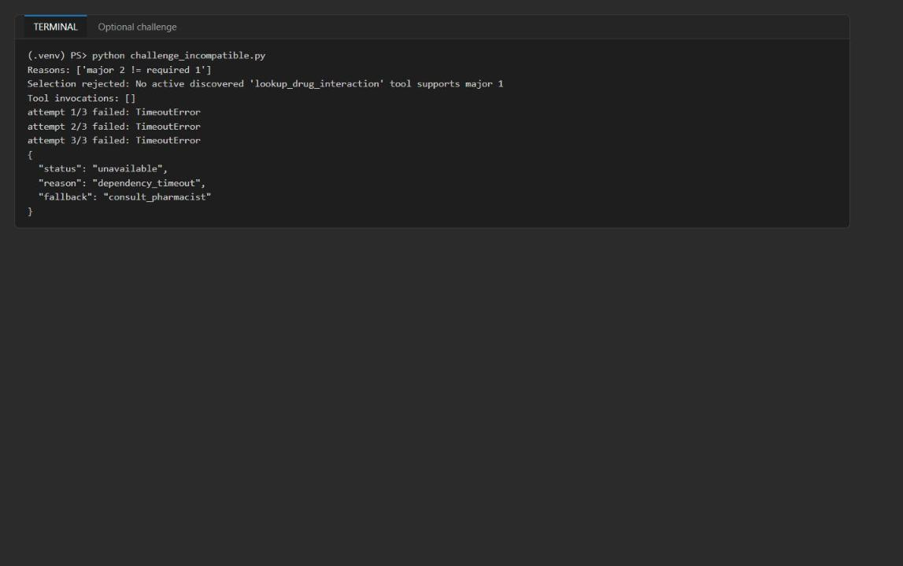

*Figure 17: The incompatible version is rejected and the timeout ends in a structured fallback*

---

## Task 8: Review the design

Answer the four review questions. Model answers are in the **Review questions** section at the end of this guide.

---

## Task 9: Clean up

1. Stop the local MCP server with **Ctrl+C** if it is still running.

2. Run `deactivate` in every terminal that shows `(.venv)`.

3. Do not commit `.env`, access tokens, logs or deployment output to source control.

4. Optional (recommended when finished): delete the Azure resources and the Entra app registration; see **Clean up** at the end of this guide.

## Validate

| Acceptance criterion | How to check (CLI) | How to check (portal) |
|---|---|---|
| Discovery returns both tools with name, description, inputSchema (local and remote) | `python -m src.main discover ...` | - |
| Drug call returns `ok` / `high` / pharmacist guidance | `call ... request-drug.json` | - |
| Capacity call returns `ok` / `northwind-central` / `2026-09-28` / `4` | `call ... request-capacity.json` | - |
| Unknown pair returns `unavailable` / `result_validation_failed` / `consult_pharmacist` | Task 5 step 2 | - |
| Log holds only event, tool name, correlation ID, status | `Select-String server-local.log` count 0 | Container App > **Log stream** shows the same event shape |
| Anonymous request rejected with 401; audience and scope correct; managed identity present | `REMOTE_BOUNDARIES_VALIDATED` | Container App > **Authentication**, **Identity** |
| Remote calls authenticated with Entra | Remote discover and calls succeed | App registration > **Expose an API** |
| Preflight, py_compile and Bicep pass | Task 7 step 5 | - |

## Troubleshooting

- **No Docker / `azd deploy` fails because Docker is not running.** Not needed in this guide: the image is built with `az acr build` in Azure Container Registry and pulled by the Container App's managed identity (Task 6 steps 7-9).
- **`AADSTS65001 ... has not consented to use the application with ID '04b07795-8ddb-461a-bbee-02f9e1bf7b46' named 'Microsoft Azure CLI'`.** The Azure CLI has no consent for your API scope. Run Task 6 step 3 (pre-authorize the Azure CLI on the `access_as_user` scope) or ask an administrator to grant consent, then retry. Do not work around it by pasting tokens.
- **Anonymous check returns `504` instead of `401`.** The app scales to zero (`minReplicas: 0`) and the first request hits a cold start. The retry loop in Task 7 step 2 handles it; if it still fails, wait a minute and rerun.
- **`az containerapp update` fails to pull the image (`UNAUTHORIZED`).** The `AcrPull` role assignment has not propagated yet. Wait 1-5 minutes and rerun the update. Confirm `az containerapp registry list` shows your registry with identity `system`.
- **Revision is unhealthy or the endpoint never answers.** Make sure ingress targets port `8000` (`az containerapp ingress show ... --query targetPort`). The bootstrap image listens on port 80, the MCP server on 8000.
- **`az acr build` uploads a very large context.** Create the `.dockerignore` from Task 6 step 7 so `.venv` is not uploaded.
- **`MCP_TOKEN_SCOPE is required for a remote MCP server`.** Set `$env:MCP_TOKEN_SCOPE` (Task 7 step 1) or make sure `.env` contains `MCP_TOKEN_SCOPE`.
- **`IndentationError` after pasting.** Check that the pasted code starts at the same column as the `# LAB PLACEHOLDER` comment and uses 4 spaces per level.
- **`GET /mcp` returns `406 Not Acceptable` in the server log.** Expected when you open the URL in a browser or with plain `curl`; MCP clients send the right headers.

## Review questions

**Which errors should be retried, and which should immediately return a structured permanent failure?** Retry only transient transport or dependency faults (connection resets, timeouts, HTTP 429/502/503/504 such as the cold-start 504, token-endpoint throttling) with bounded exponential backoff and a circuit breaker. Return the catalog's structured fallback immediately for permanent faults: no compatible active tool version, schema-validation failure, a `not_found` result, invalid arguments, and 401/403 consent or authorization errors.

**What catalog fields are required to support a 90-day deprecation window?** `version` (semver), `lifecycle` (active / deprecated / retired), `deprecated_on`, `sunset_date` (deprecated_on + 90 days), `replacement` (tool and version), a client compatibility range or `min_client_major`, an owner/contact and a migration link. Selection should warn on `deprecated`, refuse after `sunset_date`, and telemetry should count callers still on the deprecated version.

**How would per-user OAuth passthrough change the authorization boundary?** Today the Container App validates a token for `api://<app>` and trusts the caller as a whole. With per-user passthrough (or on-behalf-of), the server forwards the user's delegated token to downstream systems, so authorization is enforced per user and scope at each dependency, not only at the MCP edge. That adds consent management, audience restriction, confused-deputy risk and per-user audit; the managed identity is then used only for non-user-scoped resources.

**Which telemetry fields support diagnosis without disclosing clinical inputs?** `event`, `tool_name`, tool `version`, `correlation_id`, `status` / error class, latency, retry count, fallback reason, catalog version, server revision and caller app or tenant ID. Never log drug names, patient-linked sites, patient identifiers, tool arguments or results, or tokens. The lab server logs only event, tool name, correlation ID and status.

## Clean up (optional)

1. Delete the resource group (Container App, environment, registry and Log Analytics):

```powershell
az group delete --name <rg-lab06-xxxxxxxx> --yes --no-wait
```

2. Delete the Entra app registration. Its object ID is `MCP_ENTRA_APP_OBJECT_ID` in `.env`:

```powershell
az ad app delete --id <app-object-id>
```

3. Confirm that both are gone:

```powershell
az group exists --name <rg-lab06-xxxxxxxx>
az ad app show --id <app-object-id>
```

**Expected result:** `false`, and `az ad app show` reports that the resource does not exist. Deleting the app also removes the Azure CLI pre-authorization. Delete `.env` and `server-local.log` from the lab folder if you don't need them.

