# Lab 07: Implement advanced RAG with Azure AI Search

## Overview

**Scenario.** Northwind Health needs grounded retrieval across synthetic formulary, clinical-guideline and laboratory-reference knowledge. Exact identifiers (drug names, test names) must stay discoverable, conceptual questions must benefit from vector similarity, and semantic ranking must improve the order and captions of the candidate set. The retrieval team also needs evidence that its chunking choice improves quality enough to justify its index size and latency.

**What you'll build.** A routed retrieval pipeline over six synthetic parent documents (two formulary monographs, two guidelines, two lab references). You generate two chunk sets locally (fixed overlap and structural parent-child), create three specialized Azure AI Search indexes with vector and semantic configuration, embed and upload both chunk sets with keyless (Microsoft Entra ID) authentication, route each query to the right indexes, and compare vector, hybrid and semantic retrieval by mean reciprocal rank (MRR) and latency. The lab retrieves evidence only; it does not build a chatbot.

**Duration.** About 45-60 minutes.

> **Cost warning:** Azure AI Search **Standard** is billed per hour while the service exists, and Azure OpenAI embedding calls are billed per token. Finish the lab in one sitting and run the clean-up step at the end.

| Component | Purpose |
|---|---|
| `assets/source-documents.json` | Six synthetic parent documents, two sections each, in three categories |
| `assets/chunk-strategies.json` | Parameters for fixed-overlap (180 chars, 40 overlap) and structural parent-child chunking |
| `assets/queries.json` | Three relevance-labeled queries (exact lookup, conceptual lab question, cross-domain) |
| `assets/documents.json` | Deprecation marker only. Do not ingest it. |
| Azure AI Search (Standard, semantic ranker free plan, local auth disabled) | Three indexes: `northwind-formulary-v1`, `northwind-guidelines-v1`, `northwind-labs-v1` |
| Azure OpenAI + `text-embedding-3-small` (GlobalStandard) | Embeddings for chunks and queries (1536 dimensions) |
| `src/index_manager.py` | Index schema: searchable, filterable, vector and semantic fields (Placeholder 1) |
| `src/embeddings.py` | Ordered embedding calls (Placeholder 2) |
| `src/ingest.py` | Embeds both profiles and uploads by category and strategy (Placeholder 3) |
| `src/router.py` | Intent-based routing to one or all indexes (Placeholder 4) |
| `src/search_pipeline.py` | Vector, hybrid (RRF) and semantic search through `SearchClient` (Placeholder 5) |
| `infra/main.bicep` | Search service, Azure OpenAI account, embedding deployment and your role assignments |

## Prerequisites

Install these tools:

- [Python 3.11 or later](https://www.python.org/downloads/)
- [Azure CLI](https://learn.microsoft.com/cli/azure/install-azure-cli) (includes Bicep; run `az bicep upgrade` if needed)
- [Git](https://git-scm.com/downloads)
- [Visual Studio Code](https://code.visualstudio.com/download) with the [Python](https://marketplace.visualstudio.com/items?itemName=ms-python.python) and [Bicep](https://marketplace.visualstudio.com/items?itemName=ms-azuretools.vscode-bicep) extensions

Azure permissions: you need **Owner**, or **Contributor** plus **User Access Administrator** (or **Role Based Access Control Administrator**), on the subscription or resource group, because the template creates role assignments for you. Your subscription needs quota for Azure AI Search **Standard** and for a GlobalStandard `text-embedding-3-small` deployment in the region you pick.

Sign in to Azure from a PowerShell terminal:

```powershell
az login
az account show --output table
```

If you have more than one subscription, select the one to use:

```powershell
az account set --subscription "<your-subscription-id>"
```

---

## Task 1: Prepare the lab

1. Clone the lab repository (skip this if you already have it):

```powershell
git clone https://github.com/MicrosoftLearning/mslearn-ai-multi-agents.git
cd mslearn-ai-multi-agents
code .
```

2. In VS Code, open a new PowerShell terminal (**Terminal > New Terminal**) and change to the lab folder. Run every later command from this folder.

```powershell
cd Allfiles\07-northwind-health-advanced-rag
az version
python --version
az account show --output table
```

**Expected result:** Azure CLI and Python 3.11+ versions print, and your subscription is shown.

3. Open `assets/source-documents.json`, `assets/chunk-strategies.json` and `assets/queries.json` and review them. Every record is synthetic. `assets/documents.json` is only a deprecation marker; never ingest it.

4. Note which operations run where:

| Runs locally | Runs in Azure |
|---|---|
| Chunk generation (`generate-chunks`), routing decision (`route_query`), MRR aggregation | Embeddings (Azure OpenAI), index creation, upload, vector/hybrid/semantic search (Azure AI Search) |

> **Note:** All Azure calls use `DefaultAzureCredential` (your `az login` identity). Never add Search admin keys or model keys to `.env`; the search service is deployed with local (key) authentication disabled.

---

## Task 2: Build the virtual environment and generate the chunk sets

1. Create the virtual environment and install the dependencies, then activate it:

```powershell
./scripts/setup.ps1
. ./.venv/Scripts/Activate.ps1
```

> **Note:** On macOS/Linux run `bash scripts/setup.sh` and `source .venv/bin/activate` instead. If PowerShell blocks the script, run `Set-ExecutionPolicy -Scope Process -ExecutionPolicy Bypass` first.

**Expected result:** The prompt starts with `(.venv)`.

2. Generate both chunk sets from the same source documents and inspect them:

```powershell
python -m src.main generate-chunks --source assets/source-documents.json --strategies assets/chunk-strategies.json --output artifacts-generated-chunks.json
$chunks = Get-Content artifacts-generated-chunks.json -Raw | ConvertFrom-Json
$chunks.strategy_summaries | Format-Table strategy,chunk_count
$chunks.strategy_summaries.boundaries | Select-Object -First 8 | Format-Table id,parent_id,start,end,section_heading
```

**Expected result:** `fixed-overlap` has **16** chunks and `structural-parent-child` has **12**. Fixed-overlap windows are 0-180, 140-320, 280-387 (40-character overlap) with no section heading; structural chunks have one chunk per section, prefixed with the parent title and heading.

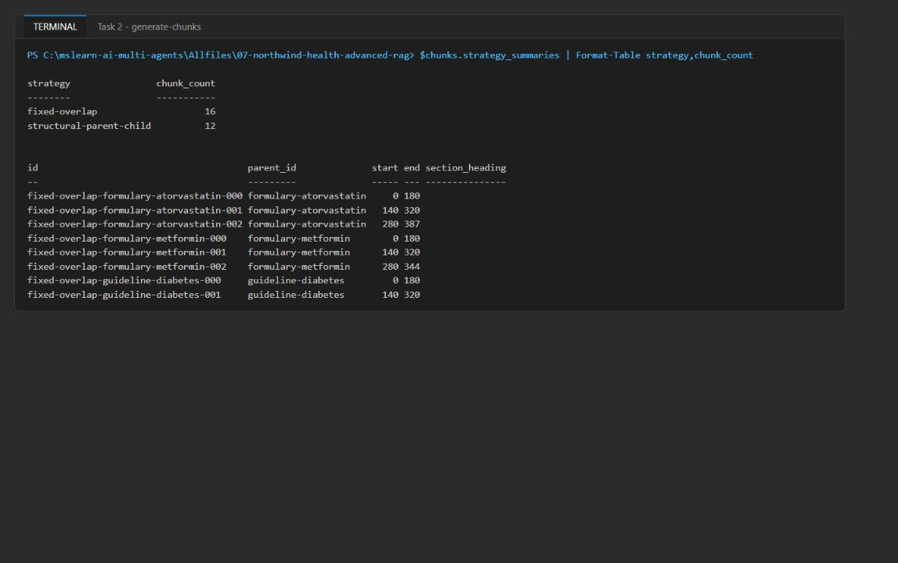

*Figure 1: Chunk counts and the first fixed-overlap boundaries*

3. Do not edit `artifacts-generated-chunks.json` by hand. If you change the source documents or strategy configuration, rerun the `generate-chunks` command so the recorded boundaries stay reproducible.

---

## Task 3: Deploy the Azure resources

The official lab uses `azd provision`. This guide uses the Azure CLI directly, which deploys the same `infra/main.bicep` template.

1. Choose a region. It must have capacity for Azure AI Search **Standard** with the semantic ranker **and** support GlobalStandard `text-embedding-3-small`.

> **Important:** Azure AI Search capacity varies by region and over time. In the reference run, `eastus2` failed with `InsufficientResourcesAvailable` for Azure AI Search, and the lab was deployed successfully in `eastus`. The script below uses `eastus`; if the deployment fails with a capacity error, delete the resource group and rerun the script with another region that has Search capacity (for example `westus3`, `swedencentral` or `northeurope`).

2. Run the provisioning script from the lab folder. It creates a unique resource group, builds and deploys the Bicep template (passing your user object ID as `principalId` so the template grants you Search Service Contributor, Search Index Data Contributor and Cognitive Services OpenAI User), re-asserts those roles at resource-group scope, and writes `.env` from the deployment outputs:

```powershell
$azureRegion = 'eastus'
$suffix = (New-Guid).Guid.Substring(0, 8)
$resourceGroupName = "rg-lab07-$suffix"
$envName = "lab07-$suffix"
$me = az ad signed-in-user show --query id -o tsv
az group create --name $resourceGroupName --location $azureRegion --output none
az bicep build --file infra/main.bicep
az deployment group create --resource-group $resourceGroupName --name lab07-main `
  --template-file infra/main.bicep `
  --parameters location=$azureRegion environmentName=$envName principalId=$me `
  --output none
# Grant yourself data-plane access (Search control + data plane, embeddings)
$rgId = az group show --name $resourceGroupName --query id -o tsv
foreach ($role in 'Search Service Contributor','Search Index Data Contributor','Cognitive Services OpenAI User') {
  az role assignment create --assignee-object-id $me --assignee-principal-type User --role $role --scope $rgId --output none
}
# Write .env from the deployment outputs
$outputs = az deployment group show --resource-group $resourceGroupName --name lab07-main --query properties.outputs -o json | ConvertFrom-Json
$lines = @("AZURE_RESOURCE_GROUP=`"$resourceGroupName`"", "AZURE_LOCATION=`"$azureRegion`"", "AZURE_ENV_NAME=`"$envName`"",
  "AZURE_SUBSCRIPTION_ID=`"$(az account show --query id -o tsv)`"", "AZURE_PRINCIPAL_ID=`"$me`"")
$outputs.PSObject.Properties | ForEach-Object { $lines += "$($_.Name.ToUpper())=`"$($_.Value.value)`"" }
$lines | Out-File .env -Encoding utf8
Get-Content .env
```

**Expected result:** The deployment takes about 3-6 minutes. `.env` lists `AZURE_SEARCH_ENDPOINT` (`https://srchlab07<...>.search.windows.net`), `AZURE_OPENAI_ENDPOINT` (`https://aoailab07<...>.openai.azure.com/`) and `AZURE_OPENAI_EMBEDDING_DEPLOYMENT="text-embedding-3-small"`. It contains no keys.

> **Note:** Role assignments can take 1-5 minutes to apply. If the first Search or embedding call returns `403 Forbidden`, wait a few minutes and retry.

3. If `az deployment group create` fails, read the first error. For a Search capacity error (`InsufficientResourcesAvailable`), delete the resource group (`az group delete --name $resourceGroupName --yes --no-wait`), set `$azureRegion` to another region and rerun the whole script. For a model quota error, pick a region with `text-embedding-3-small` GlobalStandard quota.

4. In the [Azure portal](https://portal.azure.com), open the new resource group `rg-lab07-<suffix>`. Confirm it contains the search service and the Azure OpenAI account.

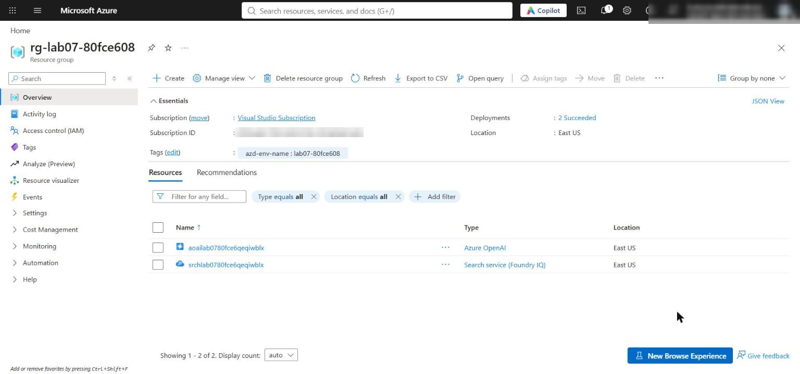

*Figure 2: The lab resource group with the search service and Azure OpenAI account*

5. Open the search service. On **Overview**, confirm the pricing tier is **Standard**. Under **Settings > Semantic ranker**, the plan is **Free**; under **Settings > Keys**, API access control is **Role-based access control** (keys disabled).

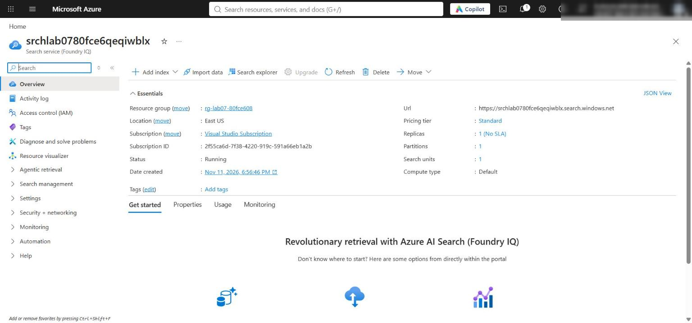

*Figure 3: Azure AI Search service overview (Standard tier)*

6. Open the Azure OpenAI account and select **Model deployments** (or **Go to Foundry portal > Deployments**). Confirm `text-embedding-3-small` is deployed with the **Global Standard** type.

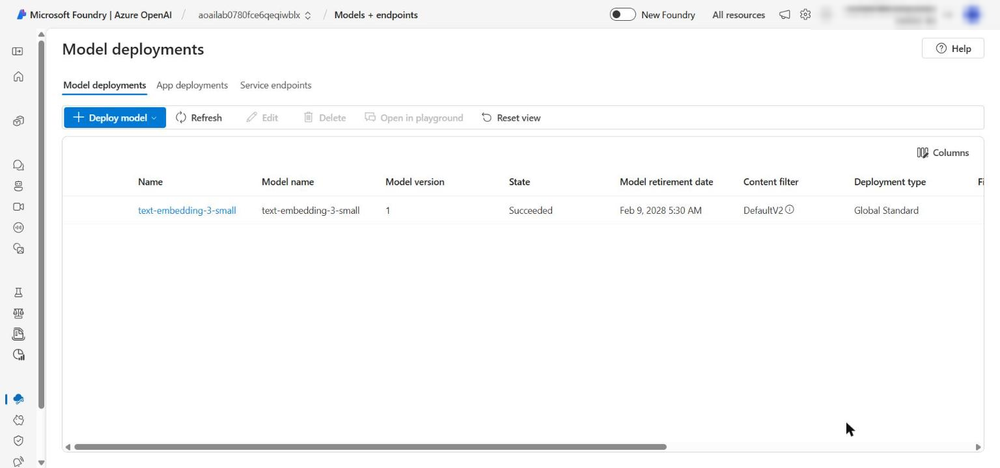

*Figure 4: The text-embedding-3-small deployment*

---

## Task 4: Implement the solution

Each placeholder marks incomplete code. For each one: open the file, find the exact `# LAB PLACEHOLDER` marker, keep the marker comment, and replace **only** the `raise NotImplementedError(...)` line under it with the code given here.

How to paste each snippet with the right indentation:

- Select the whole `raise NotImplementedError(...)` line, including its leading spaces, and delete it.
- With the cursor at the very start of that now-empty line (column 1), paste the snippet. The snippets already include the 4-space indentation the function body needs, so the first pasted line lines up with the `# LAB PLACEHOLDER` comment. Do not press Tab.

> **Tip:** The official lab shows the snippets with 2-space indentation, but the source files use 4 spaces. Mixing the two causes `IndentationError`. Use the 4-space snippets below, and compare your result with the screenshot after each placeholder.

1. Confirm `artifacts-generated-chunks.json` from Task 2 exists and both strategy summaries list their configuration, chunk count, parent IDs and boundaries.

**Placeholder 1: Create specialized vector indexes**

2. Open `src/index_manager.py`, find `# LAB PLACEHOLDER 1: Replace this line with the Task 1 sample.` inside `create_or_update_indexes`, and replace the line `raise NotImplementedError(...)` beneath it with:

```python
    client = SearchIndexClient(endpoint=endpoint, credential=credential)
    fields = [
        SimpleField(name="id", type=SearchFieldDataType.String, key=True, filterable=True),
        SearchableField(name="content", type=SearchFieldDataType.String),
        SearchableField(name="title", type=SearchFieldDataType.String),
        SimpleField(name="category", type=SearchFieldDataType.String, filterable=True),
        SimpleField(name="source", type=SearchFieldDataType.String, filterable=True),
        SimpleField(name="parent_id", type=SearchFieldDataType.String, filterable=True),
        SimpleField(name="chunk_order", type=SearchFieldDataType.Int32, sortable=True),
        SimpleField(name="chunk_strategy", type=SearchFieldDataType.String, filterable=True),
        SimpleField(name="boundary_start", type=SearchFieldDataType.Int32),
        SimpleField(name="boundary_end", type=SearchFieldDataType.Int32),
        SearchableField(name="section_heading", type=SearchFieldDataType.String),
        SearchField(
            name="content_vector",
            type=SearchFieldDataType.Collection(SearchFieldDataType.Single),
            searchable=True,
            vector_search_dimensions=vector_dimensions,
            vector_search_profile_name="clinical-vector-profile",
        ),
        SearchField(
            name="optimized_vector",
            type=SearchFieldDataType.Collection(SearchFieldDataType.Single),
            searchable=True,
            vector_search_dimensions=vector_dimensions,
            vector_search_profile_name="clinical-vector-profile",
        ),
    ]
    vector_search = VectorSearch(
        algorithms=[HnswAlgorithmConfiguration(name="clinical-hnsw")],
        profiles=[
            VectorSearchProfile(
                name="clinical-vector-profile",
                algorithm_configuration_name="clinical-hnsw",
            )
        ],
    )
    semantic_search = SemanticSearch(
        configurations=[
            SemanticConfiguration(
                name=semantic_configuration,
                prioritized_fields=SemanticPrioritizedFields(
                    title_field=SemanticField(field_name="title"),
                    content_fields=[SemanticField(field_name="content")],
                    keywords_fields=[SemanticField(field_name="section_heading")],
                ),
            )
        ]
    )
    created = []
    for index_name in INDEX_NAMES.values():
        index = SearchIndex(
            name=index_name,
            fields=fields,
            vector_search=vector_search,
            semantic_search=semantic_search,
        )
        created.append(client.create_or_update_index(index).name)
    return created
```

The same governed schema is used for three independently routed indexes. Two vector fields hold the baseline (`content_vector`) and content-aware (`optimized_vector`) embeddings; vector dimensions come from configuration.

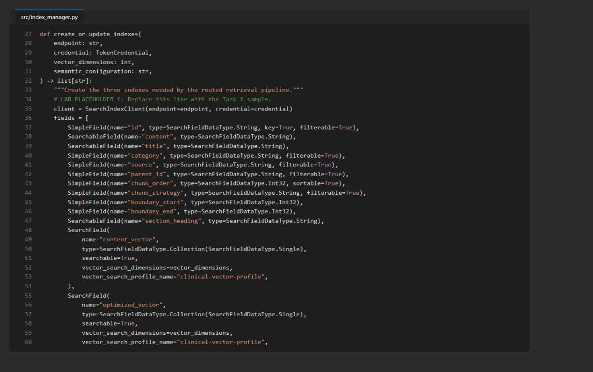

*Figure 5: src/index_manager.py after Placeholder 1*

**Placeholder 2: Generate ordered embeddings**

3. Open `src/embeddings.py`, find `# LAB PLACEHOLDER 2: Replace this line with the Task 2 sample.` inside `embed_texts`, and replace the `raise NotImplementedError(...)` line beneath it with:

```python
    if not texts:
        raise ValueError("At least one embedding input is required")
    response = client.embeddings.create(model=deployment, input=list(texts))
    return [item.embedding for item in sorted(response.data, key=lambda item: item.index)]
```

Sorting by the response `index` keeps each vector aligned with its input text.

**Placeholder 3: Embed and upload both strategies**

4. Open `src/ingest.py`, find `# LAB PLACEHOLDER 3: Replace this line with the Task 3 sample.` inside `upload_documents`, and replace the `raise NotImplementedError(...)` line beneath it with:

```python
    baseline_vectors = embed_texts(
        embedding_client,
        embedding_deployment,
        [embedding_text(document, "baseline") for document in documents],
    )
    optimized_vectors = embed_texts(
        embedding_client,
        embedding_deployment,
        [embedding_text(document, "content-aware") for document in documents],
    )
    groups: dict[tuple[str, str], list[dict[str, Any]]] = {}
    for document, baseline, optimized in zip(
        documents, baseline_vectors, optimized_vectors, strict=True
    ):
        upload_document = {
            **document,
            "content_vector": baseline,
            "optimized_vector": optimized,
        }
        key = (str(document["category"]), str(document["chunk_strategy"]))
        groups.setdefault(key, []).append(upload_document)

    counts: dict[str, int] = {}
    for (category, strategy), group in groups.items():
        client = SearchClient(endpoint, INDEX_NAMES[category], credential)
        results = client.upload_documents(group)
        failed = [result.key for result in results if not result.succeeded]
        if failed:
            raise RuntimeError(f"Index upload failed for document keys: {failed}")
        counts[f"{strategy}:{category}"] = len(results)
    return counts
```

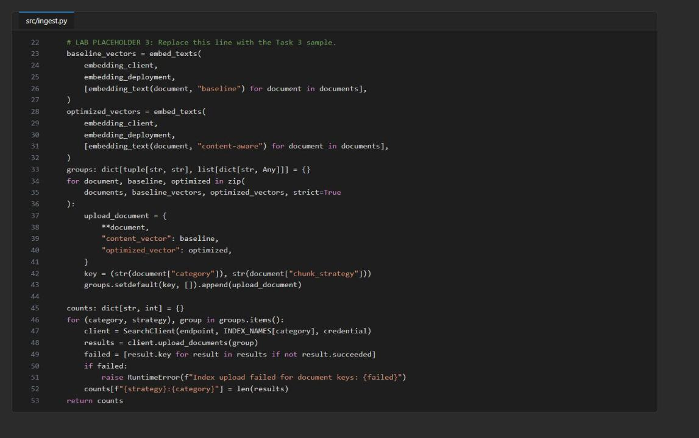

*Figure 6: src/ingest.py after Placeholder 3*

**Placeholder 4: Route by explicit intent**

5. Open `src/router.py`, find `# LAB PLACEHOLDER 4: Replace this line with the Task 4 sample.` inside `route_query`, and replace the `raise NotImplementedError(...)` line beneath it with:

```python
    normalized = query.casefold()
    intent_terms = {
        "formulary": {"medication", "drug", "atorvastatin", "contraindication", "therapy"},
        "guidelines": {"guideline", "protocol", "recommendation", "coordinate", "how should"},
        "labs": {"lab", "a1c", "range", "test", "monitoring"},
    }
    matched = [
        category
        for category, terms in intent_terms.items()
        if any(term in normalized for term in terms)
    ]
    if len(matched) != 1:
        return list(INDEX_NAMES.values())
    return [INDEX_NAMES[matched[0]]]
```

One clear intent routes to one index; multi-factor or unclassified queries fan out to all three indexes instead of silently dropping a source.

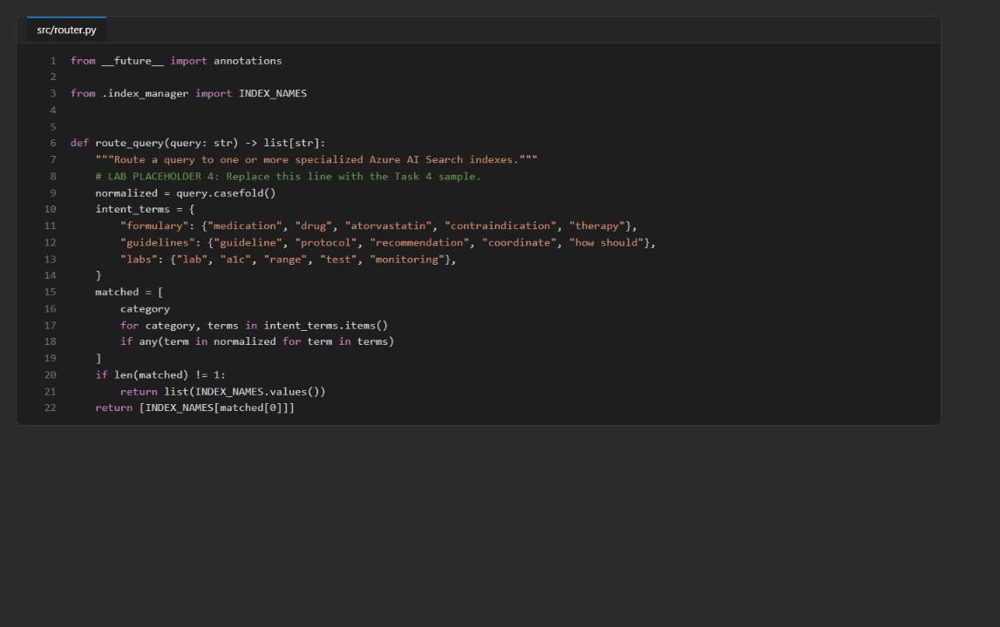

*Figure 7: src/router.py after Placeholder 4*

**Placeholder 5: Execute vector, hybrid and semantic search**

6. Open `src/search_pipeline.py`, find `# LAB PLACEHOLDER 5: Replace this line with the Task 5 sample.` inside `hybrid_semantic_search`, and replace the `raise NotImplementedError(...)` line beneath it with:

```python
    if mode not in {"vector", "hybrid", "semantic"}:
        raise ValueError(f"Unsupported search mode: {mode}")
    if vector_field not in {"content_vector", "optimized_vector"}:
        raise ValueError(f"Unsupported vector field: {vector_field}")

    search_client = SearchClient(endpoint, index_name, credential)
    options: dict[str, Any] = {
        "search_text": None if mode == "vector" else query,
        "filter": filter_expression,
        "top": top,
        "select": [
            "id", "title", "source", "parent_id", "chunk_strategy",
            "boundary_start", "boundary_end", "section_heading", "content",
        ],
    }
    if mode in {"vector", "hybrid"}:
        query_vector = embed_texts(
            embedding_client, embedding_deployment, [query]
        )[0]
        options["vector_queries"] = [
            VectorizedQuery(
                vector=query_vector,
                k_nearest_neighbors=top,
                fields=vector_field,
                weight=vector_weight,
            )
        ]
    if mode in {"hybrid", "semantic"}:
        options.update(
            query_type="semantic",
            semantic_configuration_name=semantic_configuration,
            query_caption="extractive",
        )

    output = []
    for result in search_client.search(**options):
        row = dict(result)
        row["citation"] = f"{result['title']} ({result['source']}#{result['id']})"
        row["captions"] = [
            getattr(caption, "text", str(caption))
            for caption in (result.get("@search.captions") or [])
        ]
        output.append(row)
    return output
```

In hybrid mode `search_text` and `vector_queries` go to Azure AI Search in **one** request and the service fuses them with Reciprocal Rank Fusion (RRF); semantic configuration then reranks and adds extractive captions. Do not split this into separate client-side searches.

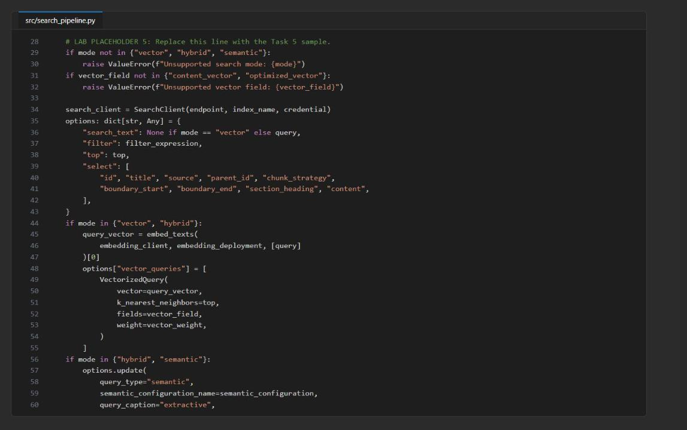

*Figure 8: src/search_pipeline.py after Placeholder 5*

7. Check that all files compile:

```powershell
Get-ChildItem src/*.py | ForEach-Object { python -m py_compile $_.FullName; "$($_.Name) exit=$LASTEXITCODE" }
```

**Expected result:** Every file reports `exit=0`.

---

## Task 5: Run the solution

**Create and populate the indexes**

1. Create the three indexes, then embed and upload both chunk sets:

```powershell
python -m src.main create-indexes
python -m src.main ingest --documents artifacts-generated-chunks.json
```

**Expected result:** `create-indexes` prints the three index names. `ingest` prints counts keyed `<strategy>:<category>`: fixed-overlap 6/5/5 and structural-parent-child 4/4/4 for formulary/guidelines/labs.

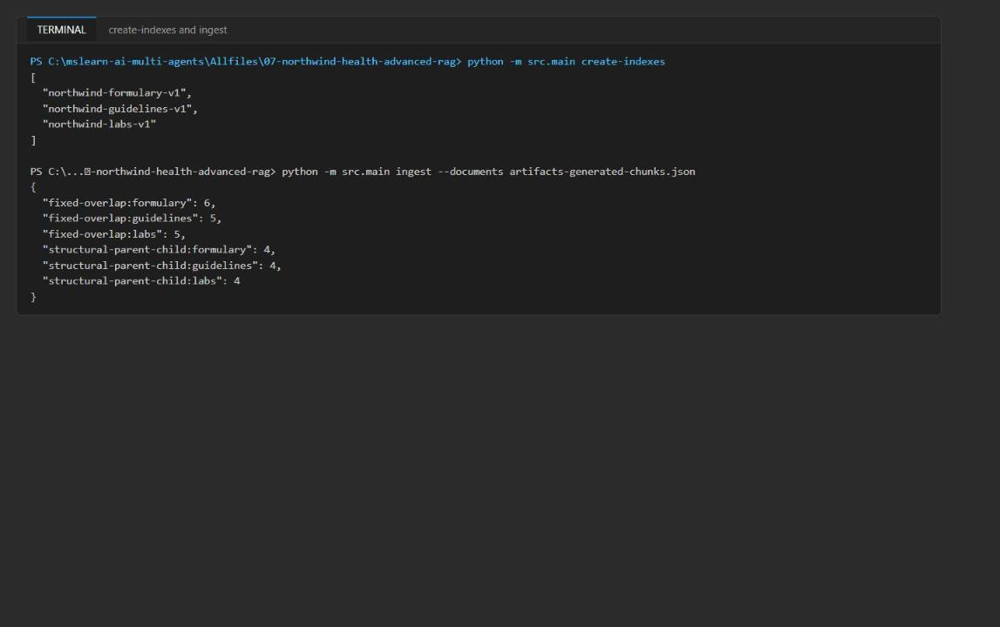

*Figure 9: create-indexes and ingest output*

**Verify the indexes in the Azure portal**

2. In the [Azure portal](https://portal.azure.com), open the search service whose name matches the host in `AZURE_SEARCH_ENDPOINT` in `.env`.

3. In the service menu, under **Search management**, select **Indexes**.

4. Confirm the indexes and document counts (select **Refresh** if the counts are still 0):

| Index | Expected document count |
|---|---|
| `northwind-formulary-v1` | 10 |
| `northwind-guidelines-v1` | 9 |
| `northwind-labs-v1` | 9 |

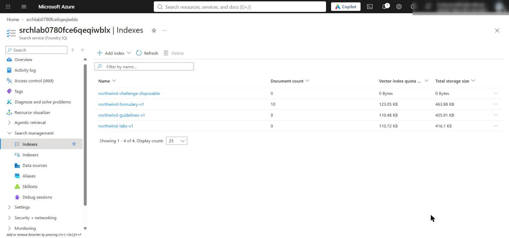

*Figure 10: The three indexes with their document counts*

> **Note:** The portal needs data-plane access to show counts. Because the service uses role-based access only, your account needs **Search Index Data Contributor** (or Reader), which Task 3 granted. If counts still show 0 after a refresh, wait a few minutes for RBAC propagation, or check `ingest` output for errors.

**Run the retrieval queries**

5. Run the following commands **one at a time** (not as a pasted batch) and inspect each JSON result before continuing. For each, first confirm which index or indexes were selected (the top-level JSON keys), then compare `parent_id`, `chunk_strategy`, `@search.score`, `@search.reranker_score`, `captions` and `citation`.

```powershell
python -m src.main search --query "atorvastatin contraindications" --chunk-strategy fixed-overlap
```

```powershell
python -m src.main search --query "atorvastatin contraindications" --chunk-strategy structural-parent-child
```

```powershell
python -m src.main search --query "What A1C range requires follow-up?"
```

```powershell
python -m src.main search --query "How should diabetes therapy and monitoring be coordinated?"
```

```powershell
python -m src.main search --query "atorvastatin contraindications" --mode vector --embedding-profile baseline --chunk-strategy fixed-overlap
```

```powershell
python -m src.main search --query "atorvastatin contraindications" --mode hybrid --embedding-profile content-aware --chunk-strategy structural-parent-child
```

```powershell
python -m src.main search --query "atorvastatin contraindications" --mode semantic --chunk-strategy structural-parent-child
```

**Expected result:**

- The atorvastatin queries route only to `northwind-formulary-v1`. In hybrid mode the atorvastatin chunks rank first (RRF score about 0.028), followed by vector-only metformin candidates (about 0.011).
- The A1C query routes only to `northwind-labs-v1`; the top result `structural-parent-child-labs-a1c-001` has a `@search.reranker_score` (about 2.4) and an extractive caption.
- The diabetes coordination query matches several intents, so it fans out to all three indexes and returns source-specific citations.

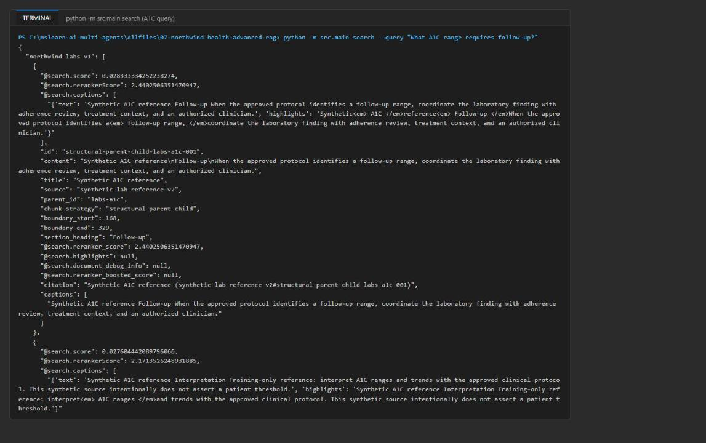

*Figure 11: The A1C query routed to the labs index, with reranker score and caption*

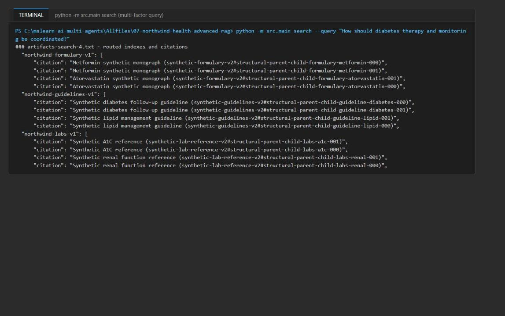

*Figure 12: The multi-factor query searches all three indexes with source-specific citations*

6. Optionally, check one query in the portal: open the search service, select **Search explorer**, choose index `northwind-formulary-v1`, enter `atorvastatin` and select **Search**. The atorvastatin chunks of both strategies are returned.

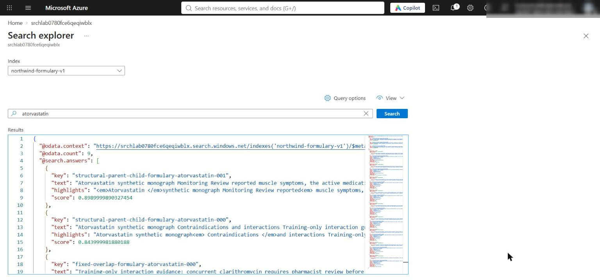

*Figure 13: Search explorer query against the formulary index*

7. Run the full comparison once. It records every configured query, strategy, mode, embedding profile and routed index as a trial:

```powershell
python -m src.main compare --queries assets/queries.json --documents artifacts-generated-chunks.json --output artifacts-retrieval-comparison.json
```

**Expected result:** `artifacts-retrieval-comparison.json` contains `chunk_strategies`, about 50 `trials` (call-level ranking, scores and latency) and 10 `aggregates` (MRR and average latency per strategy, mode and embedding profile). This takes a couple of minutes because each trial is a live service call.

---

## Task 6: Validate the implementation

1. Run the local and infrastructure checks again and summarize the evidence:

```powershell
python scripts/preflight.py
Get-ChildItem src/*.py | ForEach-Object { python -m py_compile $_.FullName }
az bicep build --file infra/main.bicep
$evidence = Get-Content artifacts-retrieval-comparison.json | ConvertFrom-Json
$evidence.chunk_strategies | Format-Table strategy,chunk_count
$evidence.aggregates | Sort-Object mode,embedding_profile,chunk_strategy | Format-Table chunk_strategy,mode,embedding_profile,trial_count,mrr,average_latency_ms
$evidence.trials | Sort-Object query,index,mode,embedding_profile,chunk_strategy | Format-Table query,index,chunk_strategy,mode,embedding_profile,reciprocal_rank,latency_ms
```

**Expected result:** `Preflight passed`, no Python or Bicep errors, both chunk strategies listed (16 and 12 chunks), and 10 aggregate rows. In the reference run every aggregate had MRR 1.00 and structural-parent-child was about 250-800 ms faster on average in every mode.

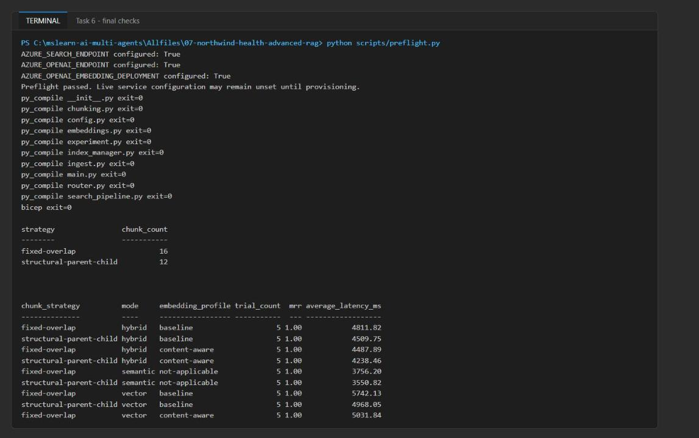

*Figure 14: Preflight, compile checks and the MRR / latency aggregates*

2. Compare vector-only and hybrid rankings for the same query, strategy and profile:

```powershell
$evidence.trials | Where-Object { $_.query -eq 'atorvastatin contraindications' -and $_.chunk_strategy -eq 'fixed-overlap' -and $_.embedding_profile -eq 'baseline' } | ForEach-Object { "$($_.mode): " + (($_.ranking | ForEach-Object id) -join ', ') }
```

**Expected result:** Two rankings from live calls. In the reference run vector order was atorvastatin-000, -001, metformin-001, metformin-000, metformin-002, and hybrid order was atorvastatin-001, -002, -000, metformin-001, metformin-000. Rankings may also coincide; the live service-call evidence is what matters.

### Acceptance criteria

| Criterion | How to check |
|---|---|
| `create-indexes` reports three index names with the semantic configuration | Task 5 step 1 output; portal **Indexes** page; index **Semantic configurations** tab shows `clinical-semantic-config` |
| Chunk artifact records both configurations, chunk counts, every boundary and the same six parent IDs | Task 2 step 2 tables; `python scripts/preflight.py` passes |
| `ingest` succeeded for every chunk, separated by strategy and category | `ingest` output 6/5/5 and 4/4/4; portal document counts 10/9/9 |
| Atorvastatin query routes to formulary with exact-name and vector candidates | Search 1, 2, 5, 6, 7 output keys show only `northwind-formulary-v1` |
| A1C query routes to labs with reranker score or caption | Search 3 output: `@search.reranker_score` and `captions` present |
| Multi-factor query searches all three indexes with source-specific citations | Search 4 output has three index keys and `citation` values per source |
| Vector-only and hybrid rankings compared for the same query, strategy and profile | Task 6 step 2 |
| Every trial identifies strategy, query, index, mode and profile, with ranking, scores and latency from one call | Inspect any element of `$evidence.trials` |
| `aggregates` reports MRR and average latency by strategy, mode and profile | Task 6 step 1 aggregate table |
| Final checks pass | `Preflight passed`, `py_compile` and `az bicep build` with no errors |

> **Note:** MRR is 1.0 everywhere in the reference run, so three synthetic queries cannot separate the strategies on quality. Structural parent-child uses fewer chunks (12 vs 16) and was slightly faster, which makes it the cheaper choice here; a larger labeled evaluation set is needed to choose on quality.

---

## Optional challenge: Create a ranking disagreement

Find a synthetic query where lexical (BM25) and vector retrieval select different top documents, and investigate a schema failure.

1. Create the file `scripts/challenge_disagreement.py` with this content. It runs live lexical and vector searches over the structural chunks in the formulary index for five candidate queries, selects the query with the biggest disagreement, and then creates a disposable index without `section_heading` to see where the failure surfaces:

```python
"""Optional challenge: find a synthetic query where lexical and vector retrieval disagree.

Every ranking comes from a live Azure AI Search call (no local similarity math).
Writes artifacts-challenge-disagreement.json in the lab folder.
"""
from __future__ import annotations

import json
import sys
import time
from pathlib import Path

ROOT = Path(__file__).resolve().parents[1]
sys.path.insert(0, str(ROOT))

from azure.core.exceptions import HttpResponseError  # noqa: E402
from azure.identity import DefaultAzureCredential  # noqa: E402
from azure.search.documents import SearchClient  # noqa: E402
from azure.search.documents.indexes import SearchIndexClient  # noqa: E402
from azure.search.documents.indexes.models import SearchIndex  # noqa: E402

from src.config import load_settings  # noqa: E402
from src.embeddings import create_embedding_client, embed_texts  # noqa: E402
from src.index_manager import INDEX_NAMES  # noqa: E402
from src.router import route_query  # noqa: E402
from src.search_pipeline import hybrid_semantic_search  # noqa: E402

STRATEGY = "structural-parent-child"
CANDIDATES = [
    # (synthetic query, expected parent judged by a reviewer for the *intent* of the query)
    ("Which drug review applies when a patient reports muscle pain?", "formulary-atorvastatin"),
    ("medication follow-up for kidney function decline", "formulary-metformin"),
    ("drug guidance on clarithromycin", "formulary-atorvastatin"),
    ("Which medication requires checking how well the kidneys filter blood?", "formulary-metformin"),
    ("medication follow-up when adherence questions arise", "formulary-metformin"),
]

def lexical(settings, credential, index_name, query):
    client = SearchClient(settings.search_endpoint, index_name, credential)
    started = time.perf_counter()
    rows = [
        {"id": r["id"], "parent_id": r["parent_id"], "search_score": r["@search.score"]}
        for r in client.search(search_text=query, filter=f"chunk_strategy eq '{STRATEGY}'", top=5,
                               select=["id", "parent_id"])
    ]
    return rows, round((time.perf_counter() - started) * 1000, 2)

def vector(settings, credential, embedding_client, index_name, query):
    started = time.perf_counter()
    rows = hybrid_semantic_search(
        settings.search_endpoint, index_name, credential, embedding_client, settings.embedding_deployment,
        settings.semantic_configuration, query, mode="vector", vector_field="optimized_vector",
        filter_expression=f"chunk_strategy eq '{STRATEGY}'",
    )
    return ([{"id": r["id"], "parent_id": r["parent_id"], "search_score": r["@search.score"]} for r in rows],
            round((time.perf_counter() - started) * 1000, 2))

def rr(rows, expected):
    for rank, row in enumerate(rows, 1):
        if row["parent_id"] == expected:
            return round(1 / rank, 4)
    return 0.0

def failure_investigation(settings, credential, embedding_client):
    """Drop a required field from a disposable index and classify the resulting failure."""
    name = "northwind-challenge-disposable"
    index_client = SearchIndexClient(settings.search_endpoint, credential)
    template = index_client.get_index(INDEX_NAMES["formulary"])
    fields = [f for f in template.fields if f.name != "section_heading"]
    index_client.create_or_update_index(SearchIndex(
        name=name, fields=fields, vector_search=template.vector_search, semantic_search=None))
    chunk = json.loads((ROOT / "artifacts-generated-chunks.json").read_text(encoding="utf-8"))["chunks"][0]
    vec = embed_texts(embedding_client, settings.embedding_deployment, [chunk["content"]])[0]
    document = {**chunk, "content_vector": vec, "optimized_vector": vec}
    try:
        SearchClient(settings.search_endpoint, name, credential).upload_documents([document])
        outcome = {"error": None, "classification": "no failure"}
    except HttpResponseError as error:
        outcome = {"error": str(error.message)[:400], "classification": (
            "schema (surfaced at ingestion): the index definition lacks 'section_heading', so the service rejects "
            "the whole upload batch before indexing; routing and grounding are never reached")}
    return {"disposable_index": name, "removed_field": "section_heading", **outcome}

def main() -> int:
    settings = load_settings()
    credential = DefaultAzureCredential()
    embedding_client = create_embedding_client(settings.openai_endpoint)
    trials = []
    for query, expected in CANDIDATES:
        for index_name in route_query(query):
            if index_name != INDEX_NAMES["formulary"]:
                continue
            lex, lex_ms = lexical(settings, credential, index_name, query)
            vec, vec_ms = vector(settings, credential, embedding_client, index_name, query)
            trials.append({
                "query": query, "routed_indexes": route_query(query), "index": index_name,
                "chunk_strategy": STRATEGY, "expected_parent_id": expected,
                "lexical": {"mode": "lexical-bm25", "top_parent": lex[0]["parent_id"] if lex else None,
                            "reciprocal_rank": rr(lex, expected), "latency_ms": lex_ms, "ranking": lex},
                "vector": {"mode": "vector", "embedding_profile": "content-aware",
                           "top_parent": vec[0]["parent_id"] if vec else None,
                           "reciprocal_rank": rr(vec, expected), "latency_ms": vec_ms, "ranking": vec},
            })
    disagreements = [t for t in trials if t["lexical"]["top_parent"] != t["vector"]["top_parent"]]
    selected = None
    if disagreements:
        t = max(disagreements, key=lambda t: abs(t["lexical"]["reciprocal_rank"] - t["vector"]["reciprocal_rank"]))
        winner = "lexical" if t["lexical"]["reciprocal_rank"] >= t["vector"]["reciprocal_rank"] else "vector"
        selected = {
            "query": t["query"], "selected_route": t["routed_indexes"],
            "winning_mode": winner, "winning_document": t[winner]["ranking"][0],
            "metric": "reciprocal rank of the expected parent (MRR over this single labeled query)",
            "lexical_rr": t["lexical"]["reciprocal_rank"], "vector_rr": t["vector"]["reciprocal_rank"],
        }
    result = {"trials": trials, "disagreement_count": len(disagreements), "selected": selected,
              "failure_investigation": failure_investigation(settings, credential, embedding_client)}
    (ROOT / "artifacts-challenge-disagreement.json").write_text(json.dumps(result, indent=2, default=str) + "\n",
                                                                encoding="utf-8")
    print(json.dumps({k: v for k, v in result.items() if k != "trials"}, indent=2, default=str))
    for t in trials:
        print(t["query"], "| lexical:", t["lexical"]["top_parent"], "| vector:", t["vector"]["top_parent"])
    return 0

if __name__ == "__main__":
    raise SystemExit(main())
```

2. Run it:

```powershell
python scripts/challenge_disagreement.py
```

**Expected result:** One disagreement. "Which medication requires checking how well the kidneys filter blood?" routes to formulary; lexical ranks atorvastatin first (expected parent at reciprocal rank 0.33) while vector ranks metformin first (reciprocal rank 1.0), so the winning mode is **vector** by reciprocal rank of the labeled parent. The upload to the disposable index fails with "The property 'section_heading' does not exist on type 'search.documentFields'": a **schema** failure that surfaces at ingestion, so routing and grounding never run.

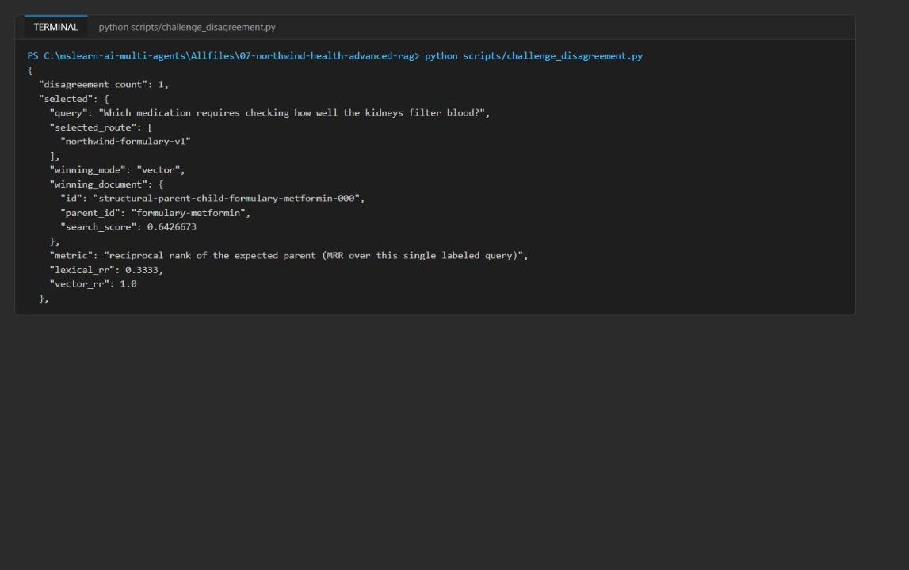

*Figure 15: Challenge output: lexical vs vector disagreement and the schema failure*

3. Delete the disposable index when you are done (or let the resource group deletion remove it):

```powershell
$search = (Get-Content .env | Select-String '^AZURE_SEARCH_ENDPOINT=').ToString().Split('=',2)[1].Trim('"')
$token = az account get-access-token --resource https://search.azure.com --query accessToken -o tsv
Invoke-RestMethod -Method Delete -Uri "$search/indexes('northwind-challenge-disposable')?api-version=2024-07-01" -Headers @{ Authorization = "Bearer $token" }
```

---

## Validate

Use the acceptance-criteria table in Task 6. In the portal you can additionally confirm:

- Search service **Indexes** page: three indexes with 10, 9 and 9 documents.
- Select an index > **Fields**: `content_vector` and `optimized_vector` are `Collection(Edm.Single)` with 1536 dimensions; `chunk_strategy`, `category`, `parent_id` are filterable.
- Select an index > **Semantic configurations**: `clinical-semantic-config` with title `title`, content `content` and keywords `section_heading`.
- Search service **Access control (IAM) > Role assignments**: your account has Search Service Contributor and Search Index Data Contributor.

## Troubleshooting

| Symptom | Cause and fix |
|---|---|
| Deployment fails with `InsufficientResourcesAvailable` for the search service | The region has no Azure AI Search capacity (this happened in `eastus2` in the reference run). Delete the resource group and redeploy in a region with Search capacity, for example `eastus`. A failed attempt can leave an Azure OpenAI account behind in the first resource group; delete that group too. |
| `403 Forbidden` from Search or Azure OpenAI right after deployment | RBAC propagation. Wait 1-5 minutes and retry. Confirm the role assignments in **Access control (IAM)**. |
| `IndentationError` after pasting a snippet | The official snippets use 2-space indentation; the files use 4 spaces. Use the 4-space code in this guide. |
| `KeyError: 'AZURE_SEARCH_ENDPOINT'` | `.env` is missing or was written elsewhere. Run the `.env` part of the Task 3 script from the lab folder. |
| Portal shows 0 documents | Wait and select **Refresh**; check the `ingest` output. The portal also needs Search Index Data Reader/Contributor because keys are disabled. |
| Latency of 3-6 seconds per trial | Expected: each trial embeds the query and acquires a token with a new client. Latency is relative evidence only. |
| `az cognitiveservices account` name conflict when redeploying with the same environment name | A soft-deleted Azure OpenAI account with the same name exists. Purge it (see Clean up) or use a new `$suffix`. |

## Review questions

**Which query types should disable semantic query rewrite to preserve exact identifiers?** Exact-identifier lookups: drug names (atorvastatin, clarithromycin), lab test codes and units, document and chunk IDs, policy or formulary version labels, and dosage or numeric-range strings. A rewrite can replace them with synonyms, normalize them or drop them. Route these lexical-first, or hybrid with rewriting off; keep rewriting for broad conceptual questions.

**What evidence would justify adding a cross-encoder after semantic ranking?** A larger, representative labeled query set where semantic ranking still leaves the expected parent outside the top positions, plus a statistically meaningful MRR or nDCG gain from the cross-encoder on held-out queries, with its extra latency and cost measured and inside budget and no regression on exact-identifier queries. In this lab MRR is already 1.0, so there is nothing to gain.

**How should source health alter routing without changing intent classification?** Keep intent classification pure (query text in, categories out) and apply source health afterwards as a separate policy step on the returned index list: skip or deprioritize an unhealthy or stale index, fall back to a replica or the previous index version, widen fan-out when the primary source is degraded, and report the degraded source in the result. Never silently drop a source.

**Which retrieval fields are safe to include in agent context?** `content`, `title`, `section_heading`, `source`, `parent_id`, chunk `id`, `chunk_strategy`, boundary offsets and the citation string. Not the vector fields (large, unreadable, expose the embedding model). Raw scores belong in evaluation logs, not the prompt. Captions are extracts of `content` and follow the same rules. Keys, endpoints and admin metadata never go into agent context.

## Clean up (optional)

1. Delete the resource group when you no longer need the resources (Search Standard is billed hourly):

```powershell
az group delete --name $resourceGroupName --yes --no-wait
```

If your terminal session was closed, use the name from `.env` (`AZURE_RESOURCE_GROUP`) instead of `$resourceGroupName`. Also delete any resource group left by a failed deployment attempt in another region.

2. Azure OpenAI accounts are soft-deleted. Purge the account so its name and quota are released:

```powershell
az cognitiveservices account list-deleted --query "[].{name:name, location:location}" -o table
az cognitiveservices account purge --name <aoai-account-name> --resource-group <resource-group-name> --location <region>
```

3. Remove `.env` and deactivate the virtual environment in every terminal where `(.venv)` appears:

```powershell
Remove-Item .env
deactivate
```

