# Lab 08: Build persistent shared memory for Foundry agents

## Overview

**Scenario.** Northwind Health runs several agents (scheduling, care navigation, medication support) that must share reviewed, patient-scoped preferences. A **Memory Coordinator** supplies bounded, patient-scoped evidence from a durable store, with patient isolation, read-your-writes consistency, retention, and auditable deletion.

**What you'll build.** You implement a custom memory layer in Azure Cosmos DB for NoSQL (vector search, partition per patient, TTL, separate audit container) and connect it to a Microsoft Agent Framework agent that you run locally and then deploy as a Microsoft Foundry **Hosted Agent**. The agent calls a read-only `recall_patient_memory` tool, builds a bounded context, and answers with cited memory IDs. Memory writes, consolidation, and pruning stay as explicit administrative CLI commands.

**Duration.** About 60-75 minutes (45 minutes of lab work plus provisioning and hosted-agent build time).

> **Important:** The Cosmos DB serverless account, both Foundry model deployments, and Hosted Agent compute are billable. Use only the synthetic data in the lab and complete the **Clean up** section when you finish.

**Architecture**

| Component | Role in the lab |
|---|---|
| `agent.py` | Hosted Agent (Microsoft Agent Framework) with the read-only `recall_patient_memory` tool |
| `src/memory_store.py` | Patient-scoped upsert, vector recall (`VectorDistance`), audit, guarded consolidation |
| `src/context_budget.py` | Bounded, delimited model context (token budget) |
| `src/consistency.py` | Read-your-writes check with explicit session-token transfer |
| `src/retention.py` | Retention policy, partition-scoped deletes, audit of deletions |
| Cosmos DB `clinical-memory-db` / `patient-memories` | Durable memory: partition key `/patientId`, 1,536-dim cosine vector policy, `quantizedFlat` index, default TTL 30 days |
| Cosmos DB `clinical-memory-db` / `memory-audit` | Content-free audit events (separate container) |
| Foundry account + project | `gpt-5.4-mini` chat deployment, `text-embedding-3-small` embedding deployment, Hosted Agent `northwind-health-memory-coordinator` |
| Hosted agent instance identity | Entra identity the deployed agent runs as; needs its own model and Cosmos data-plane roles |

---

## Prerequisites

Install these tools:

- [Python 3.13](https://www.python.org/downloads/)
- [Azure CLI](https://learn.microsoft.com/cli/azure/install-azure-cli) (2.80 or later)
- [Azure Developer CLI (azd) 1.27.1 or later](https://learn.microsoft.com/azure/developer/azure-developer-cli/install-azd), used only to run and deploy the Hosted Agent
- [Git](https://git-scm.com/downloads)
- [Visual Studio Code](https://code.visualstudio.com/download) with the [Python](https://marketplace.visualstudio.com/items?itemName=ms-python.python), [Bicep](https://marketplace.visualstudio.com/items?itemName=ms-azuretools.vscode-bicep), and [Foundry Toolkit](https://marketplace.visualstudio.com/items?itemName=ms-windows-ai-studio.windows-ai-studio) extensions

Azure permissions: you need to create a resource group, Cosmos DB account, Foundry account and project, model deployments, a Hosted Agent, and role assignments. **Owner** (or **Contributor** plus **User Access Administrator**) on the subscription or resource group is sufficient. Vector search and model availability vary by region; this guide uses `eastus2`.

---

## Task 1: Prepare the lab

1. Clone the lab repository (skip if you already have it):

```powershell
git clone https://github.com/MicrosoftLearning/mslearn-ai-multi-agents.git
```

2. Open the cloned `mslearn-ai-multi-agents` folder in Visual Studio Code, then open a terminal (**Terminal > New Terminal**, PowerShell).

3. Change to the lab folder and check the tools and your subscription:

```powershell
cd Allfiles\08-northwind-health-multi-agent-memory
az version
azd version
python --version
```

4. Sign in to Azure with both CLIs and select your subscription:

```powershell
az login
az account set --subscription "<your-subscription-id>"
az account show --output table
azd auth login
```

5. Install (or update) the azd AI agents extension, which provides the `azd ai agent` commands:

```powershell
azd extension install azure.ai.agents
azd extension upgrade azure.ai.agents
```

**Expected result:** `python --version` prints 3.13.x, `azd version` is 1.27.1 or later, and `az account show` lists the subscription you want to use.

6. Review the architecture boundaries before you edit code:

| Boundary | Component |
|---|---|
| Hosted conversation and read-only recall tool | `agent.py` |
| Durable patient-scoped memory | `src/memory_store.py` and the `patient-memories` container |
| Bounded model context | `src/context_budget.py` |
| Session consistency transfer | `src/consistency.py` |
| Retention and deletion | `src/retention.py` |
| Durable audit evidence | `memory-audit` container |
| Azure resources and synthetic input | `infra/main.bicep` and `assets/memories.json` |

Cosmos DB, not the conversation history, is the durable memory authority, and memory and audit records live in separate containers. Use `DefaultAzureCredential` only: no account keys, connection strings, real patient data, or shared memory partitions.

> **Note:** Do not replace Cosmos DB operations with an in-memory list or a local vector calculation. The lab validates real service behavior (vector index, RU charge, partitions, TTL, consistency).

---

## Task 2: Build the virtual environment

1. Create the virtual environment and install the requirements, then activate it:

```powershell
./scripts/setup.ps1
. ./.venv/Scripts/Activate.ps1
```

> **Note:** On macOS/Linux run `bash scripts/setup.sh` and then `source .venv/bin/activate`.

2. Open `assets/memories.json` and review the records. All patient IDs and observations are synthetic (`synthetic-patient-100` and `synthetic-patient-200`). There are no stored vectors: embeddings are generated at ingestion time.

**Expected result:** the prompt starts with `(.venv)`.

---

## Task 3: Deploy the Azure resources

You provision with the Azure CLI (not `azd provision`). The template `infra/main.bicep` takes three parameters: `location`, `environmentName`, and `principalId` (your user object ID, which receives Cosmos DB data-plane and model roles). It creates the Cosmos DB serverless account with vector search, the database and both containers, the Foundry `AIServices` account and project, and the `gpt-5.4-mini` and `text-embedding-3-small` deployments.

1. Choose a region where Cosmos DB vector search, Microsoft Foundry, `gpt-5.4-mini` (GlobalStandard, 10K TPM) and `text-embedding-3-small` (GlobalStandard, 20K TPM) are available with quota. The example uses `eastus2`.

2. Run the following block from the lab folder. It creates a unique resource group, deploys the Bicep template, grants your user data-plane access, and writes `.env` from the deployment outputs:

```powershell
$azureRegion = 'eastus2'
$suffix = (New-Guid).Guid.Substring(0, 8)
$resourceGroupName = "rg-lab08-$suffix"
$envName = "lab08-$suffix"
$me = az ad signed-in-user show --query id -o tsv
az group create --name $resourceGroupName --location $azureRegion --output none
az bicep build --file infra/main.bicep
az deployment group create --resource-group $resourceGroupName --name lab08-main `
  --template-file infra/main.bicep `
  --parameters location=$azureRegion environmentName=$envName principalId=$me `
  --output none
# Grant yourself data-plane access (Foundry agents + model calls)
$rgId = az group show --name $resourceGroupName --query id -o tsv
foreach ($role in 'Azure AI User','Cognitive Services OpenAI User','Azure AI Developer') {
  az role assignment create --assignee-object-id $me --assignee-principal-type User --role $role --scope $rgId --output none
}
# Write .env from the deployment outputs
$outputs = az deployment group show --resource-group $resourceGroupName --name lab08-main --query properties.outputs -o json | ConvertFrom-Json
$lines = @("AZURE_RESOURCE_GROUP=`"$resourceGroupName`"", "AZURE_LOCATION=`"$azureRegion`"", "AZURE_ENV_NAME=`"$envName`"",
  "AZURE_SUBSCRIPTION_ID=`"$(az account show --query id -o tsv)`"", "AZURE_PRINCIPAL_ID=`"$me`"", "AZURE_PRINCIPAL_TYPE=`"User`"",
  "AGENT_PATIENT_ID=`"synthetic-patient-100`"")
$outputs.PSObject.Properties | ForEach-Object { $lines += "$($_.Name.ToUpper())=`"$($_.Value.value)`"" }
$lines | Out-File .env -Encoding utf8
Get-Content .env
```

**Expected result:** the deployment finishes in about 5-10 minutes and `.env` lists `AZURE_COSMOS_ENDPOINT`, `AZURE_COSMOS_DATABASE_NAME=clinical-memory-db`, `AZURE_COSMOS_MEMORY_CONTAINER=patient-memories`, `AZURE_COSMOS_AUDIT_CONTAINER=memory-audit`, `FOUNDRY_PROJECT_ENDPOINT`, `FOUNDRY_PROJECT_ID`, `FOUNDRY_ACCOUNT_NAME`, `FOUNDRY_MODEL_NAME=gpt-5.4-mini`, `AZURE_OPENAI_ENDPOINT` and `AZURE_OPENAI_EMBEDDING_DEPLOYMENT=text-embedding-3-small`. `AZURE_OPENAI_ENDPOINT` points to the Foundry `AIServices` account (`https://aif...openai.azure.com/`), not to a separate `kind: OpenAI` account. There are no keys or connection strings in the file.

> **Note:** If the deployment fails, read the first error with `az deployment group show -g $resourceGroupName -n lab08-main --query properties.error`. The common causes are regional availability of Cosmos DB vector search or a model, `GlobalStandard` quota, and missing permission to create role assignments. Fix the cause (for example, change `$azureRegion` and use a new resource group) and run the block again.

3. Allow 1-5 minutes for the RBAC role assignments to propagate before you run code against Cosmos DB or the models.

4. In the [Azure portal](https://portal.azure.com), open your resource group `rg-lab08-<suffix>` and confirm it contains the Cosmos DB account (`cos...`) and the Foundry account (`aif...`) with its project.

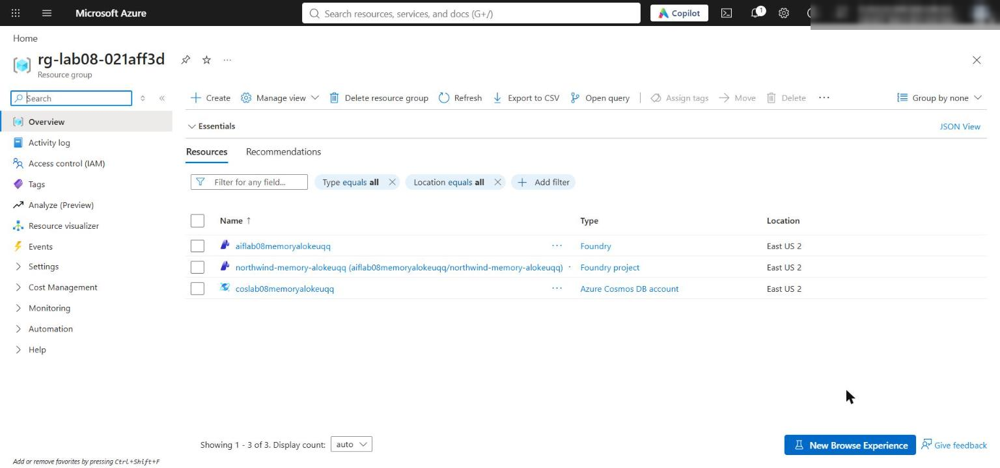

*Figure 1: The lab 08 resource group with the Cosmos DB account and the Foundry account and project*

5. Open the Foundry account, select **Model deployments** (or open the project in the [Foundry portal](https://ai.azure.com) and select **Models + endpoints**), and confirm that `gpt-5.4-mini` and `text-embedding-3-small` both show **Succeeded**.

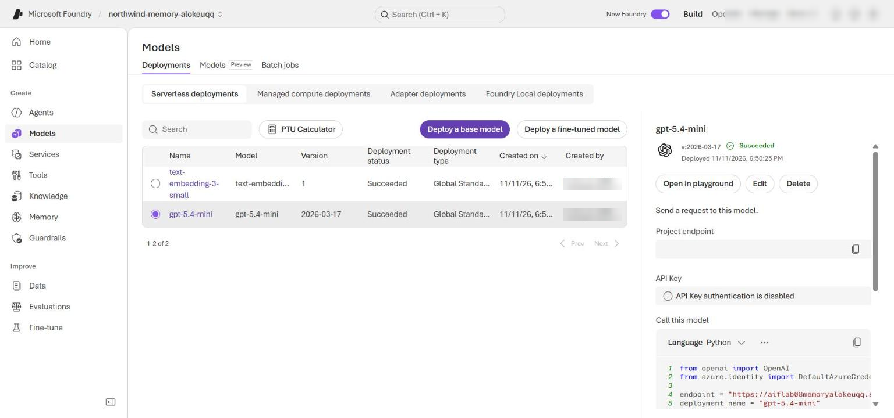

*Figure 2: Both model deployments in the Foundry project*

6. Open the Cosmos DB account and select **Data Explorer**. Expand **clinical-memory-db** and confirm the `patient-memories` and `memory-audit` containers exist.

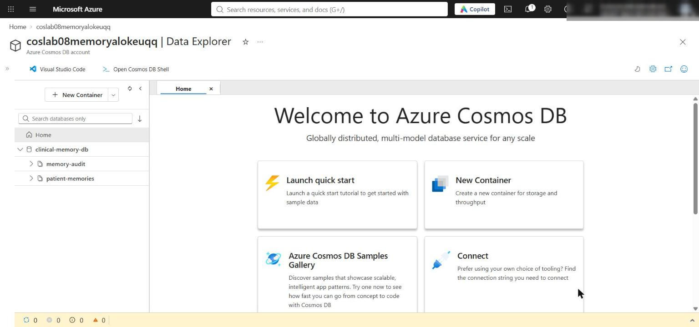

*Figure 3: The clinical-memory-db database with the patient-memories and memory-audit containers*

7. Create an azd environment for the Hosted Agent and load the values from `.env` into it. azd is used **only** for `azd ai agent run/invoke` and `azd deploy` in Task 5; do not run `azd provision`.

```powershell
azd env new lab08-memory-dev --subscription (az account show --query id -o tsv) --location $azureRegion
Get-Content .env | ForEach-Object {
  if ($_ -match '^\s*([A-Z0-9_]+)\s*=\s*"?(.*?)"?\s*$') { azd env set $Matches[1] $Matches[2] }
}
azd env get-values
```

**Expected result:** `azd env get-values` shows the same values as `.env`, including `AZURE_SUBSCRIPTION_ID`, `AZURE_LOCATION`, `AZURE_RESOURCE_GROUP`, `AZURE_AI_PROJECT_ID` and `FOUNDRY_PROJECT_ENDPOINT`.

> **Note:** Run this in PowerShell. In Git Bash, `azd env set` rewrites values that start with `/subscriptions/...` into Windows paths such as `C:/Program Files/Git/subscriptions/...`. If you must use Git Bash, prefix the command with `MSYS_NO_PATHCONV=1`.

---

## Task 4: Implement the solution

There are six placeholders. For each one, find the exact `# LAB PLACEHOLDER` comment, **keep the comment**, and replace only the `raise NotImplementedError(...)` line beneath it.

> **Note:** How to paste with the right indentation: select the whole `raise NotImplementedError(...)` line including its leading spaces and delete it, paste the snippet on that empty line, then select the pasted lines and press **Tab** the number of times given in each step, so the first pasted line lines up with the `# LAB PLACEHOLDER` comment. Python uses 4-space indentation (VS Code inserts 4 spaces per Tab). Placeholders 1-3 are inside class methods (body at 8 spaces: press **Tab twice**); placeholders 4-6 are inside module functions (body at 4 spaces: press **Tab once**).

The `PatientMemoryStore` constructor already creates one reusable async `CosmosClient` with `DefaultAzureCredential` and session consistency. Keep using that client.

### Placeholder 1: Persist an embedded memory

1. Open `src/memory_store.py` and find `# LAB PLACEHOLDER 1: Replace this line with the Task 1 sample.` in `upsert_memory`.

2. Replace the line `raise NotImplementedError("Complete upsert_memory in Task 1")` with the following code, then press **Tab twice**:

```python
patient_id = str(memory["patientId"])
self._authorize(patient_id)
item = {
    **memory,
    "embedding": self._embeddings.embed(str(memory["content"])),
}
response = await self._memories.upsert_item(item)
headers = response.get_response_headers()
return {
    "id": response["id"],
    "patientId": response["patientId"],
    "request_charge": float(headers.get("x-ms-request-charge", 0)),
    "session_token": headers.get("x-ms-session-token"),
}
```

Authorization happens before any embedding call or I/O. The result returns the RU charge and session token but never the memory content. Items without a `ttl` inherit the container default of 2,592,000 seconds (30 days); a positive `ttl` overrides it, and `ttl: -1` disables expiry for that item.

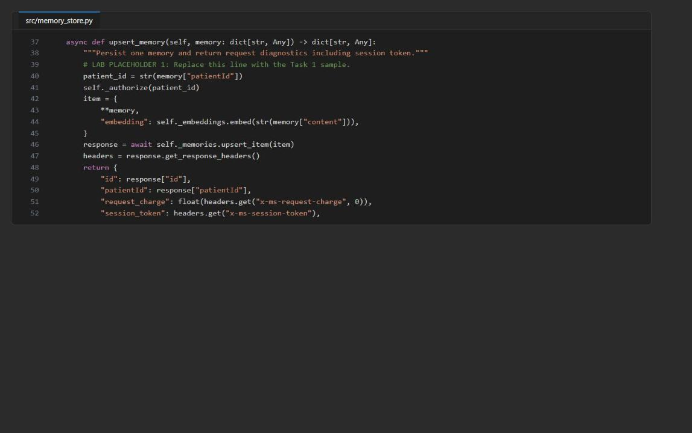

*Figure 4: upsert_memory after placeholder 1*

### Placeholder 2: Run partition-scoped vector recall

1. In `src/memory_store.py`, find `# LAB PLACEHOLDER 2: Replace this line with the Task 2 sample.` in `vector_recall`.

2. Replace the line `raise NotImplementedError("Complete vector_recall in Task 2")` with the following code, then press **Tab twice**:

```python
self._authorize(patient_id)
if isinstance(top_k, bool) or not isinstance(top_k, int) or not 1 <= top_k <= 20:
    raise ValueError("top_k must be an integer from 1 through 20")
embedding = self._embeddings.embed(query_text)
query = f"""
    SELECT TOP {top_k}
        c.id, c.patientId, c.content, c.importance, c.memoryType,
        c.critical, c.timestamp, c.ttl,
        VectorDistance(c.embedding, @embedding) AS vector_distance
    FROM c
    WHERE c.patientId = @patientId
    ORDER BY VectorDistance(c.embedding, @embedding)
"""
response_headers: dict[str, str] = {}
iterator = self._memories.query_items(
    query=query,
    parameters=[
        {"name": "@patientId", "value": patient_id},
        {"name": "@embedding", "value": embedding},
    ],
    partition_key=patient_id,
    response_hook=lambda headers, _: response_headers.update(headers),
)
results = [item async for item in iterator]
request_charge = float(response_headers.get("x-ms-request-charge", 0))
for item in results:
    item["request_charge"] = request_charge
return results
```

Only the validated integer is interpolated into `TOP`; the patient ID and the embedding stay as query parameters, and `partition_key` restricts the query to one patient partition. The `quantizedFlat` index needs at least 1,000 vectors before performance conclusions are meaningful; the six starter records validate behavior only.

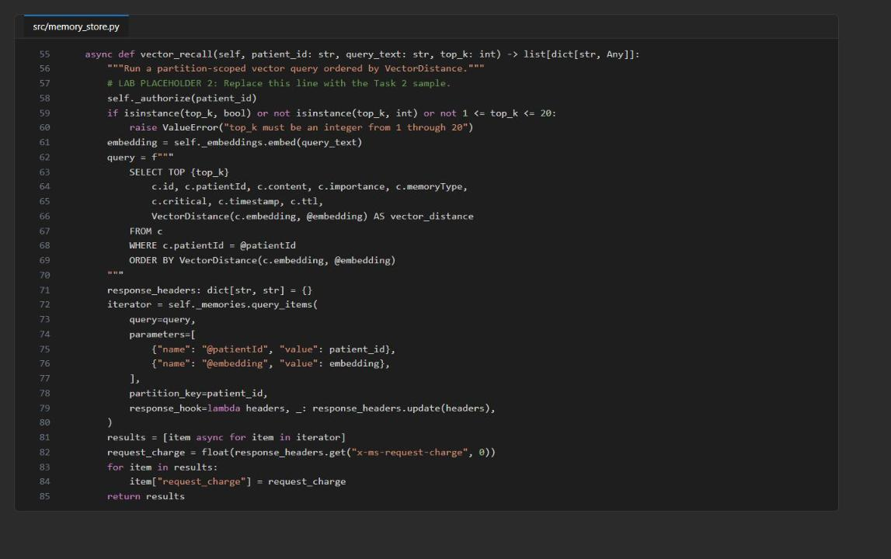

*Figure 5: vector_recall after placeholder 2*

### Placeholder 3: Write content-free audit evidence

1. In `src/memory_store.py`, find `# LAB PLACEHOLDER 3: Replace this line with the Task 3 sample.` in `write_audit`.

2. Replace the line `raise NotImplementedError("Complete write_audit in Task 3")` with the following code, then press **Tab twice**:

```python
self._authorize(patient_id)
await self._audit.upsert_item(
    {
        "id": event_id or str(uuid4()),
        "patientId": patient_id,
        "operation": operation,
        "memoryIds": sorted(set(memory_ids)),
        "reason": reason,
        "timestamp": event_timestamp or datetime.now(UTC).isoformat(),
    }
)
```

The audit event names the operation and affected IDs but deliberately excludes memory content and embeddings.

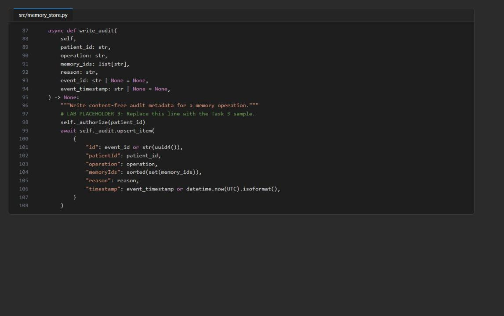

*Figure 6: write_audit after placeholder 3*

### Placeholder 4: Prove read-your-writes consistency

1. Open `src/consistency.py` and find `# LAB PLACEHOLDER 4: Replace this line with the Task 4 sample.` in `validate_read_your_writes`.

2. Replace the line `raise NotImplementedError(...)` with the following code, then press **Tab once**:

```python
diagnostics = await store.upsert_memory(memory)
session_token = diagnostics.get("session_token")
if not session_token:
    raise RuntimeError("The write response did not include a session token")
item = await store._memories.read_item(
    item=memory["id"],
    partition_key=memory["patientId"],
    session_token=session_token,
)
return {
    "write_id": diagnostics["id"],
    "read_id": item["id"],
    "patientId": item["patientId"],
    "session_token_transferred": True,
    "request_charge": diagnostics["request_charge"],
}
```

The point read uses the same partition key and the session token from the write, which gives an explicit read-your-writes guarantee.

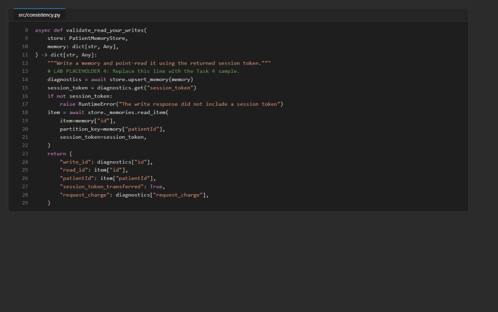

*Figure 7: validate_read_your_writes after placeholder 4*

### Placeholder 5: Build bounded memory context

1. Open `src/context_budget.py` and find `# LAB PLACEHOLDER 5: Replace this line with the Task 5 sample.` in `select_context`.

2. Replace the line `raise NotImplementedError(...)` with the following code, then press **Tab once**:

```python
if token_budget < 1:
    raise ValueError("token_budget must be positive")
recent_count = max(1, (len(memories) * 3 + 9) // 10) if memories else 0
recent = sorted(memories, key=lambda item: str(item["timestamp"]), reverse=True)[:recent_count]
ranked = sorted(
    memories,
    key=lambda item: (
        float(item.get("importance", 0)) * 0.5
        + (1.0 / (1.0 + float(item.get("vector_distance", 1)))) * 0.5
    ),
    reverse=True,
)
ordered = recent + [item for item in ranked if item not in recent]
selected: list[dict[str, Any]] = []
blocks: list[str] = []
used = estimate_tokens("<patient_memory>\n</patient_memory>")
for item in ordered:
    block = f"<memory id=\"{item['id']}\">{item['content']}</memory>"
    cost = estimate_tokens(block)
    if used + cost <= token_budget:
        selected.append(item)
        blocks.append(block)
        used += cost
return {
    "selected_ids": [item["id"] for item in selected],
    "token_count": used,
    "context": "<patient_memory>\n" + "\n".join(blocks) + "\n</patient_memory>",
}
```

The most recent 30% of records are reserved first; the rest are ranked by importance and vector score. The `<patient_memory>` delimiters separate stored memory from instructions.

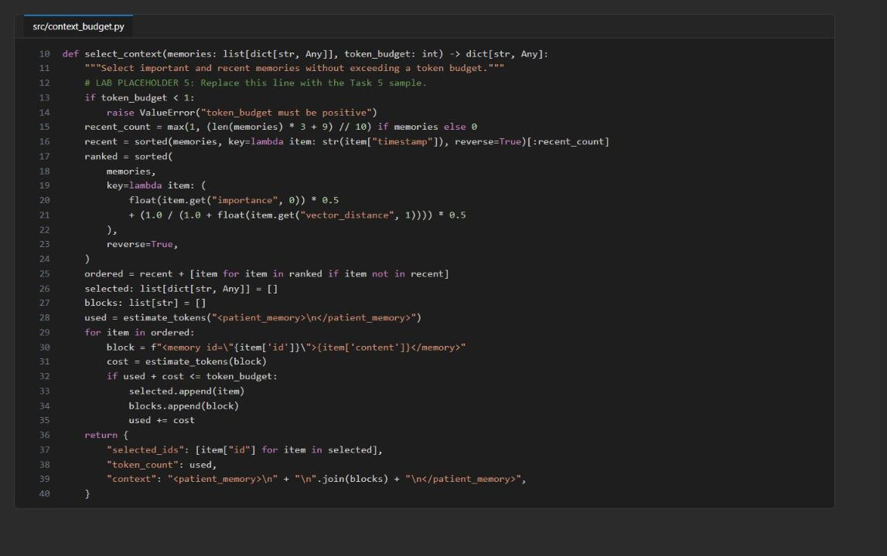

*Figure 8: select_context after placeholder 5*

### Placeholder 6: Apply retention and audit deletion

1. Open `src/retention.py` and find `# LAB PLACEHOLDER 6: Replace this line with the Task 6 sample.` in `prune_memories`.

2. Replace the line `raise NotImplementedError(...)` with the following code, then press **Tab once**:

```python
store._authorize(patient_id)
eligible_ids = sorted(
    str(memory["id"])
    for memory in memories
    if memory.get("patientId") == patient_id
    and not bool(memory.get("critical"))
    and int(memory.get("ttl", -1)) > 0
    and datetime.fromisoformat(
        str(memory["timestamp"]).replace("Z", "+00:00")
    ) + timedelta(seconds=int(memory["ttl"])) <= datetime.now(UTC)
    and float(memory.get("importance", 0)) <= 4.0
)
if dry_run:
    return {"status": "dry_run", "eligible_ids": eligible_ids, "deleted_count": 0}
for memory_id in eligible_ids:
    await store._memories.delete_item(item=memory_id, partition_key=patient_id)
if eligible_ids:
    await store.write_audit(
        patient_id,
        "retention_prune",
        eligible_ids,
        "expired noncritical memory with finite TTL and importance at or below 4.0",
    )
return {
    "status": "applied",
    "eligible_ids": eligible_ids,
    "deleted_count": len(eligible_ids),
}
```

Dry run and apply use the same rule: a record is eligible only if it is not critical, has a finite TTL, its timestamp plus TTL is in the past, and its importance is 4.0 or lower. Each delete is partition-scoped and is audited.

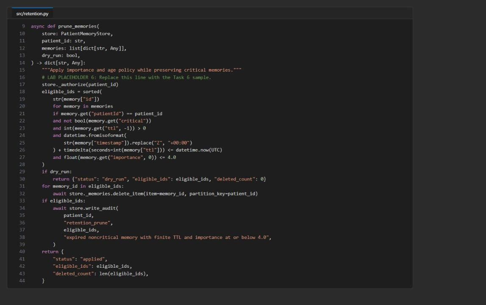

*Figure 9: prune_memories after placeholder 6*

### Review guarded consolidation (no code change)

1. In `src/memory_store.py`, read `consolidate_episodic_memories`. It point-reads every source in the patient partition, derives the TTL from the sources, and sends the semantic-memory create plus an ETag-conditional patch of every source in **one Cosmos DB transactional batch** (same `patientId` partition), so lineage changes commit all-or-nothing. The deterministic semantic ID (`semantic-<sha256>`) and audit ID make retries idempotent.

### Check the completed code

1. Save all files and run preflight:

```powershell
python scripts/preflight.py
```

**Expected result:** three `... configured: True` lines and `Preflight passed. Live service values may remain unset until provisioning.` If you see an `IndentationError` or `Preflight failed`, fix the indentation of the reported file.

---

## Task 5: Run the solution

### Run the memory operations

1. Load the synthetic memories and capture the write diagnostics:

```powershell
python -m src.main ingest --file assets/memories.json
```

**Expected result:** five entries (`mem-100-1` to `mem-100-5`), each with `patientId: synthetic-patient-100`, a `request_charge` of about 25 RU, and a `session_token`. No memory content is printed. `mem-200-1` is skipped on purpose because the store is bound to `synthetic-patient-100`.

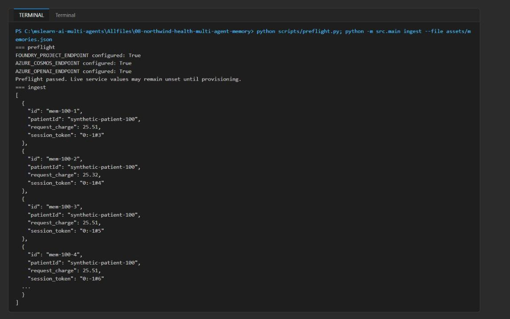

*Figure 10: Preflight and ingest output*

2. Recall memory for one patient and build the bounded context:

```powershell
python -m src.main recall --patient-id synthetic-patient-100 --query "medication tolerance and appointment preferences" --top 5 --budget 500
```

**Expected result:** `retrieved_memories` contains five records, all for `synthetic-patient-100`, each with the same query `request_charge` (about 3.3 RU). `bounded_context` lists the selected IDs, a `token_count` of 500 or less (about 132), and a `<patient_memory>` block.

> **Note:** The values in `vector_distance` appear in **descending** numeric order (for example 0.452, 0.435, 0.398, 0.373, 0.315). The container uses `distanceFunction: cosine`, and for cosine Cosmos DB `VectorDistance` returns a similarity score, so `ORDER BY VectorDistance` returns the most similar record first. The ordering is correct; the field name and the official lab text ("ascending") are misleading.

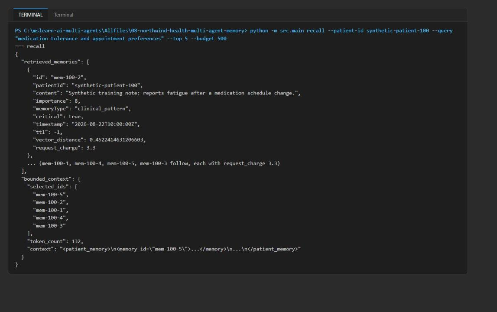

*Figure 11: Partition-scoped vector recall and bounded context*

3. Validate read-your-writes consistency:

```powershell
python -m src.main consistency --patient-id synthetic-patient-100
```

4. Run a dry-run prune before allowing any deletion:

```powershell
python -m src.main prune --patient-id synthetic-patient-100 --dry-run
```

**Expected result:** consistency shows the same `write_id` and `read_id`, `session_token_transferred: true` and the write RU charge. The dry run shows `status: dry_run`, `eligible_ids mem-100-3`, `mem-100-4`, `mem-100-5`, and `deleted_count: 0`. The critical record `mem-100-2` (ttl -1) and the high-importance `mem-100-1` are not eligible.

5. Consolidate the repeated episodic evidence into one reviewed semantic pattern. Run the dry run first, check that it lists the three sources, then apply it. (These are reminder preferences only; never infer a clinical pattern from them.)

```powershell
python -m src.main consolidate --patient-id synthetic-patient-100 --source-id mem-100-3 --source-id mem-100-4 --source-id mem-100-5 --summary "Repeatedly requests written reminders before synthetic follow-ups." --reviewer-id reviewer-07 --dry-run
```

```powershell
python -m src.main consolidate --patient-id synthetic-patient-100 --source-id mem-100-3 --source-id mem-100-4 --source-id mem-100-5 --summary "Repeatedly requests written reminders before synthetic follow-ups." --reviewer-id reviewer-07
```

**Expected result:** the dry run returns `status: dry_run`, a `semantic_memory` with `sourceMemoryIds` for the three sources, `reviewerId: reviewer-07` and `source_count: 3`. The applied run returns `status: consolidated`, one `semantic_memory_id` (`semantic-...`), the three `source_memory_ids`, and `write_diagnostics` with `transactional_batch: true` and `operation_count: 4`.

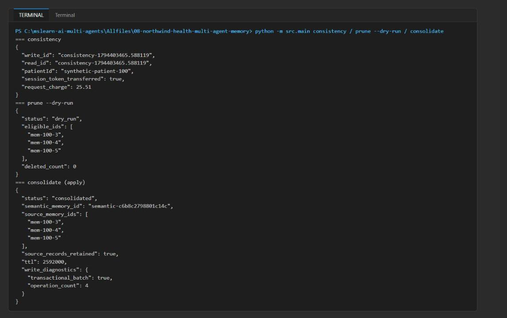

*Figure 12: Consistency, prune dry run, and applied consolidation*

### Run the Memory Coordinator locally

1. Open a **second** terminal in the lab folder, activate the virtual environment, and start the local Responses server. Keep this terminal running:

```powershell
cd Allfiles\08-northwind-health-multi-agent-memory
. ./.venv/Scripts/Activate.ps1
azd ai agent run memory-coordinator --no-client --start-command "python agent.py"
```

**Expected result:** the log shows `Running on http://0.0.0.0:8088 (CTRL + C to quit)`.

> **Note:** The `--start-command "python agent.py"` option is needed because some versions of the `azure.ai.agents` extension (for example 1.0.0-beta.23) cannot find the entry point from `codeConfiguration.entryPoint` in `azure.yaml`. If your version starts the server without it, you can omit it.

2. In the **first** terminal, invoke the local agent:

```powershell
azd ai agent invoke memory-coordinator --local --new-session "What reminder and appointment preferences should the care team consider? Cite the supporting memory IDs."
```

**Expected result:** the answer lists written reminders, morning appointments, and written summaries, cites memory IDs such as `semantic-...`, `mem-100-5`, `mem-100-4`, `mem-100-3` and `mem-100-1`, and says what the store does not contain. The server terminal logs `Function recall_patient_memory succeeded. AGENT_PATIENT_ID` binds the tool to `synthetic-patient-100`; the model cannot choose a patient ID.

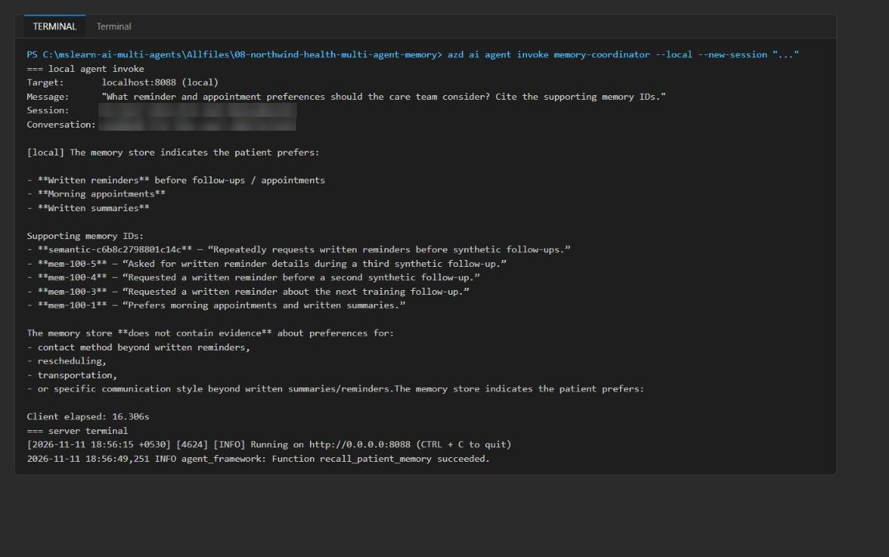

*Figure 13: Local agent answer grounded in recalled memory IDs*

3. Press **Ctrl+C** in the server terminal to stop the local agent.

### Deploy the Hosted Agent

1. Deploy the same tested code to Foundry. azd packages the source, uploads it, and Foundry builds and starts the hosted agent `northwind-health-memory-coordinator` (about 2-3 minutes):

```powershell
azd deploy memory-coordinator
```

**Expected result:** `memory-coordinator: Done`, an agent endpoint URL ending in `/agents/northwind-health-memory-coordinator/endpoint/protocols/openai/responses?api-version=v1`, and `SUCCESS: Your application was deployed to Azure`.

### Grant the hosted agent identity access to the model and Cosmos DB

The deployed agent does **not** run as the project managed identity that the Bicep template grants roles to. Foundry creates a dedicated **instance identity** (a Microsoft Entra service principal) for each hosted agent at deploy time. Without its own roles, the first remote invoke fails with **401** and the agent answers that "the memory lookup failed". Grant the roles now.

1. Get the agent's instance identity principal ID:

```powershell
azd ai agent show memory-coordinator
```

**Expected result:** the output includes `Instance Identity Principal ID   <agent-identity-principal-id>` and `Status   active`.

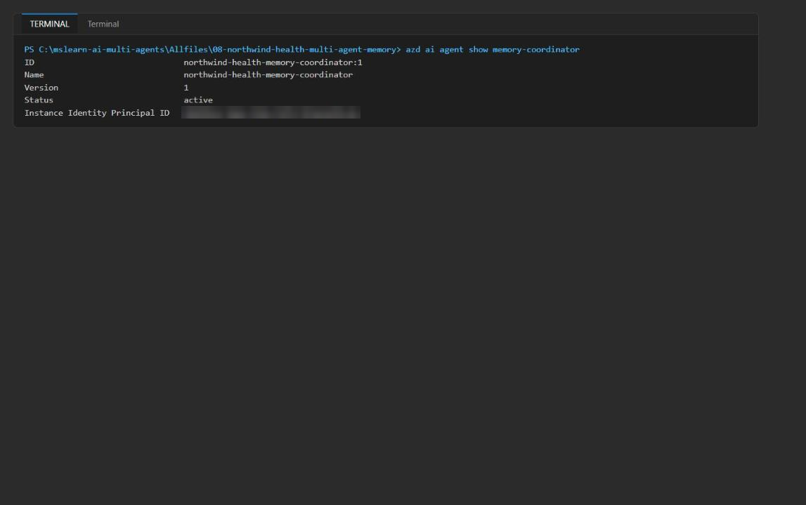

*Figure 14: The hosted agent and its instance identity principal ID*

2. Store the ID in a variable. You can copy it from the previous output, or read it with the REST API:

```powershell
$projectEndpoint = (Get-Content .env | Select-String '^FOUNDRY_PROJECT_ENDPOINT=').ToString().Split('=',2)[1].Trim('"')
$agentPrincipalId = az rest --method get `
  --url "$projectEndpoint/agents/northwind-health-memory-coordinator?api-version=v1" `
  --resource "https://ai.azure.com" `
  --query "instance_identity.principal_id" -o tsv
$agentPrincipalId
```

> **Note:** You can also find it in the [Foundry portal](https://ai.azure.com): open the project, select **Build** > **Agents** (or **Agents**), select `northwind-health-memory-coordinator`, and open **Identity**.

3. Grant the agent identity **Cognitive Services OpenAI User** on the Foundry account (it calls the embedding deployment through `AZURE_OPENAI_ENDPOINT`):

```powershell
$foundryAccount = az cognitiveservices account list -g $resourceGroupName --query "[0].name" -o tsv
$foundryId = az cognitiveservices account show -g $resourceGroupName -n $foundryAccount --query id -o tsv
az role assignment create --assignee-object-id $agentPrincipalId --assignee-principal-type ServicePrincipal `
  --role "Cognitive Services OpenAI User" --scope $foundryId --output none
```

4. Grant the agent identity the Cosmos DB **Built-in Data Contributor** data-plane role (role definition `00000000-0000-0000-0000-000000000002`) on the Cosmos DB account:

```powershell
$cosmosAccount = az cosmosdb list -g $resourceGroupName --query "[0].name" -o tsv
az cosmosdb sql role assignment create --account-name $cosmosAccount --resource-group $resourceGroupName `
  --role-definition-id 00000000-0000-0000-0000-000000000002 `
  --principal-id $agentPrincipalId --scope "/" --output none
az cosmosdb sql role assignment list --account-name $cosmosAccount --resource-group $resourceGroupName `
  --query "[].{principal:principalId, role:roleDefinitionId}" -o table
```

> **Note:** If you opened a new terminal since Task 3, set `$resourceGroupName = '<your-resource-group>'` first. Wait 1-5 minutes for the role assignments to propagate.

**Expected result:** the Cosmos role assignment list includes the agent principal ID alongside your user and the project identity. In the Azure portal, the Foundry account's **Access control (IAM)** > **Role assignments** shows the agent identity with **Cognitive Services OpenAI User**.

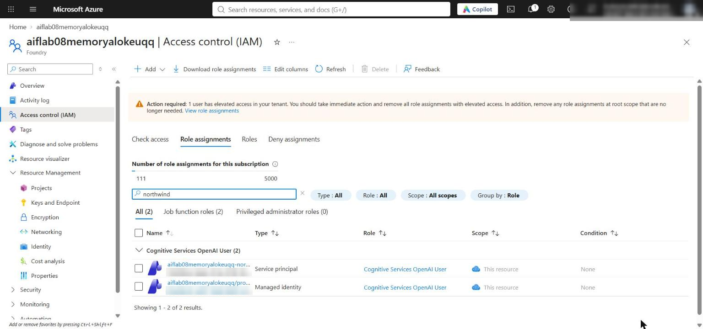

*Figure 15: The hosted agent identity holds Cognitive Services OpenAI User on the Foundry account*

### Invoke the Hosted Agent

1. Invoke the deployed agent:

```powershell
azd ai agent invoke memory-coordinator --new-session "What reminder and appointment preferences should the care team consider? Cite the supporting memory IDs."
```

**Expected result:** the `(remote)` agent answers with the reminder and appointment preferences and cites supporting memory IDs, limited to the bounded context. Foundry hosts the Responses endpoint and the model call; patient memory stays in Cosmos DB. Optionally run `azd ai agent monitor memory-coordinator` to see `Function recall_patient_memory succeeded.` and `embeddings ... 200 OK` in the hosted log.

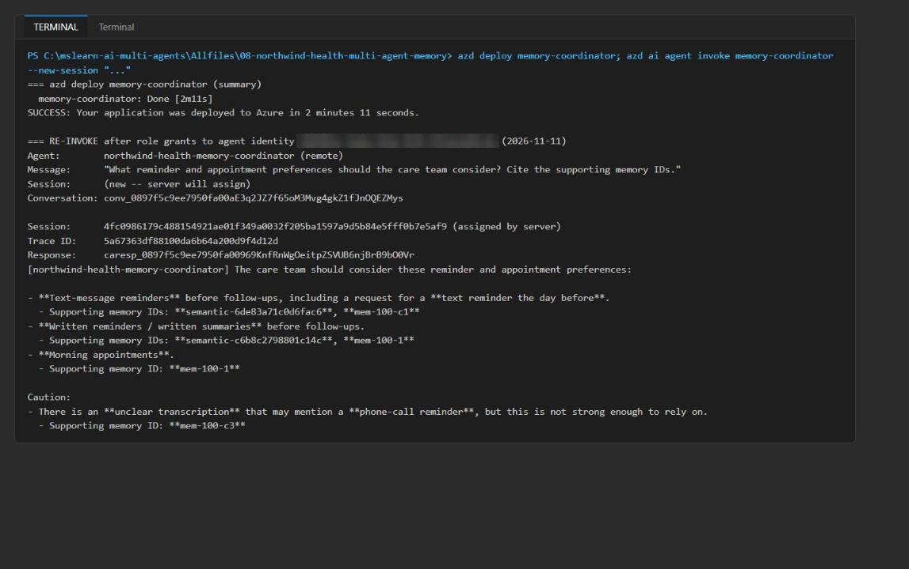

*Figure 16: Deployed hosted agent answer after the role grants*

---

## Task 6: Validate the implementation

### Review evidence from the commands you already ran

1. Use the Task 5 output to confirm:

- `ingest` reports each ID, `patientId`, RU charge and a session token, without content.
- `recall` returns only `synthetic-patient-100` records, each with the same query `request_charge`, ordered most-similar first, and `bounded_context.token_count` is 500 or less.
- `consistency` shows matching `write_id` and `read_id`, `session_token_transferred: true`, and the write RU charge.
- `prune --dry-run` shows `status: dry_run`, `deleted_count: 0`, and the eligible IDs, and preserves the critical record.
- Consolidation dry run shows three sources and no writes; the applied run shows `status: consolidated`, one semantic ID, the three retained sources, and transactional-batch diagnostics.
- Both the local and the deployed agent call `recall_patient_memory`, cite memory IDs, and stay within the bounded context.

### Inspect the persisted records in the portals

1. In the [Foundry portal](https://ai.azure.com), open the lab project, confirm both deployments exist, then open **Agents** and confirm `northwind-health-memory-coordinator` has an active deployed version.

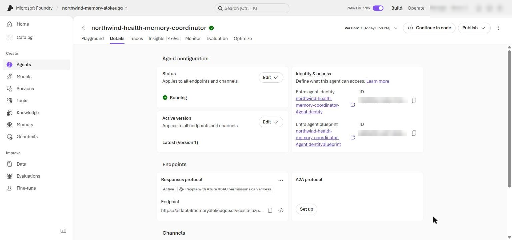

*Figure 17: The deployed Memory Coordinator in the Foundry portal*

2. In the [Azure portal](https://portal.azure.com), open the Cosmos DB account and select **Data Explorer** > **clinical-memory-db** > **patient-memories** > **Items**.

3. Open `mem-100-1` and confirm it has `patientId`, `schemaVersion`, `memoryType`, `importance`, `timestamp`, `ttl`, and an `embedding` array (1,536 numbers, as required by the container's vector embedding policy).

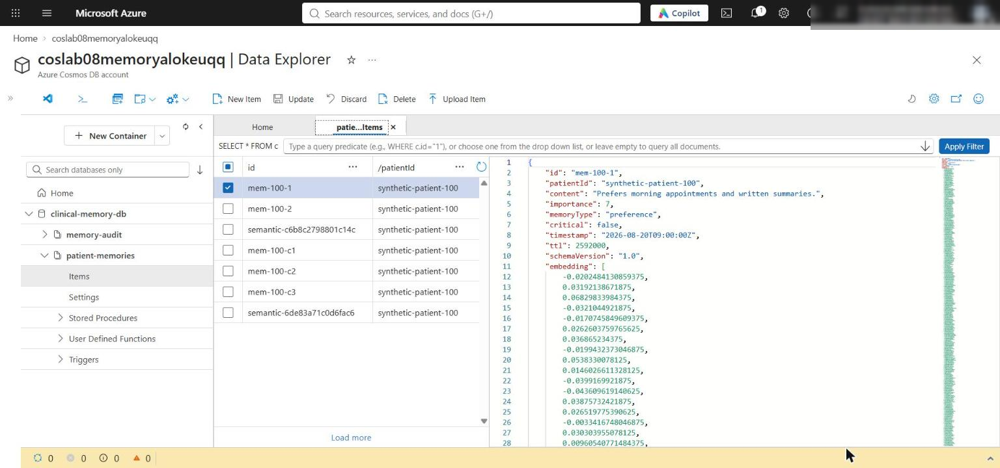

*Figure 18: A persisted memory item with its schema fields and embedding array*

4. Open `mem-100-3`, `mem-100-4` and `mem-100-5` and confirm all three still exist and contain the same `consolidatedInto` semantic ID.

5. Open the `semantic-...` document and confirm `memoryType` is `semantic_pattern`, `sourceMemoryIds` contains the three source IDs, and `reviewerId` is `reviewer-07`.

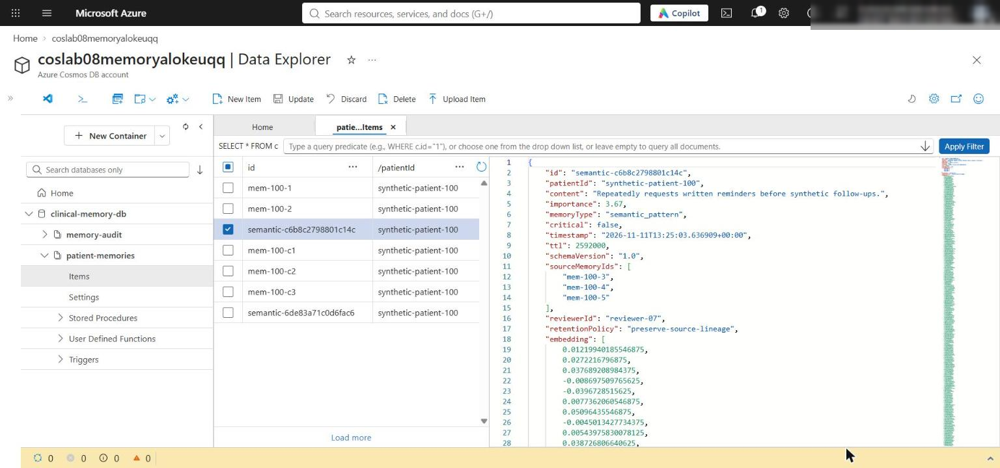

*Figure 19: The consolidated semantic_pattern document with its source lineage*

These checks validate persistence and lineage; the terminal output remains the evidence for vector ordering, RU charge, context budgeting, and session-token transfer.

### Complete the remaining live checks

1. Rerun the applied consolidation **before pruning** to prove retries are idempotent:

```powershell
python -m src.main consolidate --patient-id synthetic-patient-100 --source-id mem-100-3 --source-id mem-100-4 --source-id mem-100-5 --summary "Repeatedly requests written reminders before synthetic follow-ups." --reviewer-id reviewer-07
```

**Expected result:** `status: already_consolidated` with the same semantic ID and source IDs. No duplicate semantic memory is created.

2. Apply the retention policy. This **deletes** the eligible noncritical, finite-TTL records, so run it only after steps 5-7:

```powershell
python -m src.main prune --patient-id synthetic-patient-100
```

**Expected result:** `status: applied`, `eligible_ids mem-100-3`, `mem-100-4`, `mem-100-5`, and `deleted_count: 3`.

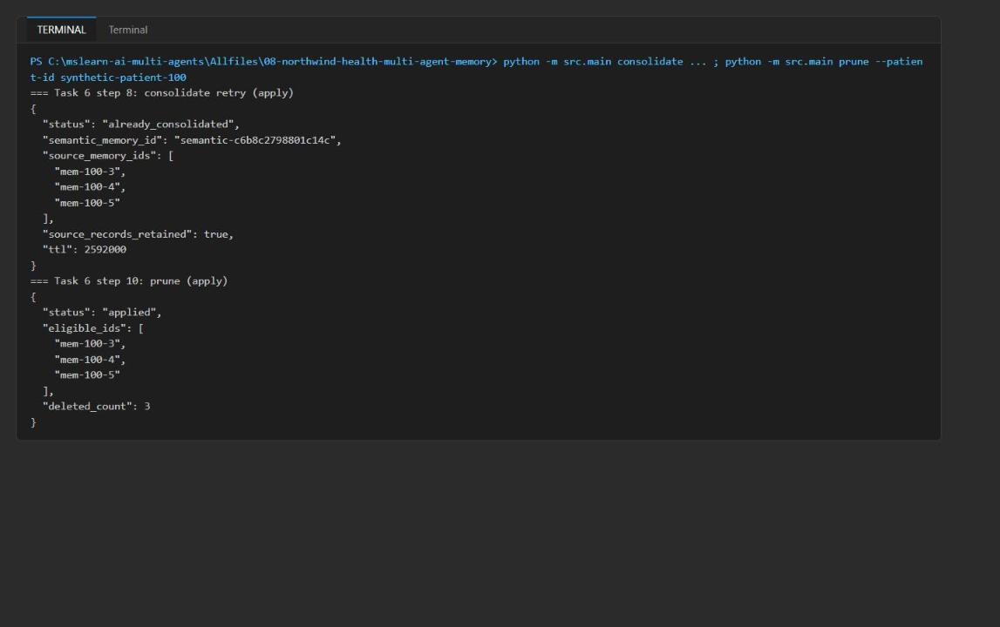

*Figure 20: Idempotent consolidation retry and applied prune*

3. In Data Explorer, select **clinical-memory-db** > **memory-audit** > **Items**. Open the event whose `operation` is `retention_prune` and confirm it contains `patientId`, `operation`, `memoryIds`, `reason` and `timestamp`, but no memory content and no embedding. You also see the `audit-semantic-...` consolidation event.

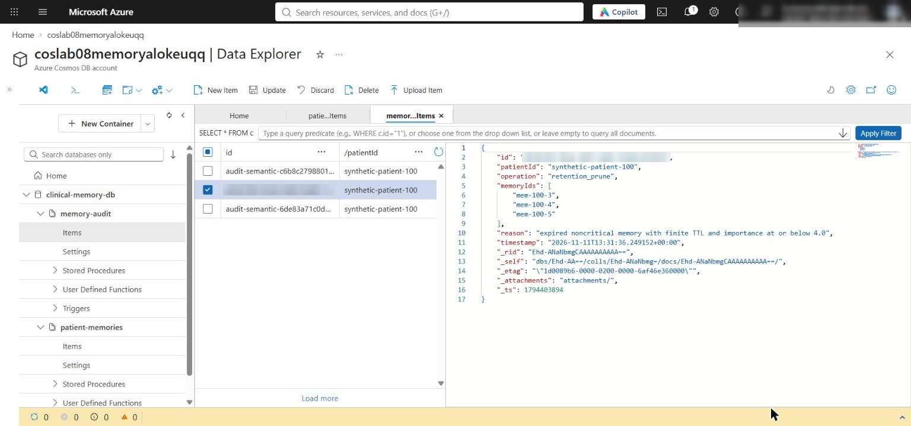

*Figure 21: Content-free retention_prune audit event*

4. Review `_authorize` in `src/memory_store.py`. It raises `PermissionError` when the requested patient differs from the patient bound to the store, and it is the first statement in upsert, recall, audit, and consolidate (and in prune through `store._authorize`), so it runs before any embedding or Cosmos DB I/O.

**Acceptance criteria**

| Criterion | How to check |
|---|---|
| Ingest reports ID, patientId, RU and session token, no content | `ingest` output (Task 5 step 1) |
| Recall returns only the bound patient, same query RU per record | `recall` output; every `patientId` is `synthetic-patient-100` |
| Recall ordered by `VectorDistance` (most similar first) | `vector_distance` values decrease (cosine similarity) |
| `bounded_context.token_count` is 500 or less | `recall` output |
| Read-your-writes: write_id equals read_id, token transferred | `consistency` output |
| Prune dry run: dry_run, deleted_count 0, critical preserved | `prune --dry-run` output |
| Consolidation applied in one transactional batch | `status: consolidated`, `transactional_batch: true`, `operation_count: 4` |
| Retry is idempotent | `status: already_consolidated`, same semantic ID |
| Prune apply deletes eligible records | `status: applied`, `deleted_count: 3` |
| Audit is content-free | Data Explorer > `memory-audit` > `retention_prune` item |
| Persisted schema and 1,536-dim embedding | Data Explorer > `patient-memories` > `mem-100-1` |
| Semantic lineage | Data Explorer > `semantic-...` item: `sourceMemoryIds`, `reviewerId` |
| Deployments exist and agent version is active | Foundry portal, or `az cognitiveservices account deployment list -g <rg> -n <foundry-account> -o table` and `azd ai agent show memory-coordinator` |
| Local and hosted agent grounded with cited IDs | `azd ai agent invoke` output (local and remote) |
| `_authorize` before any I/O | Code review of `src/memory_store.py` |

---

## Optional challenge: Gate memory consolidation

Add a synthetic `confidence` field and consolidate only evidence at or above a documented threshold (0.8 in this solution). Low-confidence evidence stays in source history but is not consolidated; the semantic record stores the threshold, the rejected IDs, and the reviewer.

1. Create `assets/challenge-memories.json` with this content:

```json
[
  {"id":"mem-100-c1","patientId":"synthetic-patient-100","content":"Asked for a text-message reminder the day before a synthetic follow-up.","importance":4.0,"memoryType":"episodic","critical":false,"timestamp":"2026-10-01T12:00:00Z","ttl":2592000,"schemaVersion":"1.0","confidence":0.92},
  {"id":"mem-100-c2","patientId":"synthetic-patient-100","content":"Confirmed a text-message reminder works best before synthetic follow-ups.","importance":4.0,"memoryType":"episodic","critical":false,"timestamp":"2026-10-08T12:00:00Z","ttl":2592000,"schemaVersion":"1.0","confidence":0.85},
  {"id":"mem-100-c3","patientId":"synthetic-patient-100","content":"Unclear transcription that may mention a phone-call reminder.","importance":2.0,"memoryType":"episodic","critical":false,"timestamp":"2026-10-15T12:00:00Z","ttl":2592000,"schemaVersion":"1.0","confidence":0.40}
]
```

2. In `src/main.py`, in `_parser()`, find the line `consolidate.add_argument("--dry-run", action="store_true")` and add this line directly below it (same indentation, 4 spaces):

```python
consolidate.add_argument("--min-confidence", type=float, default=None)
```

3. In `src/main.py`, in `_run()`, find the call to `store.consolidate_episodic_memories(...)` and add `args.min_confidence,` as the last argument, directly below `args.dry_run,` (same indentation):

```python
args.min_confidence,
```

4. In `src/memory_store.py`, change the `consolidate_episodic_memories` signature by adding a new last parameter below `dry_run: bool,` (8-space indentation, same as `dry_run`):

```python
min_confidence: float | None = None,
```

5. In the same method, select the block that starts with `digest = hashlib.sha256(...)` and ends with `raise ValueError("Every consolidation source must be episodic")` (the digest, semantic ID, source reads, and episodic check), and replace it with the following code. After pasting, press **Tab twice** so it lines up with `self._authorize(patient_id)`:

```python
sources = [
    await self._memories.read_item(item=memory_id, partition_key=patient_id)
    for memory_id in unique_ids
]
if any(source.get("memoryType") != "episodic" for source in sources):
    raise ValueError("Every consolidation source must be episodic")
# Optional challenge: confidence gate. Sources below the documented threshold stay
# untouched in source history and are excluded from the consolidated pattern.
rejected_ids: list[str] = []
if min_confidence is not None:
    if not 0.0 <= min_confidence <= 1.0:
        raise ValueError("min_confidence must be between 0.0 and 1.0")
    rejected_ids = [
        str(source["id"])
        for source in sources
        if float(source.get("confidence", 0.0)) < min_confidence
    ]
    sources = [source for source in sources if str(source["id"]) not in rejected_ids]
    unique_ids = [str(source["id"]) for source in sources]
    if len(unique_ids) < 2:
        raise ValueError("Fewer than two sources meet the confidence threshold")
digest = hashlib.sha256(f"{patient_id}:{':'.join(unique_ids)}".encode()).hexdigest()[:16]
semantic_id = f"semantic-{digest}"
```

6. Still in the method, find the line `"retentionPolicy": "preserve-source-lineage",` and the closing `}` of the `semantic = {...}` dictionary. Directly below that closing `}` (and above `if dry_run:`), add the following code (8-space indentation, press **Tab twice** after pasting):

```python
if min_confidence is not None:
    semantic["confidenceThreshold"] = min_confidence
    semantic["rejectedSourceIds"] = rejected_ids
```

7. In both returned dictionaries that contain `"status": "already_consolidated"` and `"status": "consolidated"`, add this entry directly below the `"source_memory_ids": unique_ids,` line (same indentation):

```python
"rejected_source_ids": rejected_ids,
```

8. Run preflight, ingest the challenge records, then consolidate with the threshold (dry run, apply, and repeat for idempotency):

```powershell
python scripts/preflight.py
python -m src.main ingest --file assets/challenge-memories.json
python -m src.main consolidate --patient-id synthetic-patient-100 --source-id mem-100-c1 --source-id mem-100-c2 --source-id mem-100-c3 --summary "Prefers text-message reminders before synthetic follow-ups." --reviewer-id reviewer-07 --min-confidence 0.8 --dry-run
python -m src.main consolidate --patient-id synthetic-patient-100 --source-id mem-100-c1 --source-id mem-100-c2 --source-id mem-100-c3 --summary "Prefers text-message reminders before synthetic follow-ups." --reviewer-id reviewer-07 --min-confidence 0.8
python -m src.main consolidate --patient-id synthetic-patient-100 --source-id mem-100-c1 --source-id mem-100-c2 --source-id mem-100-c3 --summary "Prefers text-message reminders before synthetic follow-ups." --reviewer-id reviewer-07 --min-confidence 0.8
```

**Expected result:** `mem-100-c1` (0.92) and `mem-100-c2` (0.85) are consolidated (`operation_count: 3`) and `mem-100-c3` (0.40) appears in `rejected_source_ids`; it keeps no `consolidatedInto`. The semantic record stores `confidenceThreshold: 0.8`, `rejectedSourceIds` and `reviewerId`. The repeated run returns `already_consolidated` with the same ID, because the semantic ID is derived deterministically from the accepted source IDs.

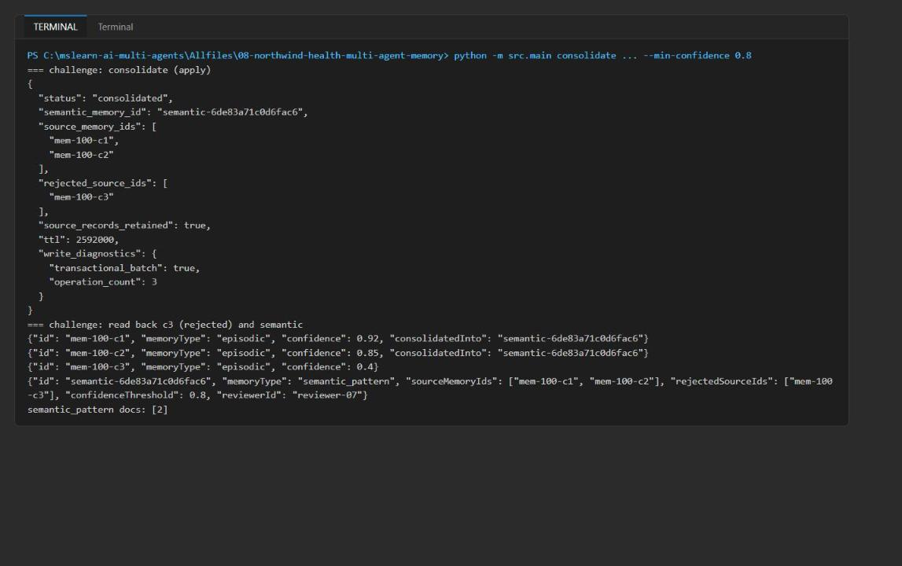

*Figure 22: Confidence-gated consolidation and its idempotent retry*

---

## Troubleshooting

| Symptom | Cause and fix |
|---|---|
| Remote `azd ai agent invoke` answers "the memory lookup failed"; hosted log shows 401 | The hosted agent runs as its own instance identity, not the project managed identity that Bicep grants roles to. Do Task 5 steps 10-13 (Cognitive Services OpenAI User on the Foundry account and Cosmos DB Built-in Data Contributor), wait a few minutes, and invoke again with `--new-session`. |
| `azd ai agent run` cannot find the entry point | Start it with `--start-command "python agent.py"`. |
| ARM IDs in the azd environment look like `C:/Program Files/Git/subscriptions/...` | `azd env set` was run in Git Bash. Re-run Task 3 step 7 in PowerShell, or prefix with `MSYS_NO_PATHCONV=1`. |
| `recall` shows `vector_distance` descending, not ascending | Expected: with the cosine distance function `VectorDistance` returns similarity, and `ORDER BY` returns the most similar first. |
| `ingest` writes only five records | Expected: `mem-200-1` belongs to another patient and is skipped because the store is bound to `synthetic-patient-100`. |
| `Forbidden` / `403` from Cosmos DB or `401` from the model when running locally | RBAC is still propagating (wait 1-5 minutes), or you are signed in to a different tenant or subscription (`az account show`). |
| `IndentationError` in preflight | A placeholder snippet is not aligned with its `# LAB PLACEHOLDER` comment. Select the snippet and use Tab or Shift+Tab. |
| Deployment fails with quota or `InvalidResourceLocation` | Choose another region with Cosmos DB vector search and GlobalStandard quota for both models, and use a new resource group. |
| `already_consolidated` is not returned on retry | You pruned before retrying; run the retry (Task 6 step 7) before the prune. |

---

## Review questions

1. **Which memory fields should be immutable after creation?** `id`, `patientId` (also the partition key), `content`, `memoryType`, `timestamp`, `schemaVersion`, `embedding` (must match `content`), and lineage fields such as `sourceMemoryIds` and `reviewerId`. Only lifecycle metadata such as `consolidatedInto`, `supersededBy`, `ttl` and status flags should change; corrections are new records.

2. **How should a contradiction supersede an older memory without destroying audit history?** Write a new memory with `supersedes: <oldId>` and a reason, and in the same partition-scoped transactional batch patch the old record with `supersededBy` under an ETag condition. Write a content-free audit event naming both IDs. Recall excludes superseded records by default; the old record is kept or expires through retention.

3. **When is explicit session-token transfer required instead of client-local token management?** When the read happens on a different `CosmosClient` or process than the write: another agent, another hosted replica, another worker, or after a restart. The SDK tracks session tokens only inside one client, so other readers need the token from the write response.

4. **What would a right-to-deletion verification query need to prove?** That `SELECT VALUE COUNT(1) FROM c WHERE c.patientId=@p` returns 0 in `patient-memories` (including derived semantic records and embeddings); that no other partition or container references the patient's content; that the audit container holds a content-free deletion event with IDs, actor, reason and timestamp; and that the check ran with a post-delete session token (or strong consistency) so a stale replica cannot hide leftovers.

---

## Clean up (optional)

1. Delete the resource group, which removes the Cosmos DB account, the Foundry account and project, the model deployments, and the Hosted Agent:

```powershell
az group delete --name $resourceGroupName --yes --no-wait
```

2. Purge the soft-deleted Foundry account so its name and quota are released (after the group deletion completes):

```powershell
az cognitiveservices account list-deleted --query "[].{name:name, location:location}" -o table
az cognitiveservices account purge --name <foundry-account-name> --resource-group $resourceGroupName --location $azureRegion
```

3. Remove the local azd environment and the `.env` file:

```powershell
Remove-Item -Recurse -Force .azure\lab08-memory-dev
Remove-Item .env
```

4. Run `deactivate` in every terminal that shows `(.venv)`:

```powershell
deactivate
```

