# Lab 09: Implement CI/CD for Foundry hosted agents

## Overview

**Scenario.** Fabrikam reviews code changes with three Microsoft Foundry hosted agents (v2): a **scanner** (security findings), a **reviewer** (maintainability and release risk) and an **orchestrator** that calls both and returns one release recommendation. A deliberately thin **release dashboard** runs in Azure Container Apps. Each dashboard revision is bound to one exact, immutable orchestrator version, so the dashboard is the progressive-delivery boundary (75/25 canary, 0/100 promotion, rollback).

**What you'll build.** A private GitHub repository with four GitHub Actions workflows that use passwordless OIDC to Azure. You deploy a development release, open a pull request that changes the scanner's logical version, deploy it as a 75/25 canary, promote it, promote the same reviewed commit to staging and production, then trigger a regression that rolls back to the persisted last-verified release set and opens an incident issue.

**How this guide differs from the official lab.** Everything is done from a terminal with the **GitHub CLI (`gh`)** and the **Azure CLI**. The guide also contains every fix that a real GitHub Actions run needed (workflows, Bicep and scripts). The figures come from a real run in a private repository.

**Duration.** About 2-3 hours. Each deployment workflow run takes 9-13 minutes.

> **Important:** This lab creates billable resources in up to three resource groups: Azure Container Registry, Log Analytics, Container Apps and a Microsoft Foundry account with a `gpt-5.4-mini` (version `2026-03-17`) deployment per environment, plus hosted-agent compute. Use a training subscription and complete **Clean up** when you finish.

**Architecture**

| Component | Role in the lab |
|---|---|
| `agents/*.yml` | Logical semantic versions, dependency ranges, exact model policy, evaluation identity, instructions and tool contracts |
| `src/scanner_agent.py`, `src/reviewer_agent.py`, `src/orchestrator_agent.py` | Foundry hosted agents (Responses protocol 2.0.0, Python 3.13), deployed by `azd deploy` |
| `dashboard/app.py` | The only Container App: shows the release set, channel, revision and exact orchestrator version, and invokes that version |
| `infra/main.bicep`, `infra/delivery-resources.bicep` | Per-environment Foundry account and project, model deployment, ACR, Log Analytics, Container Apps environment, dashboard and RBAC |
| `scripts/` | Release-set export, capture of immutable versions, canary traffic, finalize, restore |
| `.github/workflows/validate-agents.yml` | Credential-free validation (PRs and the first job of every deploy) |
| `.github/workflows/deploy-environment.yml` | OIDC login, provision, serial agent deploys, smoke evaluation, dashboard revision, 75/25 exposure |
| `.github/workflows/canary-quality-gate.yml` | Promote (0/100 and persist `verified-<env>`) or dispatch a rollback |
| `.github/workflows/rollback-agents.yml` | Restores the verified dashboard revision, verifies it and opens an incident issue |
| Entra app `fabrikam-agent-github` | OIDC identity for GitHub Actions (federated credentials, no client secret) |
| GitHub environments `development`, `staging`, `production` | One resource group, Foundry project and variable set each |

**The three version identities** (the lab keeps them separate):

| Identity | Example | Purpose |
|---|---|---|
| Logical semantic version | `scanner 1.2.1` | Source compatibility and dependency ranges |
| Immutable Foundry agent version | `fabrikam-code-scanner`, version `3` | The deployed executable, its version endpoint and version-bound sessions |
| Dashboard Container App revision | `fabrikam-release-lab09-cicd-d--azd-1794415369` | Traditional-app release channel and traffic weight |

---

## Prerequisites

Install these tools:

- [Python 3.13](https://www.python.org/downloads/)
- [Git](https://git-scm.com/downloads)
- [GitHub CLI (`gh`) 2.60 or later](https://cli.github.com/)
- [Azure CLI](https://learn.microsoft.com/cli/azure/install-azure-cli) (2.80 or later) with Bicep (`az bicep install`)
- [Azure Developer CLI (azd) 1.27.1 or later](https://learn.microsoft.com/azure/developer/azure-developer-cli/install-azd) (optional locally; the workflows install it on the runner)
- [Visual Studio Code](https://code.visualstudio.com/download) with the Python, GitHub Actions and Bicep extensions
- PowerShell 7 (all commands in this guide are PowerShell)

Accounts and permissions:

- A GitHub account that can create a **private** repository, workflows, environments, variables, releases and issues.
- Azure: permission to create resource groups and role assignments (**Owner**, or **Contributor** plus **User Access Administrator**) on the subscription.
- Microsoft Entra ID: permission to register applications (the default user setting, or the **Application Developer** role).
- Quota for `gpt-5.4-mini` version `2026-03-17` (GlobalStandard, capacity 10) in your region, three times (one per environment). This guide uses `eastus2`.

> **Note:** Required reviewers on GitHub environments are only available for **private** repositories on a paid plan (GitHub Pro, Team or Enterprise). On the free plan, the API returns HTTP 422 and the staging and production deployments run without an approval gate. The guide shows both paths.

---

## Task 1: Prepare the lab

1. Clone the lab repository and change to the lab folder:

```powershell
git clone https://github.com/MicrosoftLearning/mslearn-ai-multi-agents.git
cd mslearn-ai-multi-agents\Allfiles\09-fabrikam-multi-agent-cicd
code .
```

2. Sign in to Azure and select the subscription:

```powershell
az login
az account set --subscription "<your-subscription-id>"
az account show --output table
```

3. Sign in to GitHub with the CLI, then add the `workflow` scope. Without it, `git push` of files under `.github/workflows` is rejected.

```powershell
gh auth login --hostname github.com --git-protocol https --web
gh auth refresh --hostname github.com --scopes workflow
gh auth setup-git
gh auth status
```

**Expected result:** `gh auth status` shows that you are logged in and the token scopes include `repo` and `workflow`.

4. Optional: sign in to azd (only needed if you run `azd` commands locally):

```powershell
$env:AZURE_DEV_USER_AGENT = 'microsoft_foundry_skill'; azd auth login
```

5. Review the source. Use only synthetic data, and don't add a client secret or an `AZURE_CREDENTIALS` secret to GitHub at any point.

- `azure.yaml`: `scanner`, `reviewer` and `orchestrator` are `host: azure.ai.agent` (`kind: hosted`); `dashboard` is the only `host: containerapp` service.
- `agents/orchestrator.yml`: logical version `1.3.0`, dependencies `scanner: '>=1.0.0,<2.0.0'` and `reviewer: '>=1.0.0,<2.0.0'`, model `gpt-5.4-mini` / `2026-03-17`, evaluation `fabrikam-release-smoke` / `deterministic-contract-smoke`, hosted manifest Responses `2.0.0`, `python_3_13`.
- `dashboard/app.py`: `release_metadata()` returns `release_set_id`, `release_channel`, `container_app_revision`, `orchestrator_name`, `orchestrator_version` and `orchestrator_responses_endpoint`.

---

## Task 2: Apply the GitHub Actions fixes and validate locally

The shipped lab was written against a local emulation. A real GitHub Actions run needed the fixes below. Apply all of them in the lab folder **before** you copy it to the practice repository; the workflow files you activate in Task 6 are copied from `assets\workflows`.

### Fix 1: test discovery path (`assets/workflows/validate-agents.yml`)

The workflow runs at the repository root, where `Allfiles/09-.../tests` does not exist (`ImportError: Start directory is not importable`). In the step list, replace:

```yaml
      - run: python -m unittest discover -s Allfiles/09-fabrikam-multi-agent-cicd/tests -v
```

with:

```yaml
      - run: python -m unittest discover -s tests -t . -v
```

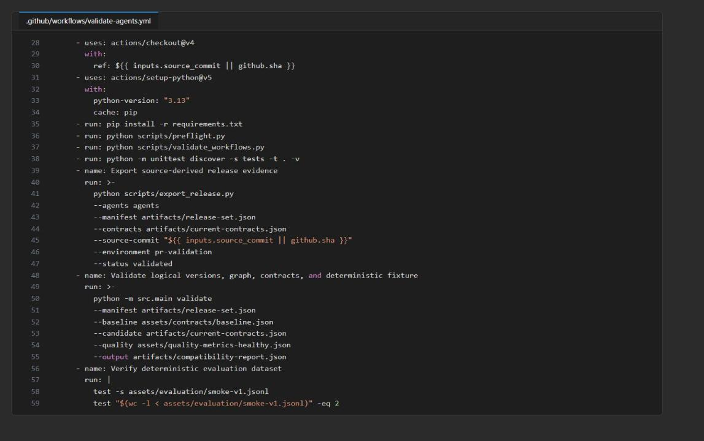

*Figure 1: validate-agents.yml after Fix 1 (credential-free validation; no Azure login)*

### Fix 2: azd authentication, environment creation and the principal variable (`assets/workflows/deploy-environment.yml`)

azd ignores the `azure/login` session unless `auth.useAzCliAuth` is set, a fresh runner has no azd environment, and GitHub forbids variable names that start with `GITHUB_`. Replace the whole **Select isolated azd environment** step with:

```yaml
      - name: Select isolated azd environment
        run: |
          AZURE_DEV_USER_AGENT=microsoft_foundry_skill azd config set auth.useAzCliAuth true
          AZURE_DEV_USER_AGENT=microsoft_foundry_skill azd extension install azure.ai.agents
          AZURE_DEV_USER_AGENT=microsoft_foundry_skill azd env select "${{ vars.AZURE_ENV_NAME }}" || AZURE_DEV_USER_AGENT=microsoft_foundry_skill azd env new "${{ vars.AZURE_ENV_NAME }}" --subscription "${{ vars.AZURE_SUBSCRIPTION_ID }}" --location "${{ vars.AZURE_LOCATION }}" --no-prompt
          AZURE_DEV_USER_AGENT=microsoft_foundry_skill azd env set AZURE_SUBSCRIPTION_ID "${{ vars.AZURE_SUBSCRIPTION_ID }}"
          AZURE_DEV_USER_AGENT=microsoft_foundry_skill azd env set AZURE_LOCATION "${{ vars.AZURE_LOCATION }}"
          AZURE_DEV_USER_AGENT=microsoft_foundry_skill azd env set AZURE_RESOURCE_GROUP "${{ vars.AZURE_RESOURCE_GROUP_NAME }}"
          AZURE_DEV_USER_AGENT=microsoft_foundry_skill azd env set GITHUB_PRINCIPAL_ID "${{ vars.AZURE_GITHUB_PRINCIPAL_ID }}"
```

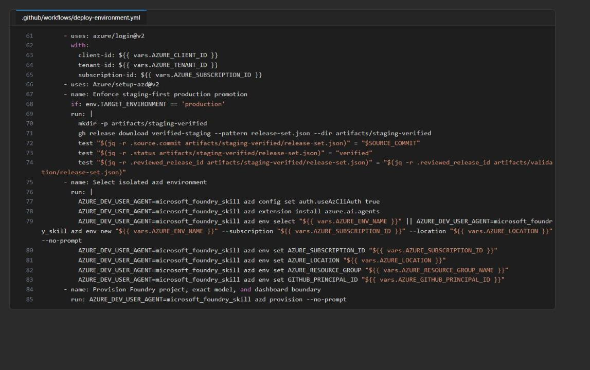

*Figure 2: deploy-environment.yml: OIDC login, staging-first check and the fixed azd environment step*

### Fix 3: orchestrator role for specialist calls (`assets/workflows/deploy-environment.yml`)

The hosted orchestrator calls the scanner and reviewer with its own agent instance identity. That identity only exists after `azd deploy orchestrator`, and without **Foundry User** (role ID `53ca6127-db72-4b80-b1b0-d745d6d5456d`, formerly Azure AI User) on the project the specialist calls return HTTP 403. Replace the whole **Deploy and verify orchestrator immutable version** step with:

```yaml
      - name: Deploy and verify orchestrator immutable version
        run: |
          AZURE_DEV_USER_AGENT=microsoft_foundry_skill azd deploy orchestrator --no-prompt
          az role assignment create --assignee-object-id "$(AZURE_DEV_USER_AGENT=microsoft_foundry_skill azd env get-value AGENT_ORCHESTRATOR_INSTANCE_IDENTITY_PRINCIPAL_ID)" --assignee-principal-type ServicePrincipal --role 53ca6127-db72-4b80-b1b0-d745d6d5456d --scope "$(AZURE_DEV_USER_AGENT=microsoft_foundry_skill azd env get-value FOUNDRY_PROJECT_ID)" --output none
          orchestrator_version="$(AZURE_DEV_USER_AGENT=microsoft_foundry_skill azd env get-value AGENT_ORCHESTRATOR_VERSION)"
          AZURE_DEV_USER_AGENT=microsoft_foundry_skill azd ai agent show orchestrator --output json | tee artifacts/orchestrator-show.json
          AZURE_DEV_USER_AGENT=microsoft_foundry_skill azd ai agent invoke orchestrator --version "$orchestrator_version" --protocol responses "Review fabrikam/payments-api commit 0123456789abcdef: validate payment amount bounds." | tee artifacts/orchestrator-smoke.txt
```

### Fix 4: import path for capture_release_set.py (`assets/workflows/deploy-environment.yml`)

The script imports `src` and fails with `ModuleNotFoundError: No module named 'src'` when run as a file. In the **Capture immutable Foundry release set** step, replace:

```yaml
          python scripts/capture_release_set.py \
```

with:

```yaml
          PYTHONPATH=. python scripts/capture_release_set.py \
```

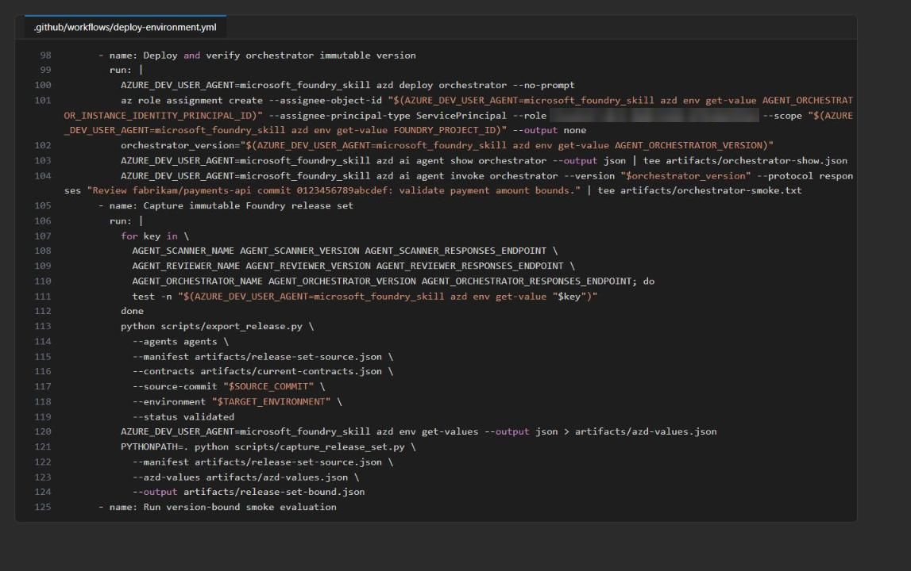

*Figure 3: deploy-environment.yml after Fix 3 and Fix 4*

### Fix 5: dashboard registry identity (`assets/workflows/deploy-environment.yml`)

The dashboard pulls its image from ACR with its system-assigned identity. Configure the registry after provisioning (when AcrPull already exists) and just before the dashboard deploy. Replace the whole **Deploy thin dashboard revision targeting selected orchestrator** step with:

```yaml
      - name: Deploy thin dashboard revision targeting selected orchestrator
        run: |
          release_set_id="$(jq -r .release_set_id artifacts/release-set-bound.json)"
          AZURE_DEV_USER_AGENT=microsoft_foundry_skill azd env set RELEASE_SET_ID "$release_set_id"
          az containerapp registry set --resource-group "$(AZURE_DEV_USER_AGENT=microsoft_foundry_skill azd env get-value AZURE_RESOURCE_GROUP_NAME)" --name "$(AZURE_DEV_USER_AGENT=microsoft_foundry_skill azd env get-value DASHBOARD_APP_NAME)" --server "$(AZURE_DEV_USER_AGENT=microsoft_foundry_skill azd env get-value AZURE_CONTAINER_REGISTRY_ENDPOINT)" --identity system --output none
          AZURE_DEV_USER_AGENT=microsoft_foundry_skill azd deploy dashboard --no-prompt
```

> **Note:** Don't put `registries: [{ server: ..., identity: 'system' }]` in the Bicep for the Container App. At create time the system identity has no AcrPull yet, and revision provisioning hangs until it expires.

### Fix 6: recreate azd state in the canary and rollback workflows

`canary-quality-gate.yml` and `rollback-agents.yml` only ran `azd env select`, but a fresh runner has no `.azure` folder, so every `azd env get-value` failed. In **both** `assets/workflows/canary-quality-gate.yml` and `assets/workflows/rollback-agents.yml`, replace the one-line **Select environment** step with:

```yaml
      - name: Select environment
        run: |
          AZURE_DEV_USER_AGENT=microsoft_foundry_skill azd config set auth.useAzCliAuth true
          AZURE_DEV_USER_AGENT=microsoft_foundry_skill azd extension install azure.ai.agents
          AZURE_DEV_USER_AGENT=microsoft_foundry_skill azd env select "${{ vars.AZURE_ENV_NAME }}" || AZURE_DEV_USER_AGENT=microsoft_foundry_skill azd env new "${{ vars.AZURE_ENV_NAME }}" --subscription "${{ vars.AZURE_SUBSCRIPTION_ID }}" --location "${{ vars.AZURE_LOCATION }}" --no-prompt
          AZURE_DEV_USER_AGENT=microsoft_foundry_skill azd env set AZURE_RESOURCE_GROUP "${{ vars.AZURE_RESOURCE_GROUP_NAME }}"
          AZURE_DEV_USER_AGENT=microsoft_foundry_skill azd env refresh --no-prompt
```

### Fix 7: Bicep (`infra/delivery-resources.bicep` and `infra/main.bicep`)

1. In `infra/delivery-resources.bicep`, in the `registry` resource, delete this line (a Basic ACR rejects it with `NetworkRuleNotSupported`):

```bicep
    networkRuleSet: { defaultAction: 'Allow' }
```

2. In the `foundryProject` resource, add `dependsOn` directly under `identity` so the project and the model deployment are not written to the account at the same time (`RequestConflict`):

```bicep
  identity: { type: 'SystemAssigned' }
  // Serialize child writes on the Foundry account; concurrent project and deployment PUTs return RequestConflict.
  dependsOn: [ modelDeployment ]
```

3. After the `githubPushRole` resource, add a role assignment that gives the GitHub principal **Foundry User** on the project. Contributor has no data actions, so without it the workflow cannot create or invoke hosted agents:

```bicep
resource githubFoundryRole 'Microsoft.Authorization/roleAssignments@2022-04-01' = if (!empty(githubPrincipalId)) {
  name: guid(foundryProject.id, githubPrincipalId, foundryUserRole)
  scope: foundryProject
  properties: {
    principalId: githubPrincipalId
    principalType: 'ServicePrincipal'
    roleDefinitionId: foundryUserRole
  }
}
```

4. Under `output registryName string = registry.name`, add:

```bicep
output foundryAccountName string = foundry.name
```

5. In `infra/main.bicep`, after `output FOUNDRY_PROJECT_ENDPOINT ...`, add the outputs that the `azure.ai.agents` azd extension reads:

```bicep
output AZURE_AI_PROJECT_ID string = deliveryResources.outputs.foundryProjectId
output AZURE_AI_PROJECT_NAME string = deliveryResources.outputs.foundryProjectName
output AZURE_AI_PROJECT_ENDPOINT string = deliveryResources.outputs.foundryProjectEndpoint
output AZURE_AI_ACCOUNT_NAME string = deliveryResources.outputs.foundryAccountName
```

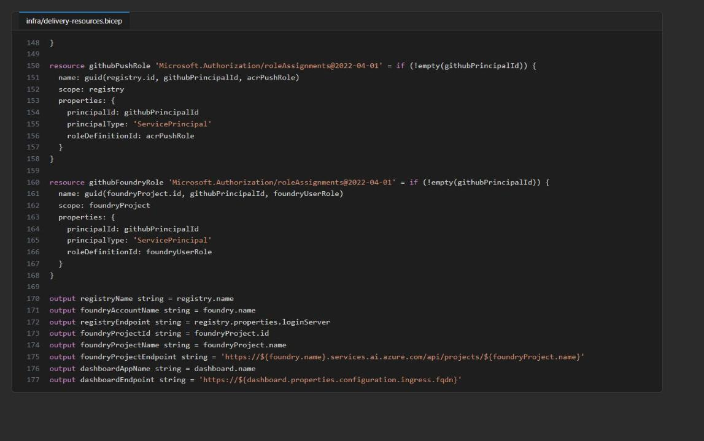

*Figure 4: delivery-resources.bicep with the new githubFoundryRole and foundryAccountName output*

### Fix 8: label URLs and parseable output (`scripts/apply_canary_decision.py`)

Container Apps serves label routes as `<app>---<label>.<environment-domain>`, not `<label>---<app>...` (the old URL returned 404). Also, the `az` JSON printed by the traffic and label commands was mixed into `traffic-after-deploy.json`, and `finalize_release_set.py` failed with `json.decoder.JSONDecodeError: Extra data`.

1. Replace the `_set_traffic` and `_set_label` functions with:

```python
def _set_traffic(resource_group: str, app: str, weights: dict[str, int]) -> None:
    subprocess.run(
        [
            "az", "containerapp", "ingress", "traffic", "set",
            "--resource-group", resource_group,
            "--name", app,
            "--revision-weight",
            *[f"{revision}={weight}" for revision, weight in weights.items()],
            "--output", "none",
        ],
        check=True,
    )

def _set_label(resource_group: str, app: str, revision: str, label: str) -> None:
    subprocess.run(
        [
            "az", "containerapp", "revision", "label", "add",
            "--resource-group", resource_group,
            "--name", app,
            "--revision", revision,
            "--label", label,
            "--yes",
            "--output", "none",
        ],
        check=True,
    )
```

2. In `_routing_evidence`, replace the `"label_urls"` entry of the returned dictionary with:

```python
        # Container Apps label hostnames are <app>---<label>.<environment-domain>.
        "label_urls": {
            label: "https://{0}---{1}.{2}".format(*fqdn.split(".", 1)[:1], label, fqdn.split(".", 1)[1])
            for label in labels
        },
```

### Fix 9: release channel detection (`dashboard/app.py`)

Replace the `release_channel` function with:

```python
def release_channel(host: str) -> str:
    prefix = host.split(".", 1)[0].lower()
    # Azure serves label routes as <app>---<label>.<environment-domain>.
    if prefix.startswith("stable---") or prefix.endswith("---stable"):
        return "stable"
    if prefix.startswith("candidate---") or prefix.endswith("---candidate"):
        return "candidate"
    return "weighted"
```

### Fix 10: activate only inactive revisions (`scripts/restore_verified_release.py`)

During a canary the verified revision is still active, and `az containerapp revision activate` fails with `RevisionAlreadyInRequestedState`. In `main()`, replace the first `subprocess.run([... "revision", "activate" ...], check=True)` call with:

```python
    active = subprocess.run(
        [
            "az", "containerapp", "revision", "show",
            "--resource-group", args.resource_group,
            "--name", args.app,
            "--revision", revision,
            "--query", "properties.active",
            "--output", "tsv",
        ],
        check=True,
        capture_output=True,
        text=True,
    ).stdout.strip().lower()
    # Azure rejects activating an already-active revision (RevisionAlreadyInRequestedState).
    if active != "true":
        subprocess.run(
            [
                "az", "containerapp", "revision", "activate",
                "--resource-group", args.resource_group,
                "--name", args.app,
                "--revision", revision,
            ],
            check=True,
        )
```

### Validate locally

1. Create the virtual environment and install dependencies:

```powershell
.\scripts\setup.ps1
. .\.venv\Scripts\Activate.ps1
```

2. Run the credential-free validation (note the corrected test path):

```powershell
python scripts\preflight.py
python scripts\validate_workflows.py
python -m unittest discover -s tests -t . -v
python scripts\export_release.py --agents agents --manifest artifacts\release-set.json --contracts artifacts\current-contracts.json --source-commit local-validation --environment pr-validation --status validated
python -m src.main validate --manifest artifacts\release-set.json --baseline assets\contracts\baseline.json --candidate artifacts\current-contracts.json --quality assets\quality-metrics-healthy.json --output artifacts\compatibility-report.json
az bicep build --file infra\main.bicep
```

3. Confirm that the remote deployment fields in the exported release set are still empty:

```powershell
(Get-Content artifacts\release-set.json | ConvertFrom-Json).agents.scanner.hosted_deployment
```

**Expected result:** Preflight reports three Foundry hosted agents v2 and one release dashboard; workflow validation passes; 9 tests pass; the compatibility report shows `"compatible": true` with deployment order `reviewer, scanner, orchestrator`; Bicep builds without errors; `name`, `version`, `responses_endpoint` and `version_endpoint` are all empty (`null`).

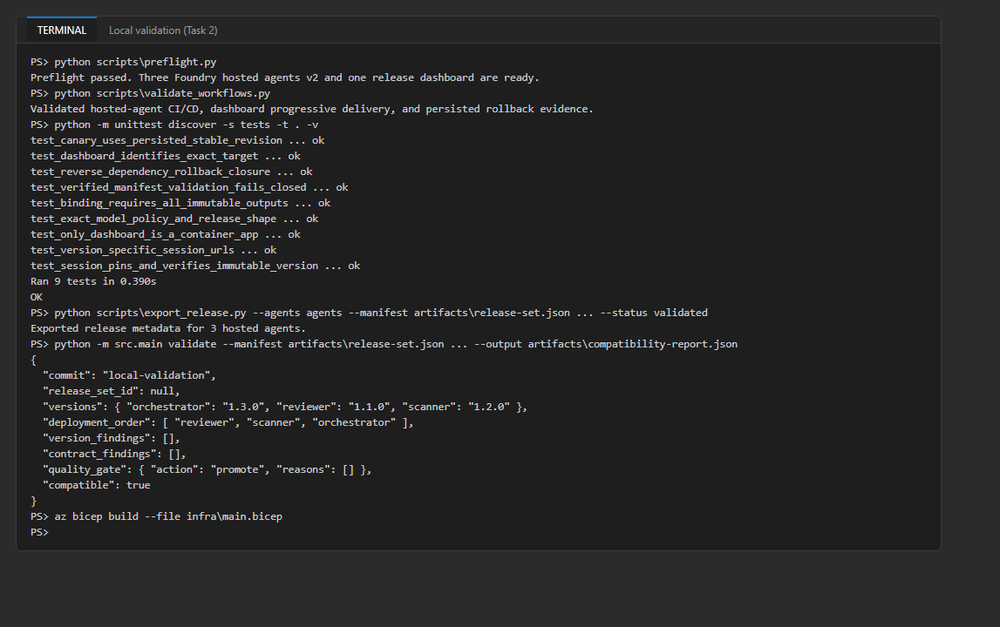

*Figure 5: Local validation after the fixes*

4. Optional: press **F5** in VS Code and choose a hosted-agent configuration to debug an entrypoint locally.

---

## Task 3: Create the practice repository

1. Create an empty private repository with the GitHub CLI (no README, `.gitignore` or license):

```powershell
$owner = gh api user --jq .login
$repo = "$owner/fabrikam-agent-cicd"
gh repo create $repo --private --description "Fabrikam Foundry hosted-agent CI/CD practice"
gh repo view $repo --json nameWithOwner,visibility
```

2. Copy the fixed lab folder into a separate practice repository in your home folder. Local state (`.azure`, `.env`, `.venv`, `artifacts`) is excluded:

```powershell
$labRoot = (Get-Location).Path
$practiceRepo = Join-Path $HOME 'fabrikam-agent-cicd'
New-Item -ItemType Directory -Force $practiceRepo | Out-Null
Get-ChildItem $labRoot -Force |
  Where-Object { $_.Name -notin @('.azure', '.env', '.venv', 'artifacts', '__pycache__') } |
  Copy-Item -Destination $practiceRepo -Recurse -Force
Set-Location $practiceRepo
@('.azure/', '.env', '.venv/', 'artifacts/', '__pycache__/') | Set-Content .gitignore -Encoding ascii
git init
git branch -M main
git remote add origin "https://github.com/$repo.git"
git remote -v
```

3. Don't push yet. A push to `main` deploys development, and the environments and Azure access don't exist yet.

---

## Task 4: Configure passwordless GitHub access

GitHub Actions exchanges a short-lived GitHub OIDC token for a Microsoft Entra token. You don't create a client secret.

1. Read the numeric IDs of the repository owner and the repository. New GitHub repositories put these **immutable IDs** in the OIDC subject claim:

```powershell
$ids = gh api "repos/$repo" --jq '.owner.id, .id'
$ownerId = $ids[0]; $repoId = $ids[1]
"owner id: $ownerId  repo id: $repoId"
gh api "repos/$repo/actions/oidc/customization/sub"
```

**Expected result:** The customization call returns `"use_immutable_subject":true` and a `sub_claim_prefix` of the form `repo:<owner>@<owner-id>/fabrikam-agent-cicd@<repo-id>`.

2. Create the single-tenant app registration `fabrikam-agent-github` and its service principal (Enterprise application), and record the IDs:

```powershell
$appId = az ad app create --display-name fabrikam-agent-github --sign-in-audience AzureADMyOrg --query appId -o tsv
$spId = az ad sp create --id $appId --query id -o tsv
$tenantId = az account show --query tenantId -o tsv
$subscriptionId = az account show --query id -o tsv
"AZURE_CLIENT_ID=$appId"; "AZURE_TENANT_ID=$tenantId"; "AZURE_GITHUB_PRINCIPAL_ID=$spId"
```

3. Add one federated credential per GitHub environment, using the immutable-ID subject `repo:<owner>@<owner-id>/fabrikam-agent-cicd@<repo-id>:environment:<env>`:

```powershell
foreach ($ghEnv in 'development', 'staging', 'production') {
  $subject = "repo:$owner@$ownerId/fabrikam-agent-cicd@$($repoId):environment:$ghEnv"
  @{ name = "gh-$ghEnv"; issuer = 'https://token.actions.githubusercontent.com'; subject = $subject; audiences = @('api://AzureADTokenExchange') } |
    ConvertTo-Json -Compress | Set-Content fc.json -Encoding ascii
  az ad app federated-credential create --id $appId --parameters fc.json --query subject -o tsv
}
Remove-Item fc.json
az ad app federated-credential list --id $appId --query "[].{Name:name,Subject:subject}" -o table
```

> **Note:** The official lab uses the legacy subject `repo:<owner>/fabrikam-agent-cicd:environment:<env>`. It only works for repositories whose `sub_claim_prefix` (step 1) has no `@<id>` parts. If the subject doesn't match, `azure/login` fails with `AADSTS700213` (see **Troubleshooting**).

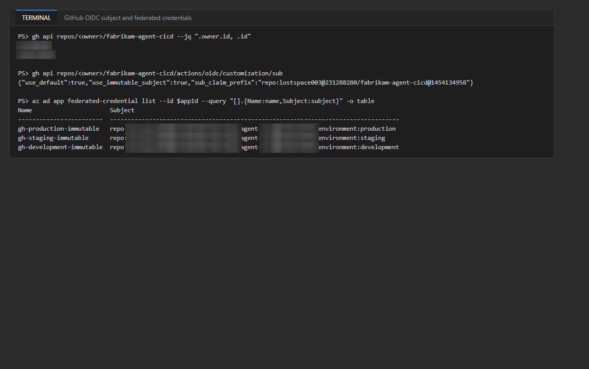

*Figure 6: Repository IDs, the immutable OIDC subject prefix and the matching federated credentials*

4. Create one resource group per environment:

```powershell
$azureRegion = 'eastus2'
$suffix = (New-Guid).Guid.Substring(0, 8)
foreach ($short in 'dev', 'stg', 'prod') {
  az group create --name "rg-lab09-$short-$suffix" --location $azureRegion --output none
}
az group list --query "[?starts_with(name, 'rg-lab09-')].{name:name, location:location}" -o table
```

5. Assign the service principal **Contributor** and **Role Based Access Control Administrator** on each resource group (an Azure administrator must do this if you lack the rights). RBAC Administrator lets the workflow create the Bicep role assignments and the orchestrator role from Fix 3.

```powershell
foreach ($short in 'dev', 'stg', 'prod') {
  $rgId = az group show --name "rg-lab09-$short-$suffix" --query id -o tsv
  foreach ($role in 'Contributor', 'Role Based Access Control Administrator') {
    az role assignment create --assignee-object-id $spId --assignee-principal-type ServicePrincipal --role $role --scope $rgId --output none
  }
}
az role assignment list --assignee $spId --all --query "[].{role:roleDefinitionName, scope:scope}" -o table
```

**Expected result:** Six role assignments, two per resource group. Role assignments can take 1-5 minutes to apply.

> **Note:** Keep this PowerShell session open; later tasks use `$repo`, `$suffix`, `$appId`, `$spId`, `$tenantId` and `$subscriptionId`. If you open a new terminal, set `$owner`, `$repo` and `$suffix` again (the suffix is in the resource group names), then run `$appId = az ad app list --display-name fabrikam-agent-github --query "[0].appId" -o tsv` and `$spId = az ad sp show --id $appId --query id -o tsv`.

---

## Task 5: Configure GitHub environments

1. Create the three environments and their seven variables. The principal variable is named `AZURE_GITHUB_PRINCIPAL_ID` because GitHub rejects variable names that start with `GITHUB_` (HTTP 422):

```powershell
$shortName = @{ development = 'dev'; staging = 'stg'; production = 'prod' }
foreach ($ghEnv in 'development', 'staging', 'production') {
  $short = $shortName[$ghEnv]
  gh api --method PUT "repos/$repo/environments/$ghEnv" --silent
  gh variable set AZURE_CLIENT_ID --repo $repo --env $ghEnv --body $appId
  gh variable set AZURE_TENANT_ID --repo $repo --env $ghEnv --body $tenantId
  gh variable set AZURE_SUBSCRIPTION_ID --repo $repo --env $ghEnv --body $subscriptionId
  gh variable set AZURE_LOCATION --repo $repo --env $ghEnv --body $azureRegion
  gh variable set AZURE_ENV_NAME --repo $repo --env $ghEnv --body "lab09-cicd-$short"
  gh variable set AZURE_GITHUB_PRINCIPAL_ID --repo $repo --env $ghEnv --body $spId
  gh variable set AZURE_RESOURCE_GROUP_NAME --repo $repo --env $ghEnv --body "rg-lab09-$short-$suffix"
}
```

2. Restrict staging and production deployments to the `main` branch:

```powershell
foreach ($ghEnv in 'staging', 'production') {
  gh api --method PUT "repos/$repo/environments/$ghEnv" -F "deployment_branch_policy[protected_branches]=false" -F "deployment_branch_policy[custom_branch_policies]=true" --silent
  gh api --method POST "repos/$repo/environments/$ghEnv/deployment-branch-policies" -f name=main -f type=branch --silent
}
```

3. Add yourself as a required reviewer for staging and production. This works on public repositories and on private repositories with a paid plan; on a free private repository it fails with HTTP 422 (`billing plan supports the required reviewers protection rule`), and you continue without approval gates.

```powershell
$userId = gh api user --jq .id
@"
{"reviewers":[{"type":"User","id":$userId}],"deployment_branch_policy":{"protected_branches":false,"custom_branch_policies":true}}
"@ | Set-Content reviewers.json -Encoding ascii
foreach ($ghEnv in 'staging', 'production') {
  gh api --method PUT "repos/$repo/environments/$ghEnv" --input reviewers.json --silent
}
Remove-Item reviewers.json
```

4. Verify the environments and variables:

```powershell
gh api "repos/$repo/environments" --jq '.environments[] | [.name, (.protection_rules | length), (.deployment_branch_policy | tostring)] | @tsv'
foreach ($ghEnv in 'development', 'staging', 'production') { "== $ghEnv"; gh variable list --repo $repo --env $ghEnv }
```

**Expected result:** Three environments. Staging and production have a branch policy (and a required-reviewers rule if your plan allows it). Each environment has seven variables with distinct `AZURE_ENV_NAME` and `AZURE_RESOURCE_GROUP_NAME` values.

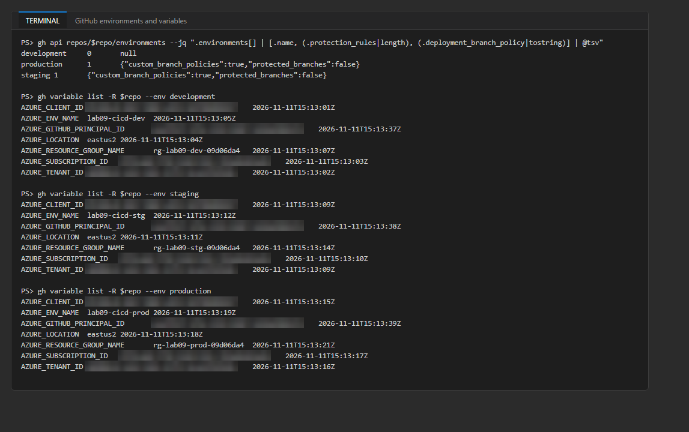

*Figure 7: Environments and environment variables (free plan: branch policy only, no reviewers)*

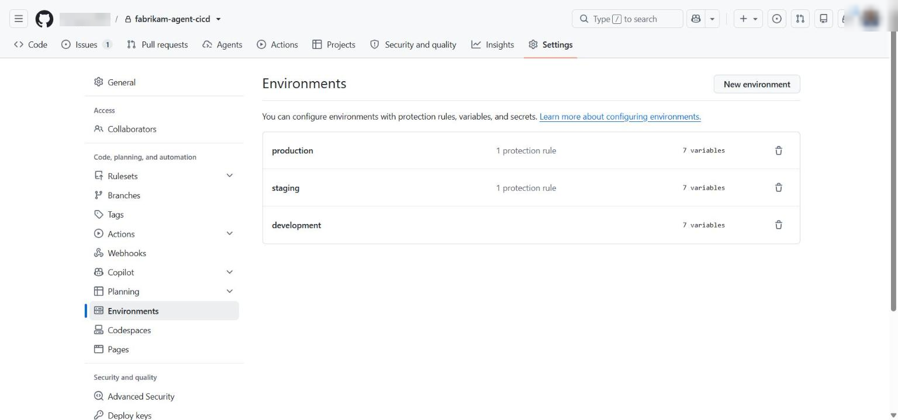

*Figure 8: Settings > Environments in GitHub*

---

## Task 6: Activate the workflows

1. In the practice repository, create `.github\workflows` and copy the four (fixed) templates:

```powershell
New-Item -ItemType Directory -Force .github\workflows | Out-Null
Copy-Item assets\workflows\validate-agents.yml .github\workflows\validate-agents.yml
Copy-Item assets\workflows\deploy-environment.yml .github\workflows\deploy-environment.yml
Copy-Item assets\workflows\canary-quality-gate.yml .github\workflows\canary-quality-gate.yml
Copy-Item assets\workflows\rollback-agents.yml .github\workflows\rollback-agents.yml
```

2. Review the workflows:

- `validate-agents.yml` has no Azure login. It validates contracts and strict semantic versions, the dependency DAG, the exact `gpt-5.4-mini` / `2026-03-17` policy, the hosted-agent v2 declarations, tests, workflows and the deterministic dataset (2 records).
- `deploy-environment.yml` deploys serially: `azd deploy scanner`, `azd ai agent show scanner`, `azd ai agent invoke scanner --version <captured>`, then the same for reviewer, then orchestrator, then `azd deploy dashboard`. Every azd command sets `AZURE_DEV_USER_AGENT=microsoft_foundry_skill`. `capture_release_set.py` captures `AGENT_<SCANNER|REVIEWER|ORCHESTRATOR>_NAME`, `_VERSION` and `_RESPONSES_ENDPOINT`.
- `canary-quality-gate.yml` refuses promotion unless the candidate artifact has passing, version-bound evaluation evidence. The healthy/regression fixture only selects the policy branch.
- `rollback-agents.yml` downloads `release-set.json` from the `verified-<environment>` release, validates it and restores that exact dashboard revision. It never assumes that the second-newest revision is safe.
- All three Azure workflows share the concurrency group `lab09-release-<environment>` with `cancel-in-progress: false`.

3. Validate the activated copies:

```powershell
python scripts\validate_workflows.py
git status --short
```

**Expected result:** `Validated hosted-agent CI/CD, dashboard progressive delivery, and persisted rollback evidence.` and a list of untracked files that includes `.github/` and `.gitignore`, but no `.venv`, `.env` or `artifacts`.

---

## Task 7: Deploy the initial development release

1. Commit and push. The push triggers **Deploy hosted-agent release set** for `development`:

```powershell
git add .
git commit -m "Initialize Foundry hosted-agent delivery"
git push -u origin main
```

2. Find the run and watch it until it finishes (about 9-10 minutes):

```powershell
Start-Sleep -Seconds 10
$initialRun = gh run list --workflow deploy-environment.yml --branch main --limit 1 --json databaseId --jq '.[0].databaseId'
gh run watch $initialRun --exit-status
gh run view $initialRun
```

What happens: `validate / compatibility` runs first; `deploy` exchanges the environment OIDC token (no secret), `azd provision` creates the development Foundry account and project, the model deployment, ACR, Log Analytics, the Container Apps environment and the dashboard app; the three agents are deployed serially, each with `azd ai agent show` and a version-pinned smoke call; the smoke dataset runs against the pinned orchestrator; one dashboard revision gets 100 percent traffic and the `stable` label. Because no `verified-development` release exists and the app only has its bootstrap revision, the run is treated as an explicit first release and persisted as the first verified baseline.

3. Confirm the persisted baseline:

```powershell
gh release view verified-development
```

**Expected result:** Both jobs succeed, and the run has the artifacts `compatibility-report` and `deployment-evidence-development-<run-id>`. The release `verified-development` (`Last verified development release`, asset `release-set.json`, author `github-actions[bot]`) exists. In the reference run, the release set was `development-8fdcc5c463c4e9c9`.

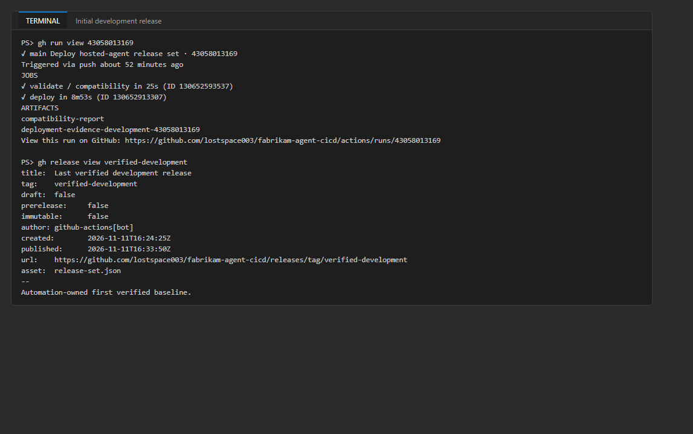

*Figure 9: Initial development release and the verified-development baseline*

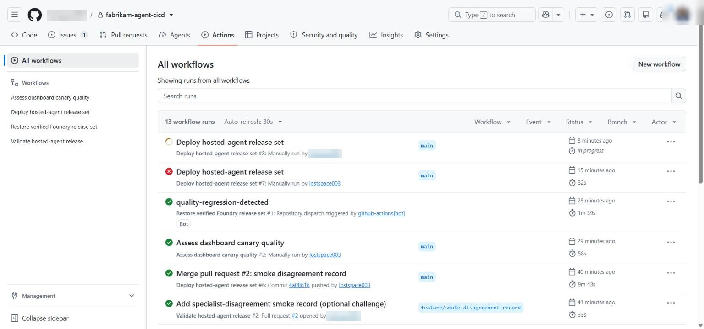

*Figure 10: The Actions tab with all lab runs*

4. Download the deployment evidence to a folder outside the repository and compare the logical and immutable versions:

```powershell
$evidence = Join-Path $HOME 'lab09-evidence'
gh run download $initialRun --name "deployment-evidence-development-$initialRun" --dir "$evidence\initial"
$rs = Get-Content "$evidence\initial\release-set.json" | ConvertFrom-Json
"$($rs.release_set_id)  status=$($rs.status)  commit=$($rs.source.commit)"
$rs.agents.PSObject.Properties | ForEach-Object { '{0,-13} logical {1,-6} foundry {2} v{3}' -f $_.Name, $_.Value.logical_version, $_.Value.hosted_deployment.name, $_.Value.hosted_deployment.version }
Get-Content "$evidence\initial\evaluation-evidence.json"
```

**Expected result:** Status `verified`. Scanner `1.2.0`, reviewer `1.1.0` and orchestrator `1.3.0` are bound to `fabrikam-code-scanner`, `fabrikam-code-reviewer` and `fabrikam-review-orchestrator` with Foundry version `1` in a fresh project (the reference run shows `2` because an earlier cancelled run had already created version 1). `evaluation-evidence.json` has the source commit, the release-set ID, the exact orchestrator version and `/versions/<n>` endpoint, the dataset and evaluator identity, `sample_count: 2` and `"status": "passed"`.

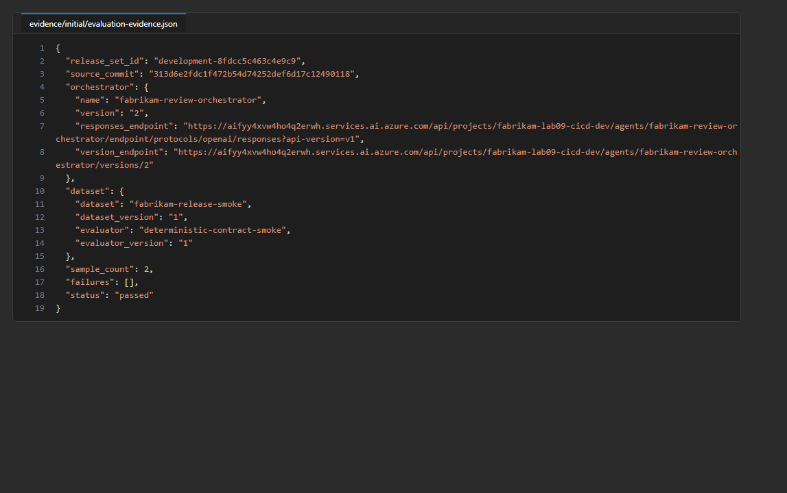

*Figure 11: Version-bound evaluation evidence of the initial release*

---

## Task 8: Verify the initial resources

1. List the development resources, the model deployment and the dashboard revisions:

```powershell
$rgDev = "rg-lab09-dev-$suffix"
az resource list -g $rgDev --query "[].{name:name, type:type}" -o table
$aif = az cognitiveservices account list -g $rgDev --query "[0].name" -o tsv
az cognitiveservices account deployment list -g $rgDev -n $aif --query "[].{name:name, model:properties.model.name, version:properties.model.version, sku:sku.name}" -o table
$app = az containerapp list -g $rgDev --query "[0].name" -o tsv
az containerapp ingress traffic show -g $rgDev -n $app -o table
```

**Expected result:** One Foundry account and project (`fabrikam-lab09-cicd-dev`), one ACR, one Log Analytics workspace, one Container Apps environment and exactly **one** Container App (`fabrikam-release-lab09-cicd-d`). There are no scanner, reviewer or orchestrator Container Apps. The deployment `gpt-5.4-mini` is version `2026-03-17`. One revision has weight 100 and the label `stable`.

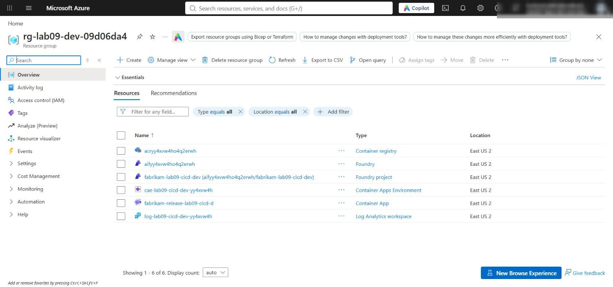

*Figure 12: The development resource group*

2. In the [Foundry portal](https://ai.azure.com), open the project `fabrikam-lab09-cicd-dev` and select **Agents**. Confirm that the three hosted agents exist with an active version that matches `release-set.json`.

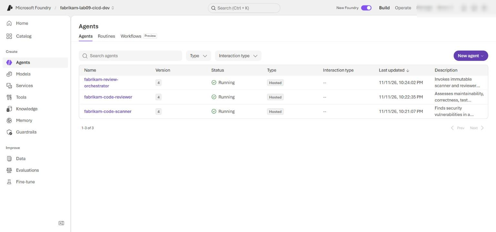

*Figure 13: The three hosted agents in the development Foundry project*

3. In the Azure portal, open the dashboard Container App, then **Revisions and replicas** (Revision management). Confirm one revision with 100 percent traffic and the `stable` label.

4. Open the dashboard and read its metadata:

```powershell
$fqdn = az containerapp show -g $rgDev -n $app --query properties.configuration.ingress.fqdn -o tsv
Invoke-RestMethod "https://$fqdn/metadata"
Start-Process "https://$fqdn"
```

5. On the dashboard page, confirm the channel, Container App revision, release-set ID and the exact orchestrator name, version and Responses endpoint. Submit the synthetic review form and confirm that the result comes from the selected orchestrator version (`served_version`).

**Expected result:** `/metadata` returns `release_set_id`, `release_channel` (`weighted` on the main URL; `stable` on the `---stable` label URL), `container_app_revision`, `orchestrator_name fabrikam-review-orchestrator`, `orchestrator_version` and `orchestrator_responses_endpoint`.

---

## Task 9: Create and review a candidate

1. Create a branch:

```powershell
git checkout -b feature/scanner-release-metadata
```

2. In `agents/scanner.yml`, change the version line from `version: 1.2.0` to:

```yaml
version: 1.2.1
```

3. In the same file, add one sentence as the last line of the `instructions: |` block (two-space indentation, directly after `Do not report style-only concerns.`). The tool contract does not change:

```yaml
  Include a short confidence explanation for each reported finding.
```

4. Run local validation:

```powershell
python scripts\preflight.py
python scripts\validate_workflows.py
python -m unittest discover -s tests -t . -v
```

5. Commit, push and open a pull request:

```powershell
git add agents\scanner.yml
git commit -m "Clarify scanner finding confidence"
git push -u origin feature/scanner-release-metadata
gh pr create --base main --head feature/scanner-release-metadata --title "Clarify scanner finding confidence" --body "Scanner 1.2.1: adds a confidence explanation to each finding. No tool-contract change."
Start-Sleep -Seconds 15
gh pr checks --watch
```

6. Download and inspect the pull-request artifact:

```powershell
$prRun = gh run list --workflow validate-agents.yml --branch feature/scanner-release-metadata --limit 1 --json databaseId --jq '.[0].databaseId'
gh run download $prRun --name compatibility-report --dir "$evidence\pr1"
Get-Content "$evidence\pr1\compatibility-report.json"
$pr = Get-Content "$evidence\pr1\release-set.json" | ConvertFrom-Json
$pr.agents.scanner | ConvertTo-Json -Depth 5
$pr.dependencies.orchestrator
```

**Expected result:** **Validate hosted-agent release** passes (about 45 seconds). Scanner logical version `1.2.1`; a `contract_digest` (`sha256:...`) is present; `contract_findings` and `version_findings` are empty; `"compatible": true`; the orchestrator dependency `>=1.0.0,<2.0.0` accepts `1.2.1`; the hosted manifest is still Responses `2.0.0`, `python_3_13`; all `hosted_deployment` fields are `null`.

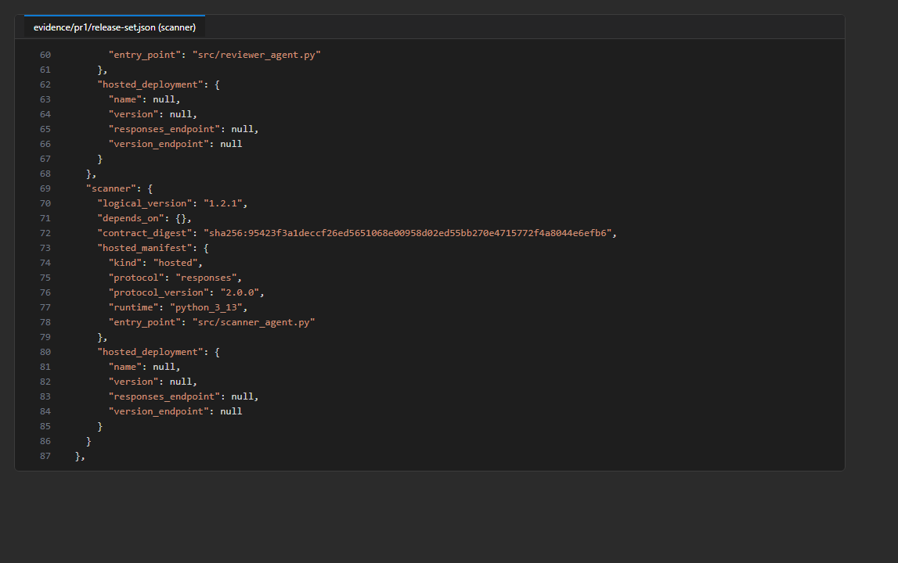

*Figure 14: Pull-request evidence: scanner 1.2.1, unchanged manifest, no deployment fields*

7. Merge the pull request and update your local `main`:

```powershell
gh pr merge feature/scanner-release-metadata --merge --delete-branch
git checkout main
git pull
```

---

## Task 10: Verify 75/25 dashboard exposure

1. The merge to `main` starts a new deployment. Watch it (about 10-11 minutes):

```powershell
Start-Sleep -Seconds 10
$candidateRun = gh run list --workflow deploy-environment.yml --branch main --event push --limit 1 --json databaseId --jq '.[0].databaseId'
gh run watch $candidateRun --exit-status
```

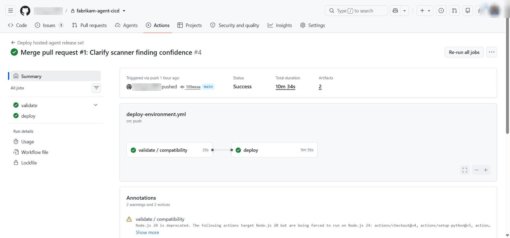

*Figure 15: The candidate deployment run in GitHub*

2. Download the evidence and confirm new immutable versions, a new release-set ID and the candidate orchestrator binding:

```powershell
gh run download $candidateRun --name "deployment-evidence-development-$candidateRun" --dir "$evidence\candidate"
$cand = Get-Content "$evidence\candidate\release-set.json" | ConvertFrom-Json
"$($cand.release_set_id)  status=$($cand.status)  commit=$($cand.source.commit)"
$cand.agents.PSObject.Properties | ForEach-Object { '{0,-13} {1,-6} v{2}' -f $_.Name, $_.Value.logical_version, $_.Value.hosted_deployment.version }
$cand.dashboard.target_orchestrator.version_endpoint
$cand.dashboard.stable_label_url
$cand.dashboard.candidate_label_url
Select-String -Path "$evidence\candidate\dashboard-invocation.html" -Pattern 'served_version' | Select-Object -First 1
```

3. Sample the weighted URL, then the two label URLs:

```powershell
function Show-Dashboard($url) { $m = Invoke-RestMethod "$url/metadata" -DisableKeepAlive; "$($m.release_channel) $($m.container_app_revision) $($m.release_set_id) orch v$($m.orchestrator_version)" }
1..16 | ForEach-Object { Show-Dashboard $cand.dashboard.url } | Group-Object | Select-Object Count, Name
1..3 | ForEach-Object { Show-Dashboard $cand.dashboard.stable_label_url }
1..3 | ForEach-Object { Show-Dashboard $cand.dashboard.candidate_label_url }
az containerapp ingress traffic show -g $rgDev -n $app -o table
```

**Expected result:** Status `candidate`, every agent has a new Foundry version (scanner `1.2.1`), and the release-set ID is new (`development-ca5ce394b4d543d8` in the reference run, agents v3). The candidate orchestrator endpoint ends in `/versions/<n>` and the invocation shows that same `served_version`. Traffic is `stable` 75 / `candidate` 25. The weighted sample is random (the reference run got 13 stable and 3 candidate out of 16, not exactly 12/4); the configured weights are authoritative. The stable label URL (`https://<app>---stable.<environment-domain>`) always returns the last-verified revision and orchestrator version, and the candidate label URL always returns the candidate.

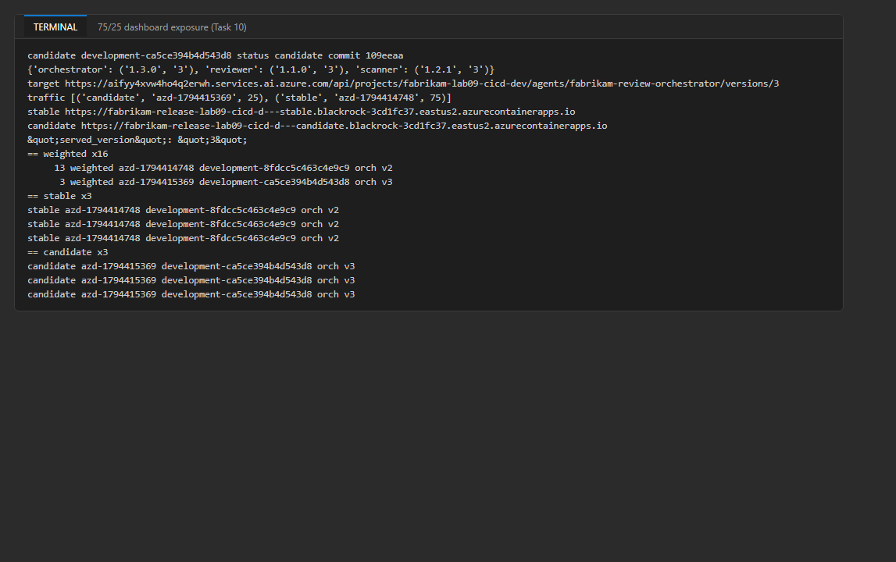

*Figure 16: Traffic weights, the weighted sample and deterministic label routes from the reference run*

4. In the Azure portal, open the dashboard app's **Revisions and replicas** page and confirm the 75/25 weights and the `stable`/`candidate` labels.

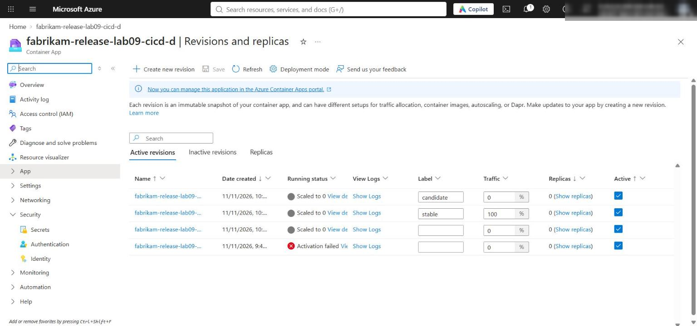

*Figure 17: Revision management of the dashboard Container App (labels and traffic weights)*

---

## Task 11: Promote the candidate across environments

1. Run **Assess dashboard canary quality** for development with the healthy profile, and watch it:

```powershell
gh workflow run canary-quality-gate.yml -f environment=development -f deployment_run_id=$candidateRun -f failed_agent=scanner -f metric_profile=healthy
Start-Sleep -Seconds 10
$gateRun = gh run list --workflow canary-quality-gate.yml --limit 1 --json databaseId --jq '.[0].databaseId'
gh run watch $gateRun --exit-status
```

2. Check the decision, the new traffic, the stable label and the persisted release:

```powershell
gh run download $gateRun --name "canary-decision-development-$gateRun" --dir "$evidence\canary-healthy"
Get-Content "$evidence\canary-healthy\quality-decision.json"
(Get-Content "$evidence\canary-healthy\promotion-traffic.json" | ConvertFrom-Json).routing.traffic
Show-Dashboard $cand.dashboard.stable_label_url
gh release view verified-development --json tagName,publishedAt,assets --jq '{tag: .tagName, published: .publishedAt, asset: .assets[0].name}'
```

**Expected result:** The gate passes in about 1-2 minutes with `"action": "promote"`. Traffic changes to 0/100: the candidate revision now has the `stable` label and 100 percent, the old one has the `previous` label and 0 percent. The stable label URL returns the promoted release set and orchestrator version, and `verified-development` now contains the promoted `release-set.json` (status `verified`).

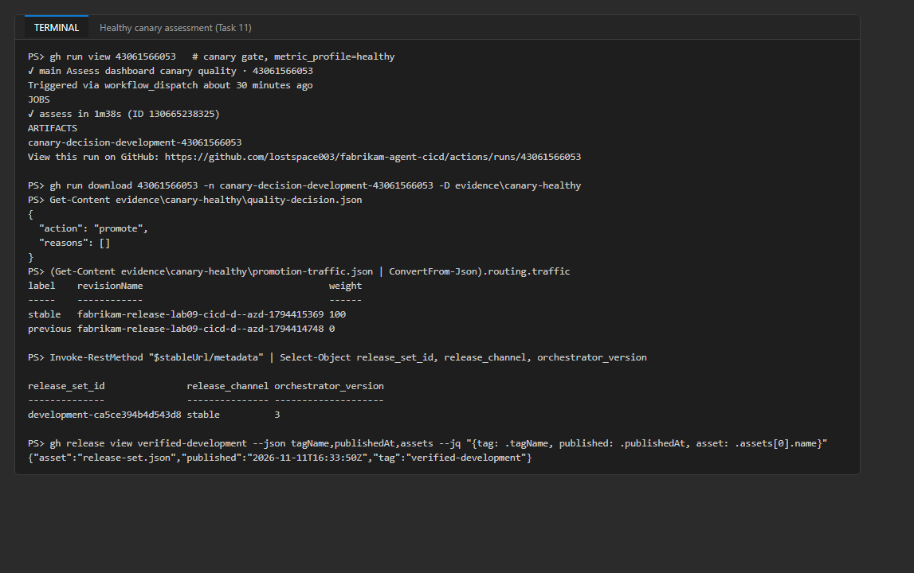

*Figure 18: Healthy canary assessment: promote, 0/100 traffic and the updated verified-development release*

3. Run the deployment workflow for **staging** with the same reviewed commit that you deployed to development:

```powershell
$reviewedCommit = $cand.source.commit
gh workflow run deploy-environment.yml -f environment=staging -f source_commit=$reviewedCommit
Start-Sleep -Seconds 10
$stagingRun = gh run list --workflow deploy-environment.yml --event workflow_dispatch --limit 1 --json databaseId --jq '.[0].databaseId'
gh run view $stagingRun
```

4. If you configured required reviewers, the `deploy` job waits for approval. Approve it in the run page (**Review deployments**) or with the CLI:

```powershell
$envIds = gh api "repos/$repo/actions/runs/$stagingRun/pending_deployments" --jq '.[].environment.id'
gh api --method POST "repos/$repo/actions/runs/$stagingRun/pending_deployments" -F "environment_ids[]=$envIds" -f state=approved -f comment="Promote reviewed commit to staging"
```

5. Watch the run (about 12 minutes) and check the persisted staging release:

```powershell
gh run watch $stagingRun --exit-status
gh release view verified-staging
gh release download verified-staging --pattern release-set.json --dir "$evidence\verified-staging" --clobber
$s = Get-Content "$evidence\verified-staging\release-set.json" | ConvertFrom-Json
$s.release_set_id; $s.status; $s.source.commit; $s.reviewed_release_id
```

**Expected result:** The staging run creates a separate Foundry project (`fabrikam-lab09-cicd-stg`) and dashboard (`fabrikam-release-lab09-cicd-s`) in `rg-lab09-stg-<suffix>`. Because staging has no verified release yet, it follows the first-release path and persists `verified-staging` itself (status `verified`). The source commit and `reviewed_release_id` equal the development candidate's; the Foundry versions start again at 1 in this project. Reference run: `staging-525bfc64d603f222`, agents v1, commit `109eeaa`.

> **Note:** The official step "run its healthy canary assessment to create `verified-staging`" doesn't apply to a first release: the gate requires a release set with status `candidate`, and the first staging release is already `verified`. Run the staging canary gate only for later staging candidates.

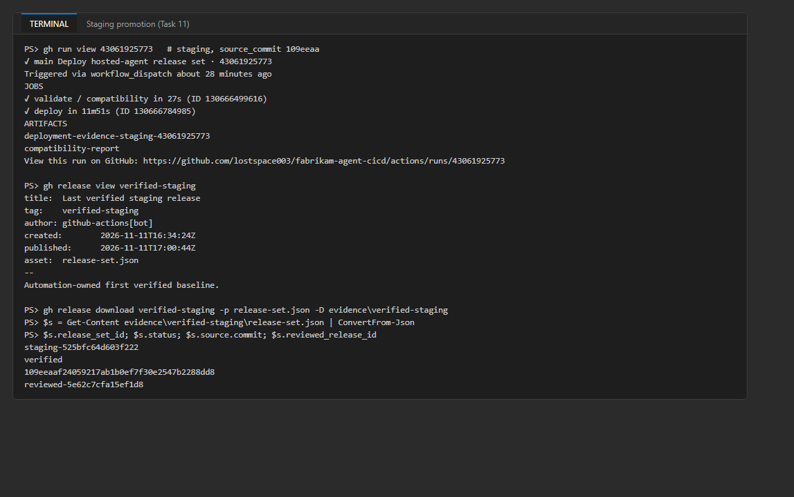

*Figure 19: Staging promotion and verified-staging (same commit and reviewed release ID)*

6. Run the deployment workflow for **production** with the same commit (approve it as in step 4 if you configured reviewers). Do this **before** you merge any other change to `main` (see the note below the expected result):

```powershell
gh workflow run deploy-environment.yml -f environment=production -f source_commit=$reviewedCommit
Start-Sleep -Seconds 10
$productionRun = gh run list --workflow deploy-environment.yml --event workflow_dispatch --limit 1 --json databaseId --jq '.[0].databaseId'
gh run watch $productionRun --exit-status
gh release view verified-production
```

**Expected result:** The step **Enforce staging-first production promotion** downloads `verified-staging` and checks that its `source.commit` equals the commit you entered, its `status` is `verified`, and its `reviewed_release_id` equals the one from this run's validation. The run then provisions `rg-lab09-prod-<suffix>` (project `fabrikam-lab09-cicd-prod`), deploys the three agents and the dashboard, follows the first-release path and creates `verified-production`. The Foundry version numbers may differ from staging, but the reviewed source identity, logical versions, contracts, model policy and evaluation identity are identical. If staging has a different commit or reviewed ID, the run stops at that step and nothing is deployed to production.

> **Note:** In the reference run, production was dispatched with commit `109eeaa` **after** the optional-challenge pull request (Task 12) had changed `validate-agents.yml` on `main` to expect 3 smoke records. The validation job uses the workflow file from `main` but checks out the old commit (2 records), so run `43066284613` failed in **Verify deterministic evaluation dataset** after 25 seconds and the deploy job was skipped (Figure 20). That's why this guide promotes to production before Task 12. If it happens to you, promote the current `main` commit through staging first and then to production.

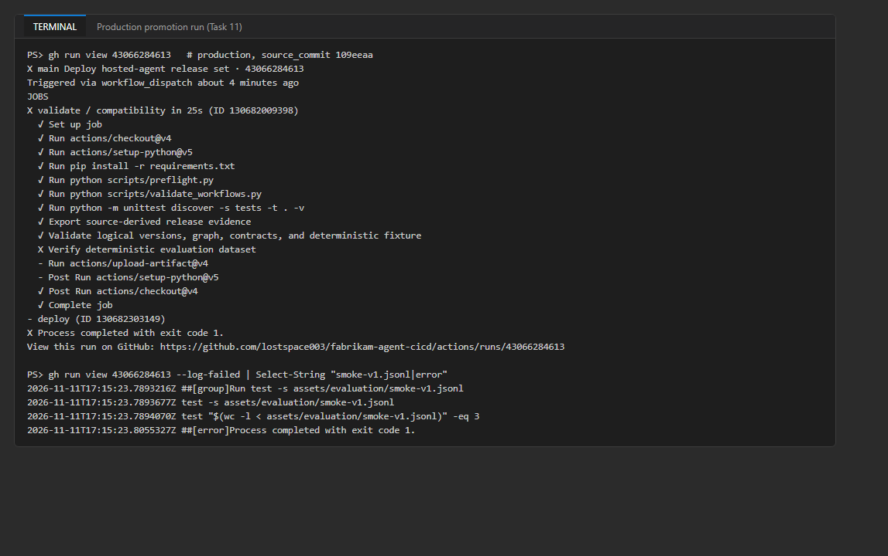

*Figure 20: The reference production run, dispatched after the dataset change, stopped in validation*

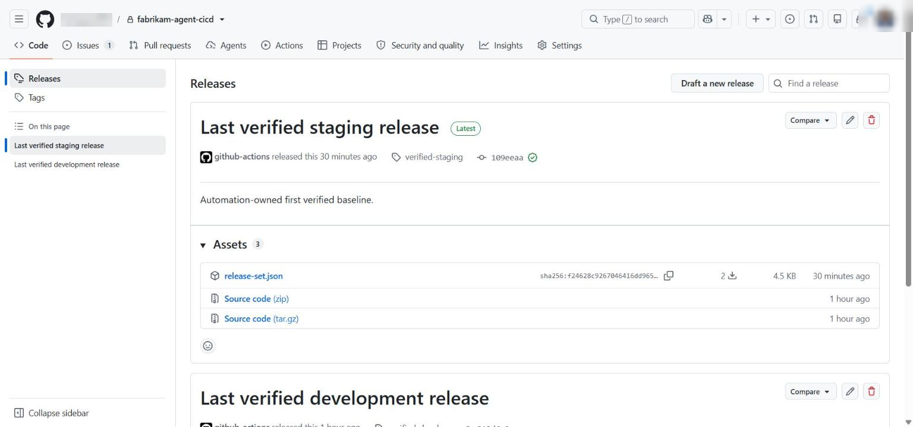

*Figure 21: The verified-* releases in GitHub*


*Figure 22: The staging resource group, separate from development*

---

## Task 12: Exercise compatible-set rollback

The rollback needs a new candidate in development. Use the optional-challenge change from the official lab as that candidate: a third smoke record. The reviewed release ID changes, but no tool contract changes.

1. Create a branch and add the third smoke record (the file already ends with a newline):

```powershell
git checkout -b feature/smoke-disagreement-record
Add-Content assets\evaluation\smoke-v1.jsonl '{"id":"specialist-disagreement","input":"Review repository fabrikam/payments-api at commit 00ff00ff00ff00ff. The scanner reports no security findings, but the reviewer reports high release risk because the change removes retry tests. Explain why the release should be held when scanner and reviewer disagree.","expected_contract":"coordinate_review"}'
```

2. Increment `dataset_version` in all three agents, update the test expectation, and change the expected record count in both copies of the validation workflow:

```powershell
foreach ($f in 'agents\scanner.yml', 'agents\reviewer.yml', 'agents\orchestrator.yml') {
  (Get-Content $f) -replace "dataset_version: '1'", "dataset_version: '2'" | Set-Content $f
}
(Get-Content tests\test_lab09.py) -replace '\["dataset_version"\], "1"\)', '["dataset_version"], "2")' | Set-Content tests\test_lab09.py
foreach ($f in '.github\workflows\validate-agents.yml', 'assets\workflows\validate-agents.yml') {
  (Get-Content $f) -replace 'smoke-v1.jsonl\)" -eq 2', 'smoke-v1.jsonl)" -eq 3' | Set-Content $f
}
git diff --stat
```

The test line becomes `self.assertEqual(release_set["evaluation"]["dataset_version"], "2")` and the workflow line becomes:

```yaml
          test "$(wc -l < assets/evaluation/smoke-v1.jsonl)" -eq 3
```

3. Validate, push, open the pull request, merge it and watch the new candidate deployment:

```powershell
python scripts\preflight.py
python scripts\validate_workflows.py
python -m unittest discover -s tests -t . -v
git add -A
git commit -m "Add specialist-disagreement smoke record (dataset v2)"
git push -u origin feature/smoke-disagreement-record
gh pr create --base main --head feature/smoke-disagreement-record --title "Add specialist-disagreement smoke record" --body "Optional challenge: third deterministic smoke record, dataset_version 2."
Start-Sleep -Seconds 15
gh pr checks --watch
gh pr merge feature/smoke-disagreement-record --merge --delete-branch
git checkout main
git pull
Start-Sleep -Seconds 10
$candidate2Run = gh run list --workflow deploy-environment.yml --branch main --event push --limit 1 --json databaseId --jq '.[0].databaseId'
gh run watch $candidate2Run --exit-status
```

**Expected result:** The PR validation passes and its `reviewed_release_id` differs from the previous one (reference: `reviewed-0742f5cfd3fedade` became `reviewed-ff1940154108d798`) while the contract digest and model policy stay the same. The deployment produces a new candidate at 25 percent (reference: `development-81293fe401ba6ece`, 3 smoke samples passed).

4. Run the canary gate with the **regression** profile for this candidate:

```powershell
gh workflow run canary-quality-gate.yml -f environment=development -f deployment_run_id=$candidate2Run -f failed_agent=scanner -f metric_profile=regression
Start-Sleep -Seconds 10
$regressionRun = gh run list --workflow canary-quality-gate.yml --limit 1 --json databaseId --jq '.[0].databaseId'
gh run watch $regressionRun --exit-status
```

5. The gate dispatches `quality-regression-detected`, which starts **Restore verified Foundry release set**. Watch it and look at the incident issue:

```powershell
Start-Sleep -Seconds 15
$rollbackRun = gh run list --workflow rollback-agents.yml --limit 1 --json databaseId --jq '.[0].databaseId'
gh run watch $rollbackRun --exit-status
gh issue list --state open
gh issue view (gh issue list --state open --limit 1 --json number --jq '.[0].number')
```

**Expected result:** The gate's decision is `rollback` with reasons `quality_drop` and `schema_violation_rate`. The rollback run (about 1.5 minutes) downloads the candidate release set and the persisted `verified-development` manifest, derives the closure `orchestrator, scanner` in reverse dependency order, restores 100 percent traffic and the `stable` label to the verified revision, checks the stable URL `/metadata` against the verified release-set ID and orchestrator version, and opens the issue **Automated compatible-set rollback: scanner** with the environment, the restored release set and the closure (reference: issue #3, restored `development-ca5ce394b4d543d8`).

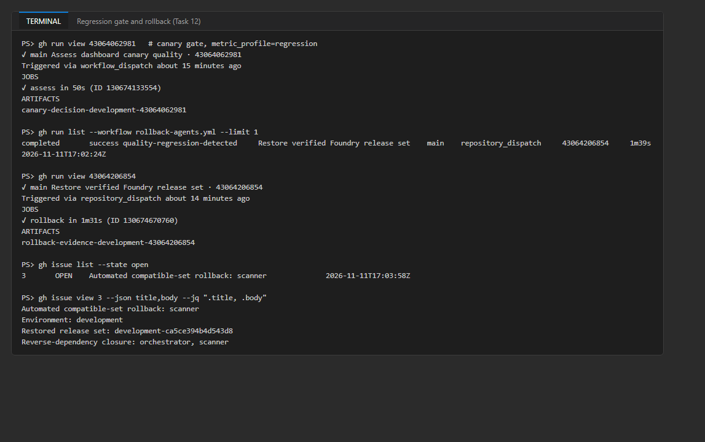

*Figure 23: Regression gate, rollback run and the incident issue*

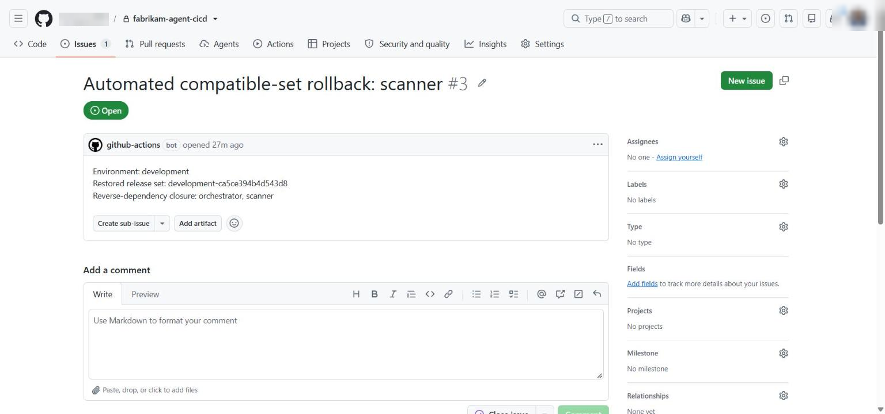

*Figure 24: The incident issue created by the rollback workflow*

6. Inspect the rollback evidence and verify the stable URL yourself:

```powershell
gh run download $rollbackRun --name "rollback-evidence-development-$rollbackRun" --dir "$evidence\rollback"
Get-Content "$evidence\rollback\rollback-set.json"
Get-Content "$evidence\rollback\rollback-evidence.json"
Show-Dashboard $cand.dashboard.stable_label_url
az containerapp ingress traffic show -g $rgDev -n $app -o table
Get-Content "$evidence\rollback\restored-orchestrator-smoke.txt" -TotalCount 12
```

**Expected result:** `rollback-evidence.json` records `restored_release_set_id`, `dashboard_revision`, the exact orchestrator `name`, `version`, `responses_endpoint` and `version_endpoint`, and `traffic_weight: 100`. The stable URL returns the same release set and orchestrator version, and traffic is `stable` 100 / `candidate` 0. Rollback doesn't delete any immutable Foundry version; it moves traffic back to a revision already bound to a known-compatible release set.

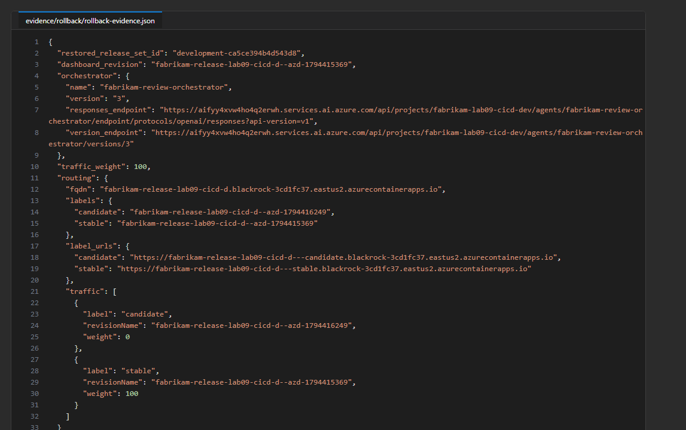

*Figure 25: rollback-evidence.json from the reference run*

> **Note:** Check `restored-orchestrator-smoke.txt`. In the reference run it contains `Agent 'orchestrator' not found` (HTTP 404): on a fresh runner the refreshed azd environment has no `AGENT_ORCHESTRATOR_NAME`, so `azd ai agent invoke orchestrator` uses the service name. The step still reported success because `| tee` hides the exit code. The dashboard check (release-set ID and orchestrator version on the stable URL) is the verification that passed. See **Troubleshooting** for an (untested) workflow change.

---

## Task 13: Review the release evidence

Keep these files from `$HOME\lab09-evidence` (or re-download them with `gh run download <run-id> --name <artifact> --dir <folder>`):

| Evidence | Where |
|---|---|
| Pull-request compatibility report | `pr1\compatibility-report.json`, `pr1\release-set.json` |
| Candidate and verified release sets | `candidate\release-set.json`, `canary-healthy\release-set.json`, `gh release download verified-<env>` |
| Version-bound evaluation evidence | `initial\evaluation-evidence.json`, `candidate\evaluation-evidence.json` |
| 75/25 and 0/100 traffic | `candidate\traffic-after-deploy.json`, `canary-healthy\promotion-traffic.json` |
| Stable/candidate direct routes | `candidate\dashboard-stable-route.json`, `candidate\dashboard-candidate-route.json` |
| Rollback closure, restored metadata, pinned invocation, incident | `rollback\rollback-set.json`, `rollback\rollback-evidence.json`, `rollback\restored-dashboard.json`, `rollback\restored-orchestrator-smoke.txt`, the issue URL |

```powershell
gh run list --limit 15
gh release list
gh pr list --state all
```

---

## Validate

| Acceptance criterion | How to check (CLI) | Portal / GitHub |
|---|---|---|
| Credential-free validation passes | Task 2 commands; `gh run view <pr-run>` | PR **Checks** tab |
| OIDC without secrets | `az ad app credential list --id $appId` returns `[]`; `az ad app federated-credential list --id $appId` | Entra ID > App registrations > fabrikam-agent-github > Certificates & secrets |
| Separate environment per stage | `gh api repos/$repo/environments`; `gh variable list --env <env>` | Settings > Environments |
| Initial release is verified | `gh release view verified-development` | Releases |
| Immutable versions captured | `release-set.json hosted_deployment` fields | Foundry portal > Agents |
| Only the dashboard is a Container App | `az containerapp list -g $rgDev -o table` | Resource group overview |
| 75/25 canary with deterministic labels | `az containerapp ingress traffic show`; `Show-Dashboard <label-url>` | Container App > Revisions and replicas |
| Promotion to 0/100 persists `verified-development` | `quality-decision.json` = `promote`; `gh release view verified-development` | Releases |
| Staging and production use the same reviewed commit | `$s.source.commit`, `$s.reviewed_release_id`; production run step **Enforce staging-first production promotion** | Actions run page |
| Rollback restores the verified set | `rollback-evidence.json`; stable `/metadata` | Issues > Automated compatible-set rollback |

---

## Troubleshooting

| Error | Cause and fix |
|---|---|
| `git push` rejected: `refusing to allow an OAuth App to create or update workflow .github/workflows/... without workflow scope` | Run `gh auth refresh --hostname github.com --scopes workflow`, then push again. |
| `azure/login`: `AADSTS700213: No matching federated identity record found for presented assertion subject 'repo:<owner>@<owner-id>/fabrikam-agent-cicd@<repo-id>:environment:development'` | The repository sends the immutable-ID subject, but the credentials use the legacy `repo:<owner>/fabrikam-agent-cicd:environment:<env>`. Setting `use_immutable_subject` to false through the OIDC customization API had no effect for a new repository. Add credentials with the subject from `gh api repos/$repo/actions/oidc/customization/sub` (`sub_claim_prefix` + `:environment:<env>`), as in Task 4 step 3, then `gh run rerun <run-id> --failed`. |
| `gh variable set GITHUB_PRINCIPAL_ID` returns HTTP 422 | GitHub reserves the `GITHUB_` prefix. Use `AZURE_GITHUB_PRINCIPAL_ID` (Task 5) and `vars.AZURE_GITHUB_PRINCIPAL_ID` in the deploy workflow (Fix 2). |
| Required reviewers: HTTP 422 `... billing plan supports the required reviewers protection rule` | Private repositories on the free plan can't use required reviewers. Continue with the branch policy only, make the repository public, or use a paid plan. |
| `ImportError: Start directory is not importable: 'Allfiles/09-fabrikam-multi-agent-cicd/tests'` | Fix 1: `python -m unittest discover -s tests -t . -v`. |
| `NetworkRuleNotSupported` during provisioning | Basic ACR doesn't support `networkRuleSet`. Fix 7 step 1. |
| `RequestConflict` on the Foundry account | The project and the model deployment were written concurrently. Fix 7 step 2 (`dependsOn: [ modelDeployment ]`). |
| azd in Actions says you're not logged in, or `azd env get-value` fails | azd needs `azd config set auth.useAzCliAuth true` after `azure/login`, and a fresh runner has no `.azure` state. Fix 2 and Fix 6. |
| Hosted-agent deploy or invoke returns 403 for the GitHub principal | Contributor has no data actions. Fix 7 step 3 (`githubFoundryRole`, Foundry User on the project). |
| Orchestrator returns "unable to assess" or logs 403 for scanner/reviewer session calls | The orchestrator's instance identity has no Foundry User role. Fix 3. A manual assignment needs 2-5 minutes to propagate. |
| `ModuleNotFoundError: No module named 'src'` in **Capture immutable Foundry release set** | Fix 4 (`PYTHONPATH=.`). |
| Dashboard revision provisioning hangs and the run times out | The registry identity was set when the app was created. Use Fix 5 instead of a Bicep `registries` block. If the app is already broken, cancel the run, delete it (`az containerapp delete -g <rg> -n <app> --yes`) and run the workflow again (`gh run rerun <run-id>`). |
| `finalize_release_set.py`: `json.decoder.JSONDecodeError: Extra data` | `az` output was mixed into `traffic-after-deploy.json`. Fix 8 step 1 (`--output none`). |
| Label URL returns 404 | The label hostname is `<app>---<label>.<environment-domain>`. Fix 8 step 2 and Fix 9. |
| `RevisionAlreadyInRequestedState` during rollback | The verified revision is still active during a canary. Fix 10. |
| Production run fails in **Verify deterministic evaluation dataset** | The reusable validation workflow comes from `main`, but the job checks out the older `source_commit` with a different number of smoke records. Promote production before later dataset changes, or promote the current `main` commit through staging and then production. |
| Canary gate fails at `test "$(jq -r .status artifacts/candidate/release-set.json)" = candidate` | The deployment run you passed was a first release (status `verified`) or belongs to another environment. Pass a run that produced a `candidate`. |
| `restored-orchestrator-smoke.txt` shows `Agent 'orchestrator' not found` | Known gap (see Task 12). An untested workflow change: in the rollback **Verify restored dashboard and pinned orchestrator** step, run `AZURE_DEV_USER_AGENT=microsoft_foundry_skill azd env set AGENT_ORCHESTRATOR_NAME "$(jq -r .agents.orchestrator.hosted_deployment.name artifacts/verified/release-set.json)"` before the invoke, and add `set -o pipefail` so a failed invoke fails the step. |
| Foundry versions are higher than expected | Every `azd deploy`, including cancelled or failed runs, creates a new immutable version. Compare against `release-set.json`, not against a number you expected. |

---

## Review questions

1. **Why is a logical semantic version insufficient to identify a deployed hosted agent?** It describes source compatibility. Every `azd deploy` creates a new immutable Foundry version, even for the same logical version, and each project numbers versions independently. Only the agent name plus the Foundry version pins the deployed code and configuration.

2. **Why capture an immutable version endpoint and create a version-bound session?** Calling the logical name serves whatever version is current, so a deployment in the middle of a canary would silently change the stable or rolled-back path. A session created with the concrete version, plus a check of the returned version, proves that the evaluated version is the one called.

3. **Why does the orchestrator deploy after scanner and reviewer?** Its environment needs their immutable names, versions and endpoints, which exist only after their deploys. The deploys are serial because they share one azd environment state.

4. **Why is the dashboard the 75/25 boundary?** Foundry has immutable versions and version-bound sessions, but the lab doesn't claim native weighted routing between agent versions. Container Apps has auditable revision weights and labels, and each dashboard revision is pinned to one orchestrator version.

5. **How do direct label URLs make verification deterministic?** The weighted URL is random per request. `<app>---stable.<domain>` and `<app>---candidate.<domain>` always reach one revision, so repeated calls must return the same release set and orchestrator version.

6. **Why can't rollback assume the second-newest revision is safe?** Age says nothing about verification: the previous revision may be a failed candidate, a bootstrap image or misconfigured. Rollback uses the persisted `verified-<env>` manifest.

7. **Why does the closure include the orchestrator when the scanner fails?** The orchestrator version is bound to specific scanner and reviewer versions. Restoring only the scanner would leave the current orchestrator calling the failed scanner. Reverse-dependency order gives `orchestrator, scanner`.

8. **Which fields must stay identical from staging to production?** Source commit, `reviewed_release_id`, logical versions, dependency ranges, contract digest, model policy, hosted manifests and evaluation identity. Foundry account/project, endpoints, Foundry version numbers, `release_set_id` and dashboard names/revisions may differ.

9. **Why are healthy/regression fixtures secondary?** They are static numbers that exercise the policy branches. The primary evidence is the version-bound smoke evaluation tied to the commit, release set and orchestrator version. (The shipped evaluator marks any non-empty response as passed; a stronger one would check the `coordinate_review` fields.)

10. **Which identity invokes Foundry from the dashboard, and why is no API key needed?** The dashboard's system-assigned managed identity, which Bicep grants Foundry User on the project and AcrPull on the registry. `DefaultAzureCredential` gets an Entra token, so no key is stored. The hosted orchestrator calls the specialists with its own agent instance identity.

---

## Clean up (optional)

1. Delete the three resource groups:

```powershell
foreach ($short in 'dev', 'stg', 'prod') {
  az group delete --name "rg-lab09-$short-$suffix" --yes --no-wait
}
```

2. Delete the GitHub environments and the automation-owned releases (ignore the error for a release that doesn't exist):

```powershell
foreach ($ghEnv in 'development', 'staging', 'production') {
  gh release delete "verified-$ghEnv" --repo $repo --cleanup-tag --yes
  gh api --method DELETE "repos/$repo/environments/$ghEnv"
}
```

3. Delete the Entra app registration (this also removes its service principal and federated credentials):

```powershell
az ad app delete --id $appId
```

4. Delete the practice repository if you no longer need the evidence (needs the `delete_repo` scope):

```powershell
gh auth refresh --hostname github.com --scopes delete_repo
gh repo delete $repo --yes
```

> **Note:** Deleted Foundry (Cognitive Services) accounts are soft-deleted for a retention period. To reuse the same names immediately, list them with `az cognitiveservices account list-deleted -o table` and purge each with `az cognitiveservices account purge --location eastus2 --resource-group <rg> --name <account>`.

