# Lab 10: Apply zero trust to a Microsoft Foundry multi-agent workflow

## Overview

**Scenario.** Fabrikam's code-review service uses three Microsoft Foundry agents: a review orchestrator, a security scanner and a compliance agent. The orchestrator can call either specialist. The specialists must not call each other, every handoff must carry verified tenant context, and the compliance agent must receive metadata only, never proprietary source code.

**What you will build.** You complete the tenant check in a fail-closed authorization module, test the agent-call allowlist, tenant boundary, authentication-flow selection and data minimization locally, then deploy a Foundry project, a model, tenant-partitioned Azure Cosmos DB containers and Application Insights. You check the least-privilege design that was actually deployed, run a live three-agent workflow in Foundry and validate the tenant and audit evidence.

**Duration.** About 45 minutes (plus 5-10 minutes for provisioning).

> **Note:** Foundry model calls, Azure Cosmos DB and Application Insights are billable. Use only the supplied synthetic data, and delete the resource group when you finish (see Clean up).

| Component | Azure resource | Purpose |
|---|---|---|
| Foundry account + project | `Microsoft.CognitiveServices/accounts` (kind AIServices) and `accounts/projects` | Hosts the three prompt agents. Local (key) auth is disabled. |
| Model deployment | `gpt-5.4-mini` version `2026-03-17` | Model used by all three agents |
| review-orchestrator | Foundry prompt agent | Calls both specialists and writes the synthesis |
| security-scanner | Foundry prompt agent | Gets `requestId`, `tenantId` and `sourceCode` only |
| compliance-agent | Foundry prompt agent | Gets request, tenant, region, classification and consent metadata only (no source code) |
| Cosmos DB | `Microsoft.DocumentDB/databaseAccounts`, database `fabrikam-review` | Containers `tenant-policies` and `security-audit`, both partitioned on `/tenantId`. Local auth disabled. |
| Cosmos DB data-plane RBAC | `sqlRoleAssignments` | Built-in Data Contributor for you, scoped to the two containers only |
| Log Analytics + Application Insights | `Microsoft.OperationalInsights/workspaces`, `Microsoft.Insights/components` | Connected to the project for Foundry tracing |

The agent graph you will enforce:

| Caller | May call | Data forwarded |
|---|---|---|
| review-orchestrator | security-scanner | `requestId`, `tenantId`, `sourceCode` |
| review-orchestrator | compliance-agent | `requestId`, `tenantId`, `repositoryRegion`, `dataClassification`, `consentRecorded` |
| security-scanner | nobody | denied (lateral movement) |
| compliance-agent | nobody | denied (lateral movement) |

> **Note:** **Residual network trust.** The Bicep template keeps public network access enabled on Foundry and Cosmos DB so that your local Python client can reach both data planes. Microsoft Entra authentication, disabled keys, tenant checks and scoped RBAC reduce identity risk, but they do not remove trust in the public network path. Production needs private endpoints, private DNS and deny-by-default network rules.

## Prerequisites

- An Azure subscription where you can create a resource group and assign roles on it (Owner, or Contributor + User Access Administrator on the resource group).
- [Python 3.10 or later](https://www.python.org/downloads/)
- [Git](https://git-scm.com/downloads)
- [Azure CLI](https://learn.microsoft.com/cli/azure/install-azure-cli) (with Bicep: `az bicep install`)
- [Visual Studio Code](https://code.visualstudio.com/download) with the [Python extension](https://marketplace.visualstudio.com/items?itemName=ms-python.python) and the [Bicep extension](https://marketplace.visualstudio.com/items?itemName=ms-azuretools.vscode-bicep)
- Region: `eastus2` (where `gpt-5.4-mini` version `2026-03-17` is available with GlobalStandard capacity).

> **Note:** This guide provisions with the Azure CLI (`az deployment group create`) instead of `azd provision`. You do not need the Azure Developer CLI.

---

## Task 1: Prepare the lab

1. Clone the lab repository (skip if you already have it):

```powershell
git clone https://github.com/MicrosoftLearning/mslearn-ai-multi-agents.git
cd mslearn-ai-multi-agents
code .
```

2. In VS Code, open a terminal (**Terminal** > **New Terminal**, PowerShell) and change to the lab folder:

```powershell
cd Allfiles\10-fabrikam-zero-trust-security
```

3. Check the tools:

```powershell
az version
az bicep version
python --version
```

**Expected result:** Azure CLI 2.6x or later, a Bicep version, and Python 3.10 or later.

4. Sign in to Azure and confirm the subscription you want to use:

```powershell
az login
az account show --output table
```

5. If the wrong subscription is selected, switch to the right one:

```powershell
az account set --subscription "<subscription-id-or-name>"
```

> **Note:** Use only the supplied synthetic data. Do not put keys, connection strings, tokens or real source code into the starter files.

---

## Task 2: Build the virtual environment

1. Create the virtual environment and install the packages (Windows):

```powershell
./scripts/setup.ps1
. ./.venv/Scripts/Activate.ps1
```

On macOS or Linux use:

```bash
bash scripts/setup.sh
source .venv/bin/activate
```

**Expected result:** pip installs `azure-ai-projects`, `azure-cosmos`, `azure-identity`, `openai` and `python-dotenv`, and your prompt starts with `(.venv)`.

> **Note:** If PowerShell blocks the script ("running scripts is disabled on this system"), run `Set-ExecutionPolicy -Scope Process -ExecutionPolicy Bypass` in the same terminal and try again.

---

## Task 3: Enforce tenant-aware agent handoffs

The synthetic `verifiedCaller` values stand for claims that an API boundary has already verified (token signature, issuer, audience and expiry). Your code authorizes what that caller may do. Never authorize a production request from an unverified JWT payload.

### Review the handoff policy

1. Open `assets/security-policy.json`. The `agentCallGraph` says that only `review-orchestrator` can call the two specialists; the specialists have empty lists.

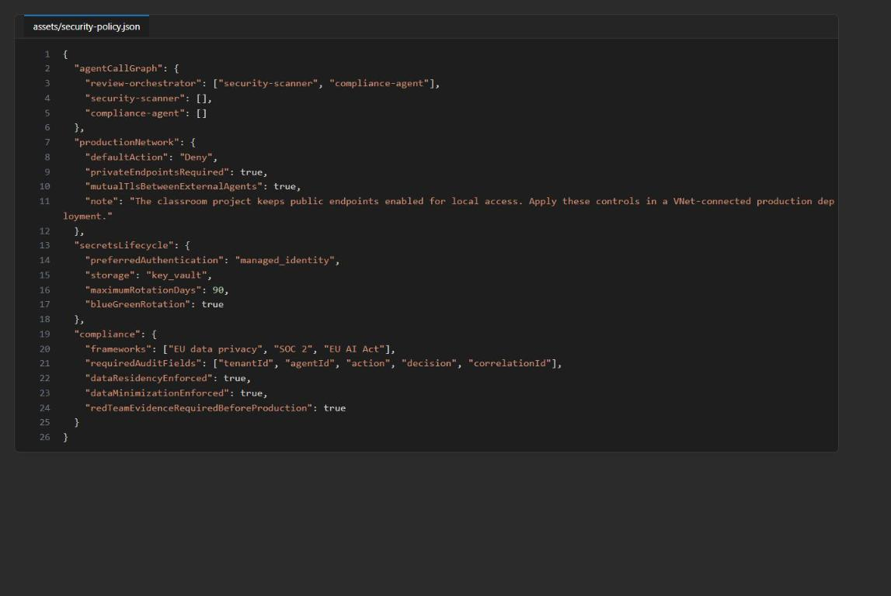

*Figure 1: The agent call graph and production controls in security-policy.json*

2. Open `assets/security-requests.json`. It has four synthetic handoff attempts. Trace each one:

| Request | Tenant matches? | Caller may call target? | Fields the target needs |
|---|---|---|---|
| allowed-orchestrator-to-scanner | yes (tenant-a) | yes | requestId, tenantId, sourceCode |
| denied-cross-tenant | no (asks for tenant-b, caller is tenant-a) | not evaluated | none |
| denied-specialist-lateral-movement | yes | no (scanner to compliance is not in the graph) | none |
| allowed-minimized-compliance-handoff | yes | yes | requestId, tenantId, repositoryRegion, dataClassification, consentRecorded |

3. Open `src/security.py`. `authorize_handoff` calls `enforce_tenant` first, then checks the call graph. `minimize_for_agent` picks the fields for each specialist, and `select_authentication_flow` picks an authentication flow. Only `enforce_tenant` is incomplete.

### Complete tenant authorization (LAB PLACEHOLDER 1)

1. In `src/security.py`, find **LAB PLACEHOLDER 1** inside `enforce_tenant`.

2. Keep the comment line. Replace only this line:

```python
    raise NotImplementedError("Complete enforce_tenant in Task 1")
```

with this code (4-space indentation, inside the function):

```python
    if not requested_tenant_id:
        raise PermissionError("Tenant context is required")
    if requested_tenant_id != verified_tenant_id:
        raise PermissionError("Tenant context does not match the verified caller")
```

> **Note:** The official lab text shows this snippet with 2-space indentation. The rest of the file uses 4 spaces, so paste the 4-space version above to avoid an `IndentationError`.

The finished function looks like this:

```python
def enforce_tenant(requested_tenant_id: str, verified_tenant_id: str) -> None:
    """Reject missing or mismatched tenant context before any downstream call."""
    # LAB PLACEHOLDER 1: Replace this line with the Task 1 sample.
    if not requested_tenant_id:
        raise PermissionError("Tenant context is required")
    if requested_tenant_id != verified_tenant_id:
        raise PermissionError("Tenant context does not match the verified caller")
```

3. Save the file (**Ctrl+S**).

This check fails closed: a missing tenant and a mismatched tenant are both denied before any other agent, model or database is called.

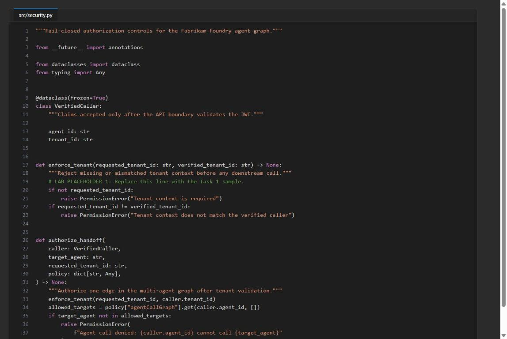

*Figure 2: enforce_tenant after LAB PLACEHOLDER 1 is filled*

### Validate the authorization decisions

1. Run the four scenarios and show one row per handoff:

```powershell
$evidence = python -m src.main | ConvertFrom-Json
$evidence.decisions | Format-Table case, decision, target, reason
```

**Expected result:**

| Case | Expected result | Why |
|---|---|---|
| allowed-orchestrator-to-scanner | `allow` | Tenant matches and the graph allows orchestrator to scanner. |
| denied-cross-tenant | `deny`, "Tenant context does not match the verified caller" | The request asks for tenant-b but the caller is tenant-a. Fails in `enforce_tenant`. |
| denied-specialist-lateral-movement | `deny`, "Agent call denied: security-scanner cannot call compliance-agent" | Tenant matches, but the graph has no scanner to compliance edge. |
| allowed-minimized-compliance-handoff | `allow` | Tenant matches and the graph allows orchestrator to compliance. |

### Validate data minimization

1. Show what the allowed compliance handoff forwards:

```powershell
$complianceDecision = $evidence.decisions | Where-Object case -eq 'allowed-minimized-compliance-handoff'
$complianceDecision.fieldsForwarded
```

**Expected result:**

```text
consentRecorded
dataClassification
repositoryRegion
requestId
tenantId
```

`sourceCode` must not appear. The compliance agent needs classification, residency, consent, request and tenant metadata, not Fabrikam's source code.

### Review authentication-flow selection

1. Show the flows chosen by `select_authentication_flow`:

```powershell
$evidence.authenticationFlows | Format-List
```

**Expected result:**

```text
agentToAzure            : managed_identity
userToMicrosoftResource : on_behalf_of
userToThirdParty        : oauth2_pkce
legacyApi               : key_vault_fallback
```

- `managed_identity`: no stored credentials for agent-to-Azure access.
- `on_behalf_of`: keeps the user's delegated permissions when calling a Microsoft resource.
- `oauth2_pkce`: interactive third-party authorization without a client secret in the app.
- `key_vault_fallback`: a legacy key is allowed only when it is stored in Key Vault and rotated within 90 days.

These are deterministic policy choices, not four live sign-ins.

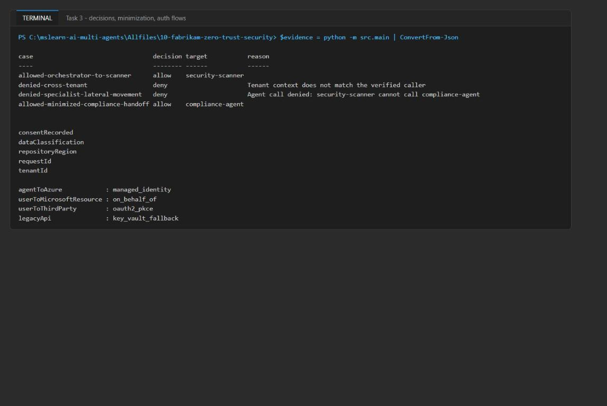

*Figure 3: Decisions, forwarded fields and authentication flows*

### Confirm the local controls

1. Run the full local check:

```powershell
$actualDecisions = $evidence.decisions.decision -join ','
if ($actualDecisions -ne 'allow,deny,deny,allow') {
  throw "Unexpected decisions: $actualDecisions"
}
if ($complianceDecision.fieldsForwarded -contains 'sourceCode') {
  throw 'Data minimization failed: sourceCode was sent to the compliance agent'
}
if ($evidence.authenticationFlows.agentToAzure -ne 'managed_identity' -or
    $evidence.authenticationFlows.userToMicrosoftResource -ne 'on_behalf_of' -or
    $evidence.authenticationFlows.userToThirdParty -ne 'oauth2_pkce' -or
    $evidence.authenticationFlows.legacyApi -ne 'key_vault_fallback') {
  throw 'One or more authentication-flow decisions are incorrect'
}
python scripts/preflight.py
$incomplete = Select-String -Path src/security.py -Pattern 'raise NotImplementedError'
if ($incomplete) { throw 'Task 1 is incomplete' }
'TASK_1_VALIDATION_PASSED'
```

**Expected result:** every preflight check is `PASS` (the three Azure settings show `INFO` because `.env` does not exist yet), followed by `READY (local)` and `TASK_1_VALIDATION_PASSED`.

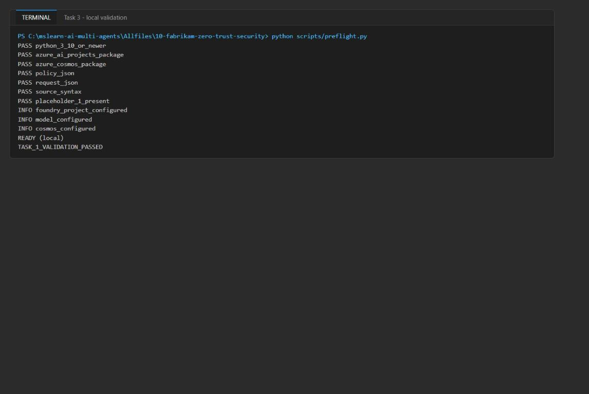

*Figure 4: Preflight READY (local) and TASK_1_VALIDATION_PASSED*

---

## Task 4: Provision the Foundry topology

The template `infra/main.bicep` takes these parameters: `location`, `environmentName`, `modelDeploymentName`, `modelName`, `modelVersion` and `principalId` (your Entra object ID, which receives the two container-scoped Cosmos DB data roles).

1. Make sure you are still in `Allfiles\10-fabrikam-zero-trust-security` with the virtual environment active.

2. Run the following script. It creates a resource group, deploys the template, grants you the Foundry data-plane roles and writes `.env` from the deployment outputs:

```powershell
$azureRegion = 'eastus2'
$suffix = (New-Guid).Guid.Substring(0, 8)
$resourceGroupName = "rg-lab10-$suffix"
$envName = "lab10-$suffix"
$me = az ad signed-in-user show --query id -o tsv
az group create --name $resourceGroupName --location $azureRegion --output none
az bicep build --file infra/main.bicep
az deployment group create --resource-group $resourceGroupName --name lab10-main `
  --template-file infra/main.bicep `
  --parameters location=$azureRegion environmentName=$envName modelDeploymentName=gpt-5.4-mini modelName=gpt-5.4-mini modelVersion=2026-03-17 principalId=$me `
  --output none
# Grant yourself data-plane access (Foundry agents + model calls)
$rgId = az group show --name $resourceGroupName --query id -o tsv
foreach ($role in 'Azure AI User','Cognitive Services OpenAI User','Azure AI Developer') {
  az role assignment create --assignee-object-id $me --assignee-principal-type User --role $role --scope $rgId --output none
}
# Write .env from the deployment outputs
$outputs = az deployment group show --resource-group $resourceGroupName --name lab10-main --query properties.outputs -o json | ConvertFrom-Json
$lines = @("AZURE_RESOURCE_GROUP=`"$resourceGroupName`"", "AZURE_LOCATION=`"$azureRegion`"", "AZURE_ENV_NAME=`"$envName`"",
  "AZURE_SUBSCRIPTION_ID=`"$(az account show --query id -o tsv)`"", "AZURE_PRINCIPAL_ID=`"$me`"", "AZURE_PRINCIPAL_TYPE=`"User`"",
  "FOUNDRY_MODEL_CATALOG_NAME=`"gpt-5.4-mini`"", "FOUNDRY_MODEL_VERSION=`"2026-03-17`"")
$outputs.PSObject.Properties | ForEach-Object { $lines += "$($_.Name.ToUpper())=`"$($_.Value.value)`"" }
$lines | Out-File .env -Encoding utf8
Get-Content .env
```

**Expected result:** the deployment takes 5-10 minutes and returns no error. `.env` contains `FOUNDRY_PROJECT_ENDPOINT`, `FOUNDRY_ACCOUNT_NAME`, `FOUNDRY_MODEL_NAME`, `COSMOS_ENDPOINT`, `COSMOS_ACCOUNT_ID`, the database and container names, `APPLICATIONINSIGHTS_RESOURCE_ID` and `LOG_ANALYTICS_WORKSPACE_ID`. It contains no keys, connection strings or tokens.

> **Note:** Keep this terminal open: the later tasks use `$resourceGroupName` and `$me`. If you open a new terminal, set them again with `$resourceGroupName = 'rg-lab10-<suffix>'` and `$me = az ad signed-in-user show --query id -o tsv`.

> **Note:** Role assignments can take 1-5 minutes to apply. If the live run in Task 6 returns `403`, wait a few minutes and run it again.

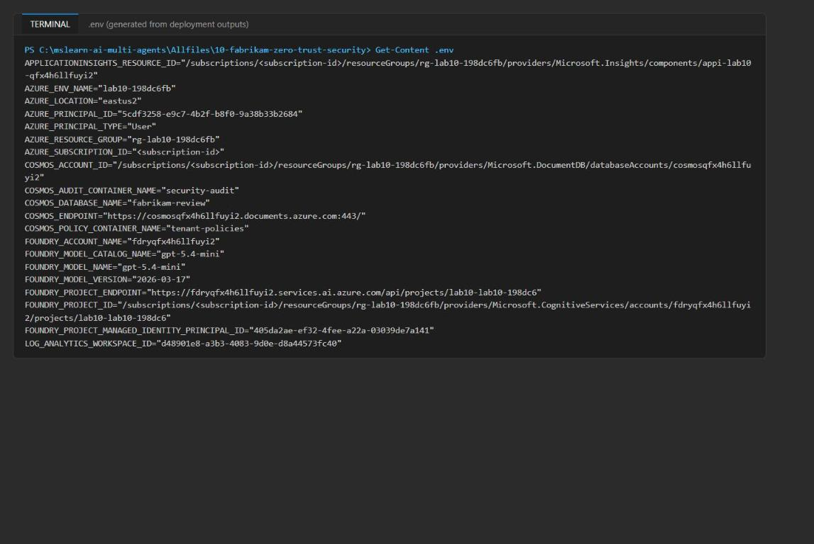

*Figure 5: .env written from the deployment outputs (no secrets)*

3. Run preflight again:

```powershell
python scripts/preflight.py
```

**Expected result:** all checks `PASS`, including `foundry_project_configured`, `model_configured` and `cosmos_configured`, then `READY (local)`.

4. In the [Azure portal](https://portal.azure.com), open the resource group `rg-lab10-<suffix>`. You should see the Foundry account (`fdry...`), the project, the Cosmos DB account (`cosmos...`), Application Insights (`appi-lab10-...`) and the Log Analytics workspace (`log-lab10-...`).

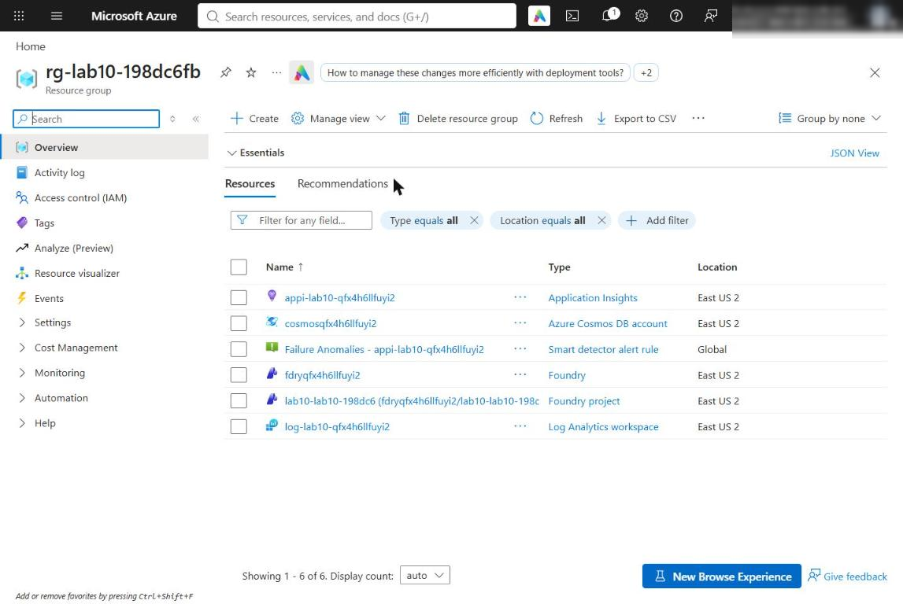

*Figure 6: The lab 10 resource group in the Azure portal*

5. Open the Foundry account, then **Resource Management** > **Model deployments** (or open the project in the [Foundry portal](https://ai.azure.com) and select **Models + endpoints**). Confirm the `gpt-5.4-mini` deployment.

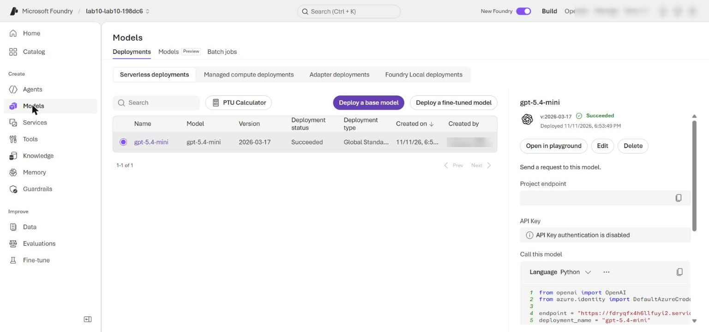

*Figure 7: The gpt-5.4-mini model deployment*

6. Open the Cosmos DB account and select **Data Explorer**. Expand `fabrikam-review` and confirm the two containers `tenant-policies` and `security-audit`. Both use partition key `/tenantId`.

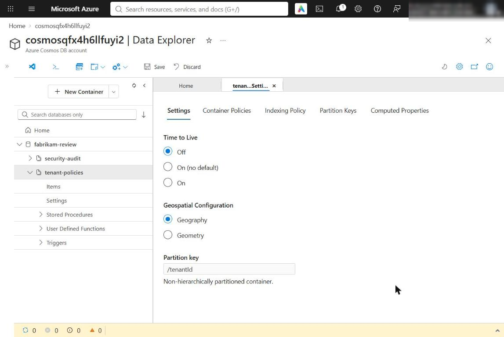

*Figure 8: The tenant-partitioned Cosmos DB containers*

> **Note:** **Production network design.** This lab does not create private endpoints, private DNS or private runtime connectivity. Foundry managed-network isolation modes are set when the resource is created, so choose and validate the production access model first. See [Configure managed virtual network for Microsoft Foundry projects](https://learn.microsoft.com/azure/foundry/how-to/managed-virtual-network#understand-isolation-modes).

---

## Task 5: Review the least-privilege design

Check what was actually deployed, not just what the template declares.

1. Load the values from `.env` into a PowerShell hashtable (this replaces `azd env get-values`):

```powershell
$values = @{}
Get-Content .env | ForEach-Object {
  if ($_ -match '^\s*([^#=]+?)\s*=\s*"?(.*?)"?\s*$') { $values[$matches[1]] = $matches[2] }
}
$values.FOUNDRY_ACCOUNT_NAME
```

2. Inspect the declared and effective controls:

```powershell
Select-String -Path infra/main.bicep -Pattern 'disableLocalAuth: true'
$foundryNetwork = az cognitiveservices account show `
  --name $values.FOUNDRY_ACCOUNT_NAME `
  --resource-group $resourceGroupName `
  --query "{publicNetworkAccess:properties.publicNetworkAccess,defaultAction:properties.networkAcls.defaultAction,disableLocalAuth:properties.disableLocalAuth}" | ConvertFrom-Json
$cosmosAccountName = ($values.COSMOS_ACCOUNT_ID -split '/')[-1]
$cosmosNetwork = az cosmosdb show `
  --name $cosmosAccountName `
  --resource-group $resourceGroupName `
  --query "{publicNetworkAccess:publicNetworkAccess,disableLocalAuth:disableLocalAuth}" | ConvertFrom-Json
$learnerDataRoles = az cosmosdb sql role assignment list `
  --account-name $cosmosAccountName `
  --resource-group $resourceGroupName | ConvertFrom-Json
$foundryNetwork | ConvertTo-Json
$cosmosNetwork | ConvertTo-Json
$learnerDataRoles | Where-Object principalId -eq $me | Select-Object principalId, roleDefinitionId, scope | ConvertTo-Json
```

3. Confirm all of the following:

- `main.bicep` lines 43 and 77 set `disableLocalAuth: true`, and Azure reports `disableLocalAuth: true` for both Foundry and Cosmos DB. Applications cannot use service keys.
- Foundry reports `publicNetworkAccess: Enabled` and `defaultAction: Allow`; Cosmos DB reports `publicNetworkAccess: Enabled`. Record this as **residual sandbox network trust**, not zero network trust.
- There are exactly **two** Cosmos DB assignments for your object ID, using role `.../sqlRoleDefinitions/00000000-0000-0000-0000-000000000002` (Built-in Data Contributor). Their scopes end in `/dbs/fabrikam-review/colls/tenant-policies` and `/dbs/fabrikam-review/colls/security-audit`. Neither is scoped to the account, resource group or subscription.

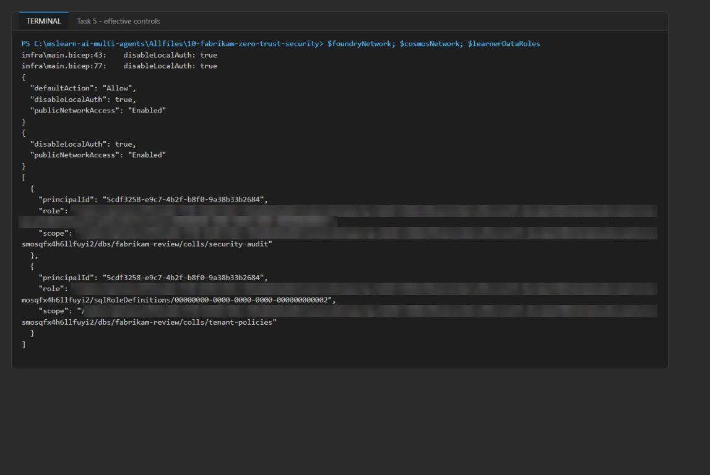

*Figure 9: Effective network settings and the two container-scoped Cosmos DB role assignments*

4. In the Azure portal, open the Foundry account and select **Resource Management** > **Networking**. Confirm **All networks** is selected (public access enabled).

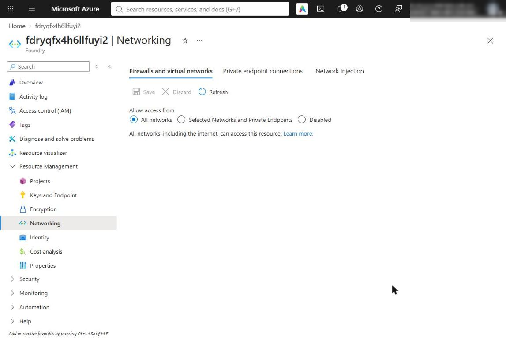

*Figure 10: Foundry networking - public access is residual network trust*

5. Open the Cosmos DB account and select **Settings** > **Networking**. Confirm public access from **All networks**.

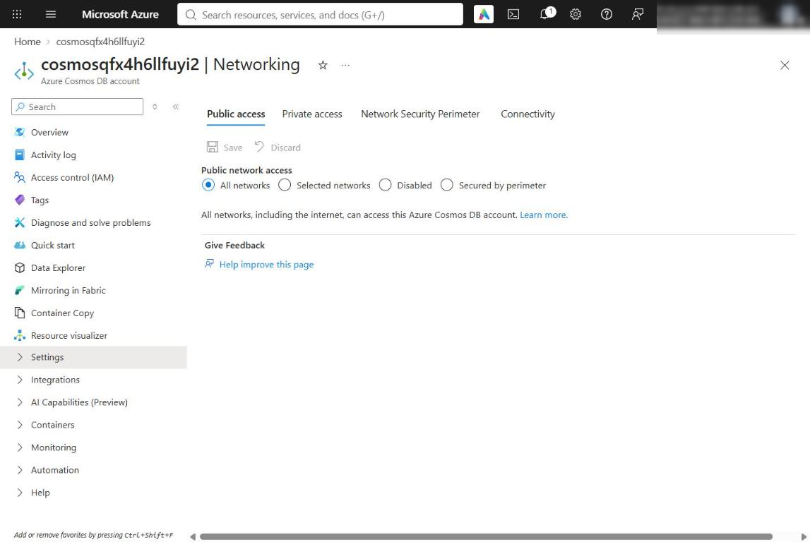

*Figure 11: Cosmos DB networking*

If any effective setting or assignment differs from the design, fix the deployment before the live run. A request that succeeds is not proof that the network or RBAC boundary is least privilege.

> **Note:** The project resource has its own managed identity. It authenticates the project's agent identity blueprint; it is not the principal that should receive downstream tool permissions. Foundry creates a separate shared agent identity after the first agent is created.

---

## Task 6: Run the live Foundry workflow

1. Run the three-agent workflow and keep its output:

```powershell
$liveEvidence = python -m src.main --live | ConvertFrom-Json
$liveEvidence | ConvertTo-Json -Depth 10
```

The script creates (or adds a new version of) `review-orchestrator`, `security-scanner` and `compliance-agent` in Foundry, gets a dedicated OpenAI client for each agent with `get_openai_client(agent_name=...)`, upserts the tenant-a policy into `tenant-policies`, calls the two specialists with minimized payloads, calls the orchestrator with both results and writes an audit event to `security-audit`.

**Expected result:**

- `orchestratorAgent` is `review-orchestrator`.
- Both `specialistOutputs` have a `responseId` that starts with `resp_`.
- `orchestratorOutput` has a synthesis such as "Code review summary for req-001 / tenant tenant-a ... No actionable issues found".
- `crossTenantHandoffDenied` is `true`: a verified tenant-b caller cannot request a tenant-a handoff, and the denial happens before any Cosmos DB, model or tool call.
- `auditEvent` contains `tenantId`, `agentId`, `action`, `decision` and `correlationId`.

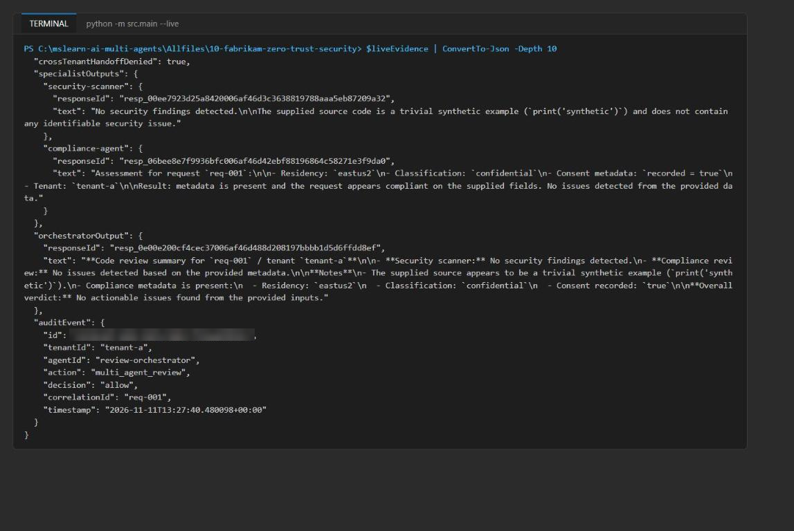

*Figure 12: Live run output - specialist and orchestrator responses, audit event*

The Python process uses your `DefaultAzureCredential` (your `az login` session) for both Cosmos DB and Foundry. A `403` means the role assignments from Task 4 are missing or have not propagated yet (see Troubleshooting).

2. In the [Foundry portal](https://ai.azure.com), open the project `lab10-lab10-<suffix>` and select **Agents**. Confirm the three agents, each with version 1.

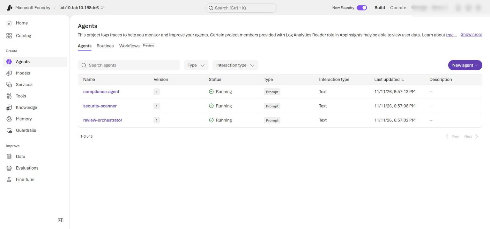

*Figure 13: The three agents in the Foundry project*

> **Note:** The prompt agents in this lab do not call Cosmos DB themselves. If a production agent later uses an MCP or A2A tool to reach Cosmos DB, an administrator must grant that agent's `agentIdentityId` only the container access the tool needs. A published agent gets its own identity; permissions given to the shared development identity do not transfer.

---

## Task 7: Inspect tenant and compliance evidence

1. Show the response IDs from the live run:

```powershell
$liveEvidence.specialistOutputs.'security-scanner'.responseId
$liveEvidence.specialistOutputs.'compliance-agent'.responseId
$liveEvidence.orchestratorOutput.responseId
```

2. In the [Foundry portal](https://ai.azure.com), open the project from `FOUNDRY_PROJECT_ENDPOINT` (`lab10-lab10-<suffix>`).

3. Open **Agents**, select an agent (for example `compliance-agent`) and open the **Traces** tab (in some portal versions: **Observability** > **Traces**). Allow a few minutes for ingestion.

4. Find the three calls by matching the response IDs and inspect each call's input and output.

Confirm that:

- No real tenant GUID, domain, user ID, repository name or customer source code appears.
- The security-scanner input contains only the synthetic source `print('synthetic')`.
- The compliance-agent input contains request, tenant, region, classification and consent metadata, and **no** `sourceCode`.
- The orchestrator input contains `tenant-a`, `req-001` and both specialist results.
- `tenant-b` does not appear in any trace; the app rejected it before any agent call.

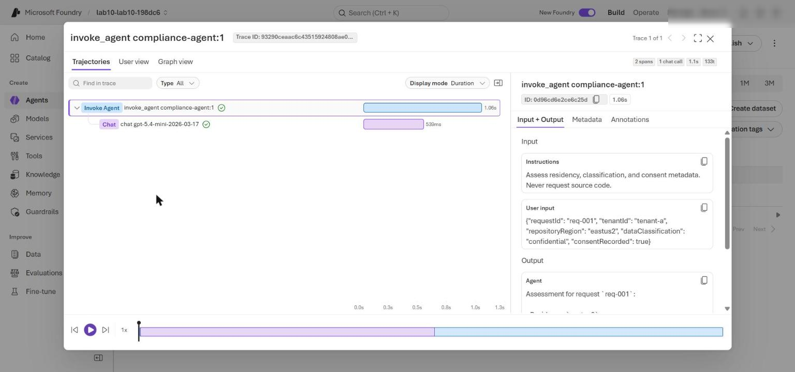

*Figure 14: Compliance-agent trace input - metadata only, no sourceCode*

> **Note:** The local Python client does not export OpenTelemetry, so a KQL query against Application Insights may return no rows. Use the Foundry portal traces (or the response history of each agent) for this step.

5. Validate the tenant policy and audit evidence from the live run:

```powershell
$liveEvidence.tenantPolicy | Format-List
$liveEvidence.auditEvent | Format-List
if ($liveEvidence.tenantPolicy.tenantId -ne 'tenant-a') { throw 'Unexpected policy tenant' }
if (-not $liveEvidence.crossTenantHandoffDenied) { throw 'Cross-tenant handoff was not denied' }
$requiredAuditFields = @('tenantId', 'agentId', 'action', 'decision', 'correlationId')
$missingAuditFields = $requiredAuditFields | Where-Object { -not $liveEvidence.auditEvent.PSObject.Properties[$_] }
if ($missingAuditFields) { throw "Audit evidence is missing: $($missingAuditFields -join ', ')" }
if ($liveEvidence.auditEvent.PSObject.Properties['sourceCode']) { throw 'Audit evidence contains source code' }
'TENANT_AND_AUDIT_EVIDENCE_VALIDATED'
```

**Expected result:** the policy shows `tenantId : tenant-a`, `allowedRegion : eastus2`, `classification : confidential`; the audit event shows `agentId : review-orchestrator`, `action : multi_agent_review`, `decision : allow`, `correlationId : req-001`; the last line is `TENANT_AND_AUDIT_EVIDENCE_VALIDATED`.

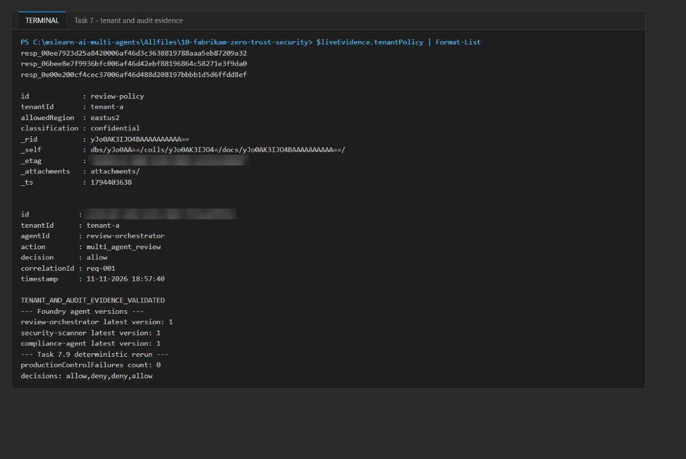

*Figure 15: Tenant policy, audit event and TENANT_AND_AUDIT_EVIDENCE_VALIDATED*

6. (Optional) In the Azure portal, open the Cosmos DB account > **Data Explorer** > `fabrikam-review` > `security-audit` > **Items**. Open the audit item: it has partition key `tenant-a` and no source code.

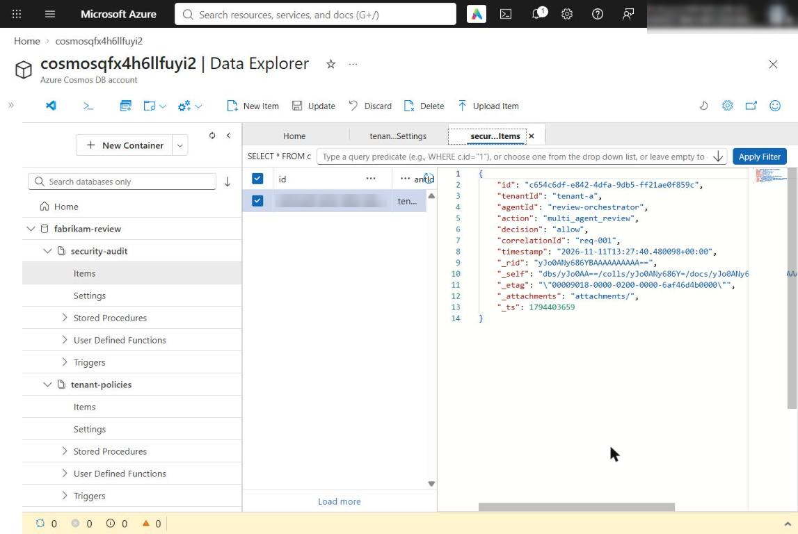

*Figure 16: The tenant-scoped audit item in Cosmos DB*

7. Run the deterministic scenarios again (do this after any policy change):

```powershell
$rerun = python -m src.main | ConvertFrom-Json
"productionControlFailures count: $($rerun.productionControlFailures.Count)"
"decisions: $($rerun.decisions.decision -join ',')"
```

**Expected result:** `productionControlFailures count: 0` and `decisions: allow,deny,deny,allow`.

8. Treat any change in the cross-tenant, lateral-movement, minimization, authentication-flow, network-contract or audit-schema result as a release blocker.

---

## Optional challenge: Deny a cross-tenant handoff

Send a request whose requested tenant differs from the verified caller tenant, and prove the Cosmos DB partition boundary holds.

1. In the lab folder, create a file named `challenge_cross_tenant.py` with this content:

```python
import json
import os

from azure.cosmos import CosmosClient, exceptions
from azure.identity import DefaultAzureCredential
from dotenv import load_dotenv

from src.security import VerifiedCaller, authorize_handoff

load_dotenv(".env")
with open("assets/security-policy.json", encoding="utf-8") as handle:
    policy = json.load(handle)

calls = {"cosmos": 0, "model": 0}
result = {"case": "challenge-cross-tenant", "verifiedTenant": "tenant-a", "requestedTenant": "tenant-b"}
try:
    authorize_handoff(VerifiedCaller("review-orchestrator", "tenant-a"), "security-scanner", "tenant-b", policy)
    result["decision"] = "allow"
except PermissionError as error:
    result.update({"decision": "deny", "boundary": "tenant-policy", "reason": str(error)})
result["downstreamCallsBeforeDenial"] = calls
print(json.dumps(result))

# Partition probe: the tenant-a policy must not be readable under the tenant-b partition key.
client = CosmosClient(os.environ["COSMOS_ENDPOINT"], credential=DefaultAzureCredential())
container = client.get_database_client(os.environ["COSMOS_DATABASE_NAME"]).get_container_client(
    os.environ["COSMOS_POLICY_CONTAINER_NAME"]
)
try:
    container.read_item("review-policy", partition_key="tenant-b")
    print("partition probe: LEAK - review-policy was readable under tenant-b")
except exceptions.CosmosResourceNotFoundError:
    print("partition probe: review-policy not found under partition tenant-b (404) - data partition isolation holds")
```

2. Run it:

```powershell
python challenge_cross_tenant.py
```

**Expected result:** a `deny` decision with `boundary: tenant-policy`, the reason "Tenant context does not match the verified caller", zero downstream calls, and the partition probe returns 404.

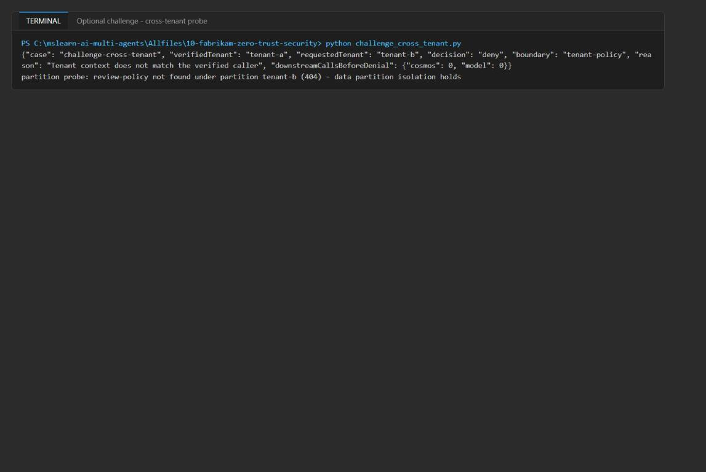

*Figure 17: Cross-tenant request denied and partition probe 404*

3. **Failure investigation.** Use this table to tell the boundaries apart:

| Boundary | Evidence that identifies it |
|---|---|
| Identity (authentication / RBAC) | HTTP 401/403 from Foundry or Cosmos DB ("does not have required RBAC permissions"); the request reached the service. |
| Network | Connection refused, timeout, DNS failure, or 403 "public network access disabled" / "IP not allowed", before RBAC is evaluated. |
| Tenant policy | Local `PermissionError: Tenant context does not match the verified caller`; no outbound call, no trace, no audit write. |
| Agent call graph | Local `PermissionError: Agent call denied: X cannot call Y`; tenant check passed. |
| Data partition | Cosmos read with another partition key returns 404 NotFound; nothing leaks across partitions. |

---

## Validate

| Acceptance criterion | How to check | Expected |
|---|---|---|
| Handoff decisions | Task 3 step 7 | allow, deny (tenant mismatch), deny (agent call), allow |
| Data minimization | Task 3 step 8 | consentRecorded, dataClassification, repositoryRegion, requestId, tenantId; no sourceCode |
| Authentication flows | Task 3 step 9 | managed_identity, on_behalf_of, oauth2_pkce, key_vault_fallback |
| Local validation | Task 3 step 10 | `READY (local)` and `TASK_1_VALIDATION_PASSED` |
| Provisioning, no secrets in .env | `Get-Content .env`; portal resource group | Deployment succeeded; no keys or connection strings |
| Keys disabled | Task 5 `az` queries | `disableLocalAuth: true` on Foundry and Cosmos DB |
| Residual network trust recorded | Task 5 `az` queries; portal **Networking** | Foundry Enabled/Allow, Cosmos Enabled |
| Container-scoped RBAC | `az cosmosdb sql role assignment list` | Exactly 2 assignments, scopes `/colls/tenant-policies` and `/colls/security-audit` |
| Three Foundry agents | Foundry portal **Agents**, or `$liveEvidence.orchestratorAgent` | review-orchestrator, security-scanner, compliance-agent (version 1) |
| Specialist and orchestrator responses | Task 7 step 1 | Three `resp_...` IDs |
| Cross-tenant denied | `$liveEvidence.crossTenantHandoffDenied` | `True` |
| Audit evidence | Task 7 step 5 | `TENANT_AND_AUDIT_EVIDENCE_VALIDATED` |
| Deterministic rerun | Task 7 step 7 | 0 failures; allow,deny,deny,allow |

---

## Troubleshooting

| Problem | Cause | Fix |
|---|---|---|
| `IndentationError` in `security.py` | The official snippet uses 2-space indentation | Use the 4-space code in Task 3 step 5. |
| `NotImplementedError: Complete enforce_tenant in Task 1` | Placeholder not replaced, or file not saved | Replace the `raise NotImplementedError` line and save. |
| `KeyError: 'FOUNDRY_PROJECT_ENDPOINT'` or `'COSMOS_ENDPOINT'` | `.env` missing or written before the deployment finished | Re-run the `.env` part of the Task 4 script; check `Get-Content .env`. |
| `403 Forbidden` / "does not have required RBAC permissions" from Cosmos DB | `principalId` not passed to the template, so no container roles exist | Re-run `az deployment group create` with `principalId=$me`; confirm two assignments in Task 5. |
| `403` / `PermissionDenied` from Foundry when creating agents | Missing Azure AI User / Azure AI Developer role, or not yet propagated | Re-run the role loop in Task 4, wait 1-5 minutes, then retry. |
| `DefaultAzureCredential failed to retrieve a token` | Not signed in to Azure CLI in this terminal | Run `az login`, then retry. |
| Deployment fails with `InsufficientQuota` or model not available | `gpt-5.4-mini` 2026-03-17 has no capacity in the region | Use another region where the model is available, for example `swedencentral`, and create a new resource group. |
| No rows in Application Insights KQL | The local client does not export OpenTelemetry | Inspect traces in the Foundry portal instead (Task 7). |
| PowerShell blocks `setup.ps1` | Execution policy | `Set-ExecutionPolicy -Scope Process -ExecutionPolicy Bypass` |

---

## Review questions

1. **Why does the cross-tenant request fail before the call-graph check?**

`authorize_handoff` calls `enforce_tenant` first. A requested tenant (tenant-b) that does not match the verified caller (tenant-a) raises `PermissionError` before the graph, model or Cosmos DB is touched, so the system fails closed.

2. **The lateral-movement request has a matching tenant. Why is it denied?**

The call graph lists no targets for `security-scanner`. The tenant check passes but the edge scanner to compliance is not allowed, so the request is denied with "Agent call denied".

3. **What does data minimization protect in this workflow?**

The compliance agent receives only request, tenant, region, classification and consent metadata. Fabrikam's source code never leaves the scanner path, so a compromised or over-curious compliance agent cannot leak it.

4. **The deployment uses Entra-only auth and scoped RBAC. Is it zero trust on the network?**

No. Foundry and Cosmos DB keep public network access enabled (`defaultAction: Allow`) for local lab access. That is residual network trust. Production needs private endpoints, private DNS, deny-by-default ACLs and a Foundry managed-network isolation mode chosen at creation time.

5. **Which identity should receive permissions for a production agent tool that reads Cosmos DB?**

The agent's `agentIdentityId`, scoped to only the containers the tool needs. The project managed identity authenticates the agent identity blueprint and should not get downstream permissions, and a published agent gets a separate identity.

6. **How do you tell an identity failure from a tenant-policy failure?**

An identity failure is an HTTP 401/403 returned by the service after the request reached it. A tenant-policy failure is a local `PermissionError` with no outbound call, no trace and no audit write.

---

## Clean up (optional)

Do this when you have finished the lab and no longer need the resources.

1. Delete the resource group and everything in it:

```powershell
az group delete --name $resourceGroupName --yes --no-wait
```

2. Foundry (Cognitive Services) accounts are soft-deleted. After the group is deleted, purge the account so its name and quota are released:

```powershell
az cognitiveservices account list-deleted --query "[?contains(name,'fdry')].{name:name,location:location}" -o table
az cognitiveservices account purge --name <foundry-account-name> --resource-group $resourceGroupName --location eastus2
```

3. Remove the local `.env` file and the challenge script, then leave the virtual environment:

```powershell
Remove-Item .env, challenge_cross_tenant.py -ErrorAction SilentlyContinue
deactivate
```

