# Lab 11: Govern a Foundry multi-agent code review

## Overview

Fabrikam uses specialized AI agents to review customer code. A **security reviewer** finds vulnerabilities, a **fairness auditor** checks whether equivalent technology stacks (Python and Node) get consistent outcomes, and a **governance orchestrator** combines their evidence. Because a recommendation can delay a deployment, Fabrikam must screen each request, minimize every handoff, keep agent attribution, and require human review when a policy threshold is exceeded.

In this lab you will:

- Deploy a Microsoft Foundry project, a `gpt-5.4-mini` model deployment with Foundry's default guardrails, Log Analytics and workspace-based Application Insights by using Bicep and the Azure CLI.
- Complete a deterministic, fail-closed human-review policy gate in Python.
- Run the workflow locally (deterministic) and live (three Foundry prompt agents).
- Validate data minimization, agent attribution, guardrails, the fairness boundary, and Application Insights evidence.

**Duration:** about 45 minutes.

> **Important:** The model deployment, Log Analytics and Application Insights are billable. Use only the supplied synthetic data and delete the resource group when you finish (see **Clean up**).

**Architecture**

| Component | Purpose |
|---|---|
| Microsoft Foundry account + project (`fdry<unique>`, `lab11-<env>`) | Hosts the three prompt agents and the model deployment |
| Model deployment `gpt-5.4-mini` (GlobalStandard, guardrail `Microsoft.DefaultV2`) | Model used by all agents; default guardrails screen prompts and completions |
| Agent `security-reviewer` | Receives only request ID, the synthetic source fragment and the CWE reference |
| Agent `fairness-auditor` | Receives only request ID, group rates, disparity and the policy threshold |
| Agent `governance-orchestrator` | Receives minimized specialist results and the deterministic policy decision |
| Log Analytics `log-lab11-<unique>` + Application Insights `appi-lab11-<unique>` | Stores the `fabrikam.governance.evidence` trace and Foundry traces |
| `policy/governance-policy.yaml` | Versioned policy: fairness threshold 0.10, required/prohibited evidence fields, allowed agent inputs |
| `src/governance.py`, `src/main.py` | Fairness calculation, payload minimization, hashing, evidence, deterministic and `--live` orchestration |
| `kql/governance-evidence.kql` | Accountability query over the minimized evidence |

## Prerequisites

- An Azure subscription where you can create a resource group, Microsoft Foundry, model deployment and monitoring resources, and **assign roles** (Owner, or Contributor + User Access Administrator).
- Quota for `gpt-5.4-mini` (GlobalStandard) in your region. This guide uses `eastus2`.
- [Python 3.10 or later](https://www.python.org/downloads/)
- [Git](https://git-scm.com/downloads)
- [Azure CLI](https://learn.microsoft.com/cli/azure/install-azure-cli) (with Bicep: `az bicep install`)
- [Visual Studio Code](https://code.visualstudio.com/download) with the [Python](https://marketplace.visualstudio.com/items?itemName=ms-python.python) and [Bicep](https://marketplace.visualstudio.com/items?itemName=ms-azuretools.vscode-bicep) extensions

> **Note:** The official lab uses the Azure Developer CLI (`azd provision`). This guide provisions the same Bicep template with the Azure CLI instead, so `azd` is not required.

---

## Task 1: Prepare the lab

1. Clone the lab repository (skip if you already have it):

```powershell
git clone https://github.com/MicrosoftLearning/mslearn-ai-multi-agents.git
```

2. Open the `mslearn-ai-multi-agents` folder in Visual Studio Code, and open a **PowerShell** terminal (**Terminal > New Terminal**).

3. Go to the lab folder and check the tools:

```powershell
cd Allfiles\11-fabrikam-responsible-ai-governance
az version
python --version
```

4. Sign in to Azure and confirm the subscription you want to use:

```powershell
az login
az account show --output table
```

If the wrong subscription is shown, select the right one:

```powershell
az account set --subscription "<your-subscription-id>"
```

5. Review the architecture before editing. Open each file and find the item listed:

| Component | What to locate |
|---|---|
| `assets/governance-scenario.json` and `policy/governance-policy.yaml` | Synthetic inputs, fairness threshold (0.10) and human-review policy |
| `src/governance.py` | Fairness calculation, minimized payloads, identifier hashing and evidence |
| `src/main.py` | Deterministic local orchestration and the `--live` Foundry path |
| `kql/governance-evidence.kql` | Minimized accountability evidence query |
| `infra/main.bicep` | Foundry, model, monitoring and least-privilege role assignments |

**Expected result:** You can confirm that `python -m src.main` (no arguments) is local and deterministic, and that only `python -m src.main --live` calls Foundry agents.

> **Note:** Do not use customer code, personal data, credentials or secrets anywhere in this lab.

---

## Task 2: Build the virtual environment

1. In the lab folder, create the virtual environment and install the requirements, then activate it:

```powershell
./scripts/setup.ps1
. ./.venv/Scripts/Activate.ps1
```

On macOS/Linux use:

```bash
bash scripts/setup.sh
source .venv/bin/activate
```

> **Note:** If PowerShell blocks the script (execution policy), run the same steps manually: `python -m venv .venv`, then `. ./.venv/Scripts/Activate.ps1`, then `python -m pip install -r requirements.txt`.

**Expected result:** The prompt starts with `(.venv)`.

---

## Task 3: Deploy Azure resources

1. Make sure you are in `Allfiles\11-fabrikam-responsible-ai-governance` with `(.venv)` active.

2. Run the following block. It creates a resource group, deploys `infra/main.bicep` with the Azure CLI, grants you data-plane roles, and writes `.env` from the deployment outputs. Change `$azureRegion` (and the model values) if `gpt-5.4-mini` version `2026-03-17` is not available in your region.

```powershell
$azureRegion = 'eastus2'
$suffix = (New-Guid).Guid.Substring(0, 8)
$resourceGroupName = "rg-lab11-$suffix"
$envName = "lab11-$suffix"
$me = az ad signed-in-user show --query id -o tsv
az group create --name $resourceGroupName --location $azureRegion --output none
az bicep build --file infra/main.bicep
az deployment group create --resource-group $resourceGroupName --name lab11-main `
  --template-file infra/main.bicep `
  --parameters location=$azureRegion environmentName=$envName modelDeploymentName=gpt-5.4-mini modelName=gpt-5.4-mini modelVersion=2026-03-17 principalId=$me `
  --output none
# Grant yourself data-plane access (Foundry agents + model calls)
$rgId = az group show --name $resourceGroupName --query id -o tsv
foreach ($role in 'Azure AI User','Cognitive Services OpenAI User','Azure AI Developer') {
  az role assignment create --assignee-object-id $me --assignee-principal-type User --role $role --scope $rgId --output none
}
# Write .env from the deployment outputs
$outputs = az deployment group show --resource-group $resourceGroupName --name lab11-main --query properties.outputs -o json | ConvertFrom-Json
$lines = @("AZURE_RESOURCE_GROUP=`"$resourceGroupName`"", "AZURE_LOCATION=`"$azureRegion`"", "AZURE_ENV_NAME=`"$envName`"",
  "AZURE_SUBSCRIPTION_ID=`"$(az account show --query id -o tsv)`"", "AZURE_PRINCIPAL_ID=`"$me`"")
$outputs.PSObject.Properties | ForEach-Object { $lines += "$($_.Name.ToUpper())=`"$($_.Value.value)`"" }
$lines | Out-File .env -Encoding utf8
Get-Content .env
```

The Bicep `principalId` parameter replaces the `AZURE_PRINCIPAL_ID` value that `azd` would pass. The template itself assigns you **Azure AI User** (shown as Foundry User) on the Foundry account, and **Monitoring Metrics Publisher** and **Log Analytics Reader** on Application Insights. The extra resource-group roles in the loop make sure agent creation and model calls work.

**Expected result:** The deployment finishes in a few minutes and `.env` lists values such as:

```text
AZURE_RESOURCE_GROUP="rg-lab11-<suffix>"
FOUNDRY_PROJECT_ENDPOINT="https://fdry<unique>.services.ai.azure.com/api/projects/lab11-lab11-<suffix>"
FOUNDRY_ACCOUNT_NAME="fdry<unique>"
FOUNDRY_MODEL_NAME="gpt-5.4-mini"
APPLICATIONINSIGHTS_RESOURCE_ID="/subscriptions/<subscription-id>/resourceGroups/rg-lab11-<suffix>/providers/Microsoft.Insights/components/appi-lab11-<unique>"
APPLICATIONINSIGHTS_CONNECTION_STRING="InstrumentationKey=<...>;IngestionEndpoint=..."
LOG_ANALYTICS_WORKSPACE_ID="<workspace-guid>"
```

> **Important:** `APPLICATIONINSIGHTS_CONNECTION_STRING` must be in `.env` (the app and preflight need it). It is an ingestion connection string, not a model key. `.env` must not contain any model keys or tokens; `DefaultAzureCredential` uses your Azure sign-in. Do not share or commit `.env`.

> **Note:** RBAC role assignments can take 1-5 minutes to apply. If a later step returns `401` or `403`, wait and retry.

3. Check the resources in the Azure portal: open **Resource groups** > `rg-lab11-<suffix>`.

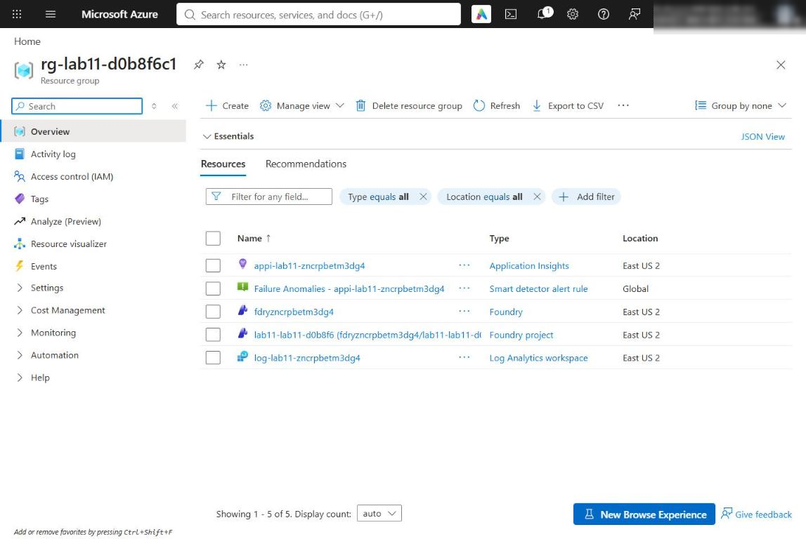

*Figure 1: Resource group with the Foundry account, project, Log Analytics workspace and Application Insights*

4. Confirm the network setting used in this lab. In the Foundry account (`fdry<unique>`), open **Resource Management > Networking**, or run:

```powershell
$acct = (Get-Content .env | Select-String '^FOUNDRY_ACCOUNT_NAME=').ToString().Split('=')[1].Trim('"')
az cognitiveservices account show --name $acct --resource-group $resourceGroupName `
  --query "{publicNetworkAccess:properties.publicNetworkAccess,defaultAction:properties.networkAcls.defaultAction}"
```

**Expected result:** `publicNetworkAccess` is `Enabled` and `defaultAction` is `Allow`, so your local app can reach the project endpoint. Microsoft Entra authentication and Azure RBAC are still required. Production environments should use selected networks or private endpoints.

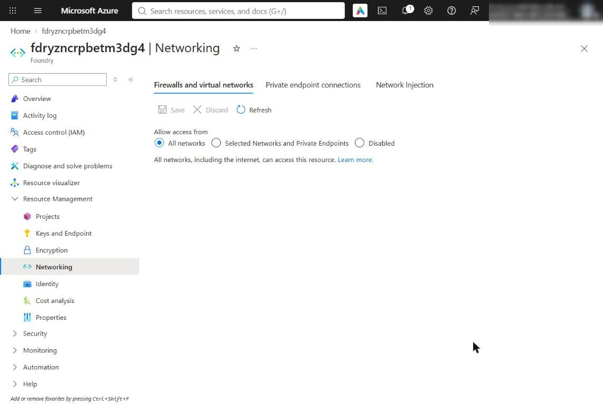

*Figure 2: Foundry account Networking page: public access enabled for this lab*

5. Optionally confirm your monitoring roles: open `appi-lab11-<unique>` > **Access control (IAM)** > **Role assignments**.

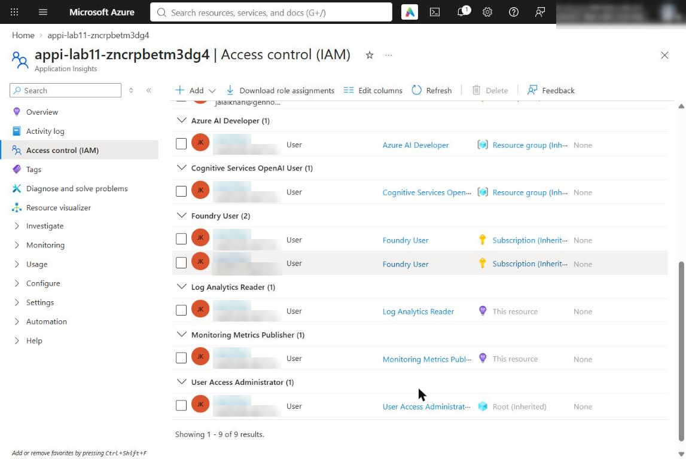

*Figure 3: Monitoring Metrics Publisher and Log Analytics Reader assigned to you on Application Insights*

---

## Task 4: Implement the policy gate

Each placeholder marks incomplete code. Keep the `LAB PLACEHOLDER` comment, replace only the indicated line, and keep the indentation (4 spaces inside the function).

1. Open `src/governance.py` and find **LAB PLACEHOLDER 1** in `requires_human_review`:

```python
    # LAB PLACEHOLDER 1: Replace this line with the Task 1 sample.
    raise NotImplementedError("Complete requires_human_review in Task 1")
```

2. Replace the whole function with this completed version (the marker comment is kept and the `raise` line is replaced):

```python
def requires_human_review(policy: dict[str, Any], evidence: dict[str, Any]) -> bool:
    """Apply the fairness threshold to complete governance evidence."""
    # LAB PLACEHOLDER 1: Replace this line with the Task 1 sample.
    fairness = evidence.get("fairness")
    if not isinstance(fairness, dict) or "max_disparity" not in fairness:
        return True

    try:
        return (
            float(fairness["max_disparity"])
            > float(policy["thresholds"]["max_fairness_disparity"])
        )
    except (KeyError, TypeError, ValueError):
        return True
```

The decision fails closed: missing or malformed evidence requires human review. The threshold comes from the versioned policy, not from code.

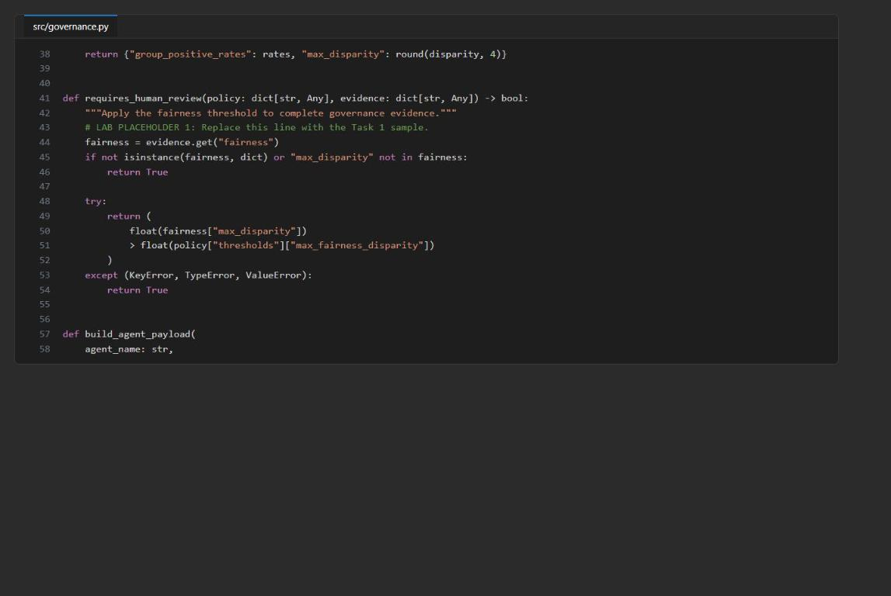

*Figure 4: src/governance.py after LAB PLACEHOLDER 1 is completed*

3. Save the file and check the code:

```powershell
& .\.venv\Scripts\python.exe -m py_compile src/main.py src/governance.py scripts/preflight.py
& .\.venv\Scripts\python.exe scripts/preflight.py
Select-String -Path src/governance.py -Pattern 'NotImplementedError'
```

**Expected result:** Every preflight check shows `PASS`, the last line is `READY (Azure configured)`, and the `Select-String` command returns nothing.

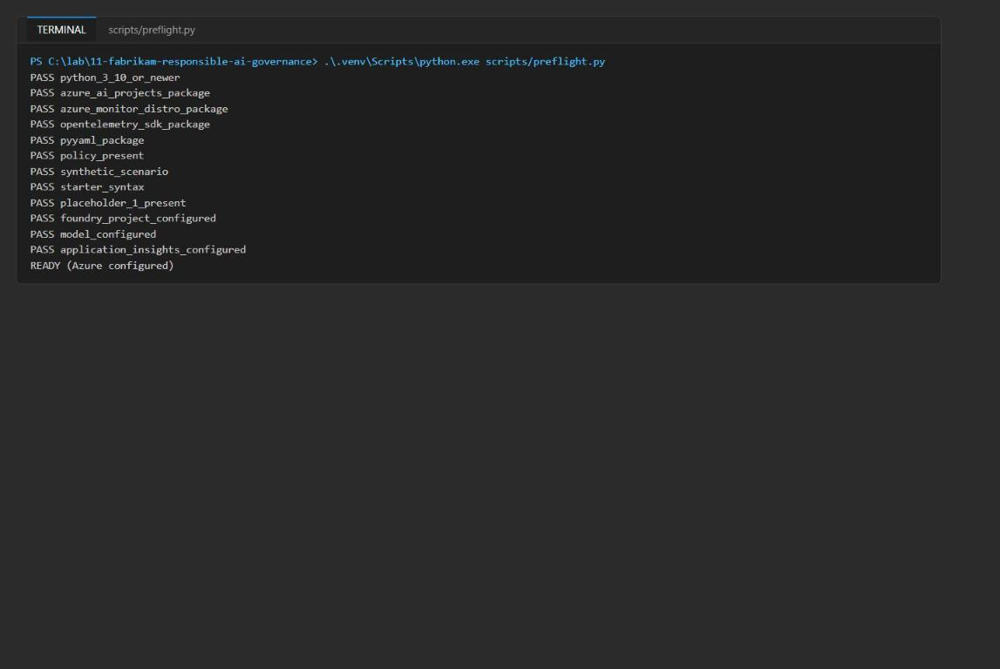

*Figure 5: Preflight output ending with READY (Azure configured)*

> **Note:** If preflight shows `INFO application_insights_configured` and ends with `READY (local)`, `.env` is missing `APPLICATIONINSIGHTS_CONNECTION_STRING`. Add it from the deployment output (see **Troubleshooting**).

**Inspect the privacy boundaries**

4. Open `policy/governance-policy.yaml` and compare `agent_inputs` with `build_agent_payload` in `src/governance.py`.

| Agent | Allowed input | Deliberately excluded |
|---|---|---|
| `security-reviewer` | Request ID, synthetic source fragment, CWE reference | Tenant identity, fairness probes, policy internals |
| `fairness-auditor` | Request ID, group rates, disparity, threshold | Source code, tenant identity, security output |
| `governance-orchestrator` | Request ID, policy version, control results, specialist results | Raw source code, tenant identity, hidden reasoning |

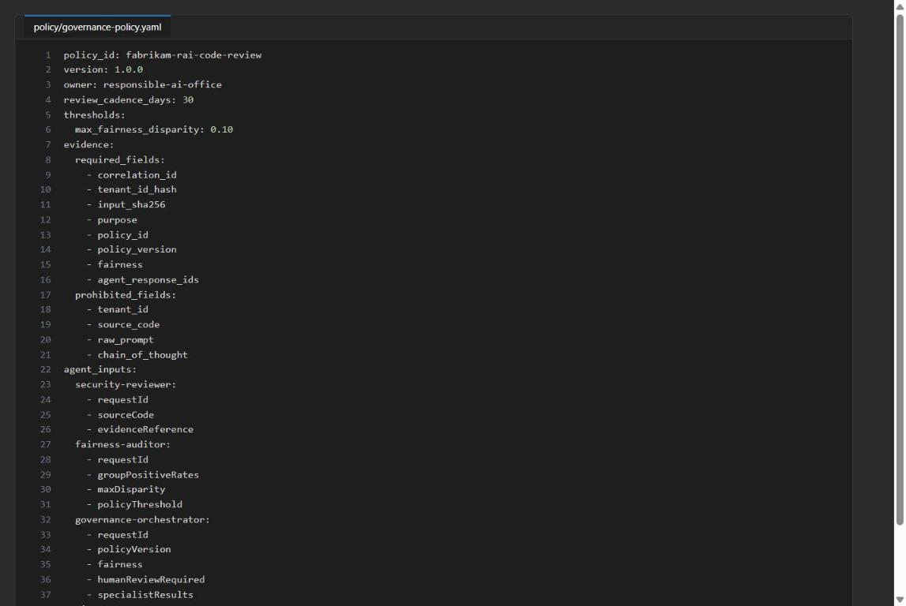

*Figure 6: governance-policy.yaml with threshold, evidence fields and per-agent inputs*

5. Check that the app does not record raw prompts or hidden reasoning:

```powershell
Select-String -Path src/governance.py,src/main.py -Pattern 'chain_of_thought|raw_prompt'
```

**Expected result:** No matches.

6. Find the hashed fields and the Foundry attribution field:

```powershell
Select-String -Path src/governance.py -Pattern 'tenant_id_hash|input_sha256|agent_response_ids'
```

**Expected result:** Matches such as `"tenant_id_hash": _sha256(str(scenario["tenant_id"]))[:16]`, `"input_sha256": _sha256(str(scenario["source_code"]))` and `agent_response_ids_json`. Raw values are replaced by hashes and Foundry response IDs give agent attribution.

---

## Task 5: Run the solution

**Run the deterministic workflow**

1. Run the workflow without any Azure calls:

```powershell
& .\.venv\Scripts\python.exe -m src.main
```

**Expected result:**

- `mode` is `deterministic`.
- Positive-outcome rates: Python `1.0`, Node `0.5`; `max_disparity` is `0.5`.
- `human_review_required` is `true` because `0.5` exceeds the threshold `0.1`.
- Three local response IDs (`local-security-response`, `local-fairness-response`, `local-governance-response`).
- Purpose-specific field names under `payloadFields`.

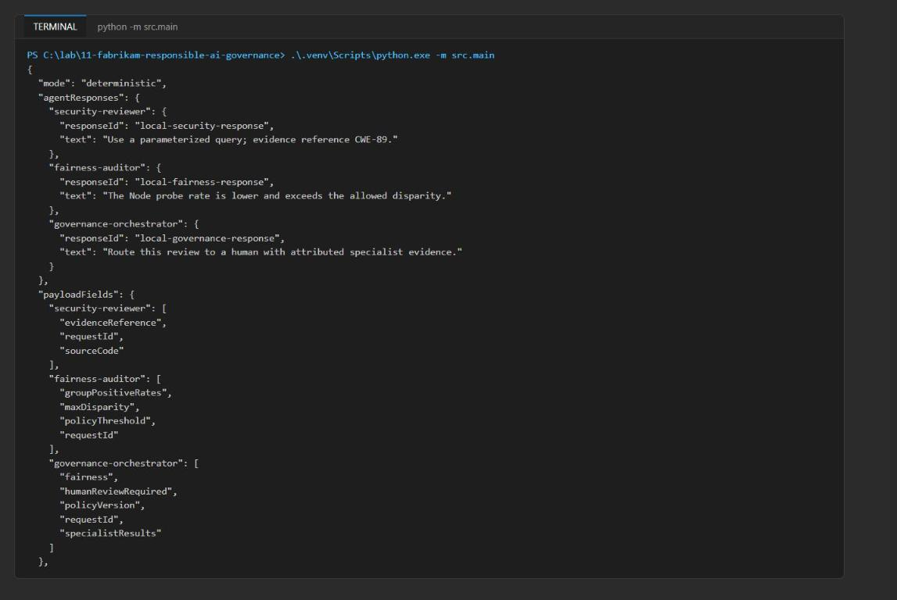

*Figure 7: Deterministic run with local response IDs and payloadFields*

2. Inspect the latest evidence record:

```powershell
$evidence = Get-Content evidence/governance-evidence.jsonl | Select-Object -Last 1 | ConvertFrom-Json
$evidence | ConvertTo-Json -Depth 10
```

3. Confirm the record has `evidence_scope` = `single_process_local_jsonl`, `policy_id` = `fabrikam-rai-code-review`, `policy_version` = `1.0.0`, the fairness rates, `tenant_id_hash`, `input_sha256`, `human_review_required` and three response IDs. Check that the raw tenant (`synthetic-fabrikam-eu`) and the source fragment are not present:

```powershell
$raw = Get-Content evidence/governance-evidence.jsonl | Select-Object -Last 1
"raw tenant present: $($raw.Contains('synthetic-fabrikam-eu'))"
"raw source present: $($raw.Contains('SELECT * FROM users'))"
```

**Expected result:** Both lines print `False`.

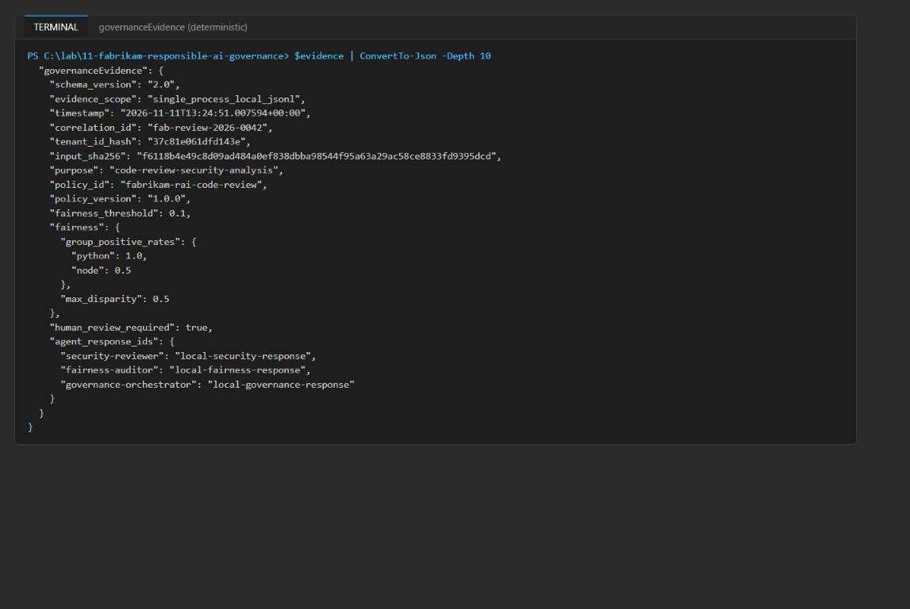

*Figure 8: Minimized governance evidence record*

> **Note:** The JSONL file is local, single-process exercise evidence. It is not a concurrency-safe or central production store; use Application Insights or another governed central sink when several processes write evidence.

**Run the live multi-agent workflow**

4. Run the live workflow once. It creates a version of each Foundry prompt agent and calls `security-reviewer`, `fairness-auditor`, then `governance-orchestrator`:

```powershell
& .\.venv\Scripts\python.exe -m src.main --live
```

**Expected result:** The output shows `"mode": "live"` and a Foundry `responseId` (starting with `resp_`) and text for each of the three agents. One minimized evidence record is appended to `evidence/governance-evidence.jsonl`, and one `fabrikam.governance.evidence` trace is sent to Application Insights. The wording varies between runs, but the fairness numbers and `human_review_required: true` stay the same.

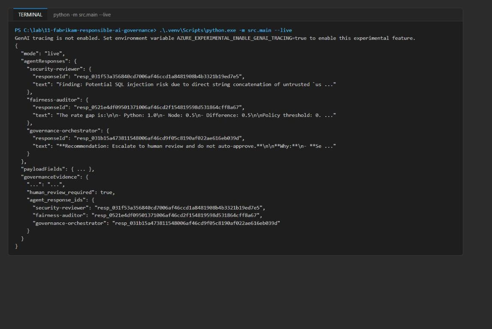

*Figure 9: Live run with three Foundry response IDs*

> **Note:** A first line `GenAI tracing is not enabled. Set environment variable AZURE_EXPERIMENTAL_ENABLE_GENAI_TRACING=true ...` is informational and can be ignored. If the run fails with an authorization error, wait a few minutes for role assignments, run `az login` again if needed, and rerun the command.

5. Save the three response IDs for the next task:

```powershell
$live = Get-Content evidence/governance-evidence.jsonl | Select-Object -Last 1 | ConvertFrom-Json
$live.agent_response_ids | Format-List
```

---

## Task 6: Validate the implementation

**Validate the agents in Microsoft Foundry**

1. Open [Microsoft Foundry](https://ai.azure.com/) and select the project `lab11-lab11-<suffix>` (the project name in `FOUNDRY_PROJECT_ENDPOINT`).

2. In the left navigation, select **Agents**.

3. Confirm that `security-reviewer`, `fairness-auditor` and `governance-orchestrator` exist and each has a version (version `1` after one live run).

4. Open each agent and review its instructions. Confirm each role is narrow, and that the orchestrator says *"Never request raw source, tenant identity, or hidden reasoning."*

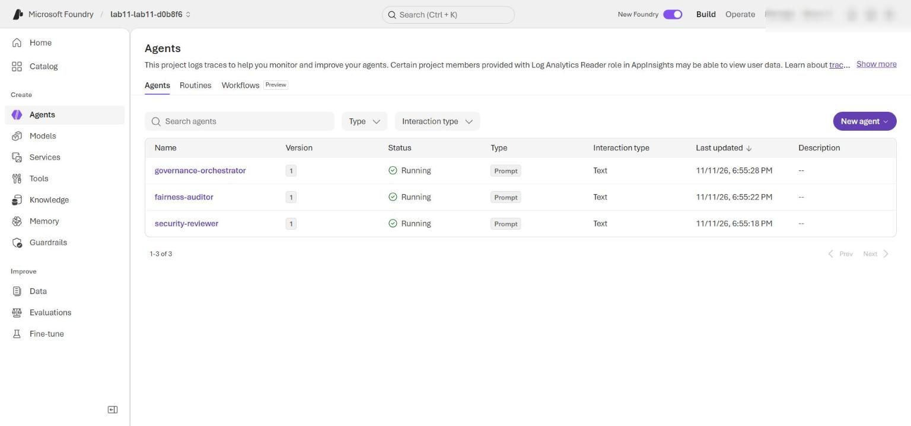

*Figure 10: Foundry Agents page with the three governance agents*

5. On the **Agents** page, open an agent (for example **fairness-auditor**) and select its **Traces** tab (there is no separate Observability item in the current portal).

6. Find the trace for the live run (you can search by trace ID or match the response ID from `$live.agent_response_ids`).

7. Open each matching trace and compare its response ID with the security reviewer, fairness auditor or orchestrator response.

8. Inspect the inputs. Confirm that only the security reviewer receives `sourceCode`; the fairness auditor and orchestrator do not, and no agent receives the tenant.

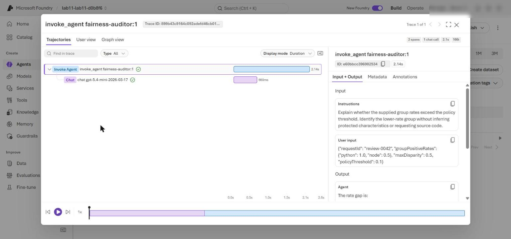

*Figure 11: Foundry trace for the fairness-auditor: rates and threshold only, no sourceCode*

If the Traces view is sparse, you can check the same inputs with the Responses API. Run this from the lab folder:

```powershell
@'
import json, os
from dotenv import load_dotenv
from azure.identity import DefaultAzureCredential
from azure.ai.projects import AIProjectClient
load_dotenv(".env")
ids = json.loads(open("evidence/governance-evidence.jsonl", encoding="utf-8").read().splitlines()[-1])["agent_response_ids"]
project = AIProjectClient(endpoint=os.environ["FOUNDRY_PROJECT_ENDPOINT"], credential=DefaultAzureCredential())
client = project.get_openai_client()
for agent, rid in ids.items():
    items = client.responses.input_items.list(rid)
    text = json.dumps([i.model_dump() for i in items])
    print(agent, rid, "| has sourceCode:", "sourceCode" in text, "| has tenant:", "synthetic-fabrikam-eu" in text)
'@ | python -
```

**Expected result:** `has sourceCode: True` only for `security-reviewer`; `has tenant: False` for all three.

> **Note:** If **Traces** is not visible or a trace cannot be opened, check that you selected the correct project, completed a live run, and waited for telemetry and role assignments to propagate. The Bicep template assigns you **Log Analytics Reader** on Application Insights, which Foundry needs to show trace data.

**Review Foundry-native guardrails**

This lab does not deploy a standalone Azure AI Content Safety resource. The model deployment uses Foundry's default guardrails for prompts and completions.

9. In the Foundry project, select **Build** in the top menu, then **Models**.

10. Open the deployment `gpt-5.4-mini`, select the **Details** tab, and scroll to **Model guardrails**.

11. Confirm the deployment uses the default safety policy, not an unfiltered custom policy. You can also check with the CLI:

```powershell
az cognitiveservices account deployment list --name $acct --resource-group $resourceGroupName `
  --query "[].{Name:name, Model:properties.model.name, Version:properties.model.version, Rai:properties.raiPolicyName}" -o table
```

**Expected result:**

```text
Name          Model         Version     Rai
------------  ------------  ----------  -------------------
gpt-5.4-mini  gpt-5.4-mini  2026-03-17  Microsoft.DefaultV2
```

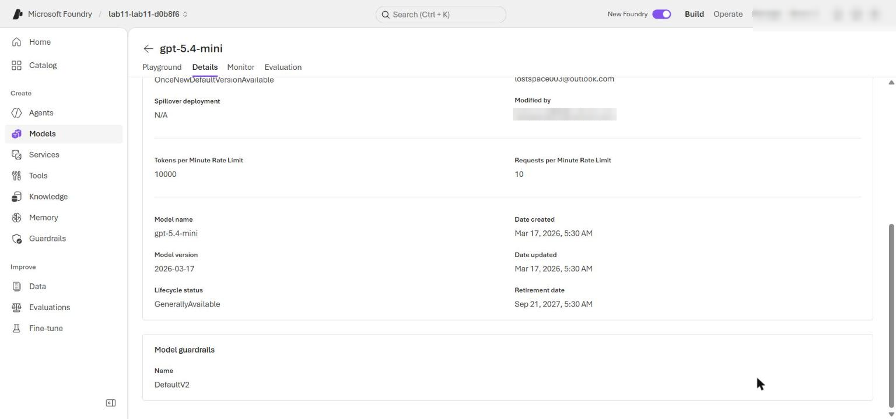

*Figure 12: gpt-5.4-mini deployment using the default guardrail*

12. Return to **Agents > Traces** and confirm that each successful response came from the guarded `gpt-5.4-mini` deployment. Use only the supplied neutral scenario; do not add harmful test content.

**Test the fairness boundary**

13. Open `assets/governance-scenario.json` and change only the final `node-b` probe from `0` to `1`:

```json
    {"probe_id": "node-b", "group": "node", "positive_outcome": 1}
```

14. Run the deterministic workflow and inspect the latest evidence:

```powershell
& .\.venv\Scripts\python.exe -m src.main | Out-Null
$updated = Get-Content evidence/governance-evidence.jsonl | Select-Object -Last 1 | ConvertFrom-Json
$updated.fairness | ConvertTo-Json -Depth 5
$updated.human_review_required
```

**Expected result:** Both rates are `1.0`, `max_disparity` is `0.0`, and `human_review_required` is `False` because no threshold is exceeded.

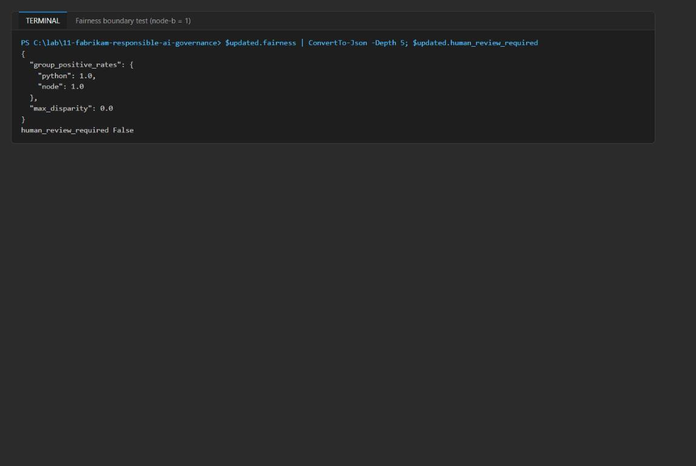

*Figure 13: Fairness boundary test with balanced probes*

15. Restore `node-b` to `0` before you continue:

```json
    {"probe_id": "node-b", "group": "node", "positive_outcome": 0}
```

If you use Git, you can also run `git checkout -- assets/governance-scenario.json`.

**Query accountability evidence**

16. Wait several minutes after the live run for the trace to reach Application Insights.

17. In the Azure portal, open the Log Analytics workspace whose name starts with `log-lab11-` (the `AppTraces` table lives in the workspace that backs Application Insights; the Application Insights **Logs** blade uses the classic `traces` schema and does not resolve `AppTraces`).

18. Select **Logs**, close the query gallery, and switch to **KQL mode** if needed. Set the time range to **Set in query**.

19. Paste and run the contents of `kql/governance-evidence.kql`:

```kql
// Review minimized multi-agent governance decisions without raw source or tenant data.
AppTraces
| where TimeGenerated > ago(30d)
| where Message == "fabrikam.governance.evidence"
| where Properties.policy_id == "fabrikam-rai-code-review"
| extend CorrelationId = tostring(Properties.correlation_id)
| extend PolicyVersion = tostring(Properties.policy_version)
| extend HumanReview = tobool(Properties.human_review_required)
| extend FairnessDisparity = todouble(Properties.max_fairness_disparity)
| extend AgentResponseIds = tostring(Properties.agent_response_ids_json)
| summarize Reviews=count(), Escalations=countif(HumanReview), MaxDisparity=max(FairnessDisparity), Correlations=dcount(CorrelationId), Responses=make_set(AgentResponseIds) by PolicyVersion
| order by Escalations desc
```

**Expected result:** One row with `PolicyVersion 1.0.0`, `Reviews` at least `1`, `Escalations` at least `1`, `MaxDisparity 0.5`, and the serialized response IDs of the three Foundry agents.

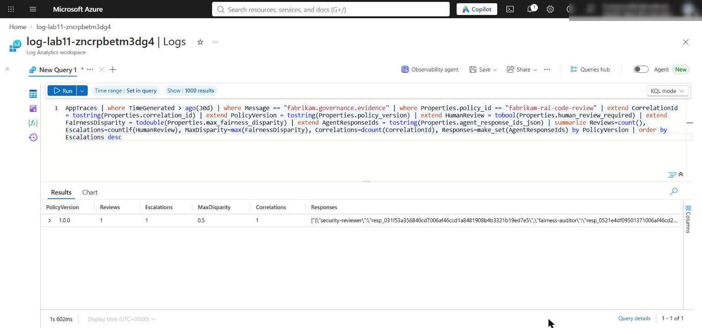

*Figure 14: Governance evidence summary in the Log Analytics workspace Logs*

20. Run the privacy check. Use the exact-key query below; it must return **zero rows**:

```kql
AppTraces
| where TimeGenerated > ago(30d)
| where Message == "fabrikam.governance.evidence"
| mv-expand Key = bag_keys(Properties) to typeof(string)
| where Key in ("tenant_id", "source_code", "raw_prompt", "chain_of_thought")
```

> **Important:** The official lab uses `Properties has_any ("tenant_id", "source_code", "raw_prompt", "chain_of_thought")`. That query returns **1 row**, which is a false positive, not a leak: the `has` operator splits text on `_`, so `tenant_id` matches the allowed hashed key `tenant_id_hash`. The exact-key query above (or `Properties has_cs "\"tenant_id\":"`) returns zero rows. You can also confirm the raw values are absent: `AppTraces | where Message == "fabrikam.governance.evidence" | where Properties has "synthetic-fabrikam-eu" or Properties has "SELECT"` returns zero rows.

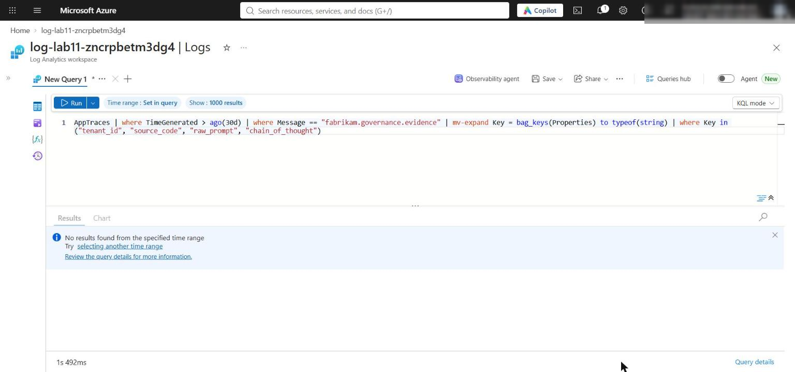

*Figure 15: Exact-key privacy query returns no results*

21. Capture the governance evidence set:

- The model deployment's default guardrail (`Microsoft.DefaultV2`).
- Fairness rates, disparity and the human-review decision.
- The three Foundry agent versions and matching response IDs.
- Trace inputs that show purpose-specific data minimization.
- The Application Insights policy summary and the zero-row privacy result.

**Optional challenge: Trigger human review and test fail-closed behavior**

22. Without editing any file, run this in-memory test. It adds a synthetic `node-c` probe with outcome `0`, then removes evidence fields to confirm the gate fails closed:

```powershell
@'
import copy, json
from src.governance import load_policy, calculate_fairness_evidence, requires_human_review
policy = load_policy("policy/governance-policy.yaml")
scenario = json.load(open("assets/governance-scenario.json", encoding="utf-8"))
threshold = policy["thresholds"]["max_fairness_disparity"]
probes = scenario["fairness_probes"] + [{"probe_id": "node-c", "group": "node", "positive_outcome": 0}]
fairness = calculate_fairness_evidence(probes)
gate = "human review required" if requires_human_review(policy, {"fairness": fairness}) else "continue"
print("rates", fairness["group_positive_rates"], "disparity", fairness["max_disparity"], "threshold", threshold, "gate:", gate)
print("missing fairness ->", requires_human_review(policy, {}))
print("missing max_disparity ->", requires_human_review(policy, {"fairness": {}}))
print("malformed max_disparity ->", requires_human_review(policy, {"fairness": {"max_disparity": "n/a"}}))
evidence = {"correlation_id": "x", "tenant_id_hash": "x", "input_sha256": "x", "purpose": "x", "policy_id": "x", "policy_version": "x"}
missing = [f for f in policy["evidence"]["required_fields"] if f not in evidence]
print("missing-evidence reason: required fields absent ->", missing)
'@ | python -
```

**Expected result:**

```text
rates {'python': 1.0, 'node': 0.6666666666666666} disparity 0.3333 threshold 0.1 gate: human review required
missing fairness -> True
missing max_disparity -> True
malformed max_disparity -> True
missing-evidence reason: required fields absent -> ['fairness', 'agent_response_ids']
```

---

## Validate

| Acceptance criterion | How to check | Expected |
|---|---|---|
| Placeholder complete, preflight ready | `python scripts/preflight.py`; `Select-String -Path src/governance.py -Pattern NotImplementedError` | `READY (Azure configured)`; no matches |
| No raw prompt or hidden reasoning in code | `Select-String` for `chain_of_thought` and `raw_prompt` (Task 4 step 5) | No matches |
| Deterministic run | `python -m src.main` | Rates 1.0 / 0.5, disparity 0.5, `human_review_required` true, 3 local IDs, `payloadFields` |
| Evidence minimized | Latest line of `evidence/governance-evidence.jsonl` | Scope, policy, hashes, IDs; no raw tenant or source |
| Live run | `python -m src.main --live` | Three `resp_` IDs, evidence appended, trace emitted |
| Agents exist with narrow instructions | Foundry portal > Agents | Three agents, version 1; orchestrator forbids raw source, tenant, hidden reasoning |
| Data minimization in traces | Foundry > Agents > Traces (or the Responses API script) | Only `security-reviewer` has `sourceCode`; no tenant |
| Default guardrail | Foundry > Build > Models, or `az cognitiveservices account deployment list` | `Microsoft.DefaultV2` |
| Fairness boundary | `node-b` = 1, then rerun | Rates 1.0 / 1.0, disparity 0.0, review False; file restored |
| Accountability KQL | App Insights > Logs, `kql/governance-evidence.kql` | 1.0.0, at least 1 review and escalation, MaxDisparity 0.5, 3 response IDs |
| Privacy query | Exact-key `bag_keys` query | Zero rows |

---

## Troubleshooting

| Problem | Cause | Fix |
|---|---|---|
| Preflight ends `READY (local)` with `INFO application_insights_configured` | `.env` has no `APPLICATIONINSIGHTS_CONNECTION_STRING` (some helper scripts skip `*CONNECTION_STRING` outputs) | Append it from the deployment outputs with the command below the table |
| `./scripts/setup.ps1` is blocked | PowerShell execution policy | Run `python -m venv .venv`, activate it, then `python -m pip install -r requirements.txt` |
| Live run returns `401`/`403` or `PermissionDenied` | Role assignments still propagating | Wait 1-5 minutes, run `az login`, rerun `python -m src.main --live` |
| `GenAI tracing is not enabled ...` message | The app does not set `AZURE_EXPERIMENTAL_ENABLE_GENAI_TRACING` | Informational only. Foundry trace spans may be sparse; use the Responses API script in Task 6 to inspect inputs |
| Official privacy query returns 1 row | `has_any` tokenizes on `_`, so `tenant_id` matches `tenant_id_hash` | Use the exact-key `bag_keys` query in Task 6 step 20 |
| KQL returns no rows | Telemetry ingestion delay or wrong time range | Wait 5-10 minutes after the live run; set time range to **Set in query** |
| Deployment fails on model | No quota or version not available in region | Choose another region or model version and redeploy |
| `az monitor log-analytics query` asks to install an extension | The `log-analytics` CLI extension is not installed | Use the portal **Logs** blade, or run `az extension add --name log-analytics` first |

To add the missing Application Insights connection string to `.env`:

```powershell
$cs = az monitor app-insights component show --resource-group $resourceGroupName `
  --query "[0].connectionString" -o tsv
"APPLICATIONINSIGHTS_CONNECTION_STRING=`"$cs`"" | Add-Content .env
python scripts/preflight.py
```

---

## Review questions (Task 7)

1. **Why is the human-review gate deterministic instead of delegated to the orchestrator agent?**

The release decision must be repeatable, auditable and tied to the versioned threshold (`max_fairness_disparity: 0.10`). A model can vary its wording, misread numbers or be steered by prompt content. The deterministic gate also fails closed: missing or malformed evidence forces human review. The orchestrator only explains a decision already made; it cannot override it.

2. **How could bias compound if the fairness auditor received a security review framed with developer metadata?**

The auditor would be anchored by non-fairness findings (severity, confidence) and proxy signals (names, tenant, region, stack preference). It could justify or inflate the gap ("Node code is riskier") instead of measuring the paired probes. Its output feeds the orchestrator, so one biased framing is repeated downstream and looks like independent confirmation. Purpose-specific payloads break that loop.

3. **Which additional controls would be required before processing real customer source code?**

A data processing agreement, consent and purpose limitation; secret and PII scanning and redaction before any model call; data residency; private endpoints with public access disabled and customer-managed keys; retention and deletion policies; Prompt Shields and a reviewed custom guardrail policy; least-privilege managed identities and access reviews; red-team and evaluation per language stack with more fairness probes; a tamper-evident central evidence sink; and a documented human-review workflow with SLAs and an appeal path.

4. **When should an audit store retain full specialist output instead of response IDs and minimized evidence?**

Only when a specific obligation needs it: a legal hold or regulatory investigation, an incident or dispute where the exact recommendation must be reproduced, or a model evaluation period. Even then, use an access-controlled, encrypted store with a defined retention period and redact customer code and identity. Response IDs alone may not be enough because the source system's retention can expire; otherwise IDs, hashes and policy metadata are sufficient.

---

## Clean up (Task 8, optional)

When you have finished, delete the Azure resources to stop charges:

```powershell
az group delete --name $resourceGroupName --yes --no-wait
```

If you opened a new terminal, use the name directly: `az group delete --name rg-lab11-<suffix> --yes --no-wait`. If you used a precreated resource group, check which resources it contains before deleting.

The Foundry account is soft-deleted. To purge it so the name can be reused:

```powershell
az cognitiveservices account list-deleted --query "[].{name:name, location:location}" -o table
az cognitiveservices account purge --name <foundry-account-name> --resource-group $resourceGroupName --location eastus2
```

Delete local evidence and environment values:

```powershell
Remove-Item evidence/governance-evidence.jsonl -ErrorAction SilentlyContinue
Remove-Item .env -ErrorAction SilentlyContinue
```

Deactivate the virtual environment in every terminal where `(.venv)` appears:

```powershell
deactivate
```

## Summary

You deployed a Bicep-defined Microsoft Foundry project and governed a three-agent code review with native model guardrails, paired fairness probes, minimized handoffs, attributable response IDs, a deterministic fail-closed human-review gate, and queryable Application Insights evidence.

