# Lab 12: Govern a multi-agent topology lifecycle

## Overview

**Scenario.** Fabrikam ships a code-review topology made of three Microsoft Foundry prompt agents: a **scanner**, a **reviewer** and an **orchestrator**. The team must know which Foundry versions belong to each logical release, prove why the release was approved, control and charge back tenant usage, and retire obsolete component versions without breaking consumers.

**What you will build.** You provision a Foundry project, a model deployment and an Azure Cosmos DB usage registry. You then:

- inventory Foundry prompt agents and their immutable versions with `AIProjectClient`;
- implement a fail-closed **promotion gate** and promote release `2.4.0` as three Foundry agent versions;
- prove that denied promotions create no versions;
- implement an **atomic usage meter** that enforces 60 requests per minute and a 1,000,000-token monthly quota and allocates an estimated USD charge to a tenant and cost center;
- retire one disposable scanner version through eight explicit governance gates.

**Duration:** about 45 minutes.

> **Important:** Foundry model deployments and Cosmos DB are billable. Use only the synthetic agents and data in this lab, never point the retirement command at any other agent or version, and delete the resource group when you finish.

| Component | Purpose |
|---|---|
| Foundry account `aif-fab-life-<suffix>` + project `fabrikam-lifecycle` | Hosts the scanner, reviewer and orchestrator prompt-agent versions |
| Model deployment `gpt-5.4-mini` (2026-03-17, GlobalStandard) | Model referenced by every agent version |
| Cosmos DB account `cos-fab-life-<suffix>` (serverless, local auth disabled) | Database `lifecycle`, container `usage-meters` (partition key = `tenant:cost-center`) |
| User-assigned identity (usage identity) | Data-plane identity granted Cosmos DB Built-in Data Contributor |
| `registry/fabrikam-review-topology-v2.4.0.yaml` | Release manifest: agents, logical versions, compatibility, evaluation, approval, compliance |
| `policy/promotion-policy.yaml` | Retirement gates and usage-governance values (quota, rate limit, price) |
| `src/lifecycle.py` | Inventory, promotion gate (**placeholder 1**), promotion, reconcile, retirement |
| `src/usage.py` | Atomic rate/quota enforcement and metering (**placeholder 2**) |
| `src/main.py` | CLI: `inventory`, `promote`, `reconcile`, `meter`, `retire` |

## Prerequisites

- An Azure subscription where you can create a resource group, a Foundry account and project, a model deployment and a Cosmos DB account, and create role assignments on that resource group (Owner or User Access Administrator + Contributor).
- [Python 3.10 or later](https://www.python.org/downloads/)
- [Git](https://git-scm.com/downloads)
- [Azure CLI 2.80 or later](https://learn.microsoft.com/cli/azure/install-azure-cli) (includes Bicep through `az bicep`)
- [Visual Studio Code](https://code.visualstudio.com/download) with the [Python extension](https://marketplace.visualstudio.com/items?itemName=ms-python.python) and the [Bicep extension](https://marketplace.visualstudio.com/items?itemName=ms-azuretools.vscode-bicep)

> **Note:** The official lab uses the Azure Developer CLI (`azd provision`). This guide deploys the same Bicep template with the Azure CLI instead, so `azd` is not required.

---

## Task 1: Prepare the lab

1. If you haven't already done so, clone the lab repository:

```powershell
git clone https://github.com/MicrosoftLearning/mslearn-ai-multi-agents.git
```

2. Open the cloned repository in Visual Studio Code, then open a PowerShell terminal (**Terminal > New Terminal**).

3. Change to the lab folder and check the tools:

```powershell
cd Allfiles\12-fabrikam-agent-lifecycle-governance
az version
python --version
```

4. Sign in to Azure and confirm the subscription you want to use:

```powershell
az login
az account show --output table
```

If the wrong subscription is active, select the right one:

```powershell
az account set --subscription "<subscription-id>"
```

5. Review the architecture. Open `infra/main.bicep`, `registry/fabrikam-review-topology-v2.4.0.yaml`, `src/lifecycle.py` and `src/usage.py`, and locate each operation that can create, meter or delete state:

| Function | Control to inspect |
|---|---|
| `promote_topology` | `validate_promotion` runs before `create_version`; a later creation failure removes the versions created by that attempt. |
| `retire_version` | All retirement gates run before `delete_version`. The target is one lab-created Foundry version, not a logical topology version. |
| `enforce_and_meter_usage` | Placeholder 2 becomes one retry loop for rate/quota checks, charge calculation and a conditional meter replacement. It never changes Foundry versions. |

Promotion, metering and retirement each have their own mutation boundary, and each fails closed.

---

## Task 2: Build the virtual environment

1. Create the virtual environment and install the requirements (Windows):

```powershell
./scripts/setup.ps1
. ./.venv/Scripts/Activate.ps1
```

On macOS/Linux use:

```bash
bash scripts/setup.sh
source .venv/bin/activate
```

> **Note:** If your execution policy blocks `setup.ps1`, run the same three steps directly: `python -m venv .venv`, `.\.venv\Scripts\python.exe -m pip install --upgrade pip`, `.\.venv\Scripts\python.exe -m pip install -r requirements.txt`.

**Expected result:** `(.venv)` appears at the start of the prompt.

2. Open `registry/fabrikam-review-topology-v2.4.0.yaml` and review it. It defines the three agents and their instructions, logical versions (`scanner 1.2.0`, `reviewer 1.1.0`, `orchestrator 1.3.0`), compatibility declarations, evaluation results (`precision: 0.96`, `minimum_precision: 0.95`), approval (`FAB-AI-240`) and the technical-file reference used in this lab.

---

## Task 3: Deploy Azure resources

The Bicep template creates the Foundry account and project, the model deployment, the Cosmos DB account with the `lifecycle` database and `usage-meters` container, and a usage identity that has Cosmos DB data access. Your own account still needs data-plane roles, which you add below.

1. In the lab folder, run the following PowerShell. Change `$azureRegion` if `gpt-5.4-mini` (2026-03-17) is not available in `eastus2` for your subscription.

```powershell
$azureRegion = 'eastus2'
$suffix = (New-Guid).Guid.Substring(0, 8)
$resourceGroupName = "rg-lab12-$suffix"
$envName = "lab12-$suffix"
az group create --name $resourceGroupName --location $azureRegion --output none
az bicep build --file infra/main.bicep
az deployment group create --resource-group $resourceGroupName --name lab12-main `
  --template-file infra/main.bicep `
  --parameters location=$azureRegion modelDeploymentName=gpt-5.4-mini modelName=gpt-5.4-mini modelVersion=2026-03-17 `
  --output none
```

**Expected result:** Bicep compiles and the deployment finishes without errors (about 5 minutes).

2. Grant yourself data-plane access to the Foundry project (agents and model calls) at resource-group scope:

```powershell
$me = az ad signed-in-user show --query id -o tsv
$rgId = az group show --name $resourceGroupName --query id -o tsv
foreach ($role in 'Azure AI User','Cognitive Services OpenAI User','Azure AI Developer') {
  az role assignment create --assignee-object-id $me --assignee-principal-type User --role $role --scope $rgId --output none
}
```

3. Grant yourself the **Cosmos DB Built-in Data Contributor** role at account scope. The Bicep template assigns it only to the usage identity, and the meter runs locally under your Azure CLI sign-in, so without this step `meter` fails with `403 Forbidden`.

```powershell
$cosmosAccountName = az cosmosdb list --resource-group $resourceGroupName --query "[0].name" -o tsv
az cosmosdb sql role assignment create `
  --account-name $cosmosAccountName `
  --resource-group $resourceGroupName `
  --role-definition-id 00000000-0000-0000-0000-000000000002 `
  --principal-id $me `
  --scope "/" `
  --output none
```

4. Write `.env` from the deployment outputs. `FOUNDRY_MODEL_CATALOG_NAME` is not a Bicep output, so it is added explicitly.

```powershell
$outputs = az deployment group show --resource-group $resourceGroupName --name lab12-main --query properties.outputs -o json | ConvertFrom-Json
$lines = @("AZURE_RESOURCE_GROUP=`"$resourceGroupName`"", "AZURE_LOCATION=`"$azureRegion`"", "AZURE_ENV_NAME=`"$envName`"",
  "AZURE_SUBSCRIPTION_ID=`"$(az account show --query id -o tsv)`"", "FOUNDRY_MODEL_CATALOG_NAME=`"gpt-5.4-mini`"")
$outputs.PSObject.Properties | ForEach-Object { $lines += "$($_.Name.ToUpper())=`"$($_.Value.value)`"" }
$lines | Out-File .env -Encoding utf8
Get-Content .env
```

**Expected result:** `.env` contains `FOUNDRY_PROJECT_ENDPOINT`, `FOUNDRY_PROJECT_ID`, `FOUNDRY_ACCOUNT_NAME`, `FOUNDRY_PROJECT_NAME`, `FOUNDRY_MODEL_NAME`, `FOUNDRY_MODEL_VERSION`, `COSMOS_ENDPOINT`, `COSMOS_DATABASE=lifecycle`, `COSMOS_CONTAINER=usage-meters`, `USAGE_IDENTITY_CLIENT_ID` and `USAGE_IDENTITY_PRINCIPAL_ID`. It contains resource identifiers only: no keys, connection strings or tokens. Do not add any.

> **Note:** Role assignments can take 1-5 minutes to apply. If the first `inventory` or `meter` call returns `403`, wait a few minutes and run it again.

5. Confirm the lab network posture. Both resources allow public network access so your local Python client can reach them; Microsoft Entra ID authentication and RBAC are still required.

```powershell
$foundryName = az cognitiveservices account list --resource-group $resourceGroupName --query "[0].name" -o tsv
az cognitiveservices account show --name $foundryName --resource-group $resourceGroupName `
  --query "{publicNetworkAccess:properties.publicNetworkAccess,defaultAction:properties.networkAcls.defaultAction,disableLocalAuth:properties.disableLocalAuth}" -o table
az cosmosdb show --name $cosmosAccountName --resource-group $resourceGroupName `
  --query "{publicNetworkAccess:publicNetworkAccess,disableLocalAuth:disableLocalAuth}" -o table
```

**Expected result:** Foundry shows `Enabled` / `Allow` / `True`; Cosmos DB shows `Enabled` / `True`. Production environments should use selected networks or private endpoints.

6. In the [Azure portal](https://portal.azure.com), open your resource group and confirm the resources.

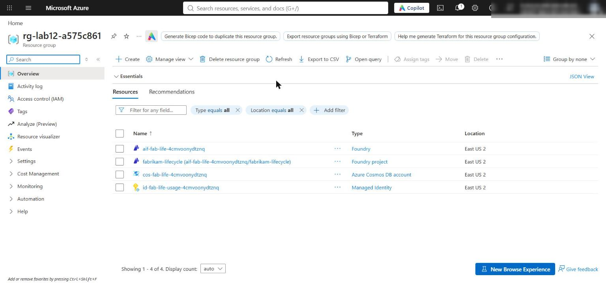

*Figure 1: The lab 12 resource group with the Foundry account and project, Cosmos DB account and usage identity*

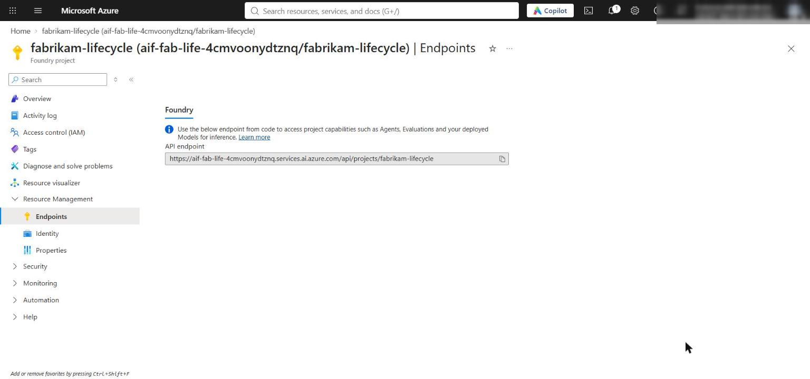

*Figure 2: The Foundry project fabrikam-lifecycle and its API endpoint in the Azure portal*

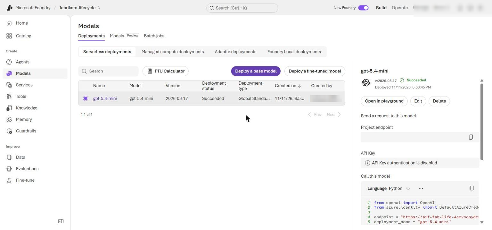

*Figure 3: The gpt-5.4-mini model deployment in the Foundry portal*

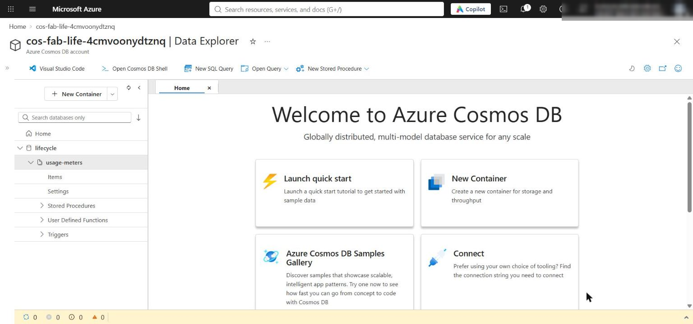

*Figure 4: Cosmos DB Data Explorer showing the lifecycle database and usage-meters container*

---

## Task 4: Implement the solution

Each placeholder marks incomplete code. Keep the `# LAB PLACEHOLDER` comment, replace only the `raise NotImplementedError(...)` line beneath it, and keep the indentation shown (4 spaces for the function body).

### Implement the promotion gate (placeholder 1)

1. Open `src/lifecycle.py` and find **LAB PLACEHOLDER 1** in `validate_promotion`:

```python
    # LAB PLACEHOLDER 1: Replace this line with the Task 1 sample.
    raise NotImplementedError("Complete validate_promotion in Task 1")
```

2. Replace only the `raise NotImplementedError(...)` line with this code:

```python
    failures: list[str] = []
    evaluation = manifest.get("evaluation") or {}
    approval = manifest.get("approval") or {}
    compliance = manifest.get("compliance") or {}
    topology = manifest.get("topology") or {}
    agent_specs = {
        str(item.get("agent_id")): item
        for item in topology.get("agents") or []
    }
    compatibility = topology.get("compatibility") or {}

    if manifest.get("status") != "approved":
        failures.append("manifest status is not approved")
    if approval.get("status") != "approved":
        failures.append("approval status is not approved")
    if set(agent_specs) != {"scanner", "reviewer", "orchestrator"}:
        failures.append("topology must contain scanner, reviewer, and orchestrator")

    try:
        scanner_schema = Version(str(compatibility["scanner_output_schema"]))
        reviewer_requirement = SpecifierSet(
            str(compatibility["reviewer_requires_scanner_schema"])
        )
        if scanner_schema not in reviewer_requirement:
            failures.append("scanner output schema is incompatible with reviewer")
    except (KeyError, TypeError, ValueError):
        failures.append("scanner-to-reviewer compatibility evidence is invalid")

    try:
        reviewer_version = Version(str(agent_specs["reviewer"]["version"]))
        orchestrator_requirement = SpecifierSet(
            str(compatibility["orchestrator_requires_reviewer_version"])
        )
        if reviewer_version not in orchestrator_requirement:
            failures.append("reviewer version is incompatible with orchestrator")
    except (KeyError, TypeError, ValueError):
        failures.append("reviewer-to-orchestrator compatibility evidence is invalid")

    try:
        if float(evaluation["precision"]) < float(evaluation["minimum_precision"]):
            failures.append("precision is below its minimum")
    except (KeyError, TypeError, ValueError):
        failures.append("precision evidence is missing or invalid")

    try:
        if float(evaluation["recall"]) < float(evaluation["minimum_recall"]):
            failures.append("recall is below its minimum")
    except (KeyError, TypeError, ValueError):
        failures.append("recall evidence is missing or invalid")

    if compliance.get("material_change_assessment") is not True:
        failures.append("material change assessment is missing")
    technical_file = str(compliance.get("technical_file_reference", "")).strip()
    if not technical_file or not Path(technical_file).is_file():
        failures.append("technical file reference is missing or unavailable")

    if failures:
        raise PermissionError("Promotion denied: " + "; ".join(failures))
```

The gate collects every failure (approval, required roles, compatibility, evaluation thresholds, material-change assessment and an existing technical file) and raises once. Missing or invalid evidence denies promotion before any version is created. `Version`, `SpecifierSet` and `Path` are already imported at the top of the file.

3. Leave `promote_topology` unchanged. It calls the gate once for all three agents and returns the logical-to-Foundry version map.

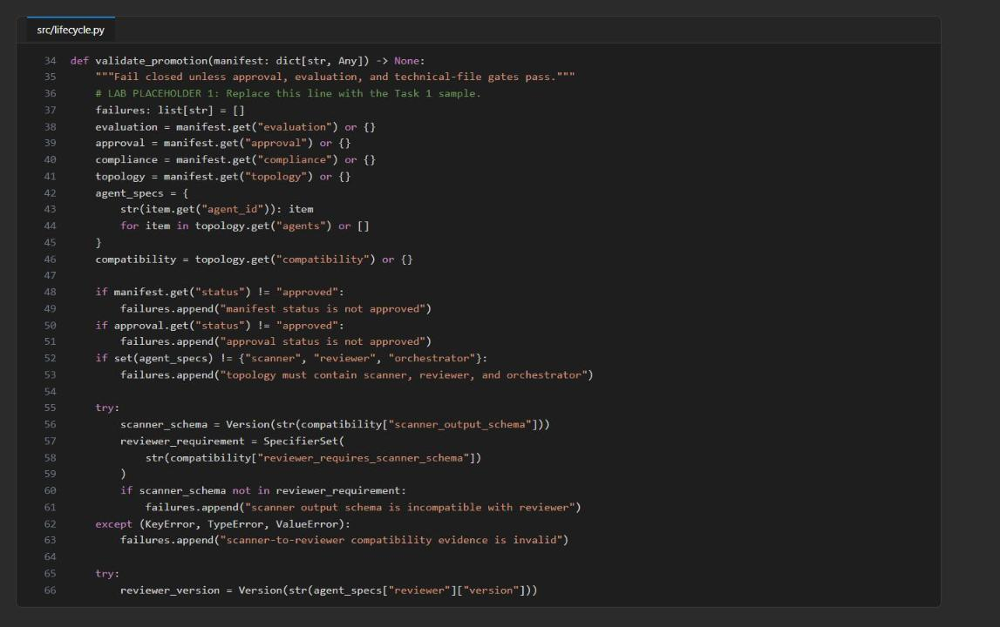

*Figure 5: src/lifecycle.py - placeholder 1 completed (part 1)*

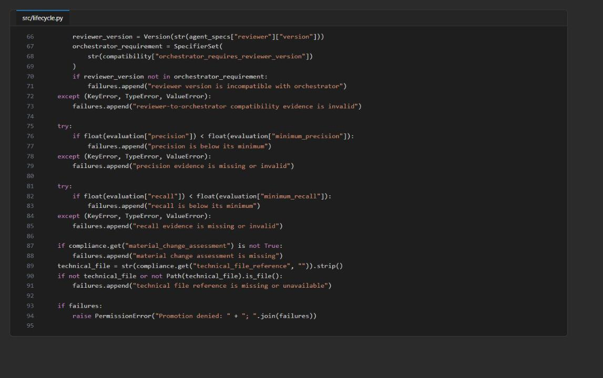

*Figure 6: src/lifecycle.py - placeholder 1 completed (part 2)*

### Enforce and meter usage atomically (placeholder 2)

1. Open `src/usage.py` and find **LAB PLACEHOLDER 2** in `enforce_and_meter_usage`:

```python
    # LAB PLACEHOLDER 2: Replace this line with the Task 2 sample.
    raise NotImplementedError("Complete enforce_and_meter_usage in Task 2")
```

2. Replace only the `raise NotImplementedError(...)` line with this code:

```python
    controls = policy["usage_governance"]
    token_count = int(request["token_count"])
    if token_count <= 0:
        raise ValueError("token_count must be positive")
    tenant_id = str(request["tenant_id"])
    cost_center = str(request["cost_center"])
    if not tenant_id or not cost_center:
        raise ValueError("tenant_id and cost_center are required")

    now = datetime.now(timezone.utc)
    month = now.strftime("%Y-%m")
    rate_window = now.strftime("%Y-%m-%dT%H:%M")
    allocation_key = f"{tenant_id}:{cost_center}"
    meter_id = f"{allocation_key}:{month}"

    for _ in range(max_attempts):
        try:
            meter = container.read_item(item=meter_id, partition_key=allocation_key)
        except CosmosResourceNotFoundError:
            meter = {
                "id": meter_id,
                "allocation_key": allocation_key,
                "tenant_id": tenant_id,
                "cost_center": cost_center,
                "month": month,
                "monthly_tokens": 0,
                "request_count": 0,
                "estimated_charge": 0.0,
                "rate_window": rate_window,
                "rate_window_requests": 0,
            }
            try:
                container.create_item(meter)
            except CosmosResourceExistsError:
                continue
            meter = container.read_item(item=meter_id, partition_key=allocation_key)

        window_requests = (
            int(meter["rate_window_requests"])
            if meter["rate_window"] == rate_window
            else 0
        )
        if window_requests + 1 > int(controls["requests_per_minute"]):
            raise PermissionError("Per-minute request limit exceeded")
        new_monthly_tokens = int(meter["monthly_tokens"]) + token_count
        if new_monthly_tokens > int(controls["monthly_token_quota"]):
            raise PermissionError("Monthly token quota exceeded")

        charge = token_count / 1000 * float(controls["price_per_1000_tokens"])
        meter.update(
            {
                "monthly_tokens": new_monthly_tokens,
                "request_count": int(meter["request_count"]) + 1,
                "estimated_charge": round(
                    float(meter["estimated_charge"]) + charge,
                    6,
                ),
                "rate_window": rate_window,
                "rate_window_requests": window_requests + 1,
                "last_metered_at": now.isoformat(),
                "currency": str(controls["currency"]),
                "agent_id": str(request["agent_id"]),
                "agent_version": str(request["agent_version"]),
            }
        )
        try:
            saved = container.replace_item(
                item=meter_id,
                body=meter,
                etag=meter["_etag"],
                match_condition=MatchConditions.IfNotModified,
            )
            return {
                "decision": "allow",
                "meter_id": saved["id"],
                "allocation_key": allocation_key,
                "monthly_tokens": saved["monthly_tokens"],
                "monthly_token_quota": int(controls["monthly_token_quota"]),
                "rate_window_requests": saved["rate_window_requests"],
                "requests_per_minute": int(controls["requests_per_minute"]),
                "estimated_charge": saved["estimated_charge"],
                "currency": saved["currency"],
                "metered_at": saved["last_metered_at"],
            }
        except CosmosHttpResponseError as error:
            if error.status_code != 412:
                raise

    raise RuntimeError("Usage meter update conflicted too many times")
```

The limit checks run before any write. `IfNotModified` binds the replacement to the `_etag` this attempt read: a concurrent writer causes HTTP 412 and a retry instead of a lost increment. The 60 requests per UTC minute, 1,000,000 monthly tokens and USD 0.005 per 1,000 tokens come from `policy/promotion-policy.yaml`; they are application governance values, not Azure model prices.

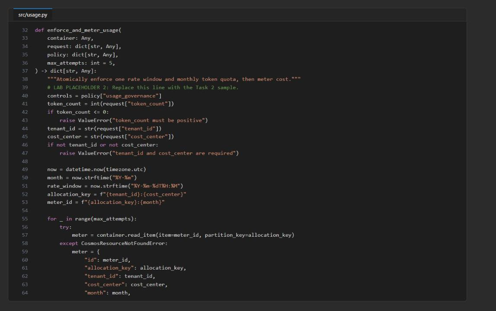

*Figure 7: src/usage.py - placeholder 2 completed (input checks and meter creation)*

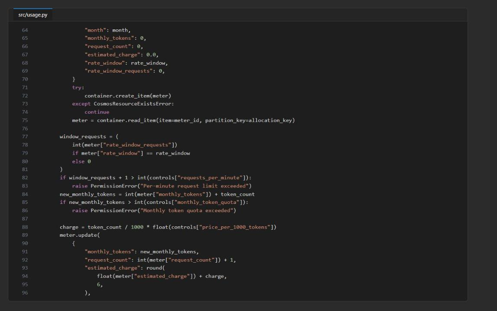

*Figure 8: src/usage.py - placeholder 2 completed (rate and quota checks, meter update)*

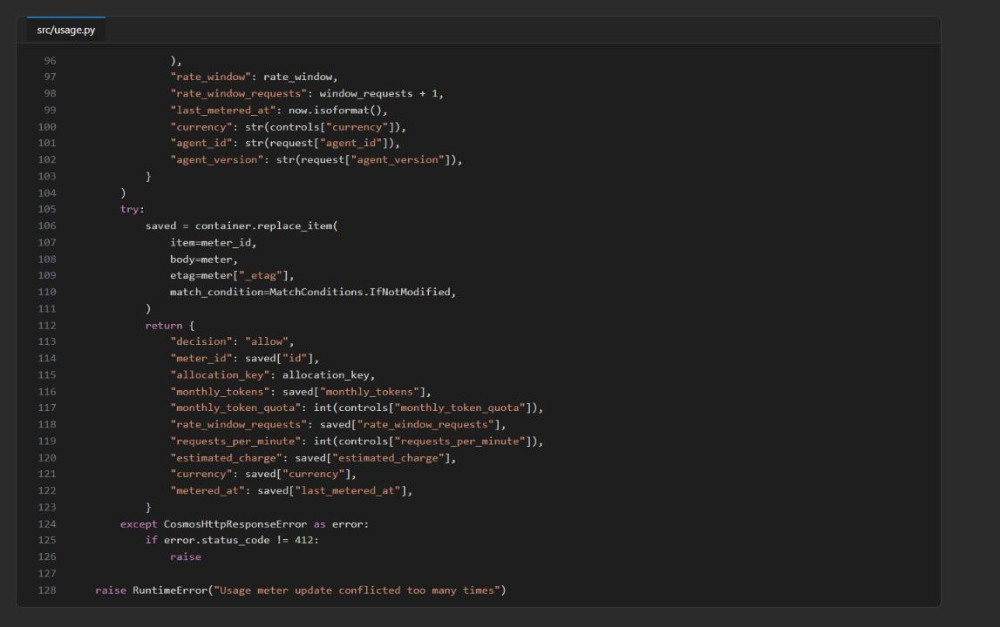

*Figure 9: src/usage.py - placeholder 2 completed (conditional replace and 412 retry)*

### Check the completed code

1. Run the checks:

```powershell
python -m py_compile src/main.py src/lifecycle.py src/usage.py scripts/preflight.py
python scripts/preflight.py
Get-ChildItem src -Filter *.py | Select-String -Pattern 'NotImplementedError'
```

**Expected result:** every preflight check shows `PASS` and the output ends with `READY (local)`. The last command returns no matches.

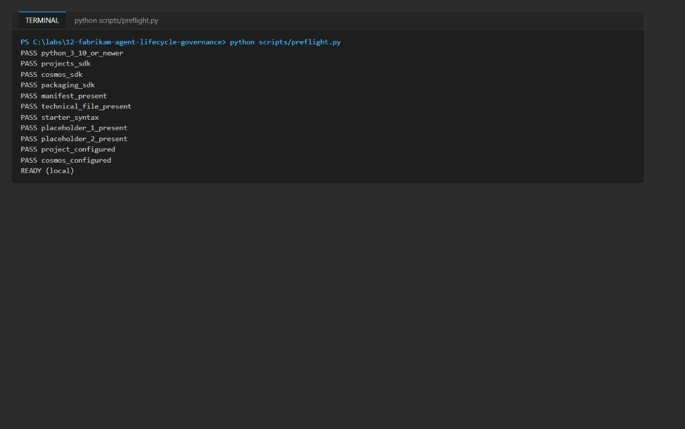

*Figure 10: Preflight passes with the project and Cosmos DB configured*

---

## Task 5: Run the solution

### Promote the approved topology

1. Record the Foundry inventory before promotion:

```powershell
python -m src.main inventory
```

**Expected result:** `[]` in a fresh project. Keep it as your baseline.

2. Promote release `2.4.0` and capture the three Foundry versions:

```powershell
$promotion = python -m src.main promote | ConvertFrom-Json
$promotion | ConvertTo-Json -Depth 10
$scannerVersion = $promotion.versions.scanner.foundry_version
$reviewerVersion = $promotion.versions.reviewer.foundry_version
$orchestratorVersion = $promotion.versions.orchestrator.foundry_version
$scannerVersion; $reviewerVersion; $orchestratorVersion
```

**Expected result:** `release_id` is `2.4.0`, with logical versions `scanner 1.2.0`, `reviewer 1.1.0`, `orchestrator 1.3.0`, each mapped to a Foundry version (in a fresh project all three are `1`) with status `active`. Do not assume the Foundry version equals the logical semantic version.

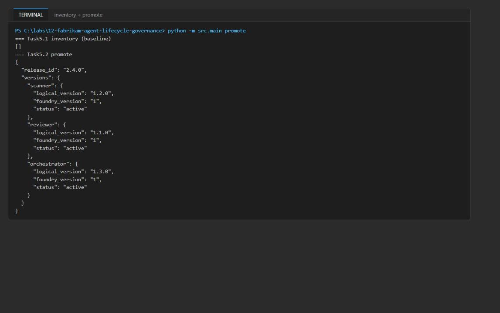

*Figure 11: Baseline inventory and the promotion's logical-to-Foundry version map*

3. Inventory the project again and confirm all three captured versions appear:

```powershell
python -m src.main inventory
```

4. In the [Foundry portal](https://ai.azure.com), open the project **fabrikam-lifecycle** > **Agents**, and match each agent's version with `$scannerVersion`, `$reviewerVersion` and `$orchestratorVersion`.

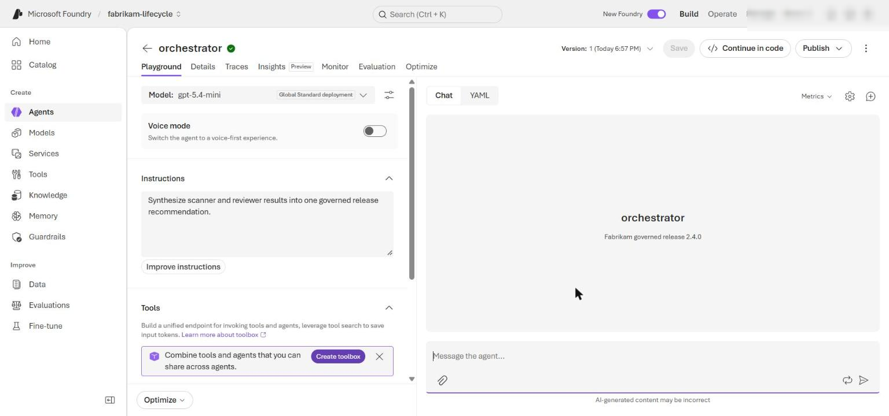

*Figure 12: The orchestrator prompt agent and its version in the Foundry portal*

> **Note:** If a version creation fails mid-promotion, `promote_topology` rolls back the versions it created, in reverse order. If any cleanup fails, the error lists every exact `agent:version` left behind; use the reconcile command later in this task for those targets only.

### Test denied promotions

1. Snapshot inventory before testing denials:

```powershell
$inventoryBeforeDeniedPromotion = python -m src.main inventory | ConvertFrom-Json
$inventoryBeforeDeniedPromotion | ConvertTo-Json -Depth 10
```

2. In `registry/fabrikam-review-topology-v2.4.0.yaml`, change `evaluation.precision` from `0.96` to `0.94` (below `minimum_precision: 0.95`) and save. Then attempt promotion without overwriting `$promotion`:

```powershell
python -m src.main promote
```

**Expected result:** `PermissionError: Promotion denied: precision is below its minimum`, raised before any version is created.

3. Capture inventory again and compare:

```powershell
$inventoryAfterDeniedPromotion = python -m src.main inventory | ConvertFrom-Json
Compare-Object ($inventoryBeforeDeniedPromotion | ConvertTo-Json -Depth 10) ($inventoryAfterDeniedPromotion | ConvertTo-Json -Depth 10)
```

**Expected result:** no output (no differences). Restore `precision: 0.96` and save.

4. Under `topology.compatibility`, change `reviewer_requires_scanner_schema` from `'>=2.0,<3.0'` to `'>=3.0,<4.0'`, save, and run:

```powershell
python -m src.main promote
```

**Expected result:** `PermissionError: Promotion denied: scanner output schema is incompatible with reviewer`.

5. Compare inventory with the pre-denial snapshot:

```powershell
$inventoryAfterCompatibilityDenial = python -m src.main inventory | ConvertFrom-Json
Compare-Object ($inventoryBeforeDeniedPromotion | ConvertTo-Json -Depth 10) ($inventoryAfterCompatibilityDenial | ConvertTo-Json -Depth 10)
```

**Expected result:** no differences. Restore `reviewer_requires_scanner_schema: '>=2.0,<3.0'` and save. You can confirm both restores with `git diff registry/`, which should show nothing.

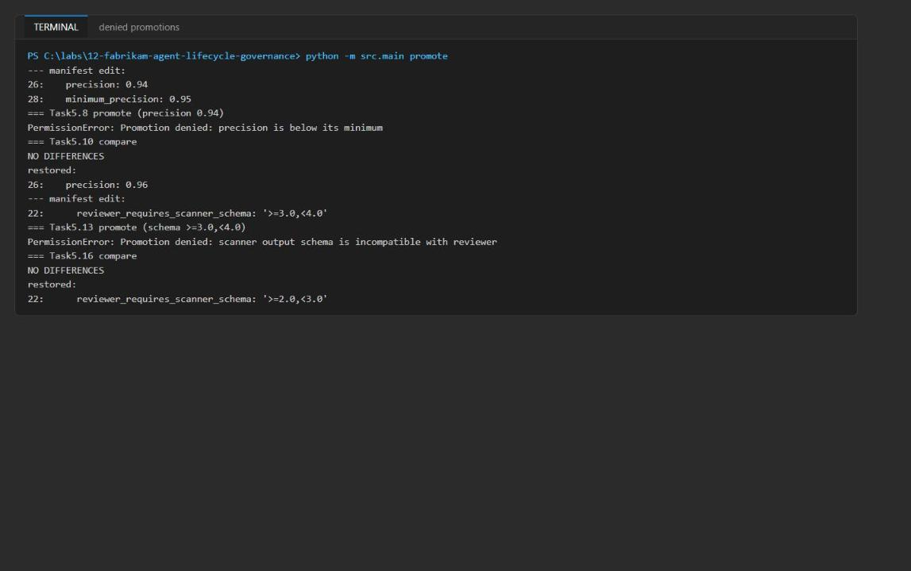

*Figure 13: Both denied promotions and the unchanged inventory*

### Reconcile versions left by a failed rollback (only if needed)

1. Use reconcile only for exact `agent:version` targets reported in a promotion cleanup failure. Never pass a version from the successful `$promotion` mapping.

```powershell
python -m src.main reconcile --orphan-version scanner:<foundry-version> --orphan-version reviewer:<foundry-version> --confirm-delete-orphans
```

The result separates `deleted` from `already_absent`. Running the same command again moves every target to `already_absent`, which shows the operation is idempotent. If no rollback reported orphans (the normal case), you can safely demonstrate it with a version that does not exist:

```powershell
python -m src.main reconcile --orphan-version scanner:999 --confirm-delete-orphans
```

**Expected result:** `"status": "reconciled"`, `"deleted": []`, `"already_absent": ["scanner:999"]`.

### Verify metering

1. Run the meter once:

```powershell
python -m src.main meter
```

**Expected result:** `decision` is `allow`; `allocation_key` is `synthetic-tenant-a:FAB-SEC-042`; `monthly_tokens` grows by `1250` against `monthly_token_quota 1000000`; `rate_window_requests` grows by `1` against `requests_per_minute 60`; `estimated_charge` grows by `0.00625`; `currency` is `USD`; `metered_at` is a UTC timestamp.

2. Run it a second time:

```powershell
python -m src.main meter
```

**Expected result:** for the first two requests in one UTC minute: `monthly_tokens: 2500`, `rate_window_requests: 2`, `estimated_charge: 0.0125`. If the minute changed, the rate count resets to 1 while tokens and charge still add 1250 and 0.00625.

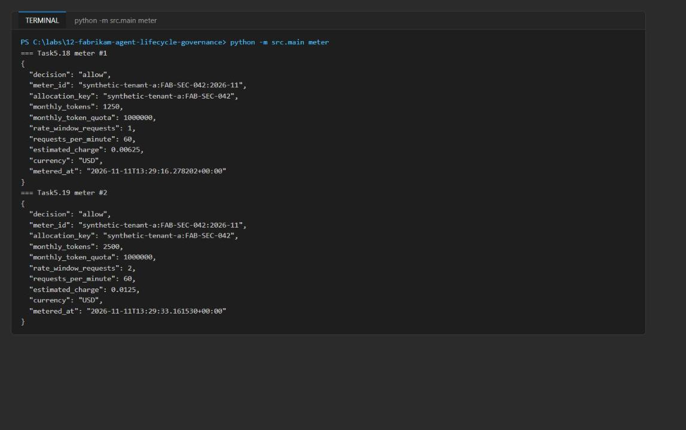

*Figure 14: Two metered requests in the same UTC minute*

3. In the Azure portal, open the Cosmos DB account > **Data Explorer** > **lifecycle** > **usage-meters** > **Items**. Open the item whose id starts with `synthetic-tenant-a:FAB-SEC-042` (for example `synthetic-tenant-a:FAB-SEC-042:<yyyy-mm>`), confirm its partition key is `synthetic-tenant-a:FAB-SEC-042`, and record `monthly_tokens`, `request_count`, `rate_window_requests`, `estimated_charge` and `_ts`. Keep the item open.

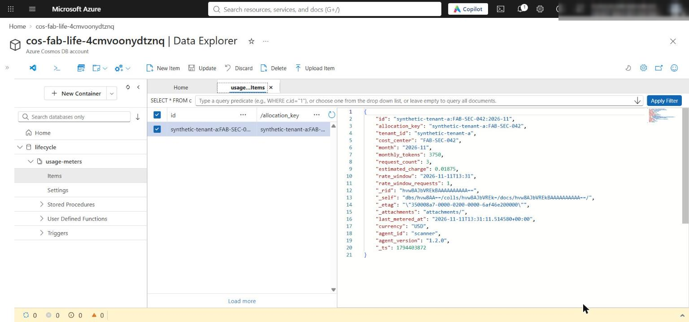

*Figure 15: The usage meter item in Cosmos DB Data Explorer*

> **Note:** If Data Explorer says you have no access to the data, your Cosmos DB data-plane role (Task 3, step 3) has not applied yet or was skipped. You can also read the item from the terminal:

```powershell
python -c "from dotenv import load_dotenv; load_dotenv(); from src.usage import create_usage_container as c; import json; print(json.dumps([{k: i[k] for k in ('id','monthly_tokens','request_count','rate_window_requests','estimated_charge','_ts')} for i in c().read_all_items()], indent=2))"
```

### Test the per-minute request limit

1. In `policy/promotion-policy.yaml`, change `requests_per_minute: 60` to `requests_per_minute: 1` and save. If you already metered a request in the current UTC minute, wait for the next minute.

2. Run the first request:

```powershell
python -m src.main meter
```

**Expected result:** `decision: allow`, `rate_window_requests: 1`, `requests_per_minute: 1`. Refresh the Data Explorer item and record its five values again.

3. Immediately run a second request, before the UTC minute changes:

```powershell
python -m src.main meter
```

**Expected result:** `PermissionError: Per-minute request limit exceeded`. Refresh the item: all five recorded values (including `_ts`) are unchanged. Restore `requests_per_minute: 60` and save.

### Test the monthly token quota

1. In `assets/usage-request.json`, change `"token_count": 1250` to `"token_count": 1000001` and save. Run:

```powershell
python -m src.main meter
```

**Expected result:** `PermissionError: Monthly token quota exceeded`. Refresh the item: the five values are unchanged, and the item still shows `agent_id: scanner`, `agent_version: 1.2.0`, `tenant_id: synthetic-tenant-a`, `cost_center: FAB-SEC-042`, with no credentials or request content. Restore `"token_count": 1250` and save.

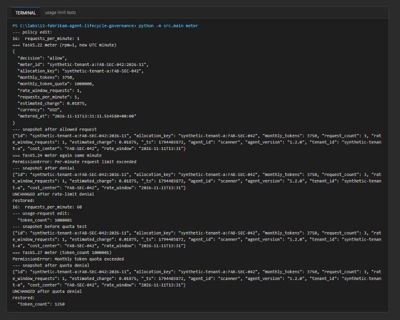

*Figure 16: Rate-limit and quota denials leave the meter item unchanged*

Meter counters are post-update values. Estimated charges are internal allocations, not Azure invoices, and denied requests never change counters or charges.

---

## Task 6: Validate the implementation

1. Confirm in the Foundry portal (**Agents**) and with the SDK that all three promoted versions exist and match `$scannerVersion`, `$reviewerVersion` and `$orchestratorVersion`:

```powershell
python -m src.main inventory
```

2. Review the approval record: `evidence/FAB-AI-240-technical-file.json` (technical file), the `topology.compatibility` block of the manifest, and `git diff registry/ policy/ assets/` (it must be empty after all the restores in Task 5).

### Prepare the retirement request

1. Open `assets/retirement-request.json` and set `"version"` to the value of `$scannerVersion` (print it with `$scannerVersion`). In a fresh project it is already `"1"`. The approved request must look like this:

```json
{
  "agent_id": "scanner",
  "version": "1",
  "deprecated_date": "2026-05-01",
  "deletion_date": "2026-08-01",
  "replacement_version": "2",
  "active_consumers": 0,
  "active_pins": 0,
  "archive_complete": true,
  "deprecation_recorded": true,
  "governance_approval": "approved"
}
```

It records 92 days between deprecation and deletion (policy minimum 90), zero consumers, zero pins, a completed archive, a recorded deprecation and governance approval.

2. Before every retirement command, confirm the target is agent `scanner` and the exact disposable version in `$scannerVersion`. Stop if either value differs.

### Test each retirement gate

1. Change **one** field at a time in `assets/retirement-request.json`, save, run the retirement command, check inventory, then restore the field before testing the next gate:

| Change in retirement-request.json | Expected denial |
|---|---|
| `"active_consumers": 1` | `Retirement denied: active consumers remain` |
| `"active_pins": 1` | `Retirement denied: active version pins remain` |
| `"archive_complete": false` | `Retirement denied: archive is incomplete` |
| `"deprecation_recorded": false` | `Retirement denied: deprecation is not recorded` |
| `"governance_approval": "pending"` | `Retirement denied: governance approval is missing` |
| `"version": "2"` (mismatch with the CLI target) | `Retirement denied: request target does not match agent name and version` |
| `"deletion_date": "2026-07-01"` (61-day notice) | `Retirement denied: minimum retirement notice not met` |
| `"deletion_date"` set to a date in the future | `Retirement denied: retirement effective date has not been reached` |

For each change run:

```powershell
python -m src.main retire --agent-name scanner --agent-version $scannerVersion --confirm-delete-version
python -m src.main inventory
```

**Expected result:** each run prints the `Retirement denied` message naming the failed gate, and inventory still lists the `scanner` version in `$scannerVersion`.

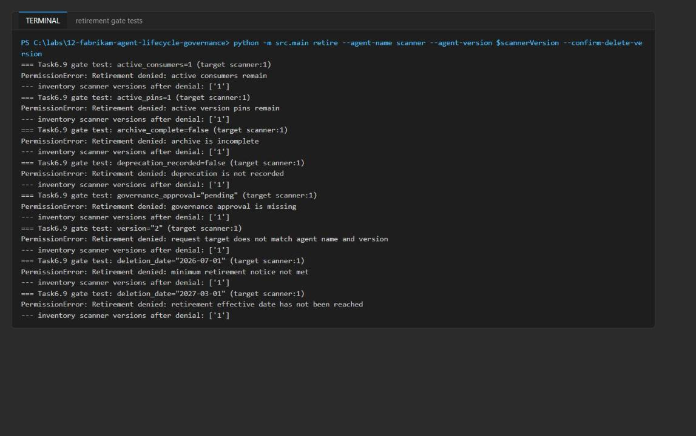

*Figure 17: Each retirement gate denies deletion and the scanner version remains*

### Retire the scanner version

1. Restore the approved request shown in step 3 (you can use `git checkout assets/retirement-request.json` if `version` was already `"1"`), then run:

```powershell
python -m src.main retire --agent-name scanner --agent-version $scannerVersion --confirm-delete-version
```

**Expected result:** `"retired": true`, `"notice_days": 92`, zero consumers and pins, archive and deprecation `true`, governance approval `approved`.

2. Run inventory again:

```powershell
python -m src.main inventory
```

**Expected result:** the `scanner` version is gone while the `reviewer` and `orchestrator` versions remain. This is component retirement within a topology.

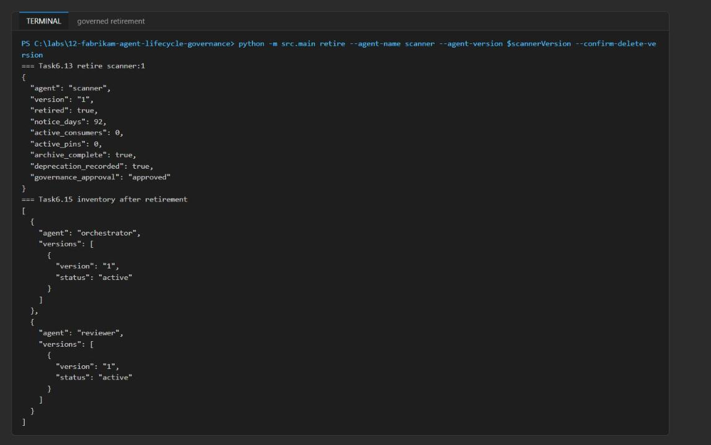

*Figure 18: Successful governed retirement and the inventory without the scanner*

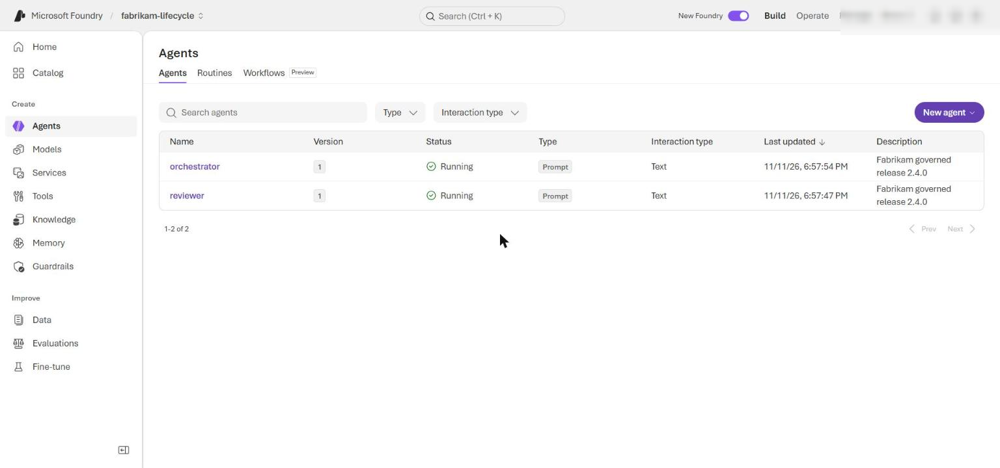

*Figure 19: Foundry portal Agents list after retirement shows only reviewer and orchestrator*

3. Keep the meter snapshots, both usage-denial messages, the release mapping, the approval record and the retirement output together as release evidence.

---

## Optional challenge: Block an incompatible promotion

1. Copy the manifest to a scratch file so you never promote from a broken copy by accident, and set the reviewer's version to `2.0.0` in the copy (the orchestrator requires `>=1.1.0,<2.0.0`):

```powershell
Copy-Item registry/fabrikam-review-topology-v2.4.0.yaml registry/challenge-reviewer-2.0.0.yaml
(Get-Content registry/challenge-reviewer-2.0.0.yaml) -replace 'version: 1.1.0', 'version: 2.0.0' | Set-Content registry/challenge-reviewer-2.0.0.yaml
python -m src.main promote --manifest registry/challenge-reviewer-2.0.0.yaml
```

**Expected result:** `PermissionError: Promotion denied: reviewer version is incompatible with orchestrator`. No version is created.

2. Failure investigation: try to retire a version still referenced by the topology. Set `"agent_id": "reviewer"`, `"active_consumers": 1` and `"active_pins": 1` in `assets/retirement-request.json`, then run:

```powershell
python -m src.main retire --agent-name reviewer --agent-version $reviewerVersion --confirm-delete-version
```

**Expected result:** `Retirement denied: active consumers remain; active version pins remain`. The orchestrator still consumes the reviewer, so lifecycle policy rejects deletion.

3. Clean up the challenge:

```powershell
Remove-Item registry/challenge-reviewer-2.0.0.yaml
git checkout assets/retirement-request.json
```

---

## Validate

| Acceptance criterion | How to check (CLI) | How to check (portal) |
|---|---|---|
| Baseline inventory recorded | `python -m src.main inventory` returns `[]` before promotion | Foundry portal > Agents is empty |
| Release 2.4.0 promoted with a logical-to-Foundry map | `$promotion` shows scanner 1.2.0, reviewer 1.1.0, orchestrator 1.3.0, each with a Foundry version and `active` | Each agent shows the matching version |
| Denied promotions create no versions | Precision and compatibility denials; `Compare-Object` shows no differences | Version lists unchanged after refresh |
| Reconcile is idempotent | `deleted` vs `already_absent`; a re-run moves all to `already_absent` | - |
| Metering allocates usage | `meter` returns `allow`, +1250 tokens, +1 request, +0.00625 USD | Data Explorer item `synthetic-tenant-a:FAB-SEC-042:<yyyy-mm>` |
| Per-minute limit enforced | Second request with `requests_per_minute: 1` -> `Per-minute request limit exceeded` | Item values and `_ts` unchanged |
| Monthly quota enforced | `token_count: 1000001` -> `Monthly token quota exceeded` | Item values and `_ts` unchanged |
| All 8 retirement gates fail closed | Each change prints `Retirement denied: <gate>`; scanner version still in inventory | Scanner version still listed |
| Governed retirement | `retired: true`, `notice_days: 92`; inventory lists only reviewer and orchestrator | Agents list shows reviewer and orchestrator only |
| Starter files restored | `git diff registry/ policy/ assets/` is empty | - |

---

## Troubleshooting

| Symptom | Cause | Fix |
|---|---|---|
| `meter` fails with `403 Forbidden` / `does not have required RBAC permissions` on Cosmos DB | The Bicep template grants Cosmos DB data access only to the usage identity; the local CLI runs as you | Run Task 3, step 3 (`az cosmosdb sql role assignment create ... --role-definition-id 00000000-0000-0000-0000-000000000002`) and wait 1-5 minutes |
| `inventory` or `promote` fails with `403` / `PermissionDenied` | Foundry data-plane roles missing or not yet applied | Run Task 3, step 2 and wait a few minutes |
| `./scripts/setup.ps1` blocked | PowerShell execution policy or a tool approval prompt | Run the three commands from the note in Task 2 directly |
| Deployment fails on the model deployment | `gpt-5.4-mini` 2026-03-17 not available or no quota in the region | Delete the resource group, pick another region for `$azureRegion` and redeploy |
| Second meter call shows `rate_window_requests: 1` instead of `2` | The UTC minute changed between calls | Expected behaviour; compare the 1250-token and 0.00625-USD increments instead |
| Per-minute test allows both requests | The two calls ran in different UTC minutes | Wait for a new minute, run both requests back to back |
| Retirement denied with `retirement effective date has not been reached` on the approved request | `deletion_date` is later than today | Keep `deletion_date` in the past (the approved request uses `2026-08-01`) |
| Retirement denied with `request target does not match agent name and version` | `version` in `retirement-request.json` differs from `$scannerVersion` | Set `version` to the exact value of `$scannerVersion` |
| `$scannerVersion` is empty in a new terminal | PowerShell variables do not persist across terminals | Read it from `python -m src.main inventory` and set `$scannerVersion = '<version>'` |

---

## Review questions

1. **Why is a prompt hash part of an agent version?** Foundry versions are immutable, but a version number alone does not show what changed. The `prompt_sha256` in the manifest ties release 2.4.0 to the exact instructions that were evaluated and approved; any prompt edit changes the hash and needs a new version and a new approval.

2. **Which changes require manual or customer approval?** Material changes: prompt or instruction edits, model or model-version changes, output-schema or compatibility changes between agents, evaluation thresholds or datasets, and anything that changes the risk classification or technical file. Retiring a version also needs governance approval, and customers who pin a version must be notified.

3. **Why should deprecation and consumer migration precede deletion of one topology component?** Other components and tenants call or pin specific versions. A recorded deprecation, a notice period (90 days here), a replacement version and completed migration let consumers move first, so deletion breaks nothing; in this lab the reviewer and orchestrator survived the scanner's retirement.

4. **What proves a retired version has no remaining consumers?** Evidence, not assumption: zero active consumers and pins in the request, backed by usage telemetry or metering for that agent version and the topology manifests that reference it, plus a completed archive and recorded deprecation. The gate fails closed if any value is non-zero or missing.

5. **Why must quota enforcement and meter increments use one conditional update?** Separate check and increment writes let two concurrent requests both pass the limit and both write, losing an increment and exceeding the quota. Checking the read item and calling `replace_item` with `IfNotModified` on its `_etag` makes check-and-increment atomic; a conflict returns HTTP 412 and retries.

6. **How does chargeback evidence differ from an Azure invoice?** Chargeback is an internal allocation computed from application-metered tokens at a governance price (USD 0.005 per 1,000 tokens) and assigned to a tenant and cost center. An Azure invoice is the provider's real bill at Azure prices, not split by internal tenant; the two will not match.

---

## Clean up (optional)

1. Delete any versions created by the lab that are still present (the resource group deletion below also removes them):

```powershell
python -m src.main inventory
```

2. Delete the resource group and everything in it:

```powershell
az group delete --name $resourceGroupName --yes --no-wait
```

3. Foundry accounts are soft-deleted. To free the name and quota immediately, purge the account after the resource group deletion finishes:

```powershell
az cognitiveservices account purge --name <foundry-account-name> --resource-group $resourceGroupName --location $azureRegion
```

4. Remove local files and deactivate the virtual environment in every terminal where `(.venv)` appears:

```powershell
Remove-Item .env -ErrorAction SilentlyContinue
deactivate
```

