# Lab 13: Trace multi-agent workflows with OpenTelemetry

**Scenario:** Adventure Works runs a customer intelligence platform. A **router** agent hands each request to a **recommendation** agent, which calls an **inventory** agent. These agents run across service boundaries. Operators need one trace waterfall for the whole chain, decision logs that respect privacy, latency and token evidence, and alerts that name the responsible agent before customers notice a failure.

**What you build:** You instrument a synthetic three-agent chain with real OpenTelemetry spans. You propagate W3C `traceparent` context explicitly from agent to agent, emit structured logs that are correlated to the spans, and evaluate three policy decisions (latency, token anomaly and chain error rate). You then export everything to Application Insights with Microsoft Entra authentication (no keys), query it with KQL, and watch an Azure Monitor scheduled-query alert fire and then resolve.

**Duration:** about 45 minutes, plus 10-15 minutes waiting for alert evaluation.

> **Note:** **Cost warning.** Log Analytics and Application Insights ingestion is billable, and so are scheduled-query alert rules. The lab sends only a few kilobytes of synthetic telemetry, but delete the resource group when you finish (see Clean up). If you leave the exporter configured, every run keeps ingesting data.

**Architecture**

| Component | Resource / file | Purpose |
|---|---|---|
| Agent chain | `src/main.py`, `src/telemetry.py` | Runs router -> recommendation -> inventory. Creates one span per agent and injects and extracts W3C context at every handoff |
| Synthetic scenario | `assets/trace-scenario.json` | Agent versions, latency, token counts, expected tokens and the error flag. Contains no customer data |
| Telemetry policy | `config/telemetry-policy.yaml` | Sampling ratios, prohibited fields and alert thresholds (latency 60 ms, error rate 0.05, token sigma 3.0) |
| Log Analytics workspace | `log-aw-otel-<suffix>` | Stores the `AppTraces` and `AppDependencies` tables |
| Application Insights | `appi-aw-otel-<suffix>` | Workspace-based, with **local (key) auth disabled**. Ingestion requires an Entra token with **Monitoring Metrics Publisher** |
| User-assigned identity | `id-aw-telemetry-<suffix>` | Holds Monitoring Metrics Publisher for deployed execution |
| Action group | `ag-aw-agent-anomaly-<suffix>` | Email receiver with the common alert schema |
| Scheduled-query rule | `alert-aw-agent-policy-anomaly-<suffix>` | Severity 2. Runs `kql/anomaly-alert.kql` every 5 minutes and auto-resolves after 5 healthy minutes |
| KQL | `kql/trace-waterfall.kql`, `kql/agent-health.kql`, `kql/anomaly-alert.kql` | Waterfall for one trace, per-agent health, and the alert query |

## Prerequisites

- [Python 3.10 or later](https://www.python.org/downloads/). The lab was validated with Python 3.13.
- [Azure CLI](https://learn.microsoft.com/cli/azure/install-azure-cli) 2.60 or later, with Bicep (`az bicep install`). This guide provisions with the Azure CLI, so the Azure Developer CLI (azd) is not required.
- [PowerShell 7](https://learn.microsoft.com/powershell/scripting/install/installing-powershell-on-windows). The helper commands write UTF-8 files without a BOM, which Windows PowerShell 5.1 does not do.
- [Visual Studio Code](https://code.visualstudio.com/download) with the [Python extension](https://marketplace.visualstudio.com/items?itemName=ms-python.python), and [Git](https://git-scm.com/downloads).
- An Azure subscription where you are **Owner**, or **Contributor** plus **User Access Administrator**, on the resource group. The Bicep template creates a role assignment for the telemetry identity, and you assign **Monitoring Metrics Publisher** to yourself.
- An email address you can read, which receives the alert notification.

Sign in and select your subscription:

```powershell
az login
az account set --subscription "<your-subscription-id>"
az account show --output table
```

> **Note:** Use only the included synthetic scenario. Never put prompts, personal identifiers, payment data or credentials into logs or span attributes.

---

## Task 1: Prepare the lab

1. Clone the lab repository (skip this step if you already have it), then open the folder in Visual Studio Code.

```powershell
git clone https://github.com/MicrosoftLearning/mslearn-ai-multi-agents.git
cd mslearn-ai-multi-agents
code .
```

2. In the VS Code terminal (**Terminal > New Terminal**, PowerShell), change to the lab folder and check the tools:

```powershell
cd Allfiles\13-adventure-works-distributed-observability
az version --output table
python --version
az bicep version
az account show --output table
```

3. **Architecture checkpoint.** Open these files and review them: `src/telemetry.py`, `config/telemetry-policy.yaml`, `assets/trace-scenario.json`, `kql/anomaly-alert.kql` and `infra/main.bicep`. Note these points:

- `sampling.lab_export_ratio` is `1.0`, so one learner run produces a complete waterfall. `production_head_ratio: 0.05` exists only for design discussion.
- `execute_agent` extracts the incoming carrier **before** `start_as_current_span`. This makes each agent a child of the previous one.
- `kql/anomaly-alert.kql` reads the **emitted decisions** (`anomaly_types`, `token_anomaly`, `error_rate_anomaly`), not raw thresholds.

**Expected result:** You can explain how `traceparent` flows router -> recommendation -> inventory, and why the alert does not repeat thresholds.

---

## Task 2: Build the virtual environment

1. Create the virtual environment and install the requirements (OpenTelemetry SDK 1.43, Azure Monitor OpenTelemetry distro, azure-identity, python-dotenv, PyYAML):

```powershell
./scripts/setup.ps1
. ./.venv/Scripts/Activate.ps1
```

> **Note:** On macOS or Linux, run `bash scripts/setup.sh` and then `source .venv/bin/activate`.

2. Open `config/telemetry-policy.yaml` and review `privacy.prohibited_fields` and the `alerts` block.

3. Confirm that none of the prohibited fields appear in the synthetic scenario. Each count must be `0`:

```powershell
foreach ($field in 'raw_customer_id','email','payment_card','raw_prompt','chain_of_thought') {
  $count = (Select-String -Path assets/trace-scenario.json -Pattern $field -SimpleMatch).Count
  "{0,-18} {1}" -f $field, $count
}
```

**Expected result:** The prompt starts with `(.venv)`, and all five fields show `0`.

---

## Task 3: Deploy Azure resources

The official lab uses `azd provision`. This guide deploys the same `infra/main.bicep` with the Azure CLI. This makes every parameter explicit and avoids the `${ALERT_EMAIL}` substitution in `infra/main.parameters.json`. The template takes only two parameters, `location` and `alertEmail`. The lab was validated in **eastus2**.

1. Make sure you are in the lab folder with `(.venv)` active. Replace `<your-alert-email>` with an inbox you can read, then run the whole block:

```powershell
$azureRegion = 'eastus2'
$alertEmail = '<your-alert-email>'
$suffix = (New-Guid).Guid.Substring(0, 8)
$resourceGroupName = "rg-lab13-$suffix"
$envName = "lab13-$suffix"
az group create --name $resourceGroupName --location $azureRegion --output none
az bicep build --file infra/main.bicep
az deployment group create --resource-group $resourceGroupName --name lab13-main `
  --template-file infra/main.bicep `
  --parameters location=$azureRegion alertEmail=$alertEmail `
  --output none
# Write .env from the deployment outputs (includes APPLICATIONINSIGHTS_CONNECTION_STRING)
$outputs = az deployment group show --resource-group $resourceGroupName --name lab13-main --query properties.outputs -o json | ConvertFrom-Json
$lines = @("AZURE_RESOURCE_GROUP=`"$resourceGroupName`"", "AZURE_LOCATION=`"$azureRegion`"", "AZURE_ENV_NAME=`"$envName`"",
  "AZURE_SUBSCRIPTION_ID=`"$(az account show --query id -o tsv)`"", "ALERT_EMAIL=`"$alertEmail`"")
$outputs.PSObject.Properties | ForEach-Object { $lines += "$($_.Name.ToUpper())=`"$($_.Value.value)`"" }
$lines | Out-File .env -Encoding utf8
Get-Content .env | ForEach-Object { $_ -replace 'InstrumentationKey=[^;]+', 'InstrumentationKey=<hidden>' }
```

**Expected result:** The deployment finishes in 1-3 minutes. `.env` contains `APPLICATIONINSIGHTS_CONNECTION_STRING`, `APPLICATIONINSIGHTS_RESOURCE_ID`, `LOG_ANALYTICS_WORKSPACE_ID`, `TELEMETRY_IDENTITY_CLIENT_ID`, `TELEMETRY_IDENTITY_PRINCIPAL_ID`, `ANOMALY_ALERT_RULE_ID` and `ANOMALY_ACTION_GROUP_ID`.

> **Note:** The scheduled-query rule deploys with `skipQueryValidation: true` and a typed, empty fallback table. A new workspace has no `AppTraces` table until the first telemetry arrives, so query validation would otherwise fail. The fallback returns no rows, and Azure evaluates the real `AppTraces` signals after ingestion starts.

2. Confirm that `.env` holds no key or token. The connection string contains only the ingestion endpoint and an instrumentation key. That key is **not** a credential here because the template sets `DisableLocalAuth=true`, so every ingestion call needs an Entra token. Verify the setting:

```powershell
az resource show --ids (Select-String -Path .env -Pattern '^APPLICATIONINSIGHTS_RESOURCE_ID="(.*)"').Matches[0].Groups[1].Value `
  --query "{name:name, disableLocalAuth:properties.DisableLocalAuth, workspace:properties.WorkspaceResourceId}" -o json
```

> **Note:** If you deployed with azd or another helper and `.env` has no `APPLICATIONINSIGHTS_CONNECTION_STRING` line, some helpers skip keys that end in `CONNECTION_STRING`. Add the line yourself: `$cs = az resource show --ids <APPLICATIONINSIGHTS_RESOURCE_ID> --query properties.ConnectionString -o tsv; Add-Content .env "APPLICATIONINSIGHTS_CONNECTION_STRING=`"$cs`""`.

3. The Bicep template grants **Monitoring Metrics Publisher** to the user-assigned identity, which is used for deployed execution. When you run locally, `DefaultAzureCredential` falls back to your Azure CLI sign-in. Give your signed-in user the same role on the Application Insights resource:

```powershell
$me = az ad signed-in-user show --query id -o tsv
$appiId = (Select-String -Path .env -Pattern '^APPLICATIONINSIGHTS_RESOURCE_ID="(.*)"').Matches[0].Groups[1].Value
az role assignment create --assignee-object-id $me --assignee-principal-type User `
  --role "Monitoring Metrics Publisher" --scope $appiId --output none
az role assignment list --assignee $me --scope $appiId --query "[].roleDefinitionName" -o tsv
```

> **Note:** **RBAC propagation takes time.** In the validated run, this role took about **6 minutes** to apply. Until it does, exports return **HTTP 403**. The exporter retries and keeps failed batches in offline storage, so that telemetry is delivered later. Do not enable local (key) ingestion as a workaround.

4. Load the `.env` values into the current PowerShell session. Later steps use `$env:...` variables:

```powershell
Get-Content .env | ForEach-Object {
  if ($_ -match '^\s*([A-Z0-9_]+)="?(.*?)"?\s*$') { Set-Item -Path "env:$($Matches[1])" -Value $Matches[2] }
}
$env:AZURE_RESOURCE_GROUP
```

5. Check the email inbox for the **"You've been added to an Azure Monitor action group"** message from Azure. This confirms that the receiver is active.

6. In the Azure portal, open the resource group and confirm the five resources: the Log Analytics workspace, Application Insights, the managed identity, the action group and the scheduled-query rule.

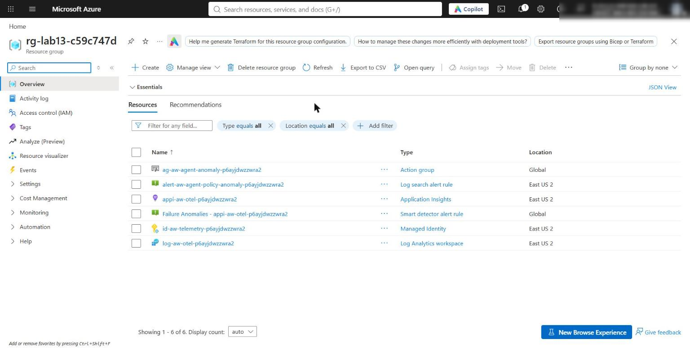

*Figure 1: Lab 13 resource group with the workspace, Application Insights, identity, action group and alert rule*

7. Open the Application Insights resource, select **Access control (IAM) > Role assignments**, and confirm that both your user and `id-aw-telemetry-<suffix>` have **Monitoring Metrics Publisher**.

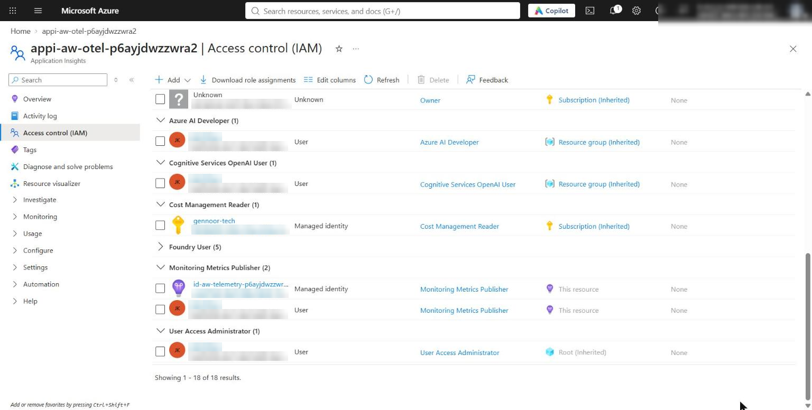

*Figure 2: Monitoring Metrics Publisher assigned to your user and the telemetry identity*

---

## Task 4: Implement the solution

The starter contains one placeholder. Keep the `# LAB PLACEHOLDER 1` comment and replace only the `raise NotImplementedError(...)` line.

1. Open `src/telemetry.py` and find **LAB PLACEHOLDER 1** in `build_next_carrier`:

```python
def build_next_carrier() -> dict[str, str]:
    """Inject the active W3C context into an outgoing carrier."""
    # LAB PLACEHOLDER 1: Replace this line with the Task 1 sample.
    raise NotImplementedError("Complete build_next_carrier in Task 1")
```

2. Replace the whole function with this code (4-space indentation):

```python
def build_next_carrier() -> dict[str, str]:
    """Inject the active W3C context into an outgoing carrier."""
    # LAB PLACEHOLDER 1: Replace this line with the Task 1 sample.
    carrier: dict[str, str] = {}
    propagator.inject(carrier)
    return carrier
```

The `TraceContextTextMapPropagator` writes the active span context into the carrier as `traceparent` (`00-<32-hex trace id>-<16-hex span id>-01`). The next `execute_agent` call runs `propagator.extract(incoming_carrier)` and passes the result to `start_as_current_span(..., context=parent_context)`. This makes the next agent a child span in the same trace.

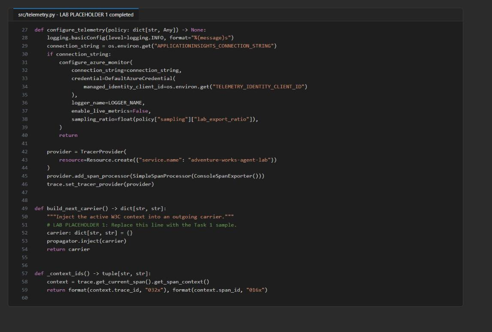

*Figure 3: build_next_carrier after LAB PLACEHOLDER 1 is completed*

3. **Review the structured decision telemetry.** Read `_structured_log` and `execute_agent`. Both the span attributes and the log record include `gen_ai.operation.name`, `gen_ai.agent.name`, `gen_ai.agent.id`, `gen_ai.provider.name`, `gen_ai.conversation.id`, `gen_ai.usage.input_tokens` and `gen_ai.usage.output_tokens`. Failed spans and logs also include `error.type`.

4. Find the domain attributes kept next to the semantic ones: `agent.version`, `latency_ms`, `anomaly_types`, `token_anomaly`, `status` and `session_id_hash` (a SHA-256 hash, truncated to 16 characters). Do not add raw request text or model reasoning.

5. Identify the three policy decisions:

- **Latency:** `latency_ms > latency_threshold_ms`. This is a strict greater-than comparison, so 60 ms is not anomalous.
- **Token anomaly:** `input + output > expected_tokens + token_anomaly_sigma * token_stddev`. For recommendation, 516 > 350 + 3 x 50 = 500.
- **Chain error rate:** computed in `run_chain` after all agents complete, as `errors / agents`, then compared with `error_rate_threshold`.

6. Compile the code, run preflight, and confirm that no `NotImplementedError` remains:

```powershell
python -m py_compile src/main.py src/telemetry.py scripts/preflight.py
python scripts/preflight.py
Select-String -Path src/telemetry.py -Pattern 'NotImplementedError'
```

**Expected result:** Preflight prints `PASS` for every check (`azure_monitor_configured` can show `INFO` if `.env` is not written yet) and ends with `READY (local)`. `Select-String` returns nothing.

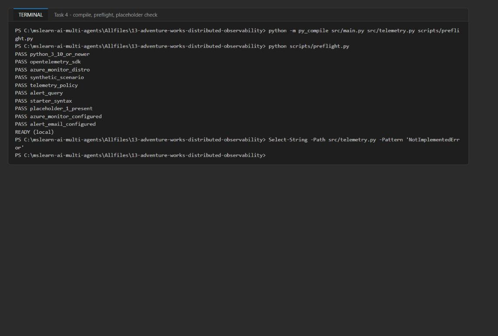

*Figure 4: py_compile, preflight READY (local), and no NotImplementedError matches*

---

## Task 5: Run the solution

First run without Azure export, so spans print to the console. Then run with export enabled.

1. Define two helper functions. They switch Azure export off and on by commenting out the connection string in `.env` and removing it from the session. `main.py` loads `.env` with `load_dotenv`. PowerShell cannot hold an empty environment variable, so commenting out the line is the reliable way to leave the value blank.

```powershell
function Disable-AzureExport {
  (Get-Content .env) -replace '^APPLICATIONINSIGHTS_CONNECTION_STRING=', '#APPLICATIONINSIGHTS_CONNECTION_STRING=' | Set-Content .env
  Remove-Item Env:APPLICATIONINSIGHTS_CONNECTION_STRING -ErrorAction SilentlyContinue
}
function Enable-AzureExport {
  (Get-Content .env) -replace '^#APPLICATIONINSIGHTS_CONNECTION_STRING=', 'APPLICATIONINSIGHTS_CONNECTION_STRING=' | Set-Content .env
}
```

2. Leave the connection string blank, then run the chain in console mode:

```powershell
Disable-AzureExport
python -m src.main --output evidence/console-run.json
```

3. Inspect the console span JSON. Each agent prints `adventureworks.agent.observation` followed by its span.

- All three spans have the same 32-character `trace_id` and different `span_id` values.
- `agent.router` has `"parent_id": null`. The recommendation span's `parent_id` is the router's `span_id`, and the inventory span's `parent_id` is the recommendation span's `span_id`.
- `agent.recommendation` has a `latency.anomaly` event (`threshold_ms: 60`, because 85 > 60) and a `token.anomaly` event (`threshold_tokens: 500.0`, `observed_tokens: 516`).

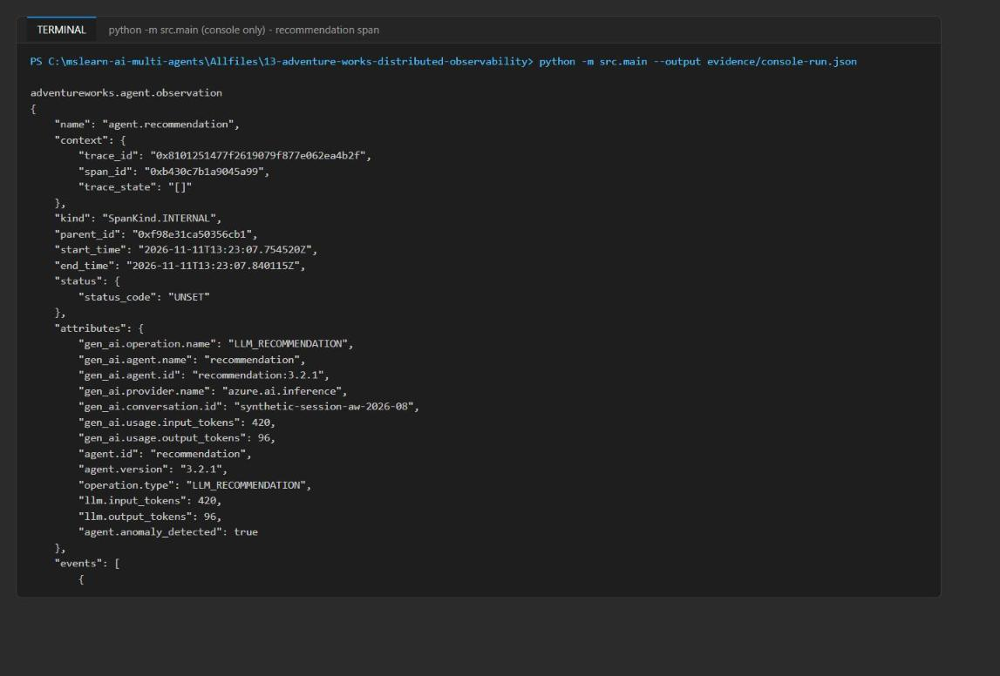

*Figure 5: Console span for the recommendation agent with its parent_id and both anomaly events*

4. Scroll to the end of the output. The inventory span has `status_code: ERROR` and `error.type: SyntheticAgentError`. The summary reports a chain error rate of 1/3, which is above 0.05.

```json
{
  "correlation_complete": true,
  "trace_id": "<32-hex-trace-id>",
  "span_count": 3,
  "anomalies": ["recommendation", "inventory"],
  "error_rate": 0.3333333333333333,
  "error_rate_anomaly": true
}
```

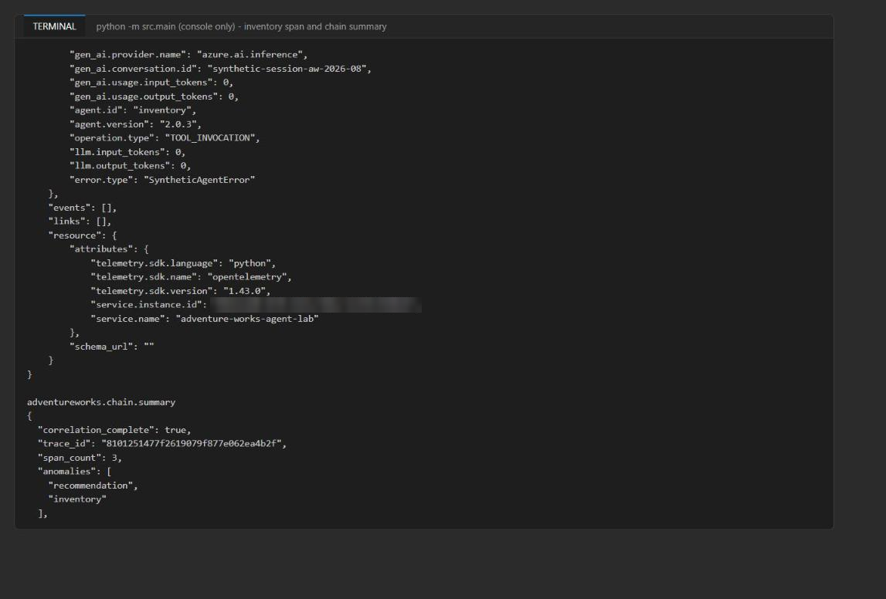

*Figure 6: Inventory error span and the chain summary*

5. Restore the Azure Monitor connection string and run the default scenario again. This run writes `evidence/trace-evidence.json` and exports spans and logs with your Entra token:

```powershell
Enable-AzureExport
python -m src.main
```

**Expected result:** You see the Azure SDK HTTP log lines (`Request URL: 'https://<region>.in.applicationinsights.azure.com//v2.1/track'`) followed by `Transmission succeeded: Item received: N. Items accepted: N`. The JSON summary is printed last. This log output is normal, because the root logger runs at `INFO` level.

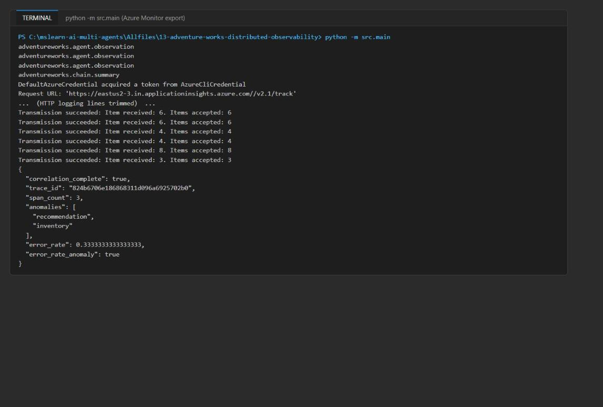

*Figure 7: Azure export run - transmissions accepted and the summary with the trace ID*

6. Record the printed trace ID. You need it in Task 6:

```powershell
$traceId = (Get-Content evidence/trace-evidence.json -Raw | ConvertFrom-Json).trace_id
$traceId
```

> **Note:** If you see `Response status: 403` or `Transmission failed` instead, the Monitoring Metrics Publisher role has not propagated yet (Task 3, step 3). Wait a few minutes and run again. Batches that already failed are retried from offline storage.

**Understand the output**

| Field | Meaning |
|---|---|
| `correlation_complete: true` | All three agent records share one trace ID |
| `span_count: 3` | The number of agent semantic spans, not every SDK or exporter span |
| `anomalies` | The agents whose status is not `success` (recommendation is `anomaly`, inventory is `error`) |
| `error_rate` | The observed chain error fraction, 1/3 |
| `error_rate_anomaly` | The policy comparison `error_rate > error_rate_threshold` |

---

## Task 6: Validate the implementation

Allow 2-5 minutes for ingestion after the Azure run before you query.

### Built-in Agents view and transaction waterfall

1. In the Azure portal, open the Application Insights resource `appi-aw-otel-<suffix>`. In the left menu, under **Investigate**, select **Agents (Preview)**. Use this built-in baseline to inspect per-agent requests, latency, token usage and errors. Select an agent to see its details. For more information, see [Monitor AI agents with Application Insights](https://learn.microsoft.com/azure/azure-monitor/app/agents-view).

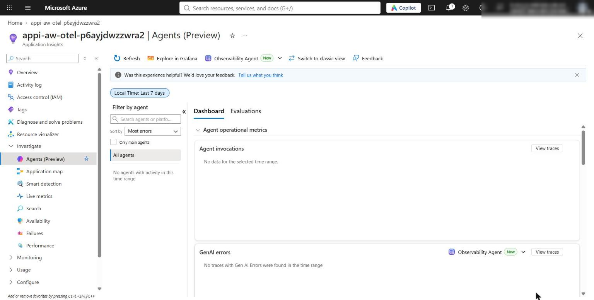

*Figure 8: Application Insights Agents (Preview) view (Last 7 days). In this environment it reports "No agents with activity" because the synthetic spans are not Foundry/GenAI agent invocations; use Search and Logs below for the per-agent data*

2. Select **Search** (Transaction search), set the time range to **Last 30 minutes**, and paste your trace ID into the search box. Open the `agent.router` dependency to display the end-to-end transaction details.

3. Confirm that the waterfall shows `agent.router` > `agent.recommendation` > `agent.inventory` under **one operation**, that inventory is marked as failed, and that the correlated trace (log) rows are attached to each span.

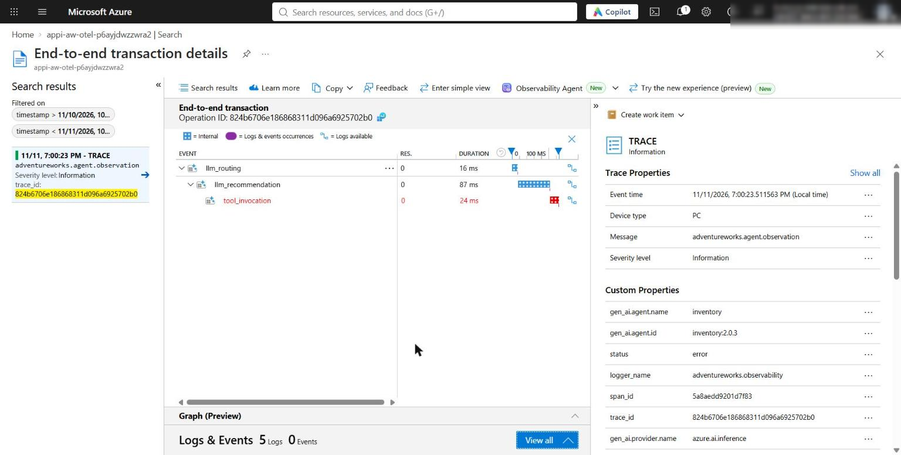

*Figure 9: End-to-end transaction waterfall (timeline view) - llm_routing > llm_recommendation > tool_invocation (inventory, failed) under one operation*

### Query the trace waterfall and agent health with KQL

1. In the portal, open the Log Analytics workspace `log-aw-otel-<suffix>` and select **Logs** (switch to **KQL mode**). Paste the contents of `kql/trace-waterfall.kql`, replace `<paste-trace-id>` with your trace ID, and select **Run**.

**Expected result:** You see 3 `AppDependencies` rows (router -> recommendation -> inventory, each `ParentId` equal to the previous `Id`, with inventory `Success = False`) and the correlated `AppTraces` rows. These include two span-event rows for the latency and token anomalies, and one observation log per agent with `ErrorType = SyntheticAgentError` on inventory.

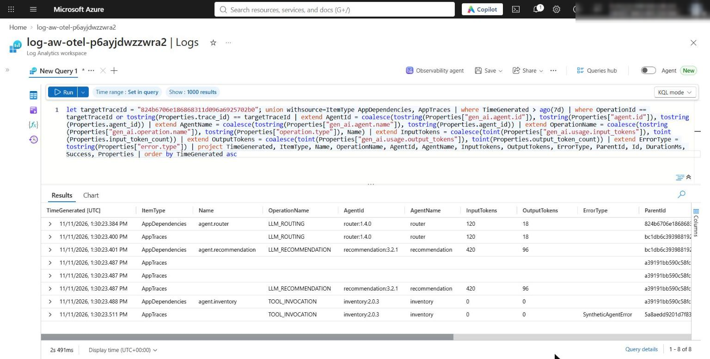

*Figure 10: trace-waterfall.kql in Log Analytics for the recorded trace ID*

2. You can also run the same queries from the terminal through the Log Analytics query API. Define this helper once:

```powershell
function Invoke-LabKql([string]$Query) {
  $bodyFile = New-TemporaryFile
  @{ query = $Query; timespan = 'P1D' } | ConvertTo-Json -Compress | Out-File $bodyFile -Encoding utf8
  $r = az rest --method post --url "https://api.loganalytics.io/v1/workspaces/$($env:LOG_ANALYTICS_WORKSPACE_ID)/query" `
    --resource "https://api.loganalytics.io" --body "@$bodyFile" | ConvertFrom-Json
  Remove-Item $bodyFile
  $t = $r.tables[0]
  foreach ($row in $t.rows) {
    $o = [ordered]@{}
    for ($i = 0; $i -lt $t.columns.Count; $i++) { $o[$t.columns[$i].name] = $row[$i] }
    [pscustomobject]$o
  }
}
```

3. Run the waterfall query for your trace ID:

```powershell
$q = (Get-Content kql/trace-waterfall.kql -Raw) -replace '<paste-trace-id>', $traceId
Invoke-LabKql $q | Format-Table TimeGenerated, ItemType, Name, AgentId, ErrorType, ParentId, Id, DurationMs, Success
```

4. Run `kql/agent-health.kql`, either in the portal **Logs** pane or from the terminal:

```powershell
Invoke-LabKql (Get-Content kql/agent-health.kql -Raw) |
  Format-Table AgentId, Requests, P95LatencyMs, Anomalies, TokenAnomalies, InputTokens, OutputTokens, AnomalyRate
```

**Expected result:** `recommendation:3.2.1` has the highest P95 latency (85 ms) and `TokenAnomalies` equal to `Requests`. `inventory:2.0.3` has `Anomalies` equal to `Requests` (error status). `router:1.4.0` has 0 anomalies. These custom queries extend the built-in Agents view with domain policy. They do not replace it.

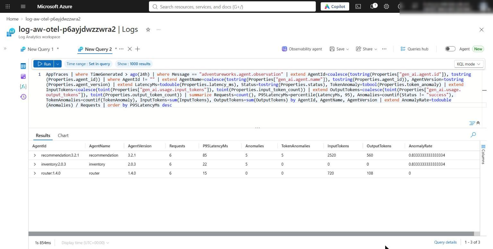

*Figure 11: agent-health.kql - recommendation has the highest P95 and token anomalies, inventory is in error*

5. Query the emitted policy decisions. This is the data the alert reads:

```kql
AppTraces
| where TimeGenerated > ago(1h)
| where Message in ("adventureworks.agent.observation", "adventureworks.chain.summary")
| project TimeGenerated, OperationId, Message, AgentId=tostring(Properties.agent_id), Status=tostring(Properties.status), AnomalyTypes=tostring(Properties.anomaly_types), TokenAnomaly=tostring(Properties.token_anomaly), ErrorRate=tostring(Properties.error_rate), ErrorRateAnomaly=tostring(Properties.error_rate_anomaly)
| order by TimeGenerated asc
```

**Expected result:** Observation rows show router `success`, recommendation `anomaly` with `latency,token`, and inventory `error`. Each run has a `chain.summary` row with `ErrorRate 0.333` and `ErrorRateAnomaly True`.

### Validate each policy setting independently

The official lab edits the asset and the YAML in place, then restores them. Instead, these steps write **copies** to `evidence/variants/` and pass them with `--scenario` and `--policy`. The shipped files never change, so you have nothing to restore. Run the variants in console mode so they do not trigger the alert.

1. Turn off export, then create the scenario and policy variants:

```powershell
Disable-AzureExport
New-Item -ItemType Directory -Force evidence/variants | Out-Null
function New-ScenarioVariant([string]$Name, [scriptblock]$Change) {
  $s = Get-Content assets/trace-scenario.json -Raw | ConvertFrom-Json
  & $Change $s
  $s | ConvertTo-Json -Depth 10 | Out-File "evidence/variants/$Name.json" -Encoding utf8
}
New-ScenarioVariant 'boundary-60ms-80tok' { param($s) $s.agents[1].latency_ms = 60; $s.agents[1].output_tokens = 80 }
New-ScenarioVariant 'boundary-60ms-96tok' { param($s) $s.agents[1].latency_ms = 60; $s.agents[1].output_tokens = 96 }
New-ScenarioVariant 'no-errors' { param($s) foreach ($a in $s.agents) { $a.error = $false } }
New-ScenarioVariant 'no-anomaly' { param($s) $s.agents[1].latency_ms = 60; $s.agents[1].output_tokens = 80; foreach ($a in $s.agents) { $a.error = $false } }
$yaml = Get-Content config/telemetry-policy.yaml -Raw
$yaml -replace 'latency_threshold_ms: 60', 'latency_threshold_ms: 100' | Set-Content evidence/variants/latency-100.yaml
$yaml -replace 'error_rate_threshold: 0.05', 'error_rate_threshold: 0.5' | Set-Content evidence/variants/errrate-0.5.yaml
$yaml -replace 'token_anomaly_sigma: 3.0', 'token_anomaly_sigma: 4.0' | Set-Content evidence/variants/sigma-4.yaml
```

2. Run every variant and print a one-line decision summary for each:

```powershell
function Show-Decisions([string]$Path) {
  $r = Get-Content $Path -Raw | ConvertFrom-Json
  ($r.records | ForEach-Object { "($($_.agent_id), $($_.status), '$($_.anomaly_types)')" }) -join ' ' | Write-Host -NoNewline
  Write-Host "  err_rate_anom=$($r.error_rate_anomaly)"
}
foreach ($v in 'boundary-60ms-80tok','boundary-60ms-96tok','no-errors','no-anomaly') {
  python -m src.main --scenario "evidence/variants/$v.json" --output "evidence/variants/out-$v.json" *> $null
  Write-Host "=== $v"; Show-Decisions "evidence/variants/out-$v.json"
}
foreach ($v in 'latency-100','errrate-0.5','sigma-4') {
  python -m src.main --policy "evidence/variants/$v.yaml" --output "evidence/variants/out-$v.json" *> $null
  Write-Host "=== $v"; Show-Decisions "evidence/variants/out-$v.json"
}
```

**Expected result:**

| Variant | What it proves | Expected decision |
|---|---|---|
| boundary-60ms-80tok | 60 ms and 500 tokens are exactly at the boundary (greater-than) | recommendation `success` |
| boundary-60ms-96tok | Restoring 96 output tokens (516 > 500) brings back the token anomaly only | recommendation `anomaly`, `token` |
| no-errors | Every `error` is false | `err_rate_anom=False` |
| latency-100 | YAML latency threshold 100 | recommendation `token` only (latency gone) |
| errrate-0.5 | YAML error-rate threshold 0.5 | `err_rate_anom=False` |
| sigma-4 | YAML sigma 4 gives a threshold of 550 | recommendation `latency` only (token gone) |
| no-anomaly | Healthy chain, used later for auto-mitigation | all `success`, `err_rate_anom=False` |

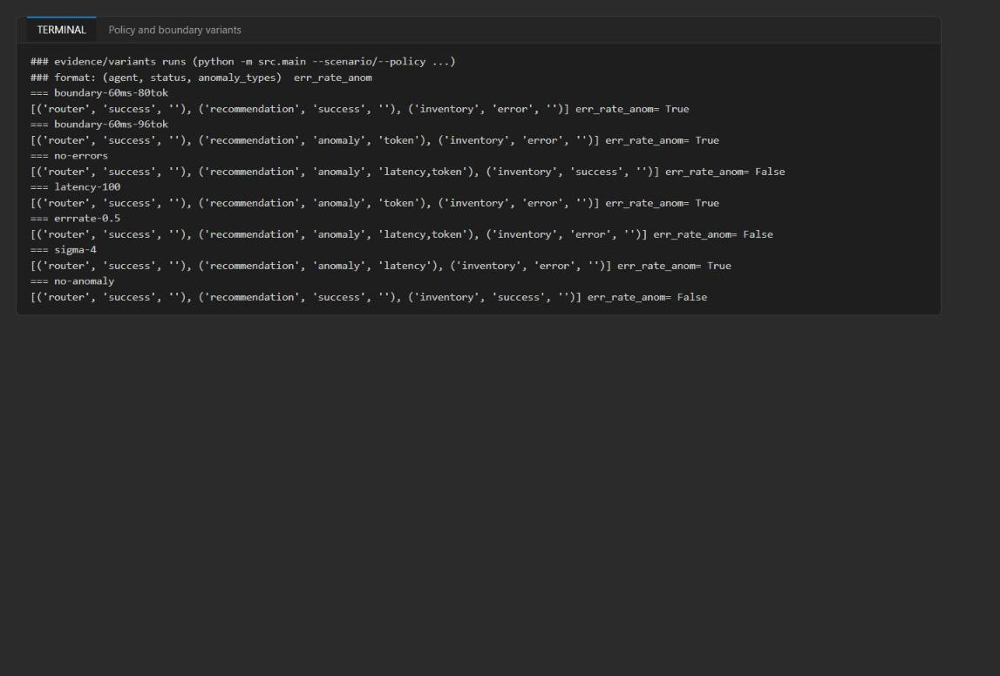

*Figure 12: Boundary and YAML variants change runtime decisions without any KQL edit*

### Inspect the alert rule and action group

1. Check the action group. `az monitor action-group show` is built into the Azure CLI:

```powershell
az monitor action-group show --ids $env:ANOMALY_ACTION_GROUP_ID `
  --query "{enabled:enabled, receivers:emailReceivers[].emailAddress, commonSchema:emailReceivers[].useCommonAlertSchema, status:emailReceivers[].status}" -o json
```

2. Check the scheduled-query rule. The official `az monitor scheduled-query show` command needs the `scheduled-query` CLI extension. The generic resource command below works without any extension:

```powershell
az resource show --ids $env:ANOMALY_ALERT_RULE_ID --api-version 2023-12-01 `
  --query "{enabled:properties.enabled, severity:properties.severity, frequency:properties.evaluationFrequency, window:properties.windowSize, scopes:properties.scopes, actions:properties.actions.actionGroups, resolve:properties.resolveConfiguration, skipQueryValidation:properties.skipQueryValidation}" -o json
```

**Expected result:** The action group is enabled with your email, `useCommonAlertSchema: true` and status `Enabled`. The rule is enabled, severity `2`, with frequency and window `PT5M`. It is scoped to the `log-aw-otel-<suffix>` workspace, linked to the action group, and auto-resolves.

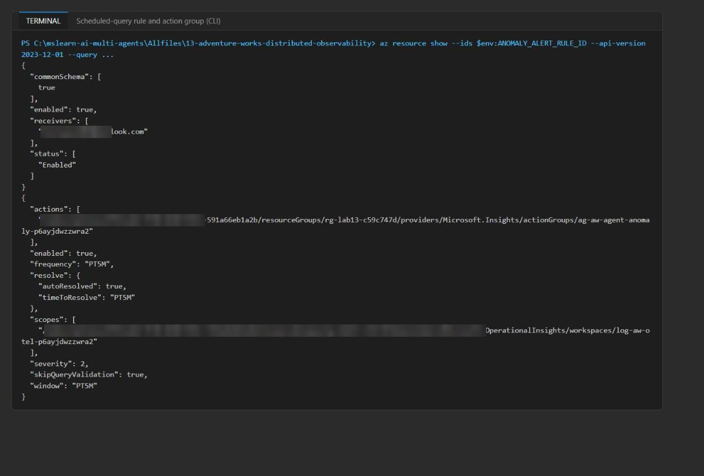

*Figure 13: Rule and action-group configuration from the CLI*

3. In the portal, open the alert rule `alert-aw-agent-policy-anomaly-<suffix>`. Confirm the scope (the workspace that stores the Application Insights telemetry), the condition (the query from `kql/anomaly-alert.kql`) and the action group.

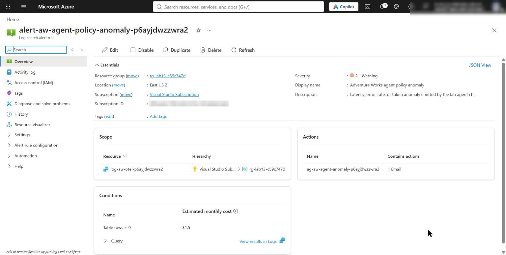

*Figure 14: Scheduled-query rule - scope, condition and action group*

### Fire and resolve the alert

1. Run the default scenario with Azure export turned on. Run it twice, about a minute apart, so that at least one run falls inside a 5-minute evaluation window:

```powershell
Enable-AzureExport
python -m src.main
```

2. Wait about 5-10 minutes (ingestion plus the next 5-minute evaluation). Then list the alerts for the rule:

```powershell
$rule = [uri]::EscapeDataString($env:ANOMALY_ALERT_RULE_ID)
az rest --method get --url "https://management.azure.com/subscriptions/$($env:AZURE_SUBSCRIPTION_ID)/providers/Microsoft.AlertsManagement/alerts?api-version=2019-05-05-preview&alertRule=$rule&timeRange=1d" `
  --query "value[].{name:name, severity:properties.essentials.severity, condition:properties.essentials.monitorCondition, started:properties.essentials.startDateTime, resolved:properties.essentials.monitorConditionResolvedDateTime, target:properties.essentials.targetResourceName}" -o table
```

**Expected result:** A **Sev2** alert named **Adventure Works agent policy anomaly** shows `monitorCondition` **Fired**. Its target is the `log-aw-otel-<suffix>` workspace.

3. In the portal, open **Monitor > Alerts**, filter **Alert rule** = `alert-aw-agent-policy-anomaly-<suffix>`, and open the alert. Its **History** tab shows that the action group `ag-aw-agent-anomaly-<suffix>` was executed. In your inbox, confirm that the notification email uses the **common alert schema** (sections such as *Essentials* and *Alert context*, a severity, the monitor condition and the affected resource).

4. Now run the healthy scenario with export turned on, so that the next evaluation windows contain no anomaly signals:

```powershell
python -m src.main --scenario evidence/variants/no-anomaly.json --output evidence/no-anomaly-azure.json
```

**Expected result:** The summary shows `"anomalies": []`, `"error_rate": 0.0` and `"error_rate_anomaly": false`.

5. Wait about 5-10 minutes for the configured 5-minute healthy period, then run the alert listing from step 15 again. The alert's `monitorCondition` changes to **Resolved** (auto-mitigated), and you receive a "Resolved" email.

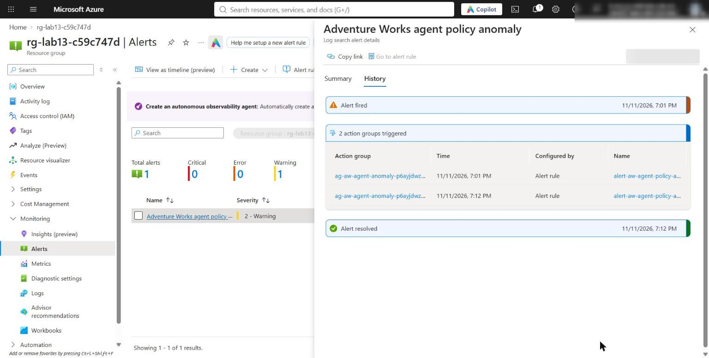

*Figure 15: Azure Monitor Alerts - the Sev2 policy anomaly alert, fired and then resolved*

6. Keep these items as live evidence: the Agents view baseline, the waterfall, the correlated property rows, the three policy decisions, the rule and action-group linkage, the fired alert, the notification email and the resolved state.

---

## Optional challenge: Add a cross-agent attribute

**Goal:** Add a synthetic `request.classification` value that travels with the trace (as W3C **baggage**, next to `traceparent`). Each agent sets it as a span attribute and a log field. The value can be selected in KQL without exposing request content.

1. In `src/telemetry.py`, replace the OpenTelemetry import line `from opentelemetry import trace` with these three lines:

```python
from opentelemetry import baggage, trace
from opentelemetry import context as otel_context
from opentelemetry.baggage.propagation import W3CBaggagePropagator
```

2. Below the line `propagator = TraceContextTextMapPropagator()`, add:

```python
# Optional challenge: synthetic request classification travels as W3C baggage.
baggage_propagator = W3CBaggagePropagator()
CLASSIFICATION_KEY = "request.classification"
```

3. Replace `build_next_carrier` so that it injects the baggage too:

```python
def build_next_carrier() -> dict[str, str]:
    """Inject the active W3C context into an outgoing carrier."""
    # LAB PLACEHOLDER 1: Replace this line with the Task 1 sample.
    carrier: dict[str, str] = {}
    propagator.inject(carrier)
    baggage_propagator.inject(carrier)  # Optional challenge
    return carrier
```

4. In `_structured_log`, add a `classification` parameter and write it to the log record. Replace the signature and the lines just before `if status == "error":` as shown below. The middle of the `record` dictionary does not change.

```python
def _structured_log(
    agent: dict[str, Any],
    session_id: str,
    status: str,
    anomaly_types: list[str],
    classification: object = None,
) -> dict[str, Any]:
```

```python
    if classification:
        record[CLASSIFICATION_KEY] = str(classification)
    if status == "error":
        record["error.type"] = "SyntheticAgentError"
    logger.info("adventureworks.agent.observation", extra=record)
    return record
```

5. In `execute_agent`, make these three edits.

a. Replace the first line `parent_context = propagator.extract(incoming_carrier)` with:

```python
    parent_context = propagator.extract(incoming_carrier)
    parent_context = baggage_propagator.extract(incoming_carrier, context=parent_context)
    classification = baggage.get_baggage(CLASSIFICATION_KEY, parent_context)
```

b. After `span.set_attribute("llm.output_tokens", agent["output_tokens"])`, add:

```python
        if classification:
            span.set_attribute(CLASSIFICATION_KEY, str(classification))
```

c. Replace the last two lines of the `with` block (`record = _structured_log(...)` and `return record, build_next_carrier()`) with:

```python
        record = _structured_log(agent, session_id, status, anomaly_types, classification)
        if classification:
            # Optional challenge: keep the baggage active (with this span) for the next hop.
            token = otel_context.attach(baggage.set_baggage(CLASSIFICATION_KEY, classification))
            try:
                return record, build_next_carrier()
            finally:
                otel_context.detach(token)
        return record, build_next_carrier()
```

> **Note:** You must re-attach the baggage. `start_as_current_span(context=parent_context)` makes only the **span** current, not the extracted baggage. Without the `attach` call, `build_next_carrier` injects no baggage, and only the router span gets the attribute.

6. In `run_chain`, directly after `carrier: dict[str, str] = {}`, seed the first carrier with the classification. You can override the value with an optional `request_classification` key in the scenario:

```python
    classification = scenario.get("request_classification", "synthetic.product_recommendation")
    baggage_propagator.inject(carrier, context=baggage.set_baggage(CLASSIFICATION_KEY, str(classification)))
```

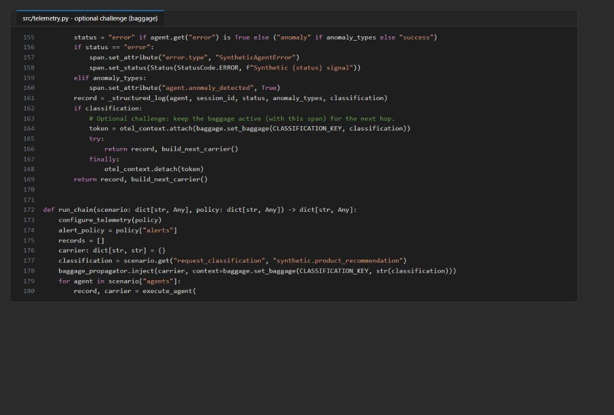

*Figure 16: execute_agent tail and run_chain with the baggage re-attach and seed*

7. Compile the code and run in console mode. Then run with export turned on:

```powershell
python -m py_compile src/telemetry.py
Disable-AzureExport
python -m src.main --output evidence/challenge-console.json
Enable-AzureExport
python -m src.main --output evidence/challenge-azure.json
```

**Expected output:** `"request.classification": "synthetic.product_recommendation"` appears on all three spans in one trace.

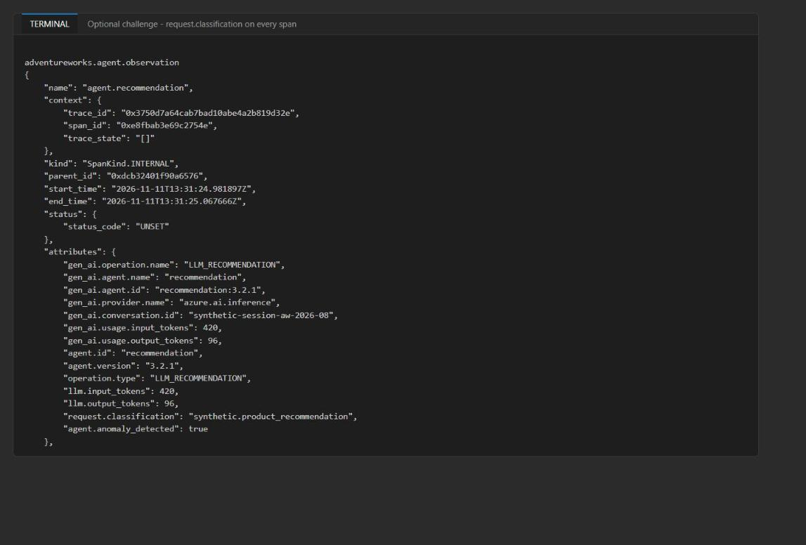

*Figure 17: request.classification carried on the recommendation span (same trace as the router)*

8. After ingestion, select the attribute in KQL:

```kql
AppDependencies
| where TimeGenerated > ago(1h)
| where isnotempty(Properties["request.classification"])
| project TimeGenerated, Name, Id, ParentId, OperationId, Classification=tostring(Properties["request.classification"])
| order by TimeGenerated asc
```

**Failure investigation:** Break context propagation at one handoff and find the first span that leaves the original trace. You don't need to edit the lab file. This scratch script (piped to Python, never saved in `src/`) drops the carrier only at the recommendation -> inventory handoff:

```powershell
$brokenHandoff = @'
import json, yaml
from src import telemetry
original = telemetry.execute_agent
def broken(agent, session_id, carrier, policy):
    if agent["name"] == "inventory":
        carrier = {}  # simulate a missing inject at this boundary
    return original(agent, session_id, carrier, policy)
telemetry.execute_agent = broken
scenario = json.load(open("assets/trace-scenario.json", encoding="utf-8"))
policy = yaml.safe_load(open("config/telemetry-policy.yaml", encoding="utf-8"))
result = telemetry.run_chain(scenario, policy)
for r in result["records"]:
    print(r["agent_id"], r["trace_id"], r["span_id"])
print("correlation_complete:", result["correlation_complete"])
'@
Disable-AzureExport
$brokenHandoff | python - 2>$null | Select-String -Pattern '^(router|recommendation|inventory) |correlation_complete'
Enable-AzureExport
```

**Expected result:** Router and recommendation share one trace ID. **Inventory** is the first span with a new trace ID (a new root), and `correlation_complete` is `False`.

> **Note:** Run the block from the lab folder. `python -` reads the script from standard input and puts the current folder on `sys.path`, so `from src import telemetry` resolves.

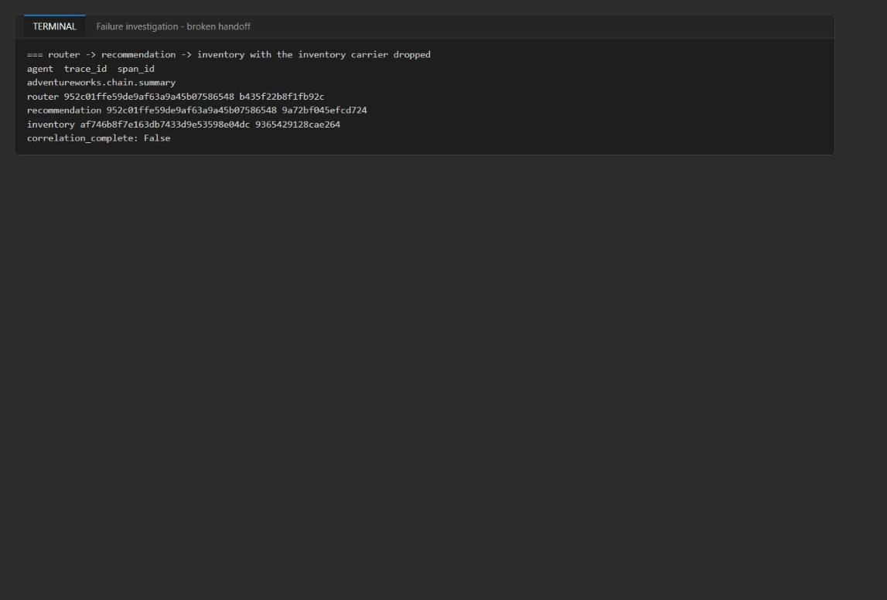

*Figure 18: Broken handoff - inventory starts a new trace*

---

## Validate

| # | Acceptance criterion | How to check (CLI) | How to check (portal) |
|---|---|---|---|
| 1 | Three spans share one 32-character trace ID and form a parent-child chain | Console run (Task 5, step 3): `parent_id` chain router -> recommendation -> inventory | Transaction search waterfall |
| 2 | Recommendation has latency (85 > 60) and token (516 > 500) anomalies, and the chain error rate is 1/3 | Summary JSON and `evidence/trace-evidence.json` | Span events in the transaction details |
| 3 | Export uses Entra auth (local auth disabled) and the waterfall is under one operation | `Transmission succeeded` lines. `DisableLocalAuth=true` | `trace-waterfall.kql` returns 3 AppDependencies plus the AppTraces rows |
| 4 | agent-health shows recommendation with the highest P95 and token anomalies, and inventory in error | `Invoke-LabKql (Get-Content kql/agent-health.kql -Raw)` | Logs |
| 5 | 60 ms / 80 tokens is not anomalous (strict greater-than) | Variant `boundary-60ms-80tok` | - |
| 6 | 96 tokens brings back the token anomaly, and latency stays clean at 60 ms | Variant `boundary-60ms-96tok` | - |
| 7 | With every error false, `error_rate_anomaly` is false | Variant `no-errors` | - |
| 8 | YAML threshold changes alter decisions with no KQL edit | Variants `latency-100`, `errrate-0.5`, `sigma-4` | - |
| 9 | Action group is enabled, uses the email receiver and the common alert schema | `az monitor action-group show` | Action group > Notifications |
| 10 | Rule is enabled, Sev2, PT5M, linked to the action group and scoped to the workspace | `az resource show --api-version 2023-12-01` | Alert rule overview |
| 11 | A Sev2 alert fires, linked to the workspace and the action group | `az rest ... AlertsManagement/alerts` | Monitor > Alerts > History |
| 12 | A no-anomaly run leads to auto-mitigation | Same listing shows `Resolved` | Alert monitor condition = Resolved |
| 13 | Notification email uses the common alert schema | - | Your inbox |

---

## Troubleshooting

| Symptom | Cause | Fix |
|---|---|---|
| `Response status: 403` / `Transmission failed` on the first Azure runs | **Monitoring Metrics Publisher** has not propagated yet. In the validated run it took about 6 minutes | Wait and run again. Failed batches are retried from the exporter's offline storage. Do not enable local-key ingestion |
| `.env` has no `APPLICATIONINSIGHTS_CONNECTION_STRING` | Some helpers (and azd setups) skip keys that end in `CONNECTION_STRING` | Add it with `az resource show --ids <APPLICATIONINSIGHTS_RESOURCE_ID> --query properties.ConnectionString -o tsv` (Task 3, step 2 note) |
| `az monitor scheduled-query show` fails with "not a valid command" / prompts for an extension | The `scheduled-query` extension is not installed | Use `az resource show --ids $env:ANOMALY_ALERT_RULE_ID --api-version 2023-12-01` (Task 6, step 12), or run `az extension add --name scheduled-query` |
| `az monitor log-analytics query` is not available | The `log-analytics` extension is not installed | Use the `Invoke-LabKql` helper (Log Analytics query REST API through `az rest`), or the portal Logs pane |
| Console run still exports to Azure | The connection string is still in the session or `.env` | Run `Disable-AzureExport`. Setting `$env:APPLICATIONINSIGHTS_CONNECTION_STRING = ''` removes the variable in PowerShell, so `load_dotenv` reloads it from `.env` |
| `json.decoder.JSONDecodeError: Unexpected UTF-8 BOM` on a variant | The file was written by Windows PowerShell 5.1 (`-Encoding utf8` adds a BOM) | Use PowerShell 7 (`pwsh`) |
| Alert rule deployment fails with "Failed to resolve table AppTraces" | Query validation on a new workspace | The template already sets `skipQueryValidation: true` with an empty fallback. Redeploy the unmodified `main.bicep` |
| `trace-waterfall.kql` returns no rows | Ingestion delay, or the placeholder was not replaced | Wait 2-5 minutes. Check that `<paste-trace-id>` was replaced with the 32-hex trace ID |
| Alert does not fire | No anomaly signal fell inside the 5-minute window, or ingestion lagged | Run the default scenario again and wait up to 10 minutes |
| No email | The action group email is wrong or went to spam | Check `az monitor action-group show` and your spam folder |
| Deployment fails on the role assignment | You lack `Microsoft.Authorization/roleAssignments/write` | Ask for Owner or User Access Administrator on the resource group |

---

## Review questions

**What breaks when context injection is omitted at one boundary?** The next agent extracts an empty carrier and starts a new root span with a new trace ID. The waterfall splits into two transactions at that hop, `correlation_complete` becomes false, OperationId-based KQL returns only part of the chain, and an alert on a downstream agent can no longer be attributed to the upstream request.

**Which structured fields are useful without exposing customer content?** These fields are useful:

- Trace and span IDs.
- `gen_ai.agent.name` and `gen_ai.agent.id`, `agent.version`, `gen_ai.operation.name` and the provider name.
- Token counts, latency, status and `error.type`.
- Anomaly flags and types, the policy ID and version, and error-rate values.
- A hashed session ID.

Raw prompts, model reasoning, customer IDs, emails and payment data are excluded (`prohibited_fields`).

**Why would errors and slow traces require collector-side tail sampling rather than head sampling?** Head sampling decides at the root span, before latency or errors are known, so a 5% ratio discards about 95% of the rare failing or slow traces. A tail-sampling collector buffers whole traces and keeps them based on their outcome (error status, duration or an anomaly attribute), while it samples healthy traffic down.

**How would you correlate simultaneous anomalies into one incident?** Group signals by trace or operation ID first (one chain = one incident), then by agent ID, version and time window. Use one scheduled-query rule for all three signals, alert processing rules or smart grouping, or dedup keys built from the trace ID plus the agent. The earliest failing span is the probable root cause.

**Why does the alert consume emitted policy decisions instead of repeating thresholds in KQL?** The policy YAML is the single source of truth. Thresholds change in one place and are versioned (`policy_id` and `policy_version` appear in the logs), and the rule stays valid without a redeploy. Thresholds duplicated in KQL drift from the runtime decision. The variants in Task 6 showed decisions changing with no KQL edit.

---

## Clean up (optional)

> **Note:** Leaving telemetry export configured keeps ingestion charges running. Delete the resources when you finish.

1. Delete the resource group:

```powershell
az group delete --name $env:AZURE_RESOURCE_GROUP --yes --no-wait
```

2. Confirm the deletion after a few minutes (the command returns `false`):

```powershell
az group exists --name $env:AZURE_RESOURCE_GROUP
```

3. Remove the local `.env` and the evidence, which contains trace IDs and resource IDs:

```powershell
Remove-Item .env, evidence -Recurse -Force
```

4. Deactivate the virtual environment in every terminal where `(.venv)` appears, and confirm that `(.venv)` is gone before you change to another lab folder:

```powershell
deactivate
```

