# Lab 14: Build a multi-agent evaluation quality gate

## Overview

**Scenario.** Adventure Works must catch regressions in its Customer Intelligence Platform before a new agent configuration reaches customers. Each agent can return a plausible answer while the complete journey still fails: the intent is not resolved, a fact is lost in a handoff, or two agents contradict each other.

**What you will build.** You are the platform engineer who owns a repeatable Microsoft Foundry evaluation run. You will:

- Complete an evaluator factory that combines component-level judges (intent resolution, task adherence, response completeness) with a journey-level judge (journey coherence).
- Run the evaluators over a privacy-safe synthetic JSONL dataset with the Azure AI Evaluation SDK `evaluate()` batch framework.
- Calibrate the journey judge against human labels.
- Apply deterministic regression thresholds (absolute minimum, maximum drop from baseline, calibration agreement) that produce an auditable release decision.
- Prove that the gate reacts to measured scores by introducing a handoff contradiction and a grounding failure.

**Duration.** About 45 minutes.

> **Note:** The evaluation runs call a deployed model and incur token charges. Use only the supplied synthetic data, check your quota before you start, and delete the resource group when you finish (Clean up).

**Architecture**

| Component | Resource / file | Purpose |
|---|---|---|
| Microsoft Foundry account | `Microsoft.CognitiveServices/accounts` (kind AIServices, S0), name `aweval<token>` | Hosts the project and the judge model; key auth disabled (Entra ID only) |
| Foundry project | `aw-evaluation` | Project endpoint used by the evaluators (Responses API client) |
| Model deployment | `gpt-5.4-mini` (GlobalStandard, version 2026-03-17) | The model judge; raised to 100K TPM in this guide to avoid HTTP 429 |
| Role assignments | Azure AI User (from Bicep), plus Cognitive Services OpenAI User and Azure AI Developer | Passwordless data-plane access for your signed-in identity |
| Dataset | `assets/evaluation-data.jsonl` | Three synthetic cases: canary, regression, historical failure, each with a human label |
| Gate configuration | `assets/evaluation-config.json` | Baseline, minimum and maximum drop per metric; minimum calibration agreement 0.67 |
| Evaluators | `src/evaluators.py` | Four Responses-based model judges |
| Runner and gate | `src/main.py` | Batch run, calibration, deterministic regression gate, report |
| Outputs | `reports/evaluation-result.json` and `reports/evaluation-result.rows.jsonl` | Release summary and row-level evidence |

## Prerequisites

- An Azure subscription where you can create a resource group, a Microsoft Foundry (AI Services) account, a model deployment and role assignments (Owner, or Contributor plus User Access Administrator).
- Quota for `gpt-5.4-mini` GlobalStandard in your region (this guide uses **100K tokens per minute**; the minimum that worked reliably).
- [Python 3.10 or later](https://www.python.org/downloads/)
- [Azure CLI](https://learn.microsoft.com/cli/azure/install-azure-cli) (includes Bicep; run `az bicep install` if `az bicep version` fails)
- [Visual Studio Code](https://code.visualstudio.com/) and [Git](https://git-scm.com/downloads)
- PowerShell 7 (the commands in this guide are PowerShell). The Azure Developer CLI (azd) is **not** required; this guide provisions with Azure CLI.

Sign in to Azure and select your subscription:

```powershell
az login
az account set --subscription "<your-subscription-id>"
az account show --output table
```

---

## Task 1: Prepare the lab

1. Clone the lab repository (skip if you already have it):

```powershell
git clone https://github.com/MicrosoftLearning/mslearn-ai-multi-agents.git
```

2. Open the cloned `mslearn-ai-multi-agents` folder in Visual Studio Code, then open a terminal (**Terminal > New Terminal**, PowerShell).

3. Change to the lab folder and verify the tools:

```powershell
cd Allfiles\14-adventure-works-evaluation-frameworks
az version
python --version
az account show --output table
```

**Expected result:** Azure CLI prints its version as JSON, Python is 3.10 or later, and the table shows the subscription you want to use.

4. Review the inputs before you continue: `assets/evaluation-data.jsonl` (three synthetic cases with `query`, `context`, `expected_behavior`, `response` and `human_label`), `assets/evaluation-config.json` (gate thresholds), `src/evaluators.py`, `src/main.py` and `infra/main.bicep`.

> **Note:** Architecture checkpoint. One dataset row must produce model-based scores from four judges, row-level reasons, a judge-versus-human calibration result, and finally a deterministic release decision. The model judge supplies quality signals; your application code owns the release decision.

---

## Task 2: Build the virtual environment

1. Create the virtual environment and install the requirements (azure-ai-evaluation, azure-ai-projects, azure-identity, openai, python-dotenv):

```powershell
./scripts/setup.ps1
. ./.venv/Scripts/Activate.ps1
```

On macOS/Linux use:

```bash
bash scripts/setup.sh
source .venv/bin/activate
```

**Expected result:** pip finishes without errors, the script prints `Activate with: . ./.venv/Scripts/Activate.ps1`, and your prompt now starts with `(.venv)`.

> **Note:** If PowerShell refuses to run the script ("running scripts is disabled on this system"), run `Set-ExecutionPolicy -Scope Process -ExecutionPolicy Bypass` in the same terminal and try again.

---

## Task 3: Deploy Azure resources

The official lab uses `azd provision`. This guide deploys the same `infra/main.bicep` with Azure CLI, which gives you clearer errors and lets you raise the model capacity in the same step. The template creates the Foundry account, the `aw-evaluation` project, the `gpt-5.4-mini` deployment and an **Azure AI User** role assignment for your user.

1. Check that your region has quota for the judge model. Look at the `gpt-5.4-mini` GlobalStandard row: `limit` minus `currentValue` must be at least 100 (100K TPM).

```powershell
az cognitiveservices usage list --location eastus2 --query "[?contains(name.value, 'gpt-5.4-mini')].{name:name.value, used:currentValue, limit:limit}" --output table
```

> **Note:** If you have less than 100K TPM free, choose another region that offers gpt-5.4-mini GlobalStandard and change `$azureRegion` below, or use the highest capacity you have (at least 50) and expect to re-run the evaluation if you see HTTP 429.

2. Make sure you are in the lab folder (`Allfiles\14-adventure-works-evaluation-frameworks`), then provision the infrastructure. The Bicep parameters are `location`, `principalId`, `modelDeploymentName`, `modelName` and `modelVersion` (see `infra/main.parameters.json`).

```powershell
$azureRegion = 'eastus2'
$suffix = (New-Guid).Guid.Substring(0, 8)
$resourceGroupName = "rg-lab14-$suffix"
$envName = "lab14-$suffix"
$modelDeployment = 'gpt-5.4-mini'
$modelVersion = '2026-03-17'
$principalId = az ad signed-in-user show --query id -o tsv

az group create --name $resourceGroupName --location $azureRegion --output none
az bicep build --file infra/main.bicep
az deployment group create --resource-group $resourceGroupName --name lab14-main `
  --template-file infra/main.bicep `
  --parameters location=$azureRegion principalId=$principalId modelDeploymentName=$modelDeployment modelName=$modelDeployment modelVersion=$modelVersion `
  --output none
```

**Expected result:** The commands finish without errors after 2-4 minutes. `az bicep build` produces no output (or only a warning about an available update).

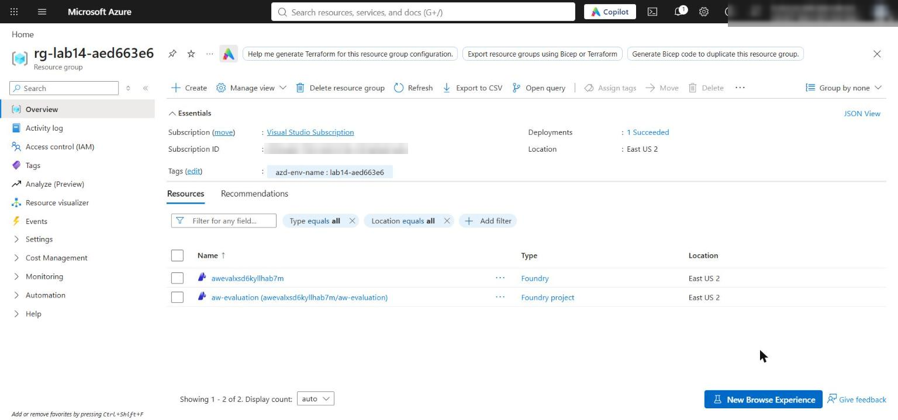

*Figure 1: The lab resource group with the Foundry account and the aw-evaluation project*

3. **Raise the model deployment capacity to 100K tokens per minute.** The Bicep template hard-codes `capacity: 10` (10K TPM) for the deployment and does not expose a capacity parameter. The evaluation runs four judges in parallel, and at 10K TPM they fail with **HTTP 429 (Too Many Requests)**. Re-create the deployment in place with a higher capacity (`deployment create` on an existing deployment updates it; there is no `deployment update` command):

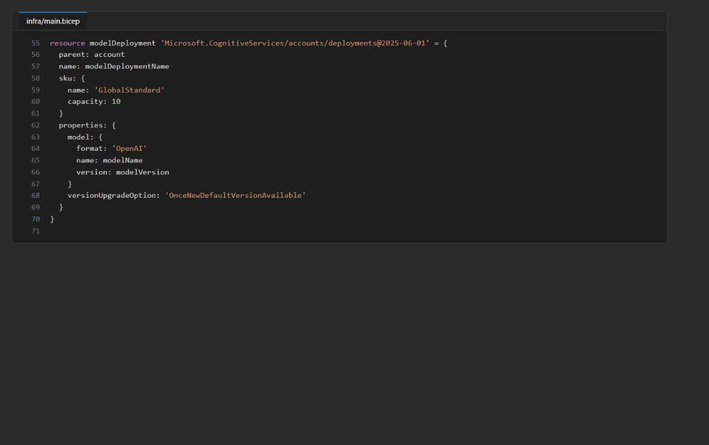

*Figure 2: infra/main.bicep - the model deployment is fixed at capacity 10 (10K TPM)*

```powershell
$accountName = az deployment group show --resource-group $resourceGroupName --name lab14-main --query properties.outputs.FOUNDRY_ACCOUNT_NAME.value -o tsv
if (-not $accountName) { $accountName = az cognitiveservices account list --resource-group $resourceGroupName --query "[0].name" -o tsv }

az cognitiveservices account deployment create `
  --resource-group $resourceGroupName --name $accountName `
  --deployment-name $modelDeployment `
  --model-name $modelDeployment --model-version $modelVersion --model-format OpenAI `
  --sku-name GlobalStandard --sku-capacity 100 `
  --output none

az cognitiveservices account deployment show --resource-group $resourceGroupName --name $accountName `
  --deployment-name $modelDeployment --query "{name:name, sku:sku.name, capacity:sku.capacity, state:properties.provisioningState}" -o table
```

**Expected result:** The table shows `gpt-5.4-mini`, `GlobalStandard`, capacity `100`, state `Succeeded`.

> **Note:** Portal alternative. In the Foundry portal (https://ai.azure.com) open your project, select **Models + endpoints**, select the **gpt-5.4-mini** deployment, select **Edit**, move **Tokens per Minute Rate Limit** to **100K**, and select **Save and close**. The new limit can take a few minutes to take effect. If you ever re-run the Bicep deployment, it resets the capacity to 10, so repeat this step.

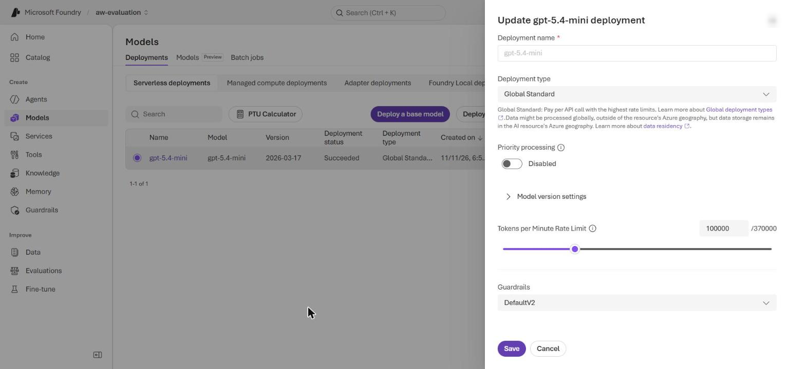

*Figure 3: Foundry portal - Edit deployment, Tokens per Minute Rate Limit set to 100K*

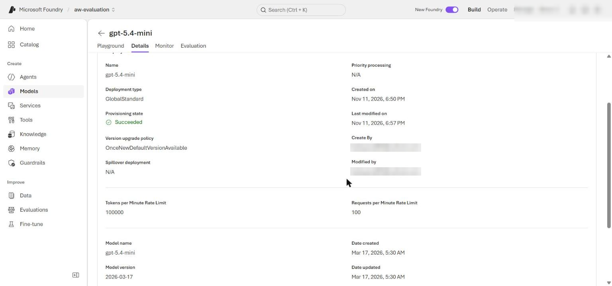

*Figure 4: Foundry portal - the gpt-5.4-mini deployment details with the 100K TPM rate limit*

4. Grant yourself the extra data-plane roles. The template only assigns **Azure AI User** on the account; the evaluator also calls the model through the project's OpenAI client, so add **Cognitive Services OpenAI User** and **Azure AI Developer** at resource-group scope:

```powershell
$me = az ad signed-in-user show --query id -o tsv
$rgId = az group show --name $resourceGroupName --query id -o tsv
foreach ($role in 'Azure AI User','Cognitive Services OpenAI User','Azure AI Developer') {
  az role assignment create --assignee-object-id $me --assignee-principal-type User --role $role --scope $rgId --output none
}
```

> **Note:** Role assignments can take 1-5 minutes to apply. If the first evaluation run returns 401 or 403 (PermissionDenied), wait a few minutes and run it again.

5. Write the `.env` file from the deployment outputs (`FOUNDRY_ACCOUNT_ENDPOINT`, `FOUNDRY_PROJECT_ENDPOINT`, `FOUNDRY_ACCOUNT_NAME`, `FOUNDRY_MODEL_NAME`, `FOUNDRY_MODEL_VERSION`) plus the environment values the official `azd` flow would export:

```powershell
$outputs = az deployment group show --resource-group $resourceGroupName --name lab14-main --query properties.outputs -o json | ConvertFrom-Json
$lines = @(
  "AZURE_RESOURCE_GROUP=`"$resourceGroupName`"",
  "AZURE_LOCATION=`"$azureRegion`"",
  "AZURE_ENV_NAME=`"$envName`"",
  "AZURE_SUBSCRIPTION_ID=`"$(az account show --query id -o tsv)`"",
  "AZURE_PRINCIPAL_ID=`"$principalId`"",
  "AZURE_PRINCIPAL_TYPE=`"User`"",
  "FOUNDRY_MODEL_CATALOG_NAME=`"$modelDeployment`""
)
$outputs.PSObject.Properties | ForEach-Object { $lines += "$($_.Name.ToUpper())=`"$($_.Value.value)`"" }
$lines | Out-File .env -Encoding utf8
Get-Content .env
```

**Expected result:** `.env` contains lines like the following (your account name and IDs differ). It contains no keys, tokens or connection strings; the code uses your signed-in identity through `DefaultAzureCredential`.

```text
AZURE_RESOURCE_GROUP="rg-lab14-<suffix>"
AZURE_LOCATION="eastus2"
FOUNDRY_ACCOUNT_ENDPOINT="https://aweval<token>.services.ai.azure.com"
FOUNDRY_PROJECT_ENDPOINT="https://aweval<token>.services.ai.azure.com/api/projects/aw-evaluation"
FOUNDRY_ACCOUNT_NAME="aweval<token>"
FOUNDRY_MODEL_NAME="gpt-5.4-mini"
FOUNDRY_MODEL_VERSION="2026-03-17"
```

---

## Task 4: Implement the solution

Each `# LAB PLACEHOLDER n` comment marks incomplete code. Replace the indicated function or block with the code below and **delete the `# LAB PLACEHOLDER` comment itself**, because `preflight.py --require-complete` fails while any marker remains.

> **Note:** The snippets in the official lab use 2-space indentation, but the source files use 4 spaces. The code below is already re-indented to 4 spaces; paste it as-is and check that it lines up with the surrounding code.

### Placeholder 1: create the evaluator set

1. Open `src/evaluators.py` and scroll to the end of the file. Find `# LAB PLACEHOLDER 1` and the stub `create_evaluators()` function below it (it returns `{}`).

2. Delete the placeholder comment and the stub function, and paste this complete function at the end of the file:

```python
def create_evaluators(
    model_config: dict[str, str], credential: TokenCredential
) -> dict[str, Any]:
    """Create Responses-based evaluators for the batch run."""
    judge_options = {
        "project_endpoint": model_config["project_endpoint"],
        "deployment_name": model_config["azure_deployment"],
        "credential": credential,
    }
    return {
        "intent_resolution": IntentResolutionEvaluator(**judge_options),
        "task_adherence": TaskAdherenceEvaluator(**judge_options),
        "response_completeness": ResponseCompletenessEvaluator(**judge_options),
        "journey_coherence": JourneyCoherenceEvaluator(**judge_options),
    }
```

This combines three component metrics with the journey-level judge, reusing the parameterized deployment and the passwordless credential.

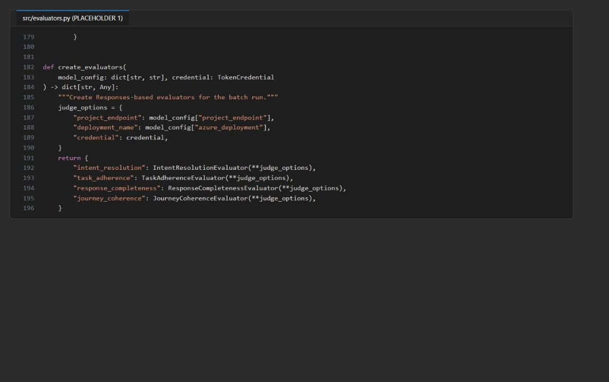

*Figure 5: src/evaluators.py - create_evaluators() completed*

> **Note:** The Foundry agent evaluators and the composite Output Quality and Tool Use Quality evaluators are preview features. This lab keeps individual evaluators because their row-level signals support the calibration exercise.

### Placeholder 2: calculate calibration agreement

1. Open `src/main.py` and find `calibration_agreement()`. Replace the whole function (including the `# LAB PLACEHOLDER 2` comment and `return 0.0`) with:

```python
def calibration_agreement(rows: list[dict[str, Any]]) -> float:
    """Return exact agreement between rounded judge scores and human labels."""
    labeled = []
    for row in rows:
        human_label = (
            row.get("human_label")
            or row.get("data.human_label")
            or row.get("inputs.human_label")
        )
        judge_score = row.get("outputs.journey_coherence.journey_coherence")
        if human_label is not None and judge_score is not None:
            labeled.append(int(human_label) == round(float(judge_score)))
    return sum(labeled) / len(labeled) if labeled else 0.0
```

Calibration keeps judge disagreement visible instead of treating the model score as ground truth.

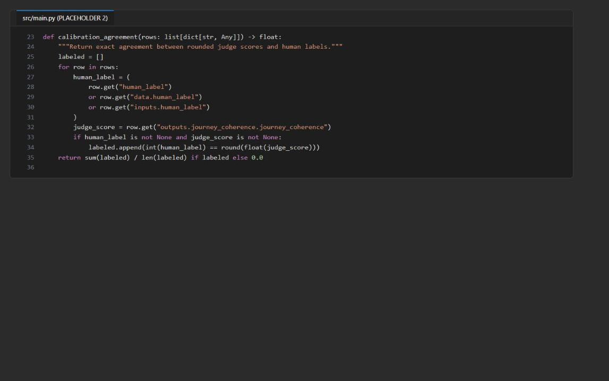

*Figure 6: src/main.py - calibration_agreement() completed*

### Placeholder 3: apply deterministic regression gates

1. In `src/main.py`, replace the whole `apply_regression_gate()` function (the `# LAB PLACEHOLDER 3` comment and the stub that returns `implementation_incomplete`) with:

```python
def apply_regression_gate(
    metrics: dict[str, float], agreement: float, config: dict[str, Any]
) -> dict[str, Any]:
    """Compare measured metrics with absolute, delta, and calibration gates."""
    comparisons = []
    failed_gates = []
    for name, policy in config["metrics"].items():
        measured = metrics.get(name)
        if measured is None:
            failed_gates.append(f"{name}: missing measured metric")
            comparisons.append({"metric": name, "status": "missing"})
            continue
        delta = measured - float(policy["baseline"])
        passed = measured >= float(policy["minimum"]) and delta >= -float(policy["maximum_drop"])
        comparisons.append({
            "metric": name,
            "measured": measured,
            "baseline": policy["baseline"],
            "delta": round(delta, 4),
            "minimum": policy["minimum"],
            "maximum_drop": policy["maximum_drop"],
            "passed": passed,
        })
        if not passed:
            failed_gates.append(name)
    if agreement < float(config["minimum_calibration_agreement"]):
        failed_gates.append("judge_calibration")
    return {
        "passed": not failed_gates,
        "failed_gates": failed_gates,
        "comparisons": comparisons,
        "calibration_agreement": agreement,
        "minimum_calibration_agreement": config["minimum_calibration_agreement"],
    }
```

The model produces semantic measurements; deterministic code owns the release decision and fails closed when a metric is missing.

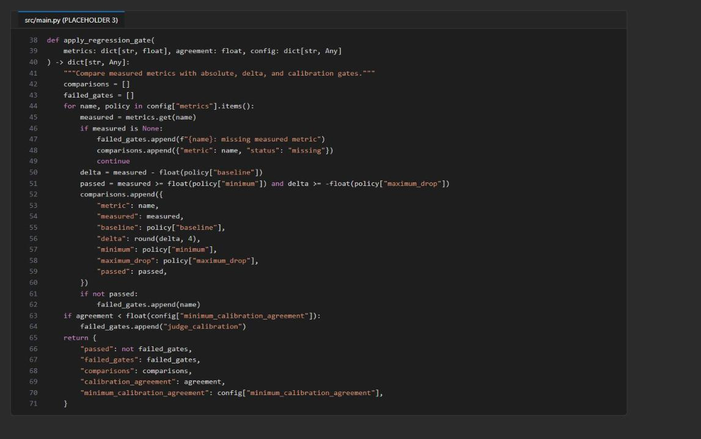

*Figure 7: src/main.py - apply_regression_gate() completed*

### Placeholder 4: run the batch evaluation

1. In the `run()` function, find `# LAB PLACEHOLDER 4`. Replace these four lines:

```python
    # LAB PLACEHOLDER 4
    evaluation = None
    if evaluation is None:
        raise NotImplementedError("Complete the batch evaluation task before running the lab.")
```

with this block (keep the following `rows = list(evaluation["rows"])` line unchanged):

```python
    evaluation = evaluate(
        data=str(data_path),
        evaluators=evaluators,
        evaluator_config={
            "intent_resolution": {
                "column_mapping": {
                    "query": "${data.query}",
                    "response": "${data.response}",
                }
            },
            "task_adherence": {
                "column_mapping": {
                    "query": "${data.query}",
                    "response": "${data.response}",
                }
            },
            "response_completeness": {
                "column_mapping": {
                    "response": "${data.response}",
                    "ground_truth": "${data.expected_behavior}",
                }
            },
            "journey_coherence": {
                "column_mapping": {
                    "query": "${data.query}",
                    "response": "${data.response}",
                    "context": "${data.context}",
                    "expected_behavior": "${data.expected_behavior}",
                }
            }
        },
        output_path=str(output_path.with_suffix(".rows.jsonl")),
    )
```

Each evaluator receives its own column mapping. Response completeness compares the response with `expected_behavior` as ground truth; the journey judge also receives the grounding `context`.

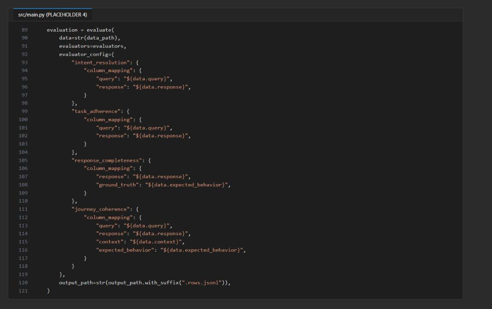

*Figure 8: src/main.py - the evaluate() batch call with per-evaluator column mappings*

### Placeholder 5: guard report generation

1. Still in `run()`, find `# LAB PLACEHOLDER 5` (just after the `report = {...}` dictionary and before `output_path.parent.mkdir(...)`). Replace the comment with:

```python
    if not rows:
        raise RuntimeError("Evaluation returned no rows; no release decision can be made.")
```

An empty evaluation must never produce a plausible-looking release recommendation.

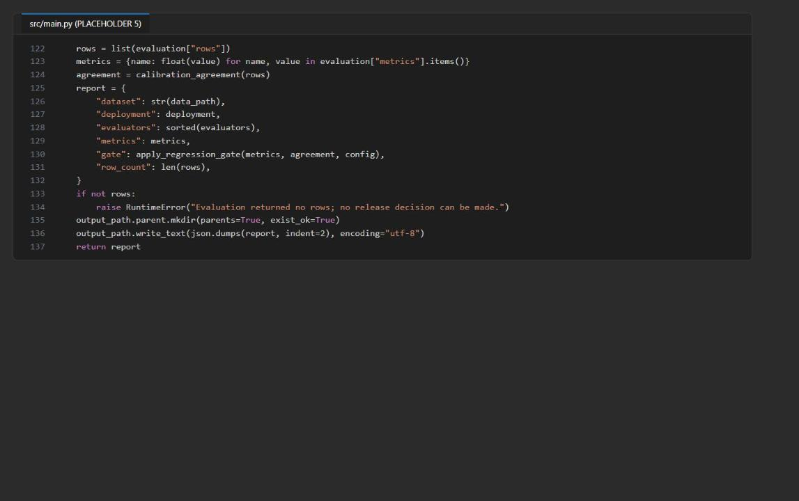

*Figure 9: src/main.py - the empty-evaluation guard before the report is written*

2. Save both files and check the code:

```powershell
python -m py_compile src/evaluators.py src/main.py
python scripts/preflight.py --require-complete
```

**Expected result:** `py_compile` prints nothing. Preflight prints seven checks, all `ready` (endpoint and deployment are ready because `.env` already exists):

```text
python_3_10_or_newer: ready
dataset_present: ready
configuration_present: ready
evaluation_sdk_installed: ready
endpoint_configured: ready
deployment_configured: ready
learner_code_complete: ready
```

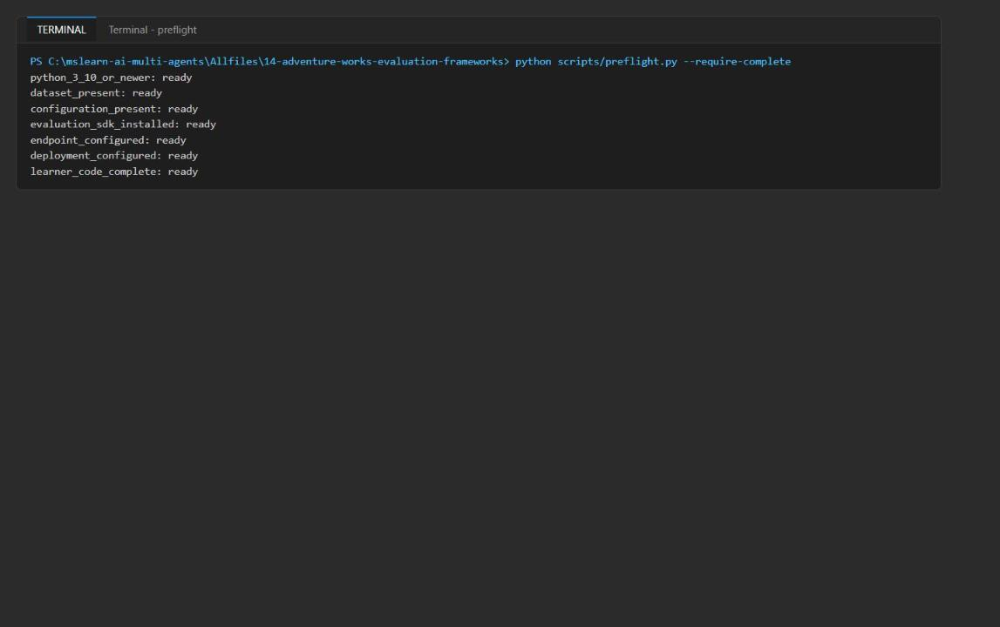

*Figure 10: preflight reports every check as ready*

> **Note:** If `learner_code_complete` is `not ready`, a `LAB PLACEHOLDER` comment is still in `src/evaluators.py` or `src/main.py`. Search for it (Ctrl+Shift+F) and delete it.

---

## Task 5: Run the solution

1. Run the batch evaluation against the live judge model:

```powershell
python -m src.main --data assets/evaluation-data.jsonl --output reports/evaluation-result.json
```

The SDK runs the four evaluators in parallel, logs `Finished n / 3 lines` progress, prints a **Combined Run Summary (Per Evaluator)**, and finally prints the release summary JSON. The run takes about 15-30 seconds.

**Expected result:** Every evaluator shows `"status": "Completed"`, `"completed_lines": 3` and `"failed_lines": 0`. If you see `failed_lines` greater than 0 or `429` in the output, see Troubleshooting.

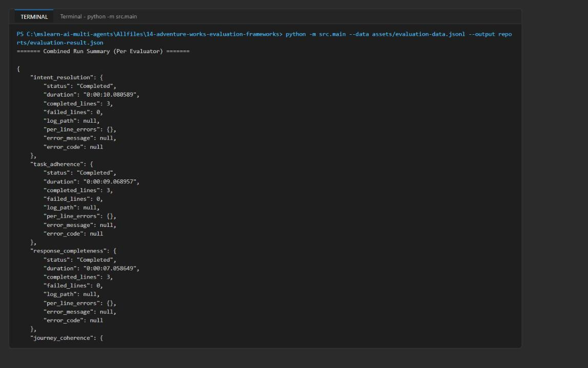

*Figure 11: Combined run summary - all four evaluators completed 3 lines with 0 failures*

2. Read the release summary at the end of the output (also saved to `reports/evaluation-result.json`):

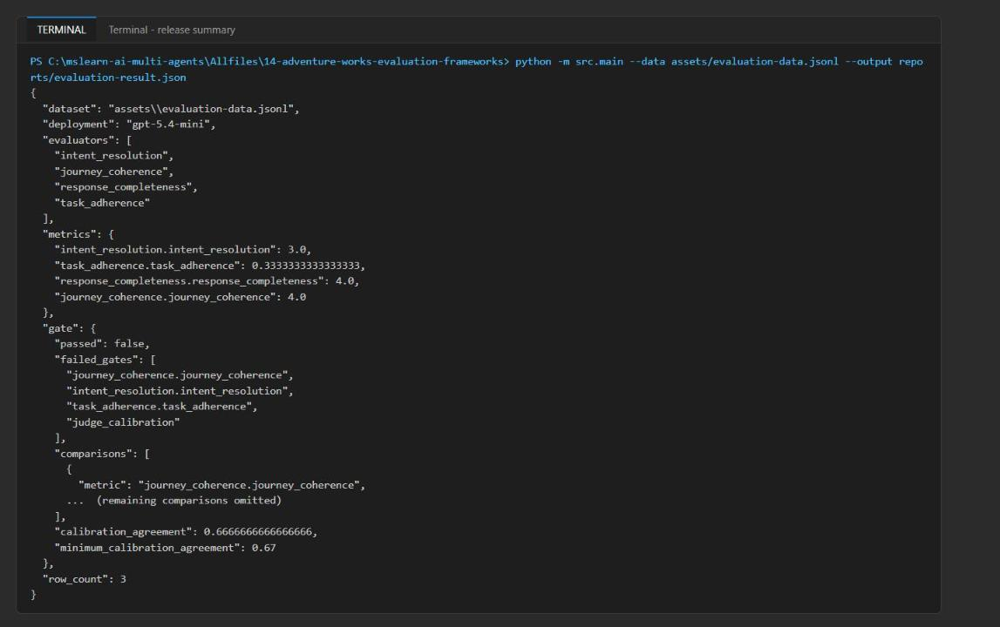

*Figure 12: The release summary - metrics, failed gates, calibration agreement and the deployment name*

**Expected result (scores vary slightly between runs):**

| Metric | Measured | Baseline | Minimum | Max drop | Passed |
|---|---|---|---|---|---|
| journey_coherence | 4.0 | 4.4 | 4.0 | 0.3 | No (delta -0.4) |
| intent_resolution | 3.0 | 4.5 | 4.0 | 0.3 | No |
| task_adherence | 0.333 | 1.0 | 0.67 | 0.33 | No |
| response_completeness | 4.0 | 4.2 | 3.8 | 0.4 | Yes |
| judge calibration | 0.667 | - | 0.67 | - | No |

`gate.passed` is `false`. This is the **correct** outcome: the supplied dataset deliberately contains a failing handoff (regression-handoff-002), so the gate must block release.

**Understand the output**

- `reports/evaluation-result.rows.jsonl` holds the row-level evidence: for every case, the inputs plus each evaluator's score and `_reason`. (The SDK writes this as a single JSON document with `rows`, `metrics` and `studio_url`, not as line-delimited JSONL, despite the file extension.)
- `reports/evaluation-result.json` is the release summary: `metrics` holds the aggregates, `gate.comparisons` shows each measured value against its absolute and delta thresholds, `gate.calibration_agreement` compares the journey judge with the human labels, and `gate.passed` is true only when `failed_gates` is empty.
- `deployment` is the deployment name read from `.env`, not a hard-coded model.

---

## Task 6: Validate the implementation

### Inspect the evaluation evidence

1. Open `reports/evaluation-result.json` and confirm it contains the dataset path, the four evaluator names, the aggregate scores, the calibration agreement, the threshold comparisons, `failed_gates` and `deployment`.

2. Print the per-row scores and the journey judge's reasons:

```powershell
python -c "import json; d=json.load(open('reports/evaluation-result.rows.jsonl', encoding='utf-8')); [print(r['inputs.case_id'], r['inputs.human_label'], [r[f'outputs.{m}.{m}'] for m in ('intent_resolution','task_adherence','response_completeness','journey_coherence')], '\n  ', r['outputs.journey_coherence.journey_coherence_reason']) for r in d['rows']]"
```

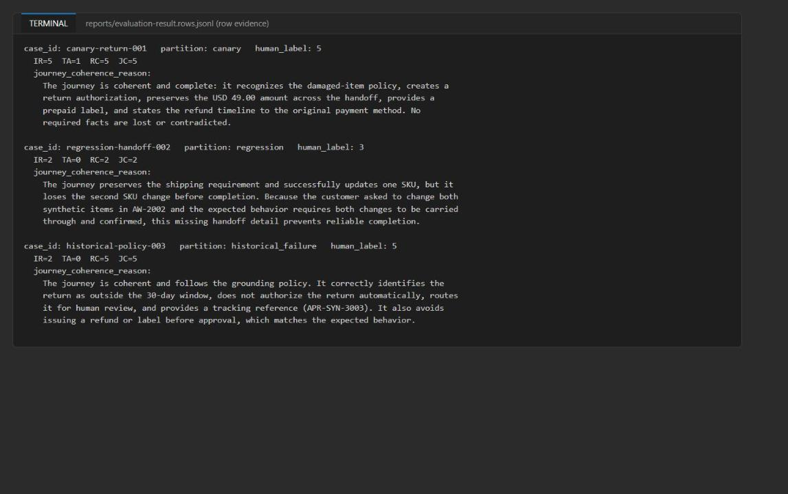

*Figure 13: Row-level evidence - scores and journey judge reasons for the three cases*

3. Classify each low-scoring row:

- **regression-handoff-002 (IR 2 / TA 0 / RC 2 / JC 2, human 3): handoff-level failure.** Inventory confirmed both SKUs, but the order agent only applied SKU-SYN-A. The fact was lost between agents.
- **historical-policy-003 (IR 2 / TA 0 / RC 5 / JC 5, human 5): component-level judge artefact.** Intent resolution and task adherence only see the query "return my order" and penalise the correct, policy-required escalation to a human. The context-aware judges (RC, JC) score it 5. This is why aggregate `task_adherence` fails even on the shipped data.
- **canary-return-001 (5 / 1 / 5 / 5): passes** the journey judge; the component judges are stricter.

### Test the regression gate with a handoff contradiction

1. Create a copy of the dataset in which the returns agent contradicts the earlier policy-agent handoff in the canary case (the original dataset stays unchanged):

```powershell
@'
import json
from pathlib import Path
rows = [json.loads(line) for line in Path("assets/evaluation-data.jsonl").read_text(encoding="utf-8").splitlines() if line.strip()]
rows[0]["response"] = (
    "The intake agent identifies a damaged-item return. The policy agent confirms eligibility under policy v5 "
    "for a USD 49.00 refund to the original payment method. The returns agent then states the order is not "
    "eligible for a return, issues no label, and offers USD 25.00 store credit instead."
)
Path("assets/evaluation-data-contradiction.jsonl").write_text("\n".join(json.dumps(r) for r in rows), encoding="utf-8")
print("wrote assets/evaluation-data-contradiction.jsonl")
'@ | python -
```

2. Re-run the evaluation on the modified dataset:

```powershell
python -m src.main --data assets/evaluation-data-contradiction.jsonl --output reports/evaluation-result-contradiction.json
```

**Expected result:** The canary row drops from 5/1/5/5 to about **1/0/1/1**. The aggregates fall (IR about 1.67, TA 0.0, RC about 2.67, JC 3.0), `response_completeness` now fails too, and `failed_gates` lists all four metrics plus `judge_calibration`. The gate changed because the measured scores changed; no scenario label is used.

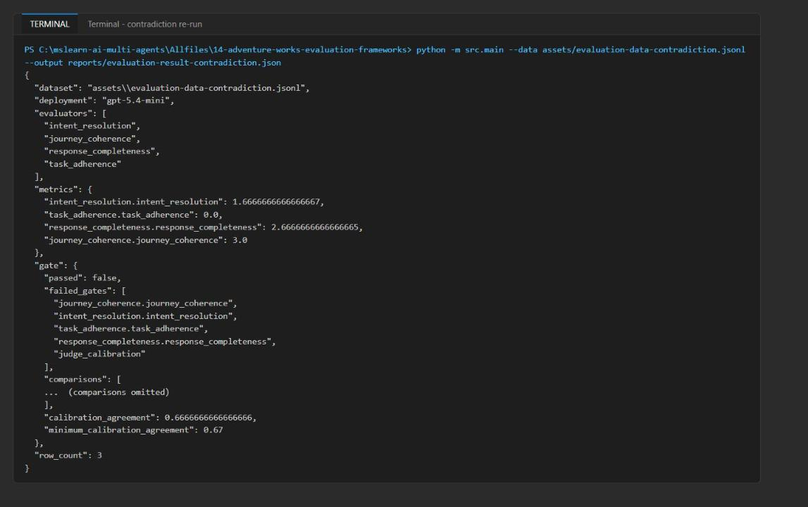

*Figure 14: Contradiction re-run - lower aggregates and all four metric gates failed*

### Optional challenge: add a grounding failure

1. Create a dataset with a fourth case that "completes" the return but contradicts the grounding evidence (wrong amount, customer pays shipping, gift card under an outdated policy). Its human label is 1:

```powershell
@'
import json
from pathlib import Path
rows = [json.loads(line) for line in Path("assets/evaluation-data.jsonl").read_text(encoding="utf-8").splitlines() if line.strip()]
rows.append({
    "case_id": "challenge-grounding-004",
    "partition": "historical_failure",
    "interaction_type": "return",
    "query": "My synthetic order AW-4004 arrived damaged. Start a return.",
    "context": "Synthetic policy v5: damaged items delivered within 30 days qualify for a prepaid return and refund to the original payment method. AW-4004 was delivered 12 days ago for USD 120.00.",
    "expected_behavior": "Create a return authorization for USD 120.00, provide a prepaid label, and refund to the original payment method.",
    "response": "The intake agent identifies a damaged-item return. The returns agent creates RA-SYN-4004 for USD 210.00, asks the customer to pay for return shipping, and states the refund will be issued as a gift card under policy v3.",
    "human_label": 1,
})
Path("assets/evaluation-data-grounding-challenge.jsonl").write_text("\n".join(json.dumps(r) for r in rows), encoding="utf-8")
print("wrote assets/evaluation-data-grounding-challenge.jsonl")
'@ | python -
python -m src.main --data assets/evaluation-data-grounding-challenge.jsonl --output reports/evaluation-result-grounding-challenge.json
```

**Expected result:** `row_count` is 4. The new row scores about IR 3 / TA 0 / RC 1 / JC 1, and the judge's reason names each contradiction with the grounding (USD 210 vs 120, paid shipping, gift card). The aggregates drop (RC 3.0, JC 3.5) and the gate blocks release on all four metrics.

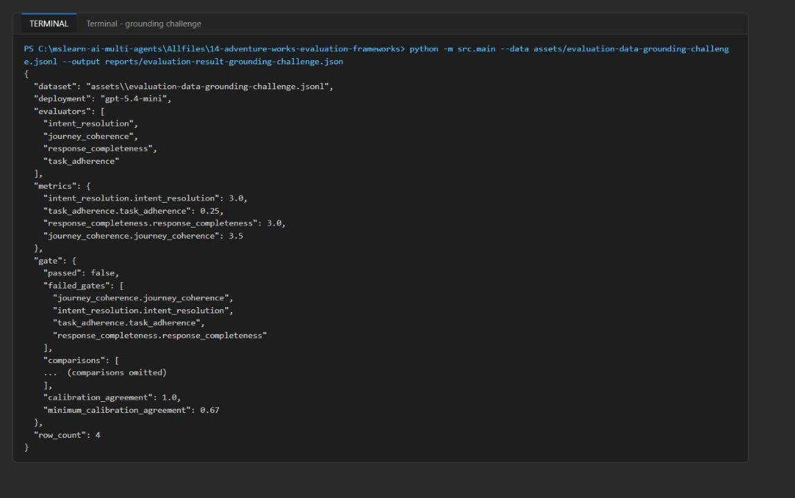

*Figure 15: Grounding challenge - four rows, all metric gates failed*

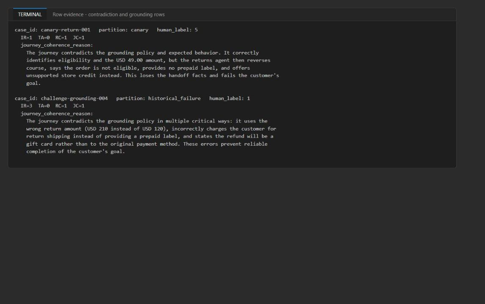

*Figure 16: The judge's reasons for the contradiction row and the grounding-failure row*

2. Distinguish calibration failure from task-result failure. In the baseline run the journey judge scored regression-handoff-002 as 2 while the human label is 3, so agreement was 2/3 = 0.667 < 0.67 and `judge_calibration` failed (a **calibration** failure: the judge and humans disagree). In the challenge run the judge may score that row 3; agreement then rises to 1.0 and `judge_calibration` passes, while the four metric gates still fail (a **task-result** failure). Judge scores vary between runs, which is exactly why calibration is tracked separately.

### Validate the Azure resources

1. Confirm the account, project and deployment from the CLI:

```powershell
az resource list --resource-group $resourceGroupName --query "[].{name:name, type:type}" -o table
az cognitiveservices account show --resource-group $resourceGroupName --name $accountName --query "{name:name, kind:kind, sku:sku.name, state:properties.provisioningState}" -o table
az cognitiveservices account deployment list --resource-group $resourceGroupName --name $accountName --query "[].{name:name, sku:sku.name, capacity:sku.capacity, model:properties.model.version}" -o table
```

**Expected result:** The account (`aweval<token>`, AIServices, S0, Succeeded), the project (`aweval<token>/aw-evaluation`) and the deployment (`gpt-5.4-mini`, GlobalStandard, capacity 100, version 2026-03-17).

2. In the Azure portal, open the resource group, select the Foundry account, and confirm it is **Succeeded**. Then select **Go to Foundry portal** and confirm the `aw-evaluation` project and the `gpt-5.4-mini` deployment under **Models + endpoints**.

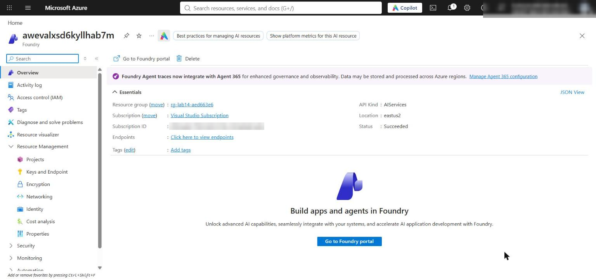

*Figure 17: Azure portal - the Foundry account overview*

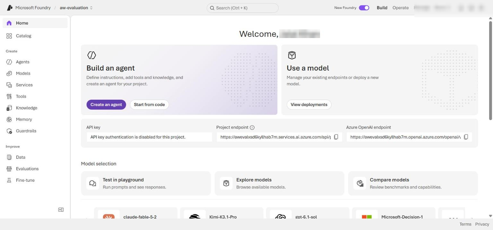

*Figure 18: Foundry portal - the aw-evaluation project overview*

---

## Task 7: Review the design

Answer the review questions in the **Review questions** section at the end of this guide. Use your row-level evidence from Task 6 to support each answer.

---

## Task 8: Clean up

See the **Clean up** section at the end of this guide. Keep only the synthetic local reports your instructor requires, and deactivate the virtual environment in every terminal that shows `(.venv)`:

```powershell
deactivate
```

---

## Validate

| Objective | Required evidence | How to check | Passing outcome |
|---|---|---|---|
| Define component, journey and system metrics | `evaluators` and `gate.comparisons` in `reports/evaluation-result.json` | Open the file; count four evaluator names and four comparisons | All configured metrics appear with measured, baseline, delta, minimum and maximum_drop; a missing metric adds `<name>: missing measured metric` to `failed_gates` |
| Run Responses-based evaluators through the SDK batch framework | `reports/evaluation-result.rows.jsonl` and the run summary | Run the row-printing command in Task 6 step 2 | Every row has all four scores and `_reason` fields; `failed_lines` is 0 for every evaluator |
| Use synthetic coverage cases | `partition` values in the dataset | Rows are canary, regression, historical_failure | Only supplied or your own synthetic cases are present |
| Produce an auditable recommendation | `gate`, `calibration_agreement`, `deployment` | Read `gate.passed`, `failed_gates` and `deployment` | Recommendation follows the measured thresholds and names `gpt-5.4-mini` |
| Regression gate uses measured results | `reports/evaluation-result-contradiction.json` | Compare with the baseline report | Canary row falls to about 1; scores and failed gates change |
| Optional: grounding failure blocks release | `reports/evaluation-result-grounding-challenge.json` | Check the new row and `failed_gates` | New row RC=1, JC=1; gate blocked |
| Azure resources | Account, project, deployment | Task 6 steps 8-9 (CLI and portal) | All Succeeded; deployment capacity 100 |

## Troubleshooting

| Symptom | Cause | Fix |
|---|---|---|
| `429 Too Many Requests` / `RateLimitReached` in the log, or `failed_lines` > 0 in the run summary | The Bicep template deploys the model with only 10K TPM, and four judges run in parallel | Raise the deployment to 100K TPM (Task 3 step 3): `az cognitiveservices account deployment create ... --sku-name GlobalStandard --sku-capacity 100`, or Foundry portal > Models + endpoints > gpt-5.4-mini > Edit > Tokens per Minute Rate Limit > 100K. Wait a few minutes for the new limit to apply, then re-run until the summary shows 0 failed lines |
| `ValueError: cannot convert float NaN to integer` from `calibration_agreement()` | A judge call failed (usually a 429), so that row's journey score is NaN and `round(float(nan))` raises | The run fails closed, which is acceptable for a gate. Fix the 429 (above) and re-run. Optional hardening: skip NaN scores (`math.isnan`) and record them as missing |
| Capacity is back to 10 after re-deploying | Re-running `az deployment group create` applies the hard-coded `capacity: 10` again | Repeat Task 3 step 3 after every Bicep deployment |
| `InsufficientQuota` when raising capacity | Your subscription has less than 100K TPM free for gpt-5.4-mini GlobalStandard in the region | Use `az cognitiveservices usage list` (Task 3 step 1) to find a region with quota, or set the highest capacity available (at least 50) |
| `learner_code_complete: not ready` | A `# LAB PLACEHOLDER` comment is still in `src/` | Delete the remaining marker comments |
| `IndentationError` after pasting | The official snippets use 2-space indentation | Use the 4-space code in this guide |
| `401`/`403` or `PermissionDenied` | Role assignments not yet active, or missing roles | Wait 1-5 minutes after Task 3 step 4; confirm Azure AI User, Cognitive Services OpenAI User and Azure AI Developer on the resource group |
| `KeyError: 'FOUNDRY_ACCOUNT_ENDPOINT'` | `.env` missing or written from another folder | Run Task 3 step 5 from the lab folder and check `Get-Content .env` |
| `DefaultAzureCredential failed to retrieve a token` | Not signed in to Azure CLI in this terminal | Run `az login` and `az account set --subscription <id>` |
| Scores differ from this guide | Model judges are non-deterministic | Expect small differences; the gate logic and the direction of change are what matter |

## Review questions

1. **Which system-level metric would expose a successful agent response followed by a failed handoff?**

`journey_coherence`, the journey-level judge. It scores the whole multi-agent trace against the grounding context and expected behavior, so a fluent final answer that dropped a fact in a handoff (regression-handoff-002, where SKU-SYN-B is never confirmed) scores low even when a component metric stays high. `response_completeness` against `expected_behavior` is the supporting signal.

2. **What calibration sample size would you require before a judge can block production?**

Three labelled rows only demonstrate the mechanism. Require at least about 100 human-labelled rows, stratified across partitions and score levels (including several 1-2 failures), with two raters and measured inter-rater agreement. Report agreement with a confidence interval whose lower bound exceeds the 0.67 threshold, and recalibrate whenever the judge model, prompt or rubric changes.

3. **Which cases belong in canary, regression and historical-failure partitions?**

Canary: small, stable, high-traffic happy paths (a damaged-item return within policy) that must always pass, run on every change as a smoke test. Regression: targeted cases for previously fixed or fragile behavior, such as multi-item handoffs and preserving amounts or shipping options across agents. Historical failure: anonymised synthetic reproductions of real incidents, such as out-of-window returns that must route to human approval, and grounding contradictions.

## Clean up (optional)

Delete the resource group when you are finished. The 100K TPM deployment is billed per token, but deleting it avoids accidental charges and frees your quota:

```powershell
az group delete --name $resourceGroupName --yes --no-wait
```

The Foundry account is soft-deleted. To release its name and quota immediately, purge it after the resource group deletion finishes:

```powershell
az cognitiveservices account purge --location $azureRegion --resource-group $resourceGroupName --name $accountName
```

Confirm the resource group is gone (this returns `false` when deletion is complete):

```powershell
az group exists --name $resourceGroupName
```

Finally, run `deactivate` in every terminal that shows `(.venv)`.

