# Lab 15: Optimize multi-agent performance and cost with measured evidence

## Overview

**Scenario.** Adventure Works routes every Customer Intelligence Platform request to its premium model and repeatedly sends oversized context. The platform team needs evidence that a cheaper design still meets each customer segment's quality, latency, and budget envelope.

**What you'll build.** You will run three synthetic customer-service requests against a live Microsoft Foundry model deployment and capture the real latency and token usage of every call. Then you will implement four optimizations and compare a premium control run with the optimized policy:

- Deterministic model-tier routing (no model tokens spent on classification).
- A priority-based context budget that never silently drops a required fact.
- Versioned exact-result cache keys and prompt-context cache keys in Azure Managed Redis.
- Quality-floor escalation, with human review when tier 3 is still below its floor.

**Duration.** About 45-60 minutes (Azure Managed Redis provisioning alone takes 10-20 minutes).

> **Important:** Live model calls and Azure Managed Redis are billable. Managed Redis (Balanced_B0) is charged per hour for as long as it exists. Run only the three supplied synthetic requests, and do the Clean up section as soon as you finish.

**Architecture**

| Component | Azure resource | Purpose |
|---|---|---|
| Foundry account | `Microsoft.CognitiveServices/accounts` (kind AIServices, local auth disabled) | Hosts the project and the model deployment |
| Foundry project | `aw-optimization` | Endpoint used by `AIProjectClient` |
| Model deployment | `gpt-5.4-mini`, version 2026-03-17, GlobalStandard, capacity 10 | Used for tier 1, tier 2 and tier 3 (`TIER1_DEPLOYMENT`, `TIER2_DEPLOYMENT`, `TIER3_DEPLOYMENT`) |
| Azure Managed Redis | `Microsoft.Cache/redisEnterprise`, SKU Balanced_B0 | Distributed exact-result and prompt-context cache |
| Redis database | `default` on port 10000, TLS, access keys disabled | Cache store; authentication uses a Microsoft Entra token |
| Redis access policy assignment | `default` policy for your user object ID | Lets your signed-in identity read and write the cache without keys |
| Role assignment | Azure AI User on the Foundry account (plus extra roles you add in Task 3) | Data-plane access to the model |

**Request path.** Every request goes through: tier classification, then context budgeting, then exact-result cache lookup, then model call (or cache return), then quality-floor evaluation and escalation, and finally an evidence row in `reports/evidence.jsonl`.

## Prerequisites

- An Azure subscription where you can create resource groups, Foundry (Cognitive Services) accounts, Azure Managed Redis, and role assignments (Owner, or Contributor plus User Access Administrator).
- Quota for `gpt-5.4-mini` GlobalStandard (at least 10K TPM) in **West US 3**.
- [Python 3.10 or later](https://www.python.org/downloads/)
- [Azure CLI](https://learn.microsoft.com/cli/azure/install-azure-cli) with [Bicep](https://learn.microsoft.com/azure/azure-resource-manager/bicep/install) (`az bicep install`)
- [Azure Developer CLI](https://learn.microsoft.com/azure/developer/azure-developer-cli/install-azd) (the official lab checks it; this guide provisions with Azure CLI instead)
- [Git](https://git-scm.com/downloads) and [Visual Studio Code](https://code.visualstudio.com/)

Sign in to Azure and select the subscription you will use:

```powershell
az login
az account set --subscription "<your-subscription-id>"
az account show --output table
```

---

## Task 1: Prepare the lab

1. Clone the lab repository (skip this if you already have it):

```powershell
git clone https://github.com/MicrosoftLearning/mslearn-ai-multi-agents.git
```

2. Open the cloned `mslearn-ai-multi-agents` folder in Visual Studio Code, then open a PowerShell terminal (**Terminal > New Terminal**).

3. Change to the lab folder and verify the tools and your sign-in:

```powershell
cd Allfiles\15-adventure-works-performance-cost
az version
azd version
python --version
az account show --output table
```

**Expected result:** each command prints a version, Python is 3.10 or later, and the table shows the subscription you selected.

4. Architecture checkpoint. Open and review these files: `assets/requests.jsonl`, `assets/optimization-config.json`, `src/main.py`, `src/cache.py`, `.env.example` and `infra/main.bicep`. Note the following:

- `assets/requests.jsonl` holds three synthetic requests: `SYN-LOOKUP-001` (order lookup, 2 dependencies, contains `unused_fields`), `SYN-COMPARE-002` (compare two bikes) and `SYN-EXCEPTION-003` (USD 850 return-policy exception, gold segment).
- `assets/optimization-config.json` sets per-tier input budgets (1200, 3000, 6000 tokens), quality floors (75, 85, 90) and the versioned price `verified-2026-10-01-global-standard` ($0.75 input / $4.50 output per 1M tokens).
- In `src/main.py`, `run()` follows the path: `classify_tier()` -> `apply_context_budget()` -> `cache.get()` -> `invoke()` or cache return -> `evaluate_quality()` and escalation -> evidence row.

---

## Task 2: Build the virtual environment

1. In the lab folder, create the virtual environment and install the requirements:

```powershell
./scripts/setup.ps1
```

2. Activate it:

```powershell
. ./.venv/Scripts/Activate.ps1
```

**Expected result:** the prompt starts with `(.venv)`.

> **Note:** On macOS/Linux run `bash scripts/setup.sh` and `source .venv/bin/activate` instead. The official lab also copies `.env.example` to `.env`; you can skip that, because Task 3 writes a complete `.env` from the deployment outputs and overwrites it anyway.

> **Note:** If PowerShell blocks the script with "running scripts is disabled on this system", run `Set-ExecutionPolicy -Scope Process -ExecutionPolicy Bypass` in the same terminal and try again.

---

## Task 3: Deploy Azure resources

This guide provisions with Azure CLI (`az deployment group create`) instead of `azd provision`. The Bicep template is the same.

> **Important: use West US 3.** In the reference run, the deployment in `eastus2` failed: Azure Managed Redis (`Microsoft.Cache/redisEnterprise`, Balanced_B0) failed to create twice with a generic `OperationFailed` error (the cluster was left in `CreateFailed` state), while the Foundry account succeeded. This is a Managed Redis capacity/availability problem in that region. The lab was redeployed in `westus3`, where every resource succeeded. `gpt-5.4-mini` version `2026-03-17` with the GlobalStandard SKU (the SKU the template uses) is available in `westus3`.

1. (Optional) Confirm that the model and version are available in West US 3 and check your quota:

```powershell
az cognitiveservices model list --location westus3 --query "[?model.name=='gpt-5.4-mini'].{version:model.version,skus:join(',', model.skus[].name)}" -o table
az cognitiveservices usage list --location westus3 --query "[?contains(name.value,'gpt-5.4-mini')].{name:name.value,used:currentValue,limit:limit}" -o table
```

**Expected result:** version `2026-03-17` is listed with `GlobalStandard` among its SKUs, and your GlobalStandard limit for `gpt-5.4-mini` leaves at least 10 units free.

2. Review the parameters in `infra/main.parameters.json`: `location`, `principalId`, `modelDeploymentName`, `modelName` and `modelVersion`. The template requires `principalId` (your user object ID), because it creates the Redis access policy assignment and the Azure AI User role assignment for you.

3. From the lab folder (with `(.venv)` active), run the provisioning block. It creates a unique resource group, deploys the template, grants your user the extra data-plane roles, and writes `.env` from the deployment outputs:

```powershell
$azureRegion = 'westus3'   # Managed Redis failed to deploy in eastus2; westus3 works
$suffix = (New-Guid).Guid.Substring(0, 8)
$resourceGroupName = "rg-lab15-$suffix"
$envName = "lab15-$suffix"
$principalId = az ad signed-in-user show --query id -o tsv
az group create --name $resourceGroupName --location $azureRegion --output none
az bicep build --file infra/main.bicep
az deployment group create --resource-group $resourceGroupName --name lab15-main `
  --template-file infra/main.bicep `
  --parameters location=$azureRegion principalId=$principalId modelDeploymentName=gpt-5.4-mini modelName=gpt-5.4-mini modelVersion=2026-03-17 `
  --output none
# Grant yourself data-plane access (model calls through the Foundry project)
$rgId = az group show --name $resourceGroupName --query id -o tsv
foreach ($role in 'Azure AI User','Cognitive Services OpenAI User','Azure AI Developer') {
  az role assignment create --assignee-object-id $principalId --assignee-principal-type User --role $role --scope $rgId --output none
}
# Write .env from the deployment outputs (no keys or connection strings)
$outputs = az deployment group show --resource-group $resourceGroupName --name lab15-main --query properties.outputs -o json | ConvertFrom-Json
$lines = @("AZURE_RESOURCE_GROUP=`"$resourceGroupName`"", "AZURE_LOCATION=`"$azureRegion`"", "AZURE_ENV_NAME=`"$envName`"",
  "AZURE_SUBSCRIPTION_ID=`"$(az account show --query id -o tsv)`"",
  "AZURE_PRINCIPAL_ID=`"$principalId`"", "AZURE_PRINCIPAL_TYPE=`"User`"",
  "FOUNDRY_MODEL_NAME=`"gpt-5.4-mini`"", "FOUNDRY_MODEL_CATALOG_NAME=`"gpt-5.4-mini`"", "FOUNDRY_MODEL_VERSION=`"2026-03-17`"")
$outputs.PSObject.Properties | ForEach-Object { $lines += "$($_.Name.ToUpper())=`"$($_.Value.value)`"" }
$lines | Out-File .env -Encoding utf8
Get-Content .env
```

> **Note:** The deployment usually takes 10-20 minutes because of Azure Managed Redis. Wait for the command to return. If it fails, see **Troubleshooting** (Managed Redis `OperationFailed`).

> **Note:** `AZURE_PRINCIPAL_ID` is not a template output, so the block adds it explicitly. `src/main.py` uses it as the Redis user name, and `scripts/preflight.py` checks it. The official lab's `AZURE_DEV_USER_AGENT` variable only applies to `azd`, so you don't need it here.

> **Note:** Role assignments can take 1-5 minutes to apply. The Redis access policy assignment can also take a few minutes after the deployment finishes. Wait before running Task 5.

**Expected result:** `.env` contains `FOUNDRY_PROJECT_ENDPOINT` (ending in `/api/projects/aw-optimization`), `REDIS_HOST` (`<cache-name>.westus3.redis.azure.net`), `REDIS_PORT=10000`, `TIER1_DEPLOYMENT`, `TIER2_DEPLOYMENT` and `TIER3_DEPLOYMENT` (all `gpt-5.4-mini`), and `AZURE_PRINCIPAL_ID`. It contains no keys, tokens or connection strings, because Redis authentication uses an Entra token obtained at runtime.

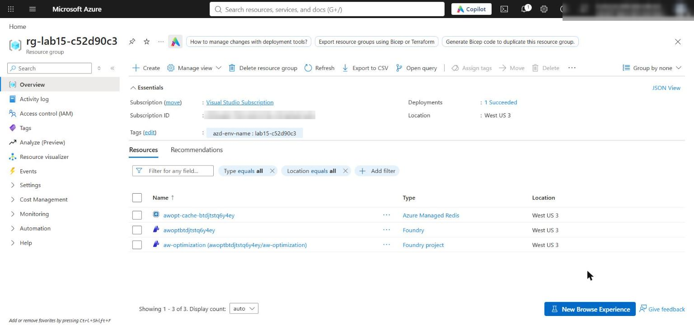

*Figure 1: The lab resource group in West US 3 with the Foundry account, project and Azure Managed Redis cluster*

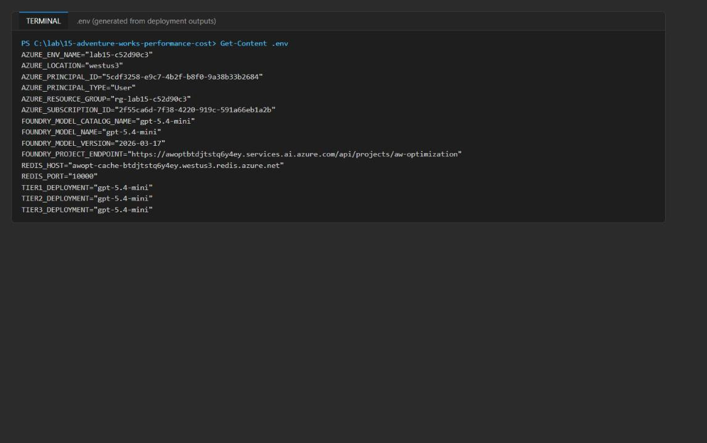

*Figure 2: The generated .env file (endpoint, Redis host and port, three tier deployments, principal ID; no secrets)*

4. (Optional) If you open a new terminal later, set the resource group variable again so the later commands work:

```powershell
$resourceGroupName = 'rg-lab15-<suffix>'
```

5. In the [Microsoft Foundry portal](https://ai.azure.com), open the `aw-optimization` project and select **Models + endpoints** to confirm the `gpt-5.4-mini` deployment.

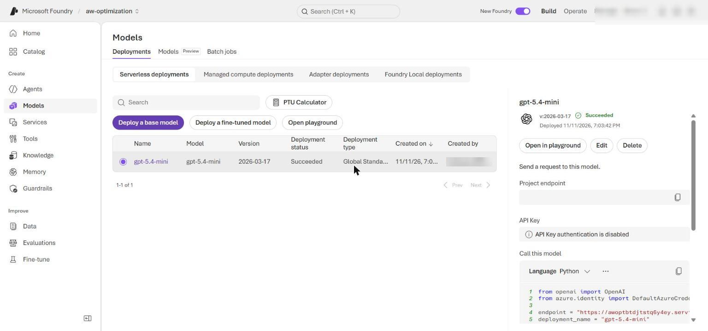

*Figure 3: The gpt-5.4-mini GlobalStandard deployment in the aw-optimization project*

---

## Task 4: Implement the solution

Each `# LAB PLACEHOLDER` marks incomplete code. Replace the whole function or method shown, and **delete the `# LAB PLACEHOLDER` comment**: `scripts/preflight.py --require-complete` counts the text `LAB PLACEHOLDER` in both files and only reports `learner_code_complete: ready` when no markers are left.

> **Important:** The snippets in the official lab use 2-space indentation, but `src/main.py` and `src/cache.py` use 4 spaces. Pasting the official snippets as-is mixes indentation and can raise `IndentationError`. Use the 4-space versions below.

**Placeholder 1: classify request complexity**

1. Open `src/main.py` and find `# LAB PLACEHOLDER 1`. Replace the whole incomplete `classify_tier()` function (the version that just does `return 3`) with:

```python
def classify_tier(request: dict[str, Any]) -> int:
    """Classify request complexity without spending model tokens."""
    message = request["message"].lower()
    if (
        request.get("policy_exception")
        or float(request.get("transaction_amount", 0)) > 200
        or any(term in message for term in ("legal", "regulatory", "chargeback"))
    ):
        return 3
    if "compare" in message or len(request.get("dependencies", [])) > 1:
        return 2
    return 1
```

The router spends no model tokens and sends exception, high-value and legal work directly to tier 3.

**Placeholder 2: build priority-based context**

2. In `src/main.py`, find `# LAB PLACEHOLDER 2`. Replace the whole incomplete `apply_context_budget()` function (the version that truncates with `context[: budget * 4]`) with:

```python
def apply_context_budget(request: dict[str, Any], budget: int) -> str:
    """Build context that preserves required facts within a character proxy budget."""
    context = request["context"]
    required = set(request.get("required_context_fields", context.keys())) - {"unused_fields"}
    selected = {key: context[key] for key in context if key in required}
    rendered = json.dumps(selected, sort_keys=True, separators=(",", ":"))
    character_limit = budget * 4
    if len(rendered) > character_limit:
        raise ValueError(
            f"Required context needs {len(rendered)} characters; tier budget allows {character_limit}."
        )
    return rendered
```

Required facts are either kept or the request fails before the model is called; silent truncation can no longer remove an authorization or order detail.

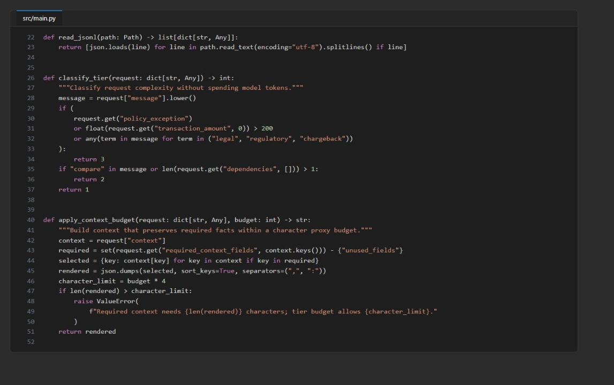

*Figure 4: src/main.py with classify_tier() and apply_context_budget() completed*

**Placeholder 3: version exact-result cache keys**

3. Open `src/cache.py` and find `# LAB PLACEHOLDER 3`. Keep the `@classmethod` decorator line above it, and replace the whole `result_key()` method (its `def` line, the placeholder comment and the `raise NotImplementedError(...)` line) with:

```python
    def result_key(cls, request: dict[str, Any], agent_version: str, policy_version: str) -> str:
        signature = {
            "request": request["message"].strip().lower(),
            "segment": request["segment"],
            "context": request["context"],
            "dependencies": sorted(request["dependencies"]),
            "agent_version": agent_version,
            "policy_version": policy_version,
        }
        return f"aw:result:{cls._digest(signature)}"
```

**Placeholder 4: version prompt-context cache keys**

4. In `src/cache.py`, find `# LAB PLACEHOLDER 4`. Keep the `@classmethod` decorator, and replace the whole `prompt_key()` method (multi-line `def` signature, placeholder comment and `raise NotImplementedError(...)`) with:

```python
    def prompt_key(
        cls,
        request: dict[str, Any],
        tier: int,
        input_budget: int,
        agent_version: str,
        policy_version: str,
    ) -> str:
        signature = {
            "context": request["context"],
            "dependencies": sorted(request["dependencies"]),
            "tier": tier,
            "input_budget": input_budget,
            "agent_version": agent_version,
            "policy_version": policy_version,
        }
        return f"aw:prompt:{cls._digest(signature)}"
```

Context, versions and dependencies stop reuse after facts, behavior or sources change. The `aw:result` and `aw:prompt` namespaces keep the two cache levels apart, and tier and budget are part of the prompt key because they change how the prompt is built.

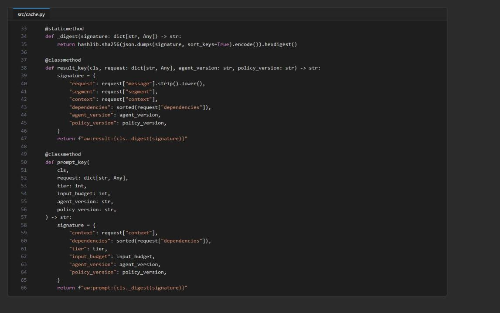

*Figure 5: src/cache.py with result_key() and prompt_key() completed*

5. Save both files, then check the completed code:

```powershell
python -m py_compile src/main.py src/cache.py scripts/compare_runs.py
python scripts/preflight.py --require-complete
$LASTEXITCODE
```

**Expected result:** `py_compile` prints nothing, every preflight check (11 in total) prints `ready`, and `$LASTEXITCODE` is `0`. If `learner_code_complete` is `not ready`, a `LAB PLACEHOLDER` comment is still in one of the files. If an `.env`-based check (`project_endpoint`, `redis_host`, `redis_port`, `principal_id`, `three_deployments`) is `not ready`, rerun the `.env` part of Task 3.

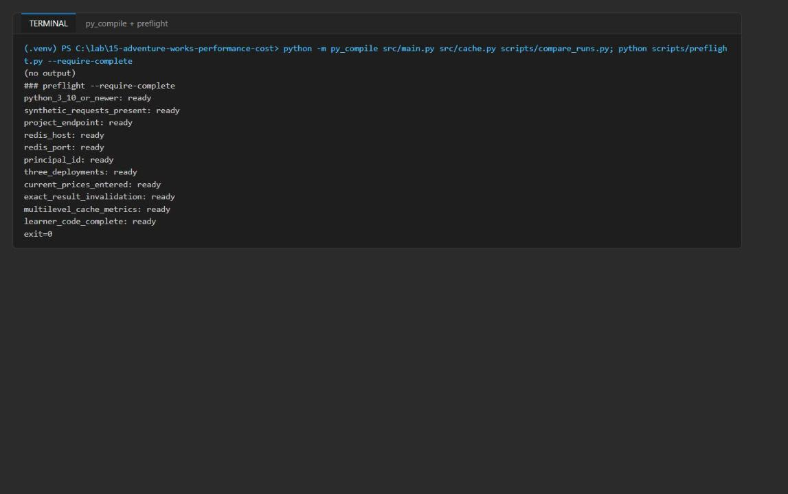

*Figure 6: py_compile prints nothing and preflight reports all 11 checks ready (exit 0)*

---

## Task 5: Run the solution

> **Note:** `reports/evidence.jsonl` is appended to on every run. If you are repeating the lab, delete it first (`Remove-Item reports/evidence.jsonl -ErrorAction SilentlyContinue`) so it holds only this attempt. Cached Redis entries live for one hour (`cache_ttl_seconds: 3600`); if you rerun within the hour, see Troubleshooting.

1. Run the premium control baseline (every request at tier 3, no cache):

```powershell
python -m src.main --policy control --output reports/control-summary.json
```

2. Run the optimized policy with a cold cache:

```powershell
python -m src.main --policy optimized --output reports/optimized-summary.json
```

**Expected result:** both runs print a summary JSON with `request_count: 3` and `successful_count: 2`. In the control run every row has `initial_tier: 3`. In the optimized run `SYN-LOOKUP-001` and `SYN-COMPARE-002` start at tier 2 and `SYN-EXCEPTION-003` at tier 3, all with `cache_level: miss`. `SYN-EXCEPTION-003` scores below the tier-3 floor of 90, so it is flagged `needs_human_review: true` (this is the intended behavior, not an error).

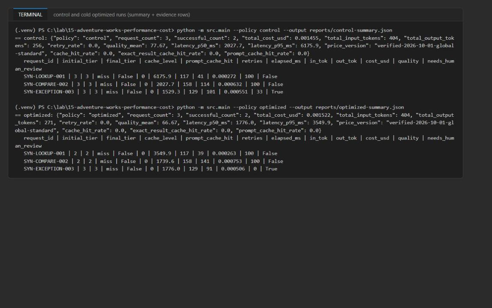

*Figure 7: Control and cold optimized runs: summary plus one evidence row per request*

3. Run the optimized policy again to get exact-result cache hits:

```powershell
python -m src.main --policy optimized --output reports/optimized-cached-summary.json
```

4. Invalidate only the exact result of `SYN-LOOKUP-001`, and write down the `exact_result_key` and `deleted` values:

```powershell
python -m src.main --invalidate-exact SYN-LOOKUP-001
```

5. Run the optimized policy a final time to show prompt-context reuse for that request:

```powershell
python -m src.main --policy optimized --output reports/optimized-prompt-cached-summary.json
```

**Expected result:**

- Warm run: `SYN-LOOKUP-001` and `SYN-COMPARE-002` are `exact_result` with 0 tokens, 0 ms and $0. `SYN-EXCEPTION-003` is `prompt` (it is never result-cached because it needs human review). `cache_hit_rate` is 1.0 = 0.67 exact + 0.33 prompt.
- Invalidation: `exact_result_key` starts with `aw:result:` and `deleted` is `1`.
- Final run: `SYN-LOOKUP-001` is now `cache_level: prompt` with `prompt_cache_hit: true` (model called with the cached context), and `SYN-COMPARE-002` is still `exact_result`, so only the selected result was invalidated.

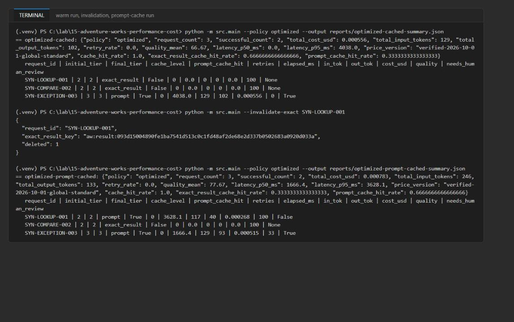

*Figure 8: Warm run, targeted invalidation (deleted: 1) and the prompt-cache run*

6. Compare the optimized runs with the control:

```powershell
python scripts/compare_runs.py reports/control-summary.json reports/optimized-summary.json reports/optimized-cached-summary.json | Tee-Object reports/comparison.json
```

**Expected result:** the first entry (cold optimized vs control) shows an input-token delta of 0 and a lower p95 latency; its cost delta can be slightly positive because of output-token variance. The second entry (warm run vs control) shows a negative cost delta (about -60% in the reference run: -$0.000899), -275 input tokens and `cache_hit_rate: 1.0`. Your exact numbers will differ.

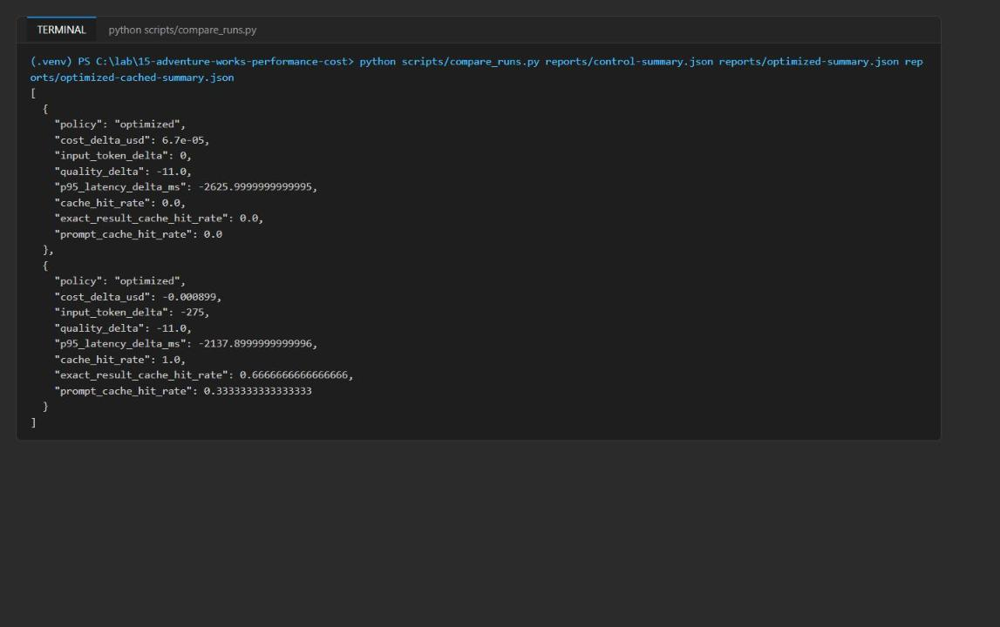

*Figure 9: compare_runs.py output: cold and warm optimized runs versus the control*

**How to read the evidence.** Each evidence row records `initial_tier`, `final_tier`, `deployment`, measured tokens, `elapsed_ms`, `price_version`, `quality_score`, `retry_count` and `cache_level`. `miss` means a model call with freshly built context, `prompt` means cached context was reused but the model was still called, and `exact_result` means no model call happened. Summary cost includes every retry attempt. `needs_human_review` is set only when tier 3 is still below its quality floor.

---

## Task 6: Validate the implementation

**Inspect the measured evidence**

1. Check that every evidence row in the four summaries (including exact-result hits) has all required fields, and that every non-cached row has measured latency and tokens:

```powershell
python -c "import json; files=['control','optimized','optimized-cached','optimized-prompt-cached']; req=['deployment','price_version','initial_tier','final_tier','cache_level','prompt_cache_hit','retry_count','cost_usd','quality_score']; rows=[r for f in files for r in json.load(open(f'reports/{f}-summary.json'))['evidence']]; print('all fields:', all(all(k in r for k in req) for r in rows)); print('measured:', all(r['elapsed_ms']>0 and r['input_tokens']>0 and r['output_tokens']>0 for r in rows if r['cache_level']!='exact_result'))"
```

**Expected result:** `all fields: True` and `measured: True`.

2. Confirm in `reports/optimized-cached-summary.json` that `SYN-LOOKUP-001` and `SYN-COMPARE-002` show `"cache_level": "exact_result"`, and in `reports/optimized-prompt-cached-summary.json` that `SYN-LOOKUP-001` shows `"cache_level": "prompt"`.

3. Confirm that `cache_hit_rate` equals `exact_result_cache_hit_rate` plus `prompt_cache_hit_rate` in both cached summaries:

```powershell
foreach ($f in 'optimized-cached','optimized-prompt-cached') { Get-Content "reports/$f-summary.json" | ConvertFrom-Json | Select-Object policy, cache_hit_rate, exact_result_cache_hit_rate, prompt_cache_hit_rate }
```

4. Verify that Redis holds only the synthetic context and responses, with no credentials. Create a new file `scripts/inspect_redis.py` with the following content (it reuses the lab's passwordless `ResultCache` connection and only reads, unless you pass `--delete`):

```python
"""Inspect the lab's Redis keys (synthetic data only); pass --delete to remove them."""

from __future__ import annotations

import json
import os
import re
import sys
from pathlib import Path

LAB = Path(__file__).resolve().parents[1]
sys.path.insert(0, str(LAB))

from azure.identity import DefaultAzureCredential  # noqa: E402
from dotenv import load_dotenv  # noqa: E402

from src.cache import ResultCache  # noqa: E402

load_dotenv(LAB / ".env")
cache = ResultCache(
    host=os.environ["REDIS_HOST"],
    port=int(os.environ["REDIS_PORT"]),
    principal_id=os.environ["AZURE_PRINCIPAL_ID"],
    credential=DefaultAzureCredential(exclude_interactive_browser_credential=True),
    ttl_seconds=3600,
)
client = cache._client
secret_pattern = re.compile(r"(password|secret|api[_-]?key|access[_-]?token|bearer|accountkey|connectionstring)", re.I)
keys = sorted(client.scan_iter(match="aw:*"))
print("key_count", len(keys))
for key in keys:
    raw = client.get(key) or "{}"
    value = json.loads(raw)
    print(key, "ttl", client.ttl(key), "fields", sorted(value), "deps", value.get("dependencies"),
          "credential_like", bool(secret_pattern.search(raw)))
    if "context" in value:
        print("   context:", value["context"])
    if "response" in value:
        print("   answer:", str(value["response"].get("response", {}).get("answer", ""))[:120])
if "--delete" in sys.argv and keys:
    print("deleted", client.delete(*keys))
```

5. Run it (within one hour of the last benchmark run, before the keys expire):

```powershell
python scripts/inspect_redis.py
```

**Expected result:** about 5 keys: 3 `aw:prompt:*` keys (context only, without `unused_fields`) and 2 `aw:result:*` keys (LOOKUP and COMPARE answers). All values are synthetic `AW-*`/`SYN-*` data and every key shows `credential_like False`.

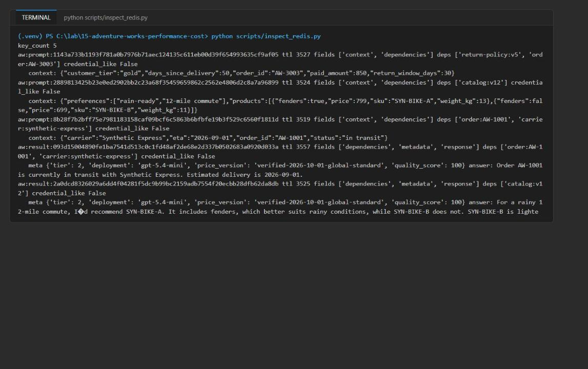

*Figure 10: Redis holds only synthetic prompt context and results, with no credentials*

**Validate the Azure resources**

6. Validate the Foundry account, project and deployment, and the Managed Redis database and Entra access policy assignment from the CLI:

```powershell
$account = az cognitiveservices account list -g $resourceGroupName --query "[0].name" -o tsv
az cognitiveservices account show -g $resourceGroupName -n $account --query "{name:name,kind:kind,location:location,state:properties.provisioningState}" -o json
az cognitiveservices account deployment list -g $resourceGroupName -n $account --query "[].{name:name,model:properties.model.name,version:properties.model.version,sku:sku.name,state:properties.provisioningState}" -o table
$redis = az resource list -g $resourceGroupName --resource-type Microsoft.Cache/redisEnterprise --query "[0].name" -o tsv
az resource show -g $resourceGroupName -n $redis --resource-type Microsoft.Cache/redisEnterprise --query "{name:name,host:properties.hostName,sku:sku.name,state:properties.provisioningState}" -o json
$sub = az account show --query id -o tsv
$dbUri = "https://management.azure.com/subscriptions/$sub/resourceGroups/$resourceGroupName/providers/Microsoft.Cache/redisEnterprise/$redis/databases/default"
az rest --method get --uri "${dbUri}?api-version=2025-07-01" --query "{name:name,port:properties.port,accessKeys:properties.accessKeysAuthentication,state:properties.provisioningState}" -o json
az rest --method get --uri "${dbUri}/accessPolicyAssignments?api-version=2025-07-01" --query "value[].{name:name,policy:properties.accessPolicyName,state:properties.provisioningState}" -o table
```

**Expected result:** the account (`AIServices`, `westus3`) is `Succeeded`; the deployment `gpt-5.4-mini` / `2026-03-17` / `GlobalStandard` is `Succeeded` and matches `TIER1_DEPLOYMENT`, `TIER2_DEPLOYMENT` and `TIER3_DEPLOYMENT`; the Redis cluster (Balanced_B0) is `Succeeded`; database `default` is on port 10000 with `accessKeys: Disabled`; and there is one access policy assignment with policy `default` in state `Succeeded`.

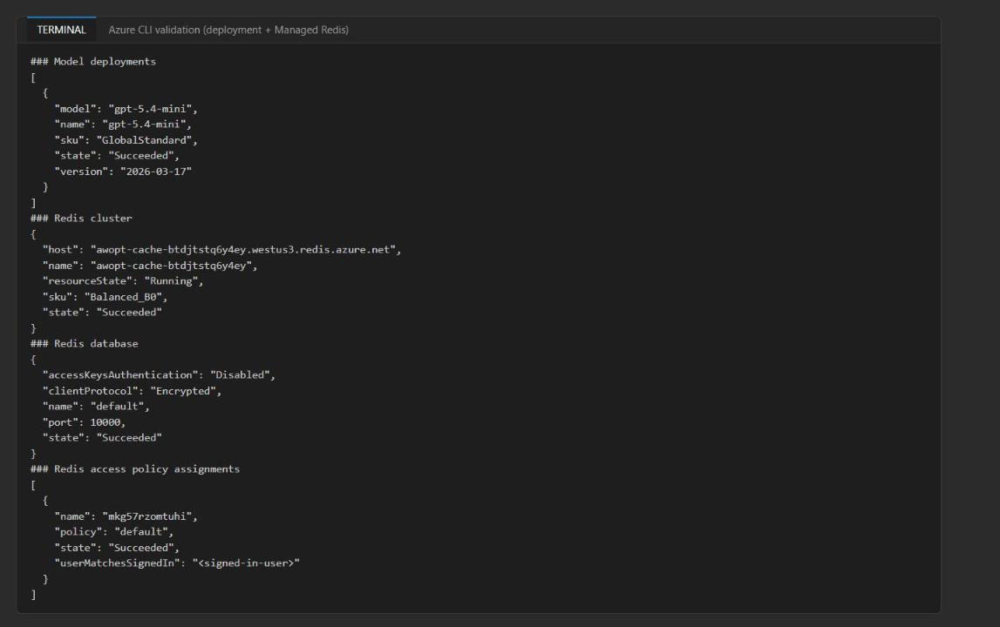

*Figure 11: CLI validation of the model deployment, Redis cluster, default database and Entra access policy assignment*

7. Do the same check in the portals:

- In the [Azure portal](https://portal.azure.com), open your resource group, then the Foundry account (`awopt<token>`): it shows kind AI Foundry / AIServices in West US 3.
- In the [Microsoft Foundry portal](https://ai.azure.com), the `aw-optimization` project lists the `gpt-5.4-mini` deployment under **Models + endpoints** (Figure 3).
- In the Azure portal, open the Azure Managed Redis resource (`awopt-cache-<token>`): the **Overview** shows the West US 3 host name and Balanced_B0. Under **Settings > Authentication**, access keys are disabled and the **Microsoft Entra Authentication** tab lists your user with the `default` access policy.

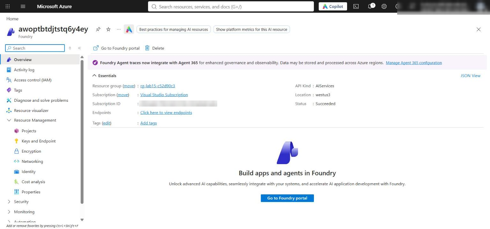

*Figure 12: The Foundry account overview in the Azure portal*

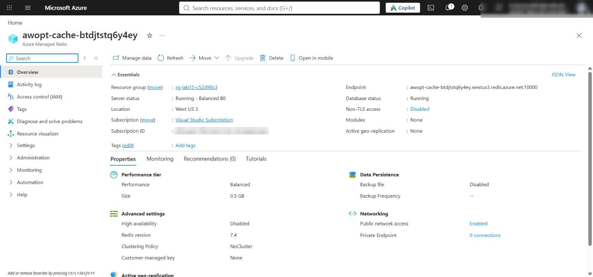

*Figure 13: The Azure Managed Redis overview (Balanced_B0, West US 3)*

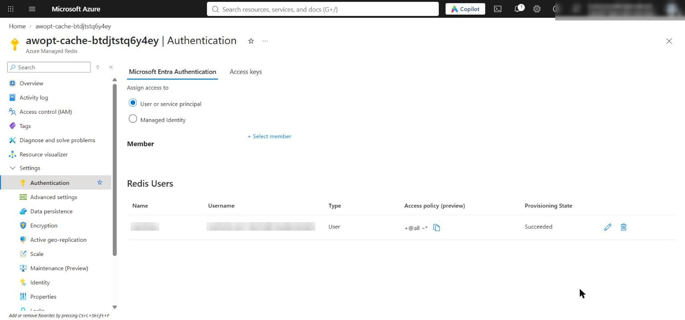

*Figure 14: Redis Authentication, Microsoft Entra Authentication tab: your user is listed as a Redis user with the default access policy (access keys are disabled on the Access keys tab)*

> **Note:** The standalone lab maps all three routing tiers to one deployment, so the measured differences come from budgets, retries and caching, not model quality. In production, use separately priced and benchmarked deployments per tier.

**Review objective coverage**

| Objective | Required evidence | Passing outcome |
|---|---|---|
| Route requests by complexity | Evidence tier fields | `SYN-EXCEPTION-003` starts at tier 3; LOOKUP and COMPARE start at tier 2 (LOOKUP has 2 dependencies, so the `> 1 dependency` rule puts it in tier 2, not tier 1) |
| Apply cache separation and invalidation | Cache levels and invalidation output | `aw:result` and `aw:prompt` keys differ; invalidation deletes 1 key and only LOOKUP drops to `prompt` |
| Enforce context budgets | Completed function and successful runs | All runs succeed with no budget error; `unused_fields` is not in the cached context |
| Compare measured performance and cost | Three summaries and comparison output | Recommendation uses actual tokens, latency, retries, quality and observed cache hits, excluding the human-review request |

---

## Optional challenge: Isolate cache entries by tenant

Goal: identical requests from two tenants create distinct cache entries, and targeted invalidation removes only the selected tenant's result. Then use stale invalidation metadata and decide whether the defect is in key construction or invalidation scope. The script below makes no model calls; it writes a few keys to Redis and removes them at the end.

1. Create a new file `scripts/tenant_challenge.py` with this content:

```python
"""Optional challenge: isolate cache entries by synthetic tenant (no model calls)."""

from __future__ import annotations

import json
import os
import sys
from pathlib import Path
from typing import Any

sys.path.insert(0, str(Path(__file__).resolve().parents[1]))

from azure.identity import DefaultAzureCredential  # noqa: E402
from dotenv import load_dotenv  # noqa: E402

from src.cache import ResultCache  # noqa: E402

class TenantCache(ResultCache):
    @classmethod
    def result_key(cls, request: dict[str, Any], agent_version: str, policy_version: str) -> str:
        signature = {
            "tenant_id": request["tenant_id"],
            "request": request["message"].strip().lower(),
            "segment": request["segment"],
            "context": request["context"],
            "dependencies": sorted(request["dependencies"]),
            "agent_version": agent_version,
            "policy_version": policy_version,
        }
        return f"aw:{request['tenant_id']}:result:{cls._digest(signature)}"

    @classmethod
    def prompt_key(cls, request, tier, input_budget, agent_version, policy_version) -> str:
        signature = {
            "tenant_id": request["tenant_id"],
            "context": request["context"],
            "dependencies": sorted(request["dependencies"]),
            "tier": tier,
            "input_budget": input_budget,
            "agent_version": agent_version,
            "policy_version": policy_version,
        }
        return f"aw:{request['tenant_id']}:prompt:{cls._digest(signature)}"

def main() -> int:
    lab = Path(__file__).resolve().parents[1]
    load_dotenv(lab / ".env")
    config = json.loads((lab / "assets/optimization-config.json").read_text(encoding="utf-8"))
    base = json.loads((lab / "assets/requests.jsonl").read_text(encoding="utf-8").splitlines()[0])
    av, pv = config["agent_version"], config["policy_version"]
    cache = TenantCache(
        host=os.environ["REDIS_HOST"],
        port=int(os.environ["REDIS_PORT"]),
        principal_id=os.environ["AZURE_PRINCIPAL_ID"],
        credential=DefaultAzureCredential(exclude_interactive_browser_credential=True),
        ttl_seconds=300,
    )
    a = {**base, "tenant_id": "SYN-TENANT-A"}
    b = {**base, "tenant_id": "SYN-TENANT-B"}
    created = []
    for req in (a, b):
        rk = cache.result_key(req, av, pv)
        pk = cache.prompt_key(req, 2, 3000, av, pv)
        cache.put(rk, {"response": {"answer": "synthetic"}}, req["dependencies"], {"tier": 2, "quality_score": 100})
        cache.put_prompt(pk, "{}", req["dependencies"])
        created += [rk, pk]
    report: dict[str, Any] = {
        "tenant_a_result_key": cache.result_key(a, av, pv),
        "tenant_b_result_key": cache.result_key(b, av, pv),
        "result_keys_distinct": cache.result_key(a, av, pv) != cache.result_key(b, av, pv),
        "prompt_keys_distinct": cache.prompt_key(a, 2, 3000, av, pv) != cache.prompt_key(b, 2, 3000, av, pv),
    }
    # Failure investigation: stale invalidation metadata (old agent version) -> wrong key, nothing deleted.
    stale = cache.delete_exact(a, "aw-cip-v2", pv)
    report["stale_invalidation"] = {
        **stale,
        "tenant_a_still_cached": cache.get(report["tenant_a_result_key"]) is not None,
        "diagnosis": "key construction: stale agent_version yields a different digest, so scope was never reached",
    }
    targeted = cache.delete_exact(a, av, pv)
    report["targeted_invalidation"] = {
        **targeted,
        "tenant_a_result_present": cache.get(report["tenant_a_result_key"]) is not None,
        "tenant_b_result_present": cache.get(report["tenant_b_result_key"]) is not None,
    }
    report["passed"] = (
        report["result_keys_distinct"]
        and report["prompt_keys_distinct"]
        and stale["deleted"] == 0
        and targeted["deleted"] == 1
        and not report["targeted_invalidation"]["tenant_a_result_present"]
        and report["targeted_invalidation"]["tenant_b_result_present"]
    )
    report["cleanup_deleted"] = int(cache._client.delete(*created))
    print(json.dumps(report, indent=2))
    return 0 if report["passed"] else 1

if __name__ == "__main__":
    raise SystemExit(main())
```

2. Run it:

```powershell
python scripts/tenant_challenge.py | Tee-Object reports/tenant-challenge.json
```

**Expected result:** `result_keys_distinct` and `prompt_keys_distinct` are `true`; the stale invalidation (old `agent_version aw-cip-v2`) deletes `0` keys and tenant A is still cached; the targeted invalidation deletes `1` key, tenant A is gone and tenant B is still present; `passed` is `true`. Diagnosis: the defect is in **key construction** (stale metadata produces a different digest), not in invalidation scope.

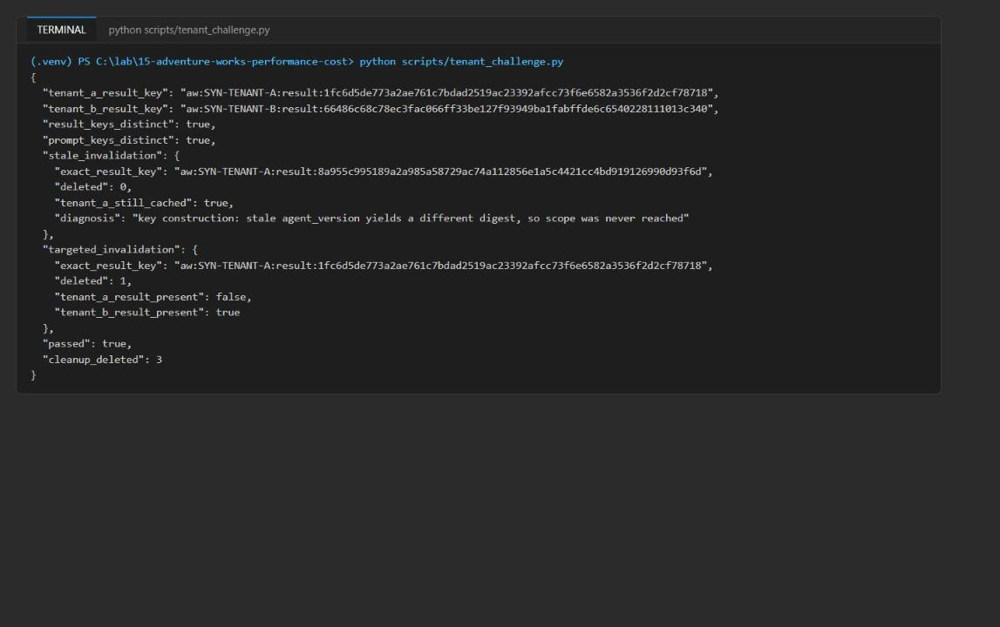

*Figure 15: Tenant challenge: distinct tenant keys, stale invalidation deletes 0, targeted invalidation deletes only tenant A*

---

## Task 7: Review the design

1. Answer the three review questions in the **Review questions** section at the end of this guide, using your `reports/*-summary.json` files and the comparison output as evidence.

2. (Optional) Fill in `reports/optimization-report-template.md` with your configuration and price version, control evidence, optimized evidence, comparison, cache and invalidation evidence, and a recommendation with a rollback trigger. Base the recommendation only on measured evidence: exclude savings from requests that need human review and from cache hits you did not observe.

---

## Validate

| Acceptance criterion | How to check (CLI) | How to check (portal) | Expected |
|---|---|---|---|
| Every row has deployment, price_version, initial/final tier, cache_level, prompt_cache_hit, retry_count, cost and quality (exact hits included) | Task 6 step 1 script | n/a | `all fields: True` |
| Non-cached rows have measured elapsed_ms and actual input/output tokens | Task 6 step 1 script | n/a | `measured: True` |
| Second optimized run shows `exact_result` | `reports/optimized-cached-summary.json` | n/a | LOOKUP and COMPARE are `exact_result`, 0 tokens, $0 |
| Invalidation output recorded | `python -m src.main --invalidate-exact SYN-LOOKUP-001` | n/a | `aw:result:<sha256>` key and `deleted: 1` |
| Rerun shows SYN-LOOKUP-001 `cache_level: prompt` | `reports/optimized-prompt-cached-summary.json` | n/a | LOOKUP `prompt`, COMPARE still `exact_result` |
| `cache_hit_rate` counts exact + prompt hits | Task 6 step 3 | n/a | 1.0 = 0.67 + 0.33 (warm) and 0.33 + 0.67 (final) |
| Redis holds only synthetic data, no credentials | `python scripts/inspect_redis.py` | n/a | `aw:prompt`/`aw:result` keys, `credential_like False` |
| Foundry account, project and deployment | Task 6 step 6 | Foundry portal, **Models + endpoints** | `gpt-5.4-mini` Succeeded, matches TIER1/2/3 |
| Redis `default` database and Entra `default` access policy assignment | Task 6 step 6 (`az rest`) | Managed Redis, **Authentication** | Port 10000, access keys disabled, assignment Succeeded |
| Routing by complexity | Evidence `initial_tier` | n/a | EXCEPTION tier 3; LOOKUP and COMPARE tier 2 |
| Cost comparison | `scripts/compare_runs.py` | n/a | Warm run cheaper than control with fewer input tokens |

---

## Troubleshooting

**Azure Managed Redis fails to deploy in East US 2 (`OperationFailed`)**

- Symptom: `az deployment group create` (or `azd provision`) fails after several minutes. The failed operation is on `Microsoft.Cache/redisEnterprise` (`awopt-cache-<token>`) with error code `OperationFailed` and a generic message, the Redis resource is left in `CreateFailed` / Failed state, and the Foundry account and deployment succeed. Retrying in the same region fails again.
- Cause: Azure Managed Redis capacity/availability for the Balanced_B0 SKU in `eastus2` at the time of the run (not a template error).
- Fix: delete the failed resource group and redeploy the full Task 3 block in `westus3`:

```powershell
az deployment operation group list --resource-group $resourceGroupName --name lab15-main --query "[?properties.provisioningState=='Failed'].{resource:properties.targetResource.resourceName,status:properties.statusMessage.error.code}" -o table
az group delete --name $resourceGroupName --yes --no-wait
# Then rerun the Task 3 provisioning block with: $azureRegion = 'westus3'
```

A new `$suffix` gives a new resource group, so you don't need to wait for the delete to finish. Make sure the failed group is eventually deleted so the failed Redis cluster doesn't stay in your subscription.

**`NotImplementedError: Complete the result-cache key task...` or every request goes to tier 3**

You have not replaced placeholder 3/4 in `src/cache.py`, or placeholder 1 in `src/main.py` still returns `3`. Complete Task 4.

**`preflight.py --require-complete` exits 1 with `learner_code_complete: not ready`**

A `# LAB PLACEHOLDER` comment is still in `src/main.py` or `src/cache.py`. The check counts the text itself, so remove the comment lines too.

**`IndentationError` or `unindent does not match any outer indentation level`**

You pasted the official lab's 2-space snippets into 4-space files. Use the 4-space code in Task 4.

**Redis `AuthenticationError` / `WRONGPASS invalid username-password pair`**

- `AZURE_PRINCIPAL_ID` in `.env` must be your own user object ID (`az ad signed-in-user show --query id -o tsv`). It is the Redis user name, and the template creates the `default` access policy assignment only for that ID.
- The access policy assignment can take a few minutes to become active after deployment. Wait and retry.
- Make sure `az login` uses the same account, because `DefaultAzureCredential` gets the Redis token from your Azure CLI sign-in.

**`PermissionDenied` / 401 / 403 when calling the model**

RBAC has not propagated yet. Wait 1-5 minutes after the role assignments in Task 3 and run again. Confirm with `az role assignment list --assignee $principalId --scope $rgId -o table`.

**`KeyError: 'REDIS_PORT'` or `'TIER1_DEPLOYMENT'`**

`.env` is missing deployment outputs (for example, you copied `.env.example` after Task 3, or the deployment failed). Rerun the `.env` part of the Task 3 block.

**The cold optimized run already shows `exact_result`, or the counts don't match**

Entries from an earlier attempt are still in Redis (TTL 1 hour). Remove the lab keys and start Task 5 again with an empty `reports/evidence.jsonl`:

```powershell
python scripts/inspect_redis.py --delete
Remove-Item reports/evidence.jsonl -ErrorAction SilentlyContinue
```

**No request ever reaches tier 1**

This is expected with the supplied data: `SYN-LOOKUP-001` has two dependencies, and the rule `len(dependencies) > 1 -> tier 2` applies. `SYN-EXCEPTION-003` staying below the tier-3 floor (quality 0-33) and being flagged `needs_human_review` is also expected, and it is never result-cached.

---

## Review questions

**1. When did a cheaper initial route cost more because it retried?**

It didn't happen in the reference run: `retry_rate` was 0.0 in all four summaries. LOOKUP and COMPARE started at tier 2 and scored 100 (above the tier-2 floor of 85), and EXCEPTION started at tier 3 with no higher tier to escalate to. The cold optimized run cost slightly more than control (+$0.000067), but that came from output-token variance (COMPARE used 141 output tokens vs 114), not a retry. Because all tiers use the same deployment and price, routing alone cannot save money per token. A retry costs more only when a tier-1/2 attempt falls below its floor, because the run then pays for both attempts.

**2. Which context fields consumed tokens without changing quality?**

`unused_fields` (`warehouse_notes`, `supplier_history`) on `SYN-LOOKUP-001`. It supports no quality assertion; `apply_context_budget()` drops it, the cached prompt context for AW-1001 contains only `carrier`, `eta`, `order_id` and `status`, and the lookup still scored 100. Control also uses `apply_context_budget()`, so the input-token delta between policies was 0; measuring the exact saving needs a run with the raw context. `customer_tier` on the exception request isn't a required term, but it is policy-relevant, so keep it.

**3. What evidence would justify adding semantic caching rather than exact result caching?**

- Request logs showing a high share of paraphrased duplicates (same context, dependencies and intent, different wording) that the exact cache misses.
- An exact-hit ceiling well below the observed near-duplicate rate (here the warm run reached 0.67 exact hits with no paraphrases, so there is no such evidence yet).
- An offline replay where semantic hits keep quality at or above each segment's floor with a near-zero false-hit rate.
- Cost and latency savings that remain after paying for the embedding calls.

Semantic matching should never apply to tier-3/exception requests, and it must keep the same dependency, version and tenant invalidation metadata as the exact cache.

---

## Clean up (optional)

Do this as soon as you finish: Azure Managed Redis is billed per hour.

1. Delete the lab resource group (and any failed `eastus2` resource group from an earlier attempt):

```powershell
az group delete --name $resourceGroupName --yes --no-wait
az group list --query "[?starts_with(name,'rg-lab15-')].{name:name,location:location,state:properties.provisioningState}" -o table
```

2. The Foundry account is soft-deleted. Purge it so its name and quota are released (use your account name and `westus3`):

```powershell
az cognitiveservices account list-deleted --query "[?contains(name,'awopt')].{name:name,location:location}" -o table
az cognitiveservices account purge --name <account-name> --resource-group $resourceGroupName --location westus3
```

3. Remove the local `.env`:

```powershell
Remove-Item .env
```

4. After a few minutes, confirm the resource group (and the Redis instance in it) is gone:

```powershell
az group exists --name $resourceGroupName
```

**Expected result:** `false`.

5. Deactivate the virtual environment in every terminal where `(.venv)` appears, and confirm `(.venv)` is gone from the prompt:

```powershell
deactivate
```

