# Lab 16: Implement durable human approval workflows

**Scenario.** Adventure Works agents can recommend refunds and policy exceptions, but high-impact actions must pause for meaningful human review. An in-memory "pending" flag is not enough: approval can take hours, processes restart, duplicate decisions arrive, and overdue work must escalate without losing history.

**What you build.** A durable approval state machine for a synthetic refund request. Cosmos DB stores the current workflow state and an append-only audit trail. Service Bus carries approval requests and reviewer decisions. A command-line tool submits work, queues approve/reject/override/cancel decisions, resumes each decision exactly once with optimistic concurrency (ETags), and escalates overdue reviews. A small local HTTP adapter shows how a Teams or Power Automate reviewer surface would post decisions.

**Duration.** About 45 minutes (plus 5-10 minutes for provisioning).

> **Note:** Cosmos DB (serverless) and Service Bus (Standard) are billable. The lab uses synthetic payloads only (no customer PII). Do not put connection strings or keys in `.env`; the lab authenticates with your Microsoft Entra identity through `DefaultAzureCredential`. Delete the resource group when you finish (see Clean up).

| Component | Azure resource / file | Purpose |
|---|---|---|
| Workflow state | Cosmos DB account `awapproval<token>`, database `approvals`, container `workflow-state` | Current state, risk evidence, ETag, version, deadline, last transition |
| Audit trail | Cosmos DB container `approval-audit` (partition key `/workflow_id`) | Append-only, idempotent audit events linked to state ETag and version |
| Request queue | Service Bus namespace `awapproval-<token>`, queue `approval-requests` | Requests that need a reviewer (feeds a reviewer surface; no consumer in this lab) |
| Decision queue | Service Bus queue `approval-decisions` (duplicate detection on) | Reviewer decisions waiting for the resume worker |
| Workflow engine | `src/workflow.py` | Calibration, risk assessment, audit, decisions, escalation |
| CLI | `src/main.py` | `submit`, `status`, `decide`, `resume`, `escalate` |
| Reviewer adapter | `src/reviewer_webhook.py` | Local HTTP endpoint that queues authenticated decisions (HTTP 202) |
| Feedback export | `src/active_learning.py` | Rejected/overridden examples plus aggregate evaluation |

The data flow is: refund request -> calibrated risk decision -> durable `WAITING_FOR_REVIEW` state in Cosmos DB -> reviewer decision on Service Bus -> `resume` applies it once (ETag check) -> protected action -> linked audit record. A separate `escalate` scan moves overdue reviews to `ESCALATED`.

## Prerequisites

- An Azure subscription where you can create Cosmos DB, Service Bus, and role assignments (Owner, or Contributor plus User Access Administrator, on the subscription or on a resource group).
- [Python 3.10 or later](https://www.python.org/downloads/)
- [Azure CLI](https://learn.microsoft.com/cli/azure/install-azure-cli) with Bicep (`az bicep install`)
- [Visual Studio Code](https://code.visualstudio.com/) and [Git](https://git-scm.com/downloads)
- PowerShell 7 is recommended for the commands in this guide (Windows PowerShell 5.1 also works).

> **Note:** The official lab uses the Azure Developer CLI (`azd provision`). This guide deploys the same Bicep template directly with the Azure CLI, so `azd` is not required.

Sign in to Azure and select your subscription:

```powershell
az login
az account set --subscription "<your-subscription-id>"
az account show --output table
```

---

## Task 1: Prepare the lab

1. Clone the lab repository (skip this if you already have it):

```powershell
git clone https://github.com/MicrosoftLearning/mslearn-ai-multi-agents.git
```

2. Open the `mslearn-ai-multi-agents` folder in Visual Studio Code, then open a terminal (**Terminal > New Terminal**).

3. Move to the lab folder and verify the tools:

```powershell
cd Allfiles\16-adventure-works-human-approval
az version
az bicep version
python --version
az account show --output table
```

**Expected result:** Each command prints a version (Python 3.10 or later) and `az account show` shows the subscription you want to use.

4. Architecture checkpoint. Open and skim these files so you know what you are about to complete:

- `infra/main.bicep`: Cosmos DB (serverless, local auth disabled) with two containers, Service Bus (Standard, local auth disabled) with two queues, and data-plane roles for you (Cosmos DB Built-in Data Contributor and Azure Service Bus Data Owner).
- `assets/refund-request.json`: the synthetic request (raw confidence 0.91, requires a policy exception).
- `assets/calibration-curve.json`: maps raw model confidence to observed accuracy.
- `assets/workflow-state.schema.json` and `assets/adaptive-card.json`: the state contract and the reviewer card fields.
- `src/workflow.py` and `src/reviewer_webhook.py`: the state machine and the HTTP adapter.

Confirm that a high-risk request moves from calibrated risk, to durable pending state, to authenticated reviewer submission, to exactly-once resume processing, to idempotent audit evidence.

---

## Task 2: Build the virtual environment

1. In the lab folder, create the virtual environment and install the requirements:

```powershell
./scripts/setup.ps1
```

2. Activate it:

```powershell
. ./.venv/Scripts/Activate.ps1
```

> **Note:** On macOS or Linux run `bash scripts/setup.sh` and then `source .venv/bin/activate`.

**Expected result:** The prompt starts with `(.venv)` and `pip` finishes with `Successfully installed ... azure-cosmos ... azure-servicebus ...`.

> **Note:** If PowerShell blocks the script with "running scripts is disabled on this system", run `Set-ExecutionPolicy -Scope Process -ExecutionPolicy Bypass` in the same terminal and try again.

---

## Task 3: Deploy Azure resources

The Bicep template has only two parameters: `location` and `principalId` (your Entra object ID, used for the data-plane role assignments). It already grants you **Cosmos DB Built-in Data Contributor** on the account and **Azure Service Bus Data Owner** on the namespace, so no extra role assignments are needed for this lab.

1. Review the cost note in the overview and choose a region that offers Cosmos DB serverless and Service Bus Standard (the lab was tested in `eastus2`).

2. From the lab folder (`Allfiles\16-adventure-works-human-approval`), run this block. It creates a unique resource group, deploys the template, and writes `.env` from the deployment outputs:

```powershell
$azureRegion = 'eastus2'
$suffix = (New-Guid).Guid.Substring(0, 8)
$resourceGroupName = "rg-lab16-$suffix"
$envName = "lab16-$suffix"
$principalId = az ad signed-in-user show --query id -o tsv
az group create --name $resourceGroupName --location $azureRegion --output none
az bicep build --file infra/main.bicep
az deployment group create --resource-group $resourceGroupName --name lab16-main `
  --template-file infra/main.bicep `
  --parameters location=$azureRegion principalId=$principalId `
  --output none
# Write .env from the deployment outputs (endpoints and names only - no keys)
$outputs = az deployment group show --resource-group $resourceGroupName --name lab16-main --query properties.outputs -o json | ConvertFrom-Json
$lines = @("AZURE_RESOURCE_GROUP=`"$resourceGroupName`"", "AZURE_LOCATION=`"$azureRegion`"", "AZURE_ENV_NAME=`"$envName`"",
  "AZURE_SUBSCRIPTION_ID=`"$(az account show --query id -o tsv)`"", "AZURE_PRINCIPAL_ID=`"$principalId`"", "AZURE_PRINCIPAL_TYPE=`"User`"")
$outputs.PSObject.Properties | ForEach-Object { $lines += "$($_.Name.ToUpper())=`"$($_.Value.value)`"" }
$lines | Out-File .env -Encoding utf8
Get-Content .env
```

**Expected result:** The deployment takes about 5-8 minutes (Cosmos DB is the slowest part). `Get-Content .env` shows values like these:

```text
AZURE_RESOURCE_GROUP="rg-lab16-<suffix>"
AZURE_LOCATION="eastus2"
AZURE_ENV_NAME="lab16-<suffix>"
AZURE_SUBSCRIPTION_ID="<subscription-id>"
AZURE_PRINCIPAL_ID="<your-object-id>"
AZURE_PRINCIPAL_TYPE="User"
COSMOS_ENDPOINT="https://awapproval<token>.documents.azure.com:443/"
COSMOS_DATABASE="approvals"
STATE_CONTAINER="workflow-state"
AUDIT_CONTAINER="approval-audit"
SERVICE_BUS_NAMESPACE="awapproval-<token>.servicebus.windows.net"
REQUEST_QUEUE="approval-requests"
DECISION_QUEUE="approval-decisions"
```

3. Verify `.env`: it must contain the Cosmos DB endpoint, database and container names, the Service Bus namespace and both queue names, and the principal values. It must not contain any key, connection string, or token.

4. Confirm the two resources exist:

```powershell
az resource list --resource-group $resourceGroupName --query "[].{name:name, type:type}" --output table
```

**Expected result:** One `Microsoft.DocumentDB/databaseAccounts` and one `Microsoft.ServiceBus/namespaces` resource.

> **Note:** Role assignments can take 1-5 minutes to apply. If the first Cosmos DB or Service Bus call in Task 5 returns 403 / Forbidden / Unauthorized, wait a few minutes and try again.

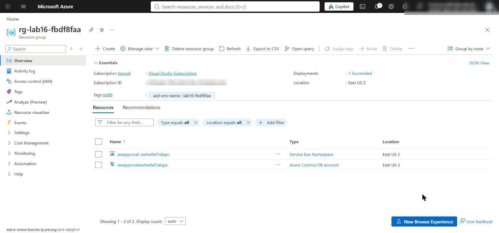

*Figure 1: The lab 16 resource group with the Cosmos DB account and the Service Bus namespace*

---

## Task 4: Implement the solution

Each `# LAB PLACEHOLDER` comment marks incomplete code. For each placeholder, delete the `# LAB PLACEHOLDER n` comment line too, because `preflight.py --require-complete` fails while any marker remains in `src/`. The code below uses 4-space indentation to match the files (the official lab text shows 2 spaces; use 4).

**Placeholder 1: calibrate raw confidence**

1. Open `src/workflow.py` and find `# LAB PLACEHOLDER 1` inside `calibrate_confidence()`.

2. Replace the whole function (including the placeholder comment and `return raw_confidence`) with:

```python
def calibrate_confidence(raw_confidence: float, curve_path: Path) -> float:
    """Map raw confidence to observed accuracy using the nearest calibration point."""
    curve = json.loads(curve_path.read_text(encoding="utf-8"))
    nearest = min(
        curve["points"],
        key=lambda point: abs(float(point["raw_confidence"]) - raw_confidence),
    )
    return float(nearest["observed_accuracy"])
```

Observed accuracy, not the model's uncalibrated confidence, now drives the review thresholds.

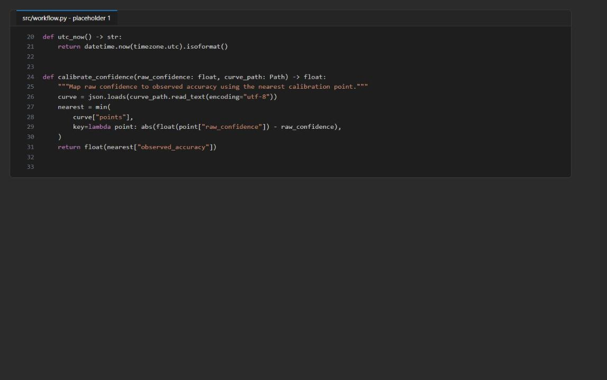

*Figure 2: calibrate_confidence() after placeholder 1*

**Placeholder 2: use calibrated confidence in risk assessment**

3. In `assess_risk()`, find `# LAB PLACEHOLDER 2` and the line below it:

```python
    calibrated = float(request["calibrated_confidence"])
```

4. Replace the placeholder comment and that line with:

```python
    calibrated = calibrate_confidence(
        float(request["raw_confidence"]),
        Path("assets/calibration-curve.json"),
    )
```

The confidence now comes from the versioned curve instead of a value copied into the request.

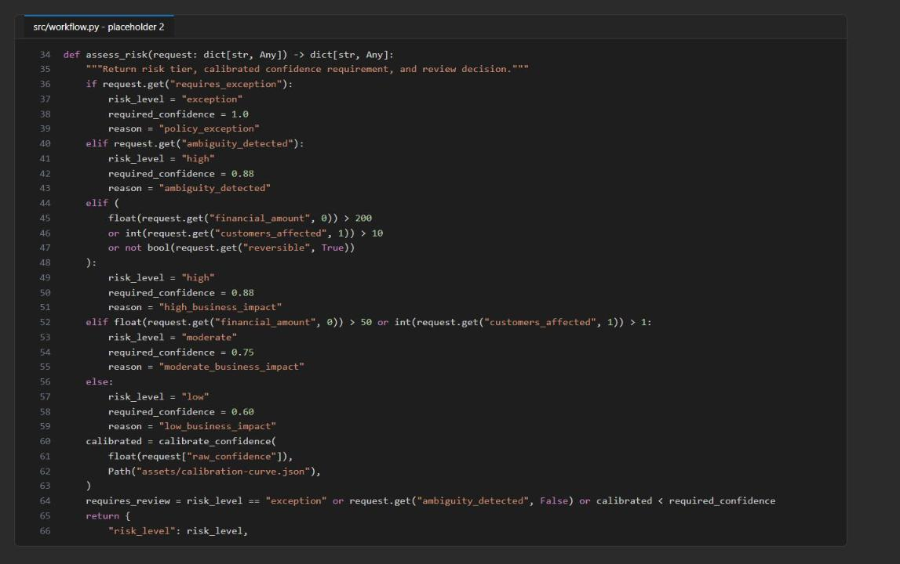

*Figure 3: assess_risk() now calls calibrate_confidence()*

**Placeholder 3: append immutable audit evidence**

5. In the `ApprovalWorkflow.append_audit()` method, find `# LAB PLACEHOLDER 3` and the line `raise NotImplementedError("Complete the audit task before submitting a workflow.")`.

6. Replace the placeholder comment and the `raise` line with (8 spaces of indentation, inside the method):

```python
        actor_hash = hashlib.sha256(actor.encode()).hexdigest()
        record = {
            "id": event_id,
            "event_id": event_id,
            "workflow_id": workflow_id,
            "event_type": event_type,
            "timestamp": utc_now(),
            "actor_hash": actor_hash,
            "previous_state": previous_state,
            "new_state": new_state,
            "policy_version": policy_version,
            "trace_id": trace_id,
            "rationale_category": rationale_category,
            "state_etag": state_etag,
            "state_version": state_version,
            "details": details,
        }
        try:
            self._audit.create_item(record)
        except exceptions.CosmosResourceExistsError:
            existing = self._audit.read_item(
                item=event_id,
                partition_key=workflow_id,
            )
            identity_fields = ("event_id", "workflow_id", "policy_version", "trace_id")
            if any(existing.get(field) != record.get(field) for field in identity_fields):
                raise RuntimeError(
                    f"Audit event ID {event_id} already belongs to different evidence"
                )
```

The event ID is the audit document ID, so a redelivered event cannot create a second record. An existing record is accepted only if its workflow, policy, and trace identity match; conflicting evidence fails closed. The reviewer is stored only as a SHA-256 hash.

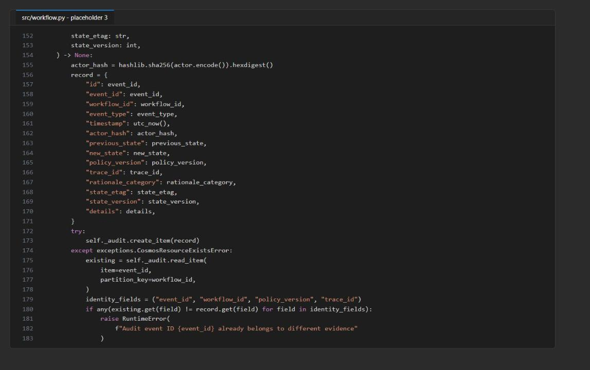

*Figure 4: append_audit() writes an idempotent, hashed audit record*

**Placeholder 4: add cancellation compensation**

7. In `apply_decision()`, find `# LAB PLACEHOLDER 4` (between the `REJECTED` branch and the final `else:`).

8. Replace the placeholder comment with this branch (keep the existing `else:` block below it):

```python
        elif decision == "CANCELLED":
            new_state = "CANCELLED"
            execution = {
                "mode": "synthetic",
                "status": "cancelled_before_execution",
                "executed_at": None,
            }
```

Cancellation is a terminal transition that never executes the action. The existing `replace_item()` call still enforces the original ETag.

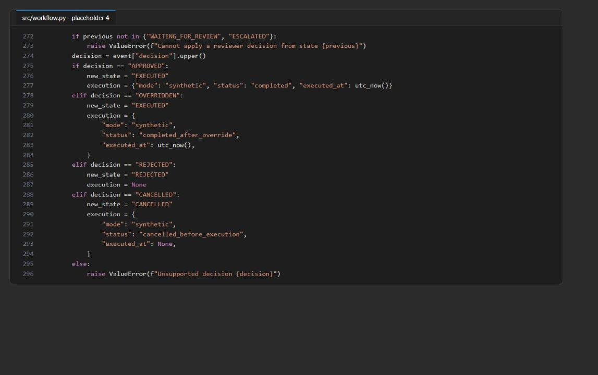

*Figure 5: The CANCELLED branch in apply_decision()*

**Placeholder 5: expose cancellation through the CLI**

9. Open `src/main.py` and find `# LAB PLACEHOLDER 5` in `main()`.

10. Replace the placeholder comment and the `decide.add_argument("--decision", ...)` line below it with:

```python
    decide.add_argument(
        "--decision",
        choices=["approved", "rejected", "overridden", "cancelled"],
        required=True,
    )
```

**Placeholder 6: escalate expired reviews durably**

11. Back in `src/workflow.py`, find `# LAB PLACEHOLDER 6` in `escalate_expired()`.

12. Replace the whole method (the `def` line, the placeholder comment, and `return []`) with (4 spaces before `def`, because it is a class method):

```python
    def escalate_expired(self) -> list[str]:
        now = utc_now()
        query = "SELECT * FROM c WHERE c.state = 'WAITING_FOR_REVIEW' AND c.review_deadline < @now"
        expired = self._state.query_items(
            query=query,
            parameters=[{"name": "@now", "value": now}],
            enable_cross_partition_query=True,
        )
        escalated = []
        for item in expired:
            previous = item["state"]
            item["state"] = "ESCALATED"
            item["version"] += 1
            item["updated_at"] = now
            escalation_event_id = str(uuid.uuid4())
            item["last_transition"] = {
                "event_id": escalation_event_id,
                "event_type": "escalated",
                "actor_hash": hashlib.sha256(b"scheduler").hexdigest(),
                "previous_state": previous,
                "new_state": "ESCALATED",
                "timestamp": now,
            }
            updated = self._state.replace_item(
                item=item["id"],
                body=item,
                etag=item["_etag"],
                match_condition=MatchConditions.IfNotModified,
            )
            self.append_audit(
                item["id"], "escalated", "scheduler", previous, "ESCALATED", {},
                policy_version=updated["policy_version"],
                trace_id=updated["trace_id"],
                rationale_category="review_deadline_expired",
                event_id=escalation_event_id,
                state_etag=updated["_etag"],
                state_version=updated["version"],
            )
            with self._bus.get_queue_sender(self._request_queue) as sender:
                sender.send_messages(
                    ServiceBusMessage(json.dumps(updated), message_id=str(uuid.uuid4()))
                )
            escalated.append(item["id"])
        return escalated
```

Scheduler-driven transitions follow the same rules as reviewer decisions: ETag check, version increment, linked `last_transition`, and an audit record.

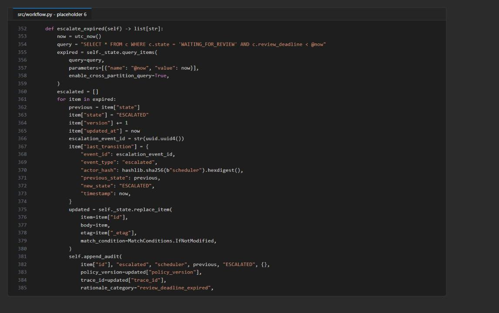

*Figure 6: escalate_expired() after placeholder 6*

**Check the completed code**

13. Save all files, then compile and run the preflight check:

```powershell
python -m py_compile src/workflow.py src/main.py src/reviewer_webhook.py src/active_learning.py
python scripts/preflight.py --require-complete
```

**Expected result:** `py_compile` prints nothing. Because `.env` already exists, every preflight check reports `ready`:

```text
python_3_10_or_newer: ready
synthetic_request: ready
state_schema_valid_json: ready
cosmos_endpoint: ready
service_bus_namespace: ready
learner_code_complete: ready
```

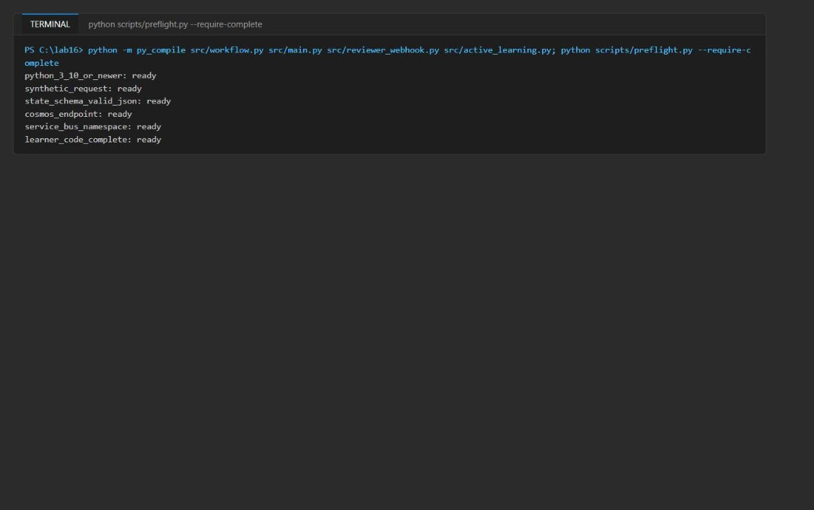

*Figure 7: py_compile is silent and preflight reports every check ready*

> **Note:** If `learner_code_complete` is `not ready`, a `LAB PLACEHOLDER` comment is still in a file under `src/`. Search for it (Ctrl+Shift+F) and delete it.

---

## Task 5: Run the solution

Run every command from the lab folder with the virtual environment active. Each command is a separate process, so a successful `status` or `resume` proves that state survived a restart.

**Approved path (and a duplicate decision)**

1. Submit the synthetic refund request and keep its workflow ID in a variable:

```powershell
$submitA = python -m src.main submit --input assets/refund-request.json | Out-String | ConvertFrom-Json
$A = $submitA.id
$submitA | ConvertTo-Json -Depth 6
```

**Expected result:** `state` is `WAITING_FOR_REVIEW`, `version` is 1, and `risk` shows `risk_level: exception`, `required_confidence: 1`, `calibrated_confidence: 0.78` (raw 0.91 mapped through the curve), and `reason: policy_exception`. The record also has an `_etag` and a `last_transition` of type `submitted`.

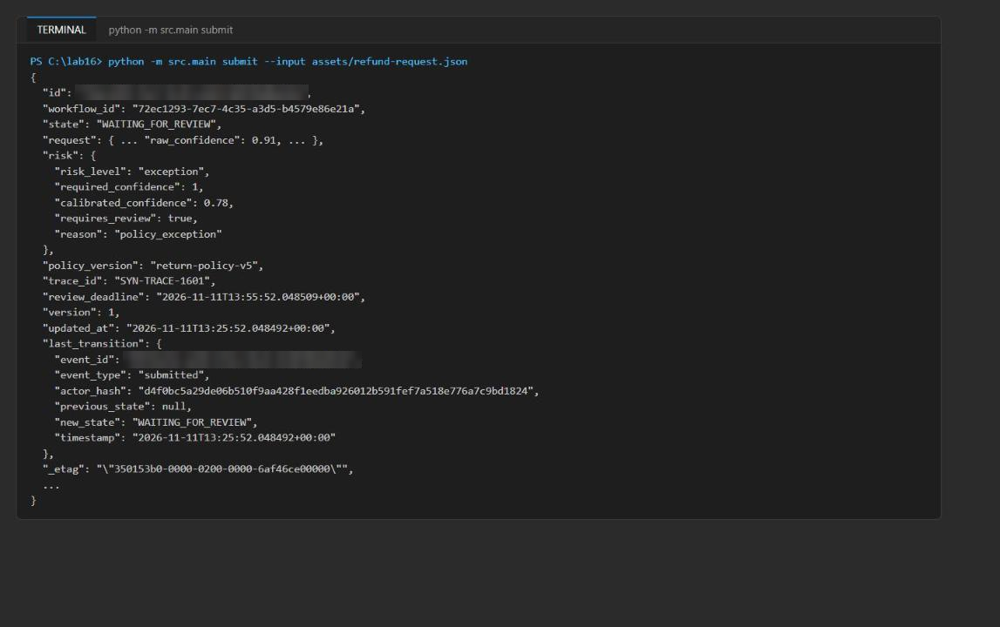

*Figure 8: submit returns durable state with risk evidence and an ETag*

2. Read the state back from Cosmos DB in a new process:

```powershell
python -m src.main status --workflow-id $A
```

3. Queue an approval, then let the resume worker apply it:

```powershell
python -m src.main decide --workflow-id $A --decision approved --reviewer SYN-REVIEWER-01 --comment "Within exception authority" --category within_authority
python -m src.main resume
```

**Expected result:** `decide` prints only `"decision_event": "queued"` (it does not touch Cosmos DB). `resume` returns the workflow with `state: EXECUTED`, `version: 2`, a `human_review` block, `execution.status: completed`, and a `last_transition` of type `decision_applied`.

4. Send the same decision again to simulate a duplicate delivery, then resume:

```powershell
python -m src.main decide --workflow-id $A --decision approved --reviewer SYN-REVIEWER-01 --comment "Duplicate redelivery test" --category within_authority
python -m src.main resume
```

**Expected result:** `resume` returns `{"workflow_id": "<A>", "state": "EXECUTED", "duplicate": true}`. The action is not executed twice; a `duplicate_decision` audit record is written instead.

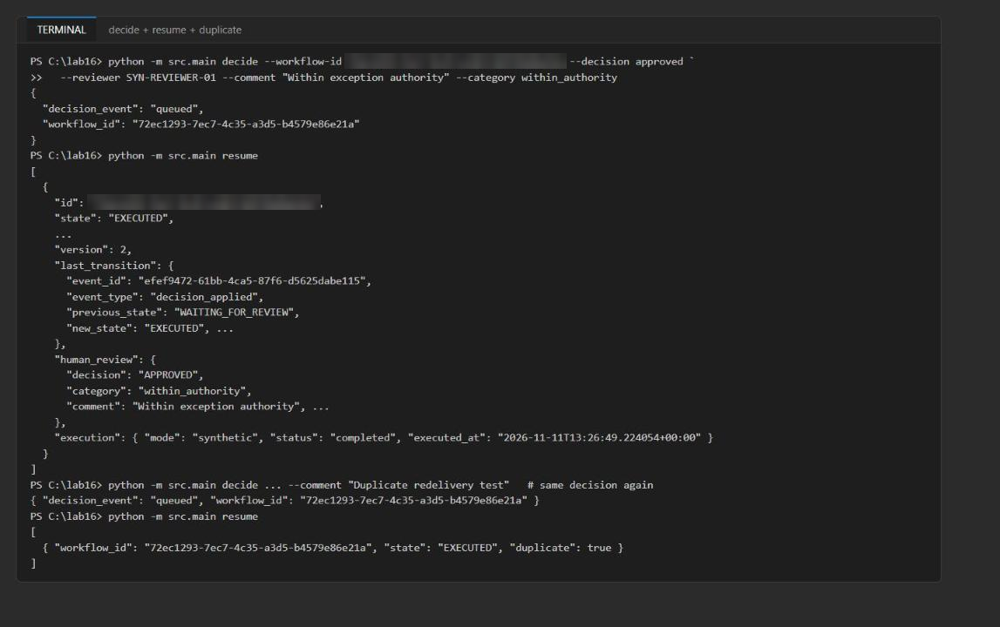

*Figure 9: decide queues the event, resume applies it once, and a duplicate is detected*

**Rejected, overridden, and cancelled paths**

5. Run the rejected path:

```powershell
$B = (python -m src.main submit --input assets/refund-request.json | Out-String | ConvertFrom-Json).id
python -m src.main decide --workflow-id $B --decision rejected --reviewer SYN-REVIEWER-02 --comment "Carrier delay evidence insufficient" --category insufficient_evidence
python -m src.main resume
```

**Expected result:** `state: REJECTED` and `execution: null`.

6. Run the overridden path:

```powershell
$C = (python -m src.main submit --input assets/refund-request.json | Out-String | ConvertFrom-Json).id
python -m src.main decide --workflow-id $C --decision overridden --reviewer SYN-REVIEWER-03 --comment "Supervisor override for gold tier" --category supervisor_override
python -m src.main resume
```

**Expected result:** `state: EXECUTED` with `execution.status: completed_after_override`.

7. Run the cancelled path (placeholders 4 and 5):

```powershell
$E = (python -m src.main submit --input assets/refund-request.json | Out-String | ConvertFrom-Json).id
python -m src.main decide --workflow-id $E --decision cancelled --reviewer SYN-REVIEWER-01 --comment "Customer withdrew request" --category customer_withdrew
python -m src.main resume
```

**Expected result:** `state: CANCELLED` with `execution.status: cancelled_before_execution` and `executed_at: null`.

**Overdue path (escalation)**

The supplied request has a 30-minute review deadline. To see escalation without waiting, create a copy with a zero-minute timeout.

8. Create `assets/refund-request-overdue.json`:

```powershell
$overdue = Get-Content assets/refund-request.json -Raw | ConvertFrom-Json
$overdue.request_id = 'SYN-REFUND-1602-OVERDUE'
$overdue.trace_id = 'SYN-TRACE-1602'
$overdue.review_timeout_minutes = 0
[IO.File]::WriteAllText("$PWD/assets/refund-request-overdue.json", ($overdue | ConvertTo-Json))
```

9. Submit it, wait a few seconds, and run the escalation scan:

```powershell
$D = (python -m src.main submit --input assets/refund-request-overdue.json | Out-String | ConvertFrom-Json).id
Start-Sleep -Seconds 3
python -m src.main escalate
python -m src.main status --workflow-id $D
```

**Expected result:** `escalate` prints `{"escalated": ["<D>"]}` and `status` shows `state: ESCALATED`, `version: 2`, and a `last_transition` of type `escalated`. The escalated request is also re-sent to the `approval-requests` queue for a senior reviewer.

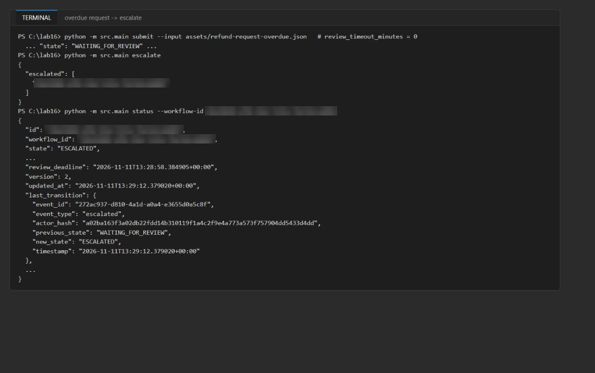

*Figure 10: The overdue request is escalated by the deadline scan*

> **Note:** `escalate` also picks up any other `WAITING_FOR_REVIEW` workflow whose 30-minute deadline has passed. If you paused for more than 30 minutes, you may see extra IDs; that is expected.

**Reviewer webhook (HTTP adapter)**

10. Load the Service Bus names from `.env` into variables so you can watch the decision queue:

```powershell
$envValues = @{}
Get-Content .env | ForEach-Object { if ($_ -match '^\s*([^#=]+)=\s*"?([^"]*)"?\s*$') { $envValues[$matches[1].Trim()] = $matches[2] } }
$rg = $envValues.AZURE_RESOURCE_GROUP
$ns = $envValues.SERVICE_BUS_NAMESPACE.Split('.')[0]
function Get-DecisionCount { az servicebus queue show -g $rg --namespace-name $ns -n approval-decisions --query countDetails.activeMessageCount -o tsv }
```

11. Submit one more request for the webhook test and note the decision queue count:

```powershell
$W = (python -m src.main submit --input assets/refund-request.json | Out-String | ConvertFrom-Json).id
$W
Get-DecisionCount
```

12. Open a second terminal (**Terminal > Split Terminal**), activate the environment, and start the webhook:

```powershell
cd Allfiles\16-adventure-works-human-approval
. ./.venv/Scripts/Activate.ps1
python -m src.reviewer_webhook --port 8080
```

**Expected result:** `Reviewer webhook listening on http://127.0.0.1:8080/api/reviewer-decisions`. Leave it running.

13. Back in the first terminal, post synthetic Adaptive Card data as an authenticated reviewer:

```powershell
$body = @{
  workflow_id = $W
  decision = 'APPROVED'
  comment = 'Synthetic local reviewer test'
  category = 'within_authority'
} | ConvertTo-Json
Invoke-RestMethod -Method Post -Uri 'http://127.0.0.1:8080/api/reviewer-decisions' `
  -Headers @{'X-MS-CLIENT-PRINCIPAL-ID'='SYN-REVIEWER-01'} `
  -ContentType 'application/json' -Body $body
```

**Expected result:** The response is `status: queued` with your workflow ID, and the webhook terminal logs `"POST /api/reviewer-decisions HTTP/1.1" 202`.

14. Prove that the endpoint rejects unauthenticated calls (no principal header):

```powershell
try {
  Invoke-RestMethod -Method Post -Uri 'http://127.0.0.1:8080/api/reviewer-decisions' -ContentType 'application/json' -Body '{}'
} catch { $_.Exception.Response.StatusCode.value__; $_.ErrorDetails.Message }
```

**Expected result:** `401` and `{"error":"authenticated_reviewer_required"}`.

15. Check the queue, resume, and check the queue again:

```powershell
Get-DecisionCount
python -m src.main resume
Get-DecisionCount
```

**Expected result:** The decision count goes from 0 to 1 after the POST and back to 0 after `resume`; the workflow is `EXECUTED` with the comment `Synthetic local reviewer test`.

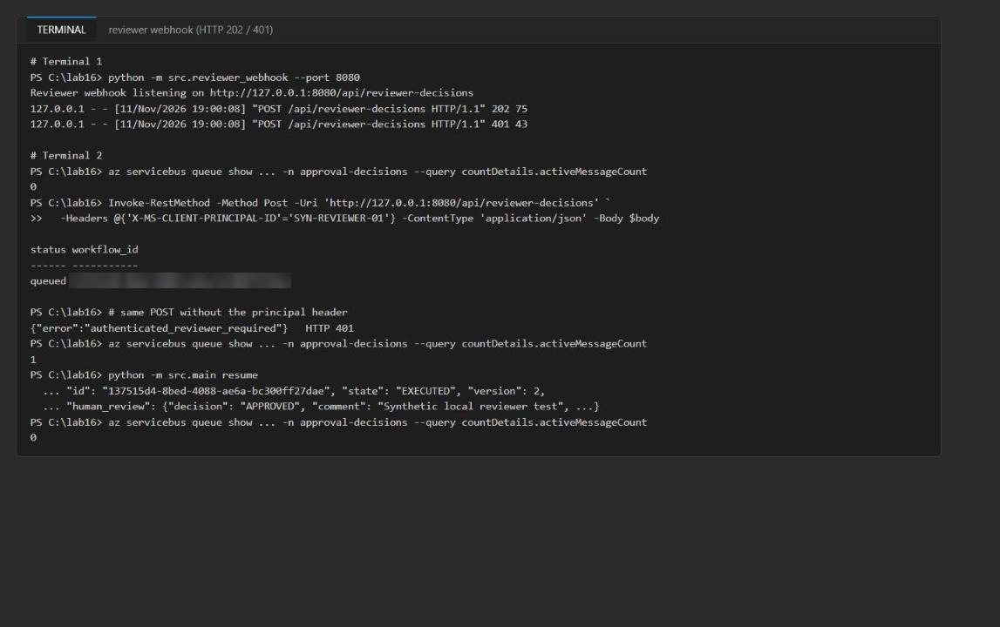

*Figure 11: Webhook returns 202, unauthenticated calls get 401, and the queue drains after resume*

16. Stop the webhook with **Ctrl+C** in the second terminal.

> **Note:** The webhook accepts only `APPROVED`, `REJECTED`, and `OVERRIDDEN`; cancellation goes through the CLI. In a hosted environment, the `X-MS-CLIENT-PRINCIPAL-ID` header must be set only by the platform's Microsoft Entra authentication layer (for example App Service authentication). Configure an optional Teams or Power Automate flow only after this local test works.

**Active-learning export**

17. Export the rejected and overridden examples:

```powershell
python -m src.active_learning --output reports/active-learning.jsonl --evaluation reports/active-learning-evaluation.json
```

**Expected result:** `example_count: 2`, `decision_counts: {OVERRIDDEN: 1, REJECTED: 1}`, `rejection_rate: 0.5`, `override_rate: 0.5`, `trace_coverage: 1`.

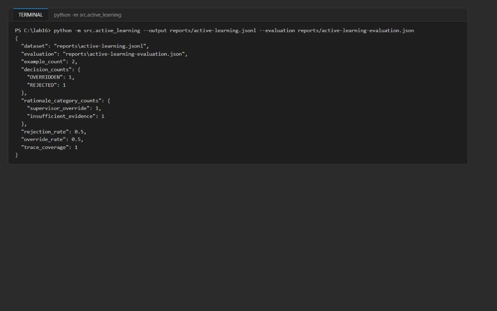

*Figure 12: Active-learning export with decision and rationale counts*

---

## Task 6: Validate the implementation

**Durable state and audit evidence (Azure portal)**

1. In the [Azure portal](https://portal.azure.com), open your resource group, then the Cosmos DB account `awapproval<token>`, and select **Data Explorer**.

2. Expand **approvals > workflow-state**, select **Items**, then **New SQL Query**, paste the query below, and select **Execute Query**:

```sql
SELECT c.id, c.state, c.version, c.human_review.decision, c.execution.status, c.trace_id FROM c
```

**Expected result:** One row per workflow you submitted: `EXECUTED` (approved and webhook), `REJECTED` with no execution, `EXECUTED` with `completed_after_override`, `CANCELLED` with `cancelled_before_execution`, and `ESCALATED` with no execution.

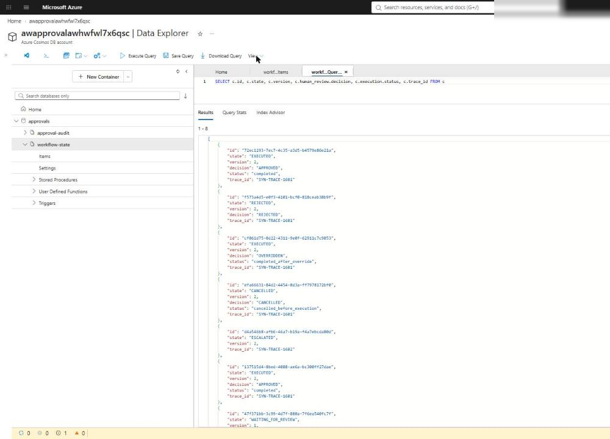

*Figure 13: workflow-state in Data Explorer shows every outcome with its version*

> **Note:** The Cosmos DB account has local (key) authentication disabled. If Data Explorer shows an authorization error, open the Data Explorer settings (gear icon) and set **Enable Entra ID RBAC** to **True**, then reload. Your user already has Cosmos DB Built-in Data Contributor from the template.

3. Select **approval-audit > Items > New SQL Query** and run:

```sql
SELECT c.workflow_id, c.event_type, c.previous_state, c.new_state, c.rationale_category, c.policy_version, c.trace_id, c.state_version, c.state_etag, c.actor_hash, c.timestamp FROM c ORDER BY c.timestamp
```

**Expected result:** Every record has a workflow ID, event ID, UTC timestamp (`+00:00`), actor hash, previous and new state (previous is `null` only for `submitted`), rationale category, policy version, trace ID, `state_etag`, and `state_version`. You see `submitted`, `decision_applied`, `duplicate_decision`, and `escalated` events.

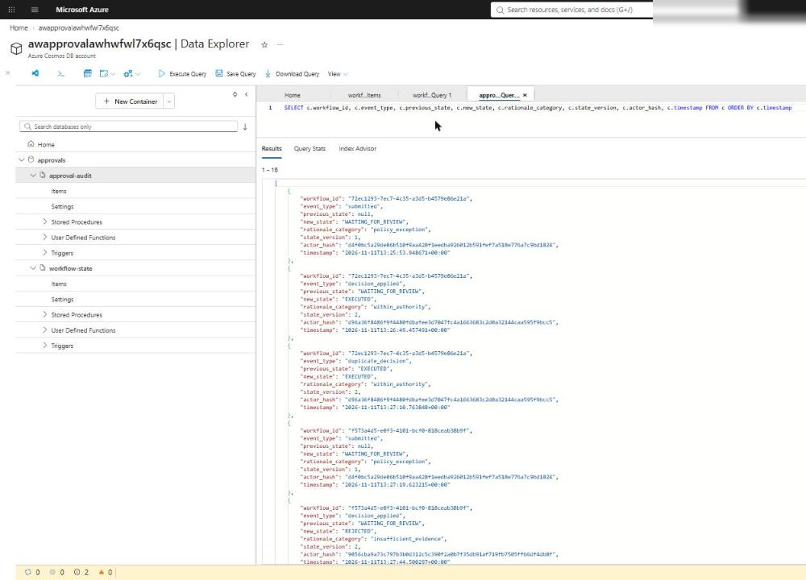

*Figure 14: approval-audit records with hashed actors and linked ETag and version*

4. Optional: run this read-only check from the terminal. It confirms that every state's `last_transition` links to an audit record with the same ETag and version, that no action executed from a pending, rejected, escalated, or cancelled state, and that the active-learning counts match Cosmos DB. Save it as `validate16.py` in the lab folder:

```python
"""Lab 16 validation: inspect Cosmos state + audit evidence (read-only)."""
import json
import os
from collections import Counter
from pathlib import Path

from azure.cosmos import CosmosClient
from azure.identity import DefaultAzureCredential
from dotenv import load_dotenv

load_dotenv(".env")
credential = DefaultAzureCredential(exclude_interactive_browser_credential=True)
db = CosmosClient(os.environ["COSMOS_ENDPOINT"], credential).get_database_client("approvals")
state = list(db.get_container_client("workflow-state").query_items("SELECT * FROM c", enable_cross_partition_query=True))
audit = list(db.get_container_client("approval-audit").query_items("SELECT * FROM c", enable_cross_partition_query=True))
print("workflow-state records:", len(state), dict(Counter(s["state"] for s in state)))
print("approval-audit records:", len(audit), dict(Counter(a["event_type"] for a in audit)))
required = ["workflow_id", "event_id", "timestamp", "actor_hash", "previous_state", "new_state",
            "rationale_category", "policy_version", "trace_id", "state_etag", "state_version"]
bad = [a["id"] for a in audit
       if any(k not in a or (a[k] is None and k != "previous_state") for k in required)
       or not a["timestamp"].endswith("+00:00")]
print("audit records missing fields or not UTC:", bad or "none")
ids = {a["id"]: a for a in audit}
unlinked = [s["id"] for s in state
            if s["last_transition"]["event_id"] not in ids
            or ids[s["last_transition"]["event_id"]]["state_version"] != s["version"]
            or ids[s["last_transition"]["event_id"]]["state_etag"] != s["_etag"]]
print("states not linked to an audit record:", unlinked or "none")
blocked = ("WAITING_FOR_REVIEW", "REJECTED", "ESCALATED", "CANCELLED")
viol = [s["id"] for s in state if s["state"] in blocked and (s.get("execution") or {}).get("executed_at")]
print("executions from pending/rejected/escalated/cancelled states:", viol or "none")
cosmos_counts = Counter(s["human_review"]["decision"] for s in state
                        if (s.get("human_review") or {}).get("decision") in ("REJECTED", "OVERRIDDEN"))
jsonl = [json.loads(l) for l in Path("reports/active-learning.jsonl").read_text().splitlines() if l.strip()]
evaluation = json.loads(Path("reports/active-learning-evaluation.json").read_text())
print("active-learning counts match:",
      dict(cosmos_counts) == evaluation["decision_counts"] == dict(Counter(j["human_decision"] for j in jsonl)))
```

```powershell
python validate16.py
```

**Expected result:** `missing fields or not UTC: none`, `not linked: none`, `executions from ...: none`, and `active-learning counts match: True`.

5. Open `reports/active-learning.jsonl` and `reports/active-learning-evaluation.json` in VS Code. Confirm the file contains only the rejected and overridden examples (2 lines) and that the counts match the Cosmos DB query in step 2.

**Reviewer path and Service Bus metrics**

6. In the portal, open the Service Bus namespace `awapproval-<token>`, select **Queues**, and confirm `approval-requests` and `approval-decisions` exist. `approval-decisions` should have 0 active messages after your last `resume`. `approval-requests` keeps a few active messages by design: it feeds a reviewer surface that this lab does not provision.

7. Select **Monitoring > Metrics** on the namespace. Add the metric **Incoming Messages** (aggregation **Sum**), select **Apply splitting** by **EntityName**, and set the time range to **Last hour**. Add a second chart with **Completed Messages**.

**Expected result:** Incoming messages on both queues, and completed messages on `approval-decisions` that match the number of decisions you resumed. This proves the reviewer path is asynchronous and observable.

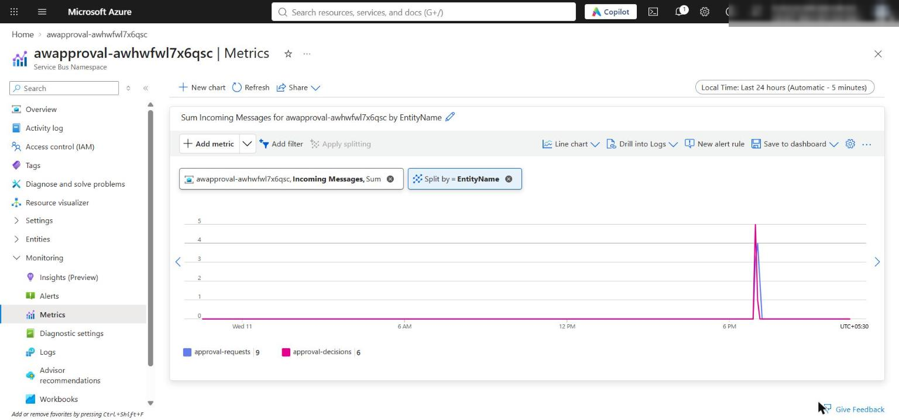

*Figure 15: Service Bus Incoming Messages (Sum) split by queue: approval-requests and approval-decisions (add a second chart for Completed Messages the same way)*

**Acceptance criteria**

| Criterion | How to check | Expected |
|---|---|---|
| Code compiles; preflight ready | Task 4 step 13 | No compile output; all checks `ready` |
| State survives restarts | `status` and `resume` in new processes; Data Explorer query | Records persist with increasing `version` |
| Audit records complete | Data Explorer audit query or `validate16.py` | All fields present, UTC timestamps, linked ETag/version |
| Approved/rejected/overridden/overdue outcomes | Task 5 and Data Explorer | EXECUTED, REJECTED, EXECUTED (override), ESCALATED |
| Duplicate decision is safe | Second `resume` on the same workflow | `duplicate: true`, no second execution |
| Webhook is authenticated and asynchronous | Task 5 steps 13-15 | HTTP 202 `queued`; 401 without header; queue 0 -> 1 -> 0 |
| No execution from pending or rejected | `validate16.py` | `none` |
| Active-learning counts match Cosmos DB | `validate16.py` and the report files | `True` (2 examples: 1 rejected, 1 overridden) |
| Resources | Portal or `az resource list` | Cosmos account, `approvals` with 2 containers; Service Bus namespace with 2 queues |

**Compare with the Durable Functions human-interaction pattern (conceptual)**

8. Read [Human interaction in Durable Functions](https://learn.microsoft.com/azure/durable-task/common/durable-task-human-interaction). In that pattern an orchestration waits for a named external approval event and starts a durable timer for the deadline; whichever finishes first wins, and the timer is cancelled when the approval arrives.

9. Map the concepts to this lab:

| Durable pattern concept | This lab |
|---|---|
| `WaitForExternalEvent("Approval")` | Decision event on the `approval-decisions` queue |
| Orchestration state and history | `workflow-state` container (state, `version`, `_etag`, `review_deadline`, `last_transition`) |
| Durable timer for the deadline | `review_deadline` plus the `escalate` scan |
| Race between approval and timer | ETag conflict resolution; escalation targets only still-waiting items |
| Event applied exactly once | `resume` + optimistic concurrency + terminal-state duplicate detection + idempotent audit IDs |

10. Record one tradeoff: this design exposes the queue and state mechanics and works without rewriting the app on Durable Functions, but the application now owns replay safety, deadline scheduling, duplicate handling, and race resolution that a durable orchestrator coordinates for you. Do not replace the lab's architecture; this is a conceptual comparison only.

---

## Optional challenge: Add a reviewer band

Route requests that need review to different synthetic reviewer groups based on calibrated confidence, then prove that replaying the same decision after a simulated timeout does not duplicate the action or the audit event.

1. In `src/workflow.py`, add this code directly after the `assess_risk()` function (before `send_decision_event()`):

```python
REVIEWER_BANDS = [
    # (minimum calibrated confidence, band name, synthetic reviewer group)
    (0.75, "near_threshold", "SYN-REVIEW-TIER1"),
    (0.0, "low_confidence", "SYN-REVIEW-SENIOR"),
]

def select_reviewer_band(calibrated: float, requires_review: bool) -> dict[str, Any]:
    """Pick a reviewer group by calibrated-confidence band."""
    if not requires_review:
        return {"review_band": None, "band_threshold": None, "reviewer_group": None}
    for threshold, band, group in REVIEWER_BANDS:
        if calibrated >= threshold:
            return {"review_band": band, "band_threshold": threshold, "reviewer_group": group}
    return {"review_band": None, "band_threshold": None, "reviewer_group": None}
```

2. At the end of `assess_risk()`, replace the `return { ... }` block with:

```python
    return {
        "risk_level": risk_level,
        "required_confidence": required_confidence,
        "calibrated_confidence": calibrated,
        "requires_review": requires_review,
        "reason": reason if requires_review else "confidence_sufficient",
        **select_reviewer_band(calibrated, requires_review),
    }
```

3. Create a low-confidence request (raw confidence 0.62 maps to a lower calibrated value):

```powershell
$low = Get-Content assets/refund-request.json -Raw | ConvertFrom-Json
$low.request_id = 'SYN-REFUND-1603-LOWBAND'
$low.trace_id = 'SYN-TRACE-1603'
$low.financial_amount = 120.0
$low.requires_exception = $false
$low.raw_confidence = 0.62
[IO.File]::WriteAllText("$PWD/assets/refund-request-lowband.json", ($low | ConvertTo-Json))
```

4. Save this script as `challenge16.py` in the lab folder. It submits both requests, applies one decision event, then replays the same event as if the worker had timed out before completing the message:

```python
"""Optional challenge: reviewer band + replay of the same decision after a simulated timeout."""
import json
import uuid
from pathlib import Path

from src.main import create_workflow
from src.workflow import utc_now

wf = create_workflow()
for path in ["assets/refund-request.json", "assets/refund-request-lowband.json"]:
    item = wf.submit(json.loads(Path(path).read_text(encoding="utf-8-sig")))
    r = item["risk"]
    print(f"{path}: state={item['state']} calibrated={r['calibrated_confidence']} "
          f"band={r['review_band']} threshold={r['band_threshold']} group={r['reviewer_group']}")
low = item
event = {"event_id": str(uuid.uuid4()), "workflow_id": low["id"], "decision": "APPROVED",
         "reviewer": "SYN-REVIEW-SENIOR-01", "comment": "Senior band approval",
         "category": "within_authority", "reviewed_at": utc_now()}

def audit_count() -> int:
    query = "SELECT c.id FROM c WHERE c.workflow_id=@w"
    return len(list(wf._audit.query_items(query, parameters=[{"name": "@w", "value": low["id"]}],
                                          partition_key=low["id"])))

first = wf.apply_decision(event)
print("first apply:", first["state"], "executed_at=", first["execution"]["executed_at"], "audit records=", audit_count())
second = wf.apply_decision(event)  # same event redelivered
after = wf.get(low["id"])
print("replay:", second, "| executed_at unchanged:",
      after["execution"]["executed_at"] == first["execution"]["executed_at"],
      "| version:", after["version"], "| audit records=", audit_count())
```

```powershell
python challenge16.py
```

**Expected result:** The supplied request lands in `near_threshold` / 0.75 / `SYN-REVIEW-TIER1`, the low-band request in `low_confidence` / 0.0 / `SYN-REVIEW-SENIOR`, both in `WAITING_FOR_REVIEW`. The replay returns `duplicate: True`, `executed_at unchanged: True`, `version: 2`, and the audit count stays at 2 (the replayed event ID already exists, so no new record is created).

---

## Task 7: Review the design

**Which signal should override high model confidence?** Business and policy signals: a policy exception, detected ambiguity, irreversibility, or high financial or customer impact force review regardless of confidence. In this lab the raw confidence is 0.91, but the calibrated (observed) accuracy is only 0.78 and the request needs a policy exception (required confidence 1.0), so it waits for review. Raw confidence is never trusted directly.

**Why does the resume worker own execution rather than the reviewer endpoint?** The endpoint only authenticates the reviewer and queues an event. The resume worker is the single place that reads durable state, checks allowed source states, writes the transition with an ETag (`IfNotModified`), executes the action, and appends audit evidence. That gives exactly-once state changes under retries and duplicates, survives restarts (the event waits in the queue), keeps Cosmos DB and execution permissions off the public HTTP surface, and makes the reviewer path observable through queue metrics.

**How would you prove that human oversight is substantive rather than rubber-stamping?** Measure it from the evidence: rejection and override rates (`active-learning-evaluation.json`), the spread of rationale categories, meaningful comments, time-to-decision compared with request complexity, and disagreement with the model on low-confidence bands. Seed known-bad synthetic canary requests and check they are rejected, and track whether human corrections change calibration or policy over time. Near-100% approvals with near-zero review time signal rubber-stamping.

---

## Troubleshooting

| Problem | Cause | Fix |
|---|---|---|
| `learner_code_complete: not ready` | A `# LAB PLACEHOLDER` comment is still in `src/` | Delete every placeholder comment after pasting the code |
| `IndentationError` after pasting | The official lab snippets use 2-space indentation | Use the 4-space code in this guide; methods are indented 4 spaces, their bodies 8 |
| 403 / `Forbidden` / `Unauthorized` from Cosmos DB or Service Bus | Role assignments from the template have not propagated yet | Wait 1-5 minutes and retry; confirm `AZURE_PRINCIPAL_ID` is your object ID (`az ad signed-in-user show --query id -o tsv`) |
| `DefaultAzureCredential failed to retrieve a token` | Not signed in to the Azure CLI in this terminal | Run `az login` and `az account set --subscription <id>` |
| `KeyError: 'COSMOS_ENDPOINT'` | `.env` is missing or is not in the lab folder | Re-run the `.env` part of the Task 3 block from `Allfiles\16-adventure-works-human-approval` |
| `escalate` returns `[]` | No request is past its deadline | Use `assets/refund-request-overdue.json` (timeout 0) and wait a few seconds |
| `json.decoder.JSONDecodeError: Unexpected UTF-8 BOM` on submit | A JSON file was saved with a byte-order mark (for example by `Out-File` in Windows PowerShell 5.1) | Create the file with the `[IO.File]::WriteAllText` command shown, or re-save it in VS Code as UTF-8 (not UTF-8 with BOM) |
| `approval-requests` keeps active messages | No consumer in this lab; it feeds a reviewer surface | Expected; deleted with the resource group |
| Webhook returns 400 `Unsupported decision CANCELLED` | The webhook accepts only APPROVED, REJECTED, OVERRIDDEN | Cancel through `python -m src.main decide --decision cancelled` |

---

## Clean up (optional)

Do this when you no longer need the resources. Cosmos DB and Service Bus keep billing while they exist.

1. Stop the webhook (Ctrl+C) if it is still running.

2. Delete the resource group:

```powershell
az group delete --name <your-resource-group> --yes --no-wait
```

3. Remove the local `.env` file and generated reports you don't need:

```powershell
Remove-Item .env
```

4. Deactivate the virtual environment in every terminal that shows `(.venv)`:

```powershell
deactivate
```

