# Lab 17: Debug a multi-agent production incident with trace evidence

**Scenario.** Adventure Works sees a drop in checkout completion. The failing payment span may be only a symptom. The on-call team needs a repeatable way to reconstruct distributed traces, preserve replay inputs, compare failed and successful paths, test competing hypotheses, and write a root cause that is backed by evidence.

**What you build.** You emit a bounded synthetic multi-agent incident (checkout orchestrator, pricing agent, payment agent) through OpenTelemetry into Application Insights. You query it with KQL, save a sanitized replay snapshot to Blob Storage, reconstruct the trace without side effects, evaluate five structured hypotheses, let an Azure Monitor alert route an event to Event Hubs for a bounded remediation consumer, and generate a blameless postmortem that cites only observed evidence.

**Duration.** About 45 minutes (plus 5 minutes for provisioning and 5-10 minutes of telemetry ingestion and alert delay).

> **Note:** Log Analytics and Application Insights ingestion, Event Hubs Standard, and Storage are billable. Emit only the four bounded synthetic traces. Snapshots contain mocked tool results only, with no customer PII and no hidden model reasoning. No Foundry project or model is used in this lab. Delete the resource group when you finish (see Clean up).

| Component | Azure resource / file | Purpose |
|---|---|---|
| Telemetry store | Log Analytics workspace `aw-incident-<token>` + Application Insights `aw-incident-<token>` (local auth disabled) | Receives OpenTelemetry spans; queried with KQL (`AppRequests`, `AppDependencies`) |
| Snapshot and report store | Storage account `awincident<token>` (shared keys disabled), containers `trace-snapshots` and `incident-reports` | Sanitized replay snapshots, postmortems, remediation evidence |
| Alert | Scheduled query rule `aw-synthetic-pricing-failure` (every 1 min over 15 min) | Detects failed synthetic pricing spans |
| Alert routing | Action Group `aw-incident-response` -> Event Hubs namespace `aw-incident-alerts-<token>`, hub `incident-alerts` | Delivers common-schema alerts to the remediation consumer |
| Emitter | `scripts/emit_synthetic_trace.py` | Sends 2 successful and 2 failed checkout traces |
| Investigation CLI | `src/main.py` (`candidates`, `capture`) | Runs KQL and builds the sanitized snapshot |
| Hypothesis engine | `src/analysis.py` + `assets/hypotheses.json` | Generic predicates over snapshot paths |
| Safe replay | `src/replay.py` | Verifies prompt hashes and substitutes captured tool mocks; no side effects |
| Remediation | `src/remediation.py` | Bounded Event Hubs receiver that records proposed actions as evidence |
| Postmortem | `src/postmortem.py` + `assets/postmortem-template.md` | Evidence-linked blameless report |

The incident path is: synthetic trace -> KQL investigation -> sanitized snapshot -> safe replay -> hypothesis decision -> bounded remediation -> evidence-linked postmortem.

## Prerequisites

- An Azure subscription where you can create Log Analytics, Application Insights, Storage, Event Hubs, alert rules, and role assignments (Owner, or Contributor plus User Access Administrator).
- [Python 3.10 or later](https://www.python.org/downloads/)
- [Azure CLI](https://learn.microsoft.com/cli/azure/install-azure-cli) with Bicep (`az bicep install`)
- [Visual Studio Code](https://code.visualstudio.com/) and [Git](https://git-scm.com/downloads)
- PowerShell 7 is recommended for the commands in this guide.

> **Note:** The official lab uses the Azure Developer CLI (`azd provision`). This guide deploys the same Bicep template directly with the Azure CLI, so `azd` is not required.

Sign in to Azure and select your subscription:

```powershell
az login
az account set --subscription "<your-subscription-id>"
az account show --output table
```

---

## Task 1: Prepare the lab

1. Clone the lab repository (skip this if you already have it):

```powershell
git clone https://github.com/MicrosoftLearning/mslearn-ai-multi-agents.git
```

2. Open the `mslearn-ai-multi-agents` folder in Visual Studio Code and open a terminal (**Terminal > New Terminal**).

3. Move to the lab folder and verify the tools:

```powershell
cd Allfiles\17-adventure-works-incident-response
az version
az bicep version
python --version
az account show --output table
```

**Expected result:** Each command prints a version (Python 3.10 or later), and `az account show` shows the subscription you want to use.

4. Architecture checkpoint. Skim these files:

- `scripts/emit_synthetic_trace.py`: emits `POST /synthetic/checkout` (server span) with child spans `pricing_agent.calculate_total` and `payment_agent.authorize`. Failed cases use model `synthetic-pricing-v2` and raise `SyntheticPriceFormatError`; successful cases use `synthetic-pricing-v1`.
- `assets/trace-snapshot.schema.json` and `assets/hypotheses.json`: the snapshot contract and five hypotheses (model version, prompt, tool, orchestration, configuration).
- `kql/01-find-candidates.kql`, `kql/02-trace-detail.kql`, `kql/03-hypothesis-comparison.kql`: discovery, single-trace detail, and cohort comparison.
- `src/main.py`, `src/replay.py`, `src/remediation.py`, `.env.example`, and `infra/main.bicep`.

---

## Task 2: Build the virtual environment

1. Create the virtual environment and install the requirements:

```powershell
./scripts/setup.ps1
```

2. Activate it:

```powershell
. ./.venv/Scripts/Activate.ps1
```

> **Note:** On macOS or Linux run `bash scripts/setup.sh` and `source .venv/bin/activate`. If PowerShell blocks the script, run `Set-ExecutionPolicy -Scope Process -ExecutionPolicy Bypass` first.

**Expected result:** The prompt starts with `(.venv)`. The official lab also copies `.env.example` to `.env` here; you can skip that, because Task 3 writes `.env` from the deployment outputs.

---

## Task 3: Deploy Azure resources

The Bicep template takes two parameters, `location` and `principalId`. It also assigns every role you need, scoped as tightly as possible: **Azure Event Hubs Data Receiver** on the `incident-alerts` hub only, **Storage Blob Data Contributor** on the storage account, **Log Analytics Reader** on the workspace, and **Monitoring Metrics Publisher** on Application Insights (needed because local auth is disabled). Do not add broader Event Hubs roles; the boundary check in step 6 fails if you do.

1. Review the costs in the overview and pick a region that offers all the services (tested in `eastus2`).

2. From the lab folder, run this block. It creates a unique resource group, deploys the template, and writes `.env`:

```powershell
$azureRegion = 'eastus2'
$suffix = (New-Guid).Guid.Substring(0, 8)
$resourceGroupName = "rg-lab17-$suffix"
$envName = "lab17-$suffix"
$principalId = az ad signed-in-user show --query id -o tsv
az group create --name $resourceGroupName --location $azureRegion --output none
az bicep build --file infra/main.bicep
az deployment group create --resource-group $resourceGroupName --name lab17-main `
  --template-file infra/main.bicep `
  --parameters location=$azureRegion principalId=$principalId `
  --output none
# Write .env from the deployment outputs
$outputs = az deployment group show --resource-group $resourceGroupName --name lab17-main --query properties.outputs -o json | ConvertFrom-Json
$lines = @("AZURE_RESOURCE_GROUP=`"$resourceGroupName`"", "AZURE_LOCATION=`"$azureRegion`"", "AZURE_ENV_NAME=`"$envName`"",
  "AZURE_SUBSCRIPTION_ID=`"$(az account show --query id -o tsv)`"", "AZURE_PRINCIPAL_ID=`"$principalId`"", "AZURE_PRINCIPAL_TYPE=`"User`"")
$outputs.PSObject.Properties | ForEach-Object { $lines += "$($_.Name.ToUpper())=`"$($_.Value.value)`"" }
$lines | Out-File .env -Encoding utf8
Get-Content .env
```

**Expected result:** The deployment takes about 3-5 minutes. `.env` contains these keys (values abbreviated):

```text
AZURE_RESOURCE_GROUP="rg-lab17-<suffix>"
AZURE_LOCATION="eastus2"
AZURE_ENV_NAME="lab17-<suffix>"
AZURE_SUBSCRIPTION_ID="<subscription-id>"
AZURE_PRINCIPAL_ID="<your-object-id>"
AZURE_PRINCIPAL_TYPE="User"
APPLICATIONINSIGHTS_CONNECTION_STRING="InstrumentationKey=<guid>;IngestionEndpoint=https://eastus2-...;ApplicationId=<guid>"
LOG_ANALYTICS_WORKSPACE_ID="<workspace-customer-id>"
BLOB_ACCOUNT_URL="https://awincident<token>.blob.core.windows.net/"
SNAPSHOT_CONTAINER="trace-snapshots"
REPORT_CONTAINER="incident-reports"
ALERT_EVENTHUB_NAMESPACE="aw-incident-alerts-<token>.servicebus.windows.net"
ALERT_EVENTHUB_NAME="incident-alerts"
ALERT_RULE_ID="/subscriptions/<subscription-id>/resourceGroups/rg-lab17-<suffix>/providers/Microsoft.Insights/scheduledQueryRules/aw-synthetic-pricing-failure"
ACTION_GROUP_ID="/subscriptions/<subscription-id>/resourceGroups/rg-lab17-<suffix>/providers/Microsoft.Insights/actionGroups/aw-incident-response"
```

> **Note:** `APPLICATIONINSIGHTS_CONNECTION_STRING` is required by the emitter. It contains only the ingestion endpoint and instrumentation key; because Application Insights has local auth disabled, ingestion still requires your Entra token and the Monitoring Metrics Publisher role. Do not add storage keys, shared-access keys, or tokens to `.env`.

3. Verify that `.env` has the Application Insights and Log Analytics identifiers, the Blob endpoint and both container names, the Event Hubs namespace and hub, and the principal values.

4. List the resources:

```powershell
az resource list --resource-group $resourceGroupName --query "[].{name:name, type:type}" --output table
```

**Expected result:** Six resources: a storage account, a Log Analytics workspace, an Event Hubs namespace, an Application Insights component, an action group, and a scheduled query rule.

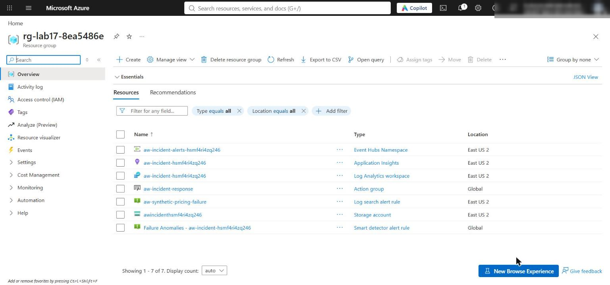

*Figure 1: The lab 17 resource group with the monitoring, storage, and Event Hubs resources*

> **Note:** Role assignments can take 1-5 minutes to apply. If a later command returns 403 / AuthorizationFailed, wait and retry.

5. Load the `.env` values into a PowerShell hashtable. Later steps reuse `$envValues`, `$rg`, `$acct`, and `$ehNs`; if you open a new terminal, run this again:

```powershell
$envValues = @{}
Get-Content .env | ForEach-Object { if ($_ -match '^\s*([^#=]+)=\s*"?([^"]*)"?\s*$') { $envValues[$matches[1].Trim()] = $matches[2] } }
$rg = $envValues.AZURE_RESOURCE_GROUP
$principalId = $envValues.AZURE_PRINCIPAL_ID
$acct = ($envValues.BLOB_ACCOUNT_URL -replace '^https://', '').Split('.')[0]
$ehNs = $envValues.ALERT_EVENTHUB_NAMESPACE -replace '\.servicebus\.windows\.net$', ''
```

6. Verify the Event Hubs network boundary and the receiver authorization:

```powershell
$networkBoundary = az eventhubs namespace network-rule-set show --namespace-name $ehNs --resource-group $rg --query "{publicNetworkAccess:publicNetworkAccess,defaultAction:defaultAction}" | ConvertFrom-Json
if ($networkBoundary.publicNetworkAccess -ne 'Enabled' -or $networkBoundary.defaultAction -ne 'Allow') { throw 'Unexpected Event Hubs network configuration' }
$eventHubId = az eventhubs eventhub show --name $envValues.ALERT_EVENTHUB_NAME --namespace-name $ehNs --resource-group $rg --query id -o tsv
$receiverRoles = @(az role assignment list --assignee $principalId --scope $eventHubId --query "[?roleDefinitionName=='Azure Event Hubs Data Receiver'].{role:roleDefinitionName,scope:scope}" | ConvertFrom-Json)
if ($receiverRoles.Count -ne 1 -or $receiverRoles[0].scope -ne $eventHubId) { throw 'Expected one Event Hubs Data Receiver assignment at the exact hub scope' }
$dataPlaneRoles = @(az role assignment list --assignee $principalId --all --query "[?starts_with(scope, '$eventHubId') && (roleDefinitionName=='Azure Event Hubs Data Sender' || roleDefinitionName=='Azure Event Hubs Data Owner')].{role:roleDefinitionName,scope:scope}" | ConvertFrom-Json)
if ($dataPlaneRoles.Count -ne 0) { throw 'The remediation receiver must not inherit Event Hubs Data Sender or Data Owner on this hub' }
[pscustomobject]@{
  publicNetworkAccess = $networkBoundary.publicNetworkAccess
  defaultAction = $networkBoundary.defaultAction
  receiverRole = $receiverRoles[0].role
  receiverScope = $receiverRoles[0].scope
  broaderDataPlaneRoles = $dataPlaneRoles.Count
} | Format-List
'EVENT_HUB_BOUNDARIES_VALIDATED'
```

**Expected result:** `Enabled` / `Allow`, one **Azure Event Hubs Data Receiver** role at the exact hub scope, `broaderDataPlaneRoles : 0`, and `EVENT_HUB_BOUNDARIES_VALIDATED`. The namespace allows public network access so your local consumer can receive alerts; Entra authentication and the exact-hub receiver role are still required. Production environments should use an approved private access path.

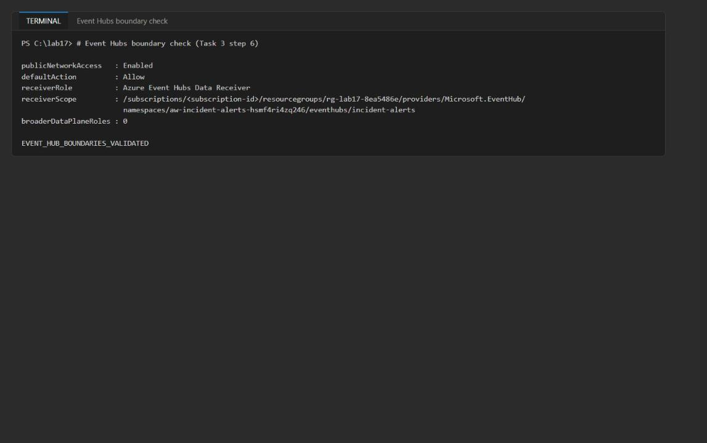

*Figure 2: The Event Hubs boundary check passes*

> **Note:** If the receiver check throws right after deployment, the role assignment may still be propagating; wait a minute and rerun step 6.

---

## Task 4: Implement the solution

Each `# LAB PLACEHOLDER` comment marks incomplete code. Delete the placeholder comment as you paste, because `preflight.py --require-complete` counts the markers. The code below uses 4-space indentation to match the files (the official lab text uses 2 spaces).

**Placeholder 1: build a sanitized replay snapshot**

1. Open `src/main.py` and find `# LAB PLACEHOLDER 1` in `sanitize_rows()`.

2. Replace the placeholder comment and the six empty declarations below it (`spans: list[...] = []` through `tool_mocks: dict[...] = {}`) with the code below. Keep the existing `return { "schema_version": "1.0", ... }` block that follows.

```python
    spans = []
    deployments = {}
    configurations = {}
    prompts = {}
    prompt_hashes = {}
    tool_mocks = {}
    for row in rows:
        properties = row.get("Properties") or {}
        if isinstance(properties, str):
            properties = json.loads(properties)
        span = {
            "time_generated": row.get("TimeGenerated"),
            "span_id": row.get("Id"),
            "parent_id": row.get("ParentId"),
            "span_name": row.get("SpanName"),
            "duration_ms": row.get("DurationMs"),
            "success": row.get("Success"),
            "result_code": row.get("ResultCode"),
            "model_version": properties.get("gen_ai.request.model"),
            "configuration_version": properties.get("agent.configuration.version"),
            "prompt_hash": properties.get("gen_ai.prompt.hash"),
            "error_type": properties.get("incident.error.type"),
            "tool_name": properties.get("tool.name"),
            "tool_mock_id": properties.get("tool.mock_id"),
            "tool_mock_response_available": properties.get("tool.mock_response") is not None,
        }
        spans.append(span)
        if span["model_version"]:
            deployments[span["span_name"]] = {
                "agent": span["span_name"], "version": span["model_version"]
            }
        if span["configuration_version"]:
            configurations[span["span_name"]] = {
                "component": span["span_name"], "version": span["configuration_version"]
            }
        if properties.get("gen_ai.prompt.hash"):
            prompt_hashes[span["span_name"]] = properties["gen_ai.prompt.hash"]
        if properties.get("gen_ai.prompt.template"):
            prompts[span["span_name"]] = properties["gen_ai.prompt.template"]
        if span["tool_name"]:
            mock_response = properties.get("tool.mock_response")
            tool_success = properties.get("tool.response.success")
            if isinstance(tool_success, str) and tool_success.lower() in {"true", "false"}:
                tool_success = tool_success.lower() == "true"
            tool_mocks[span["tool_name"]] = {
                "mock_id": span["tool_mock_id"],
                "response": json.loads(mock_response) if isinstance(mock_response, str) else mock_response,
                "success": tool_success,
                "synthetic": True,
            }
```

Only the named fields cross the telemetry boundary; message bodies, credentials, and hidden reasoning are never copied.

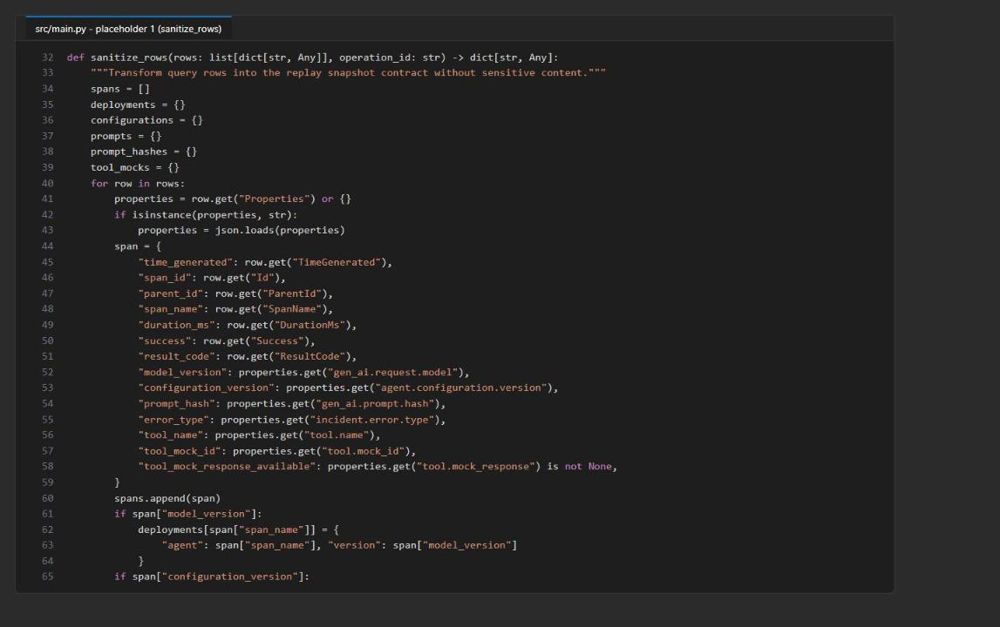

*Figure 3: sanitize_rows() maps KQL rows to the snapshot contract*

**Placeholder 2: resolve generic evidence paths**

3. Open `src/analysis.py` and find `# LAB PLACEHOLDER 2` in `values_at_path()`.

4. Replace the whole function (the `def` line, the placeholder comment, and `return []`) with:

```python
def values_at_path(document: Any, path: str) -> list[Any]:
    values = [document]
    for segment in path.split("."):
        expanded = []
        for value in values:
            if segment == "*" and isinstance(value, list):
                expanded.extend(value)
            elif segment == "*" and isinstance(value, dict):
                expanded.extend(value.values())
            elif isinstance(value, dict) and segment in value:
                expanded.append(value[segment])
        values = expanded
    return values
```

The `*` wildcard lets a hypothesis address any collection (for example `spans.*.error_type`) without hard-coding incident-specific IDs.

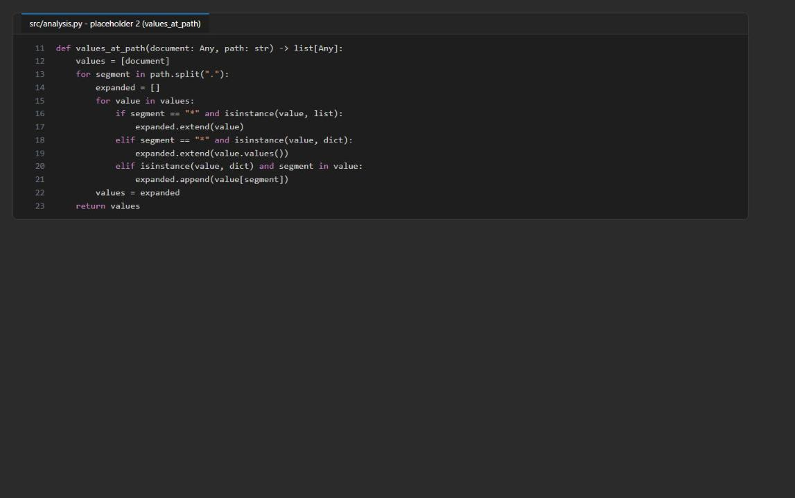

*Figure 4: values_at_path() with wildcard traversal*

**Placeholder 3: add the less-than predicate**

5. In `evaluate_hypothesis()`, find `# LAB PLACEHOLDER 3` (between the `greater_than` branch and the `changed` branch).

6. Replace the placeholder comment with this branch (8 spaces before `elif`):

```python
        elif operator == "less_than":
            passed = any(float(value) < float(expected) for value in values)
```

Failed predicates are still recorded as contradicting evidence and absent paths as missing evidence.

**Placeholder 4: reconstruct the trace with captured mocks**

7. Open `src/replay.py` and find `# LAB PLACEHOLDER 4` in `reconstruct_trace()`.

8. Replace the whole function (from `def reconstruct_trace` down to and including its existing `return { ... }` block) with:

```python
def reconstruct_trace(snapshot: dict[str, Any]) -> dict[str, Any]:
    if snapshot.get("replay_mode") is not True:
        raise ValueError("Snapshot must explicitly enable replay mode")
    prompt_checks = []
    for agent, prompt in snapshot.get("prompts", {}).items():
        actual = hashlib.sha256(prompt.encode()).hexdigest()
        expected = snapshot.get("prompt_hashes", {}).get(agent)
        prompt_checks.append({
            "agent": agent, "expected_hash": expected,
            "actual_hash": actual, "matches": actual == expected,
        })
    steps = []
    for index, span in enumerate(snapshot.get("spans", []), start=1):
        tool_name = span.get("tool_name")
        mock = snapshot.get("tool_mocks", {}).get(tool_name) if tool_name else None
        status = span.get("success", span.get("status", span.get("Success")))
        duration_ms = span.get("duration_ms", span.get("DurationMs"))
        steps.append({
            "sequence": index,
            "span_name": span.get("span_name") or span.get("Name"),
            "status": status,
            "mock_used": mock is not None,
            "mock_response": mock.get("response") if mock else None,
            "duration_ms": duration_ms,
        })
    divergences = [check for check in prompt_checks if not check["matches"]]
    tool_steps = [step for step in steps if step["mock_used"]]
    metrics = {
        "prompt_count": len(prompt_checks),
        "prompt_match_rate": round(
            sum(check["matches"] for check in prompt_checks) / len(prompt_checks), 4
        ) if prompt_checks else 0.0,
        "tool_step_count": len(tool_steps),
        "tool_mock_response_count": sum(step["mock_response"] is not None for step in tool_steps),
        "failed_step_count": sum(step["status"] is False for step in steps),
        "divergence_count": len(divergences),
    }
    return {
        "operation_id": snapshot["operation_id"],
        "side_effects_enabled": False,
        "prompt_checks": prompt_checks,
        "steps": steps,
        "divergences": divergences,
        "comparison_metrics": metrics,
    }
```

This controlled reconstruction verifies prompt hashes and substitutes the captured synthetic tool responses. It does not re-execute the model or call a production tool.

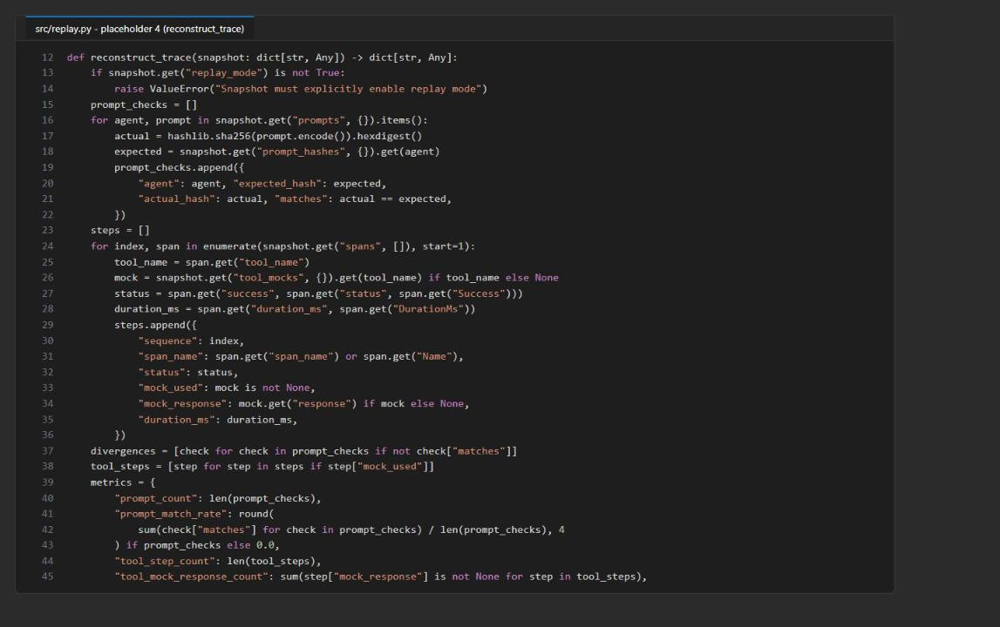

*Figure 5: reconstruct_trace() checks prompt hashes and uses captured mocks*

**Placeholder 5: synthesize only supported evidence**

9. Open `src/postmortem.py` and find `# LAB PLACEHOLDER 5` in `summarize_evidence()`.

10. Replace the whole function (the `def` line, the placeholder comment, and the existing `return ( ... )`) with:

```python
def summarize_evidence(analysis: list[dict[str, Any]], replay: dict[str, Any]) -> tuple[str, str]:
    metrics = replay["comparison_metrics"]
    supported = sorted(
        (item for item in analysis if item["status"] == "supported"),
        key=lambda item: item["priority"],
    )
    leading = supported[0] if supported else None
    observed = leading["supporting"] if leading else []
    evidence_summary = "; ".join(
        f"{item['path']} observed {json.dumps(item['observed'], sort_keys=True)}"
        for item in observed[:3]
    ) or "No causal observation has enough supporting evidence."
    if metrics["divergence_count"]:
        agents = ", ".join(item["agent"] for item in replay["divergences"])
        root_cause = (
            f"Replay detected {metrics['divergence_count']} prompt divergence(s) for {agents}; "
            "the causal statement remains bounded to the observed comparison evidence."
        )
    elif (
        leading and metrics["prompt_match_rate"] == 1.0
        and metrics["tool_step_count"] > 0
        and metrics["tool_mock_response_count"] == metrics["tool_step_count"]
    ):
        root_cause = (
            f"{leading['statement']} Evidence: {evidence_summary}. Replay matched "
            f"{metrics['prompt_count']} prompt(s), used {metrics['tool_mock_response_count']}/"
            f"{metrics['tool_step_count']} captured tool response(s), and preserved "
            f"{metrics['failed_step_count']} failed step(s)."
        )
    else:
        root_cause = "Root cause is not yet established because replay or comparison evidence is incomplete."
    return root_cause, evidence_summary
```

The report selects only the highest-priority supported hypothesis and refuses to overstate incomplete replay evidence.

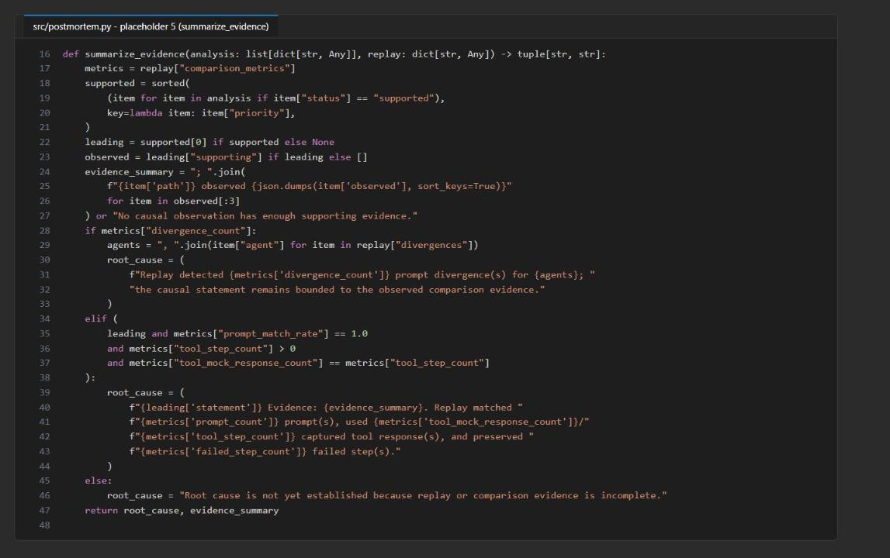

*Figure 6: summarize_evidence() cites observed values and replay metrics*

**Check the completed code**

11. Save all files and run:

```powershell
python -m py_compile src/main.py src/analysis.py src/replay.py src/postmortem.py src/remediation.py
python scripts/preflight.py --require-complete
```

**Expected result:** `py_compile` prints nothing, and because `.env` exists every preflight check reports `ready` (`three_kql_queries`, `hypotheses_present`, `hypotheses_match_snapshot`, `app_insights_connection`, `workspace_id`, `blob_account_url`, `alert_eventhub_namespace`, `learner_code_complete`). Preflight does not send telemetry or read Azure data.

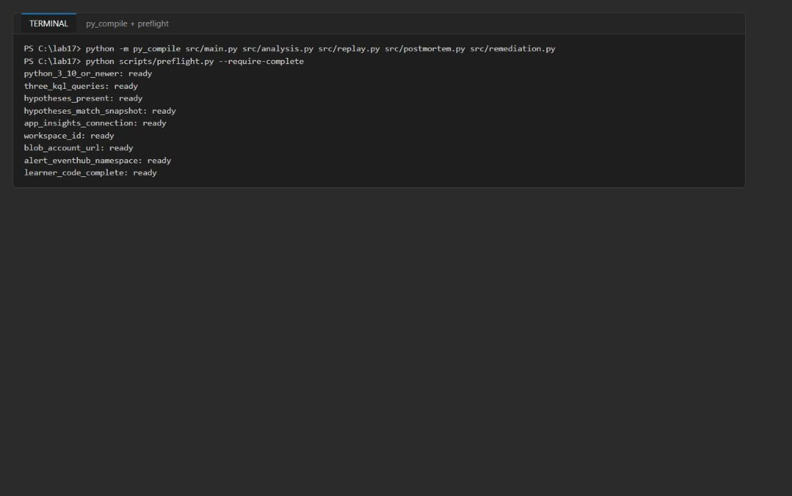

*Figure 7: py_compile is silent and every preflight check is ready*

---

## Task 5: Run the solution

**Emit and find the incident traces**

1. Emit the bounded synthetic cohort (2 successful and 2 failed checkouts):

```powershell
python scripts/emit_synthetic_trace.py
```

**Expected result:** `Emitted and flushed four bounded synthetic traces. Allow several minutes for ingestion.` The emitter sends the root checkout as a server request, uses a fixed 1.0 sampling ratio, and flushes before exit, so all four traces reach `AppRequests` and `AppDependencies`.

2. Wait 3-5 minutes, then run the discovery query and pick a failed operation:

```powershell
$candidates = python -m src.main candidates --query kql/01-find-candidates.kql | Out-String | ConvertFrom-Json
$candidates | Format-Table TimeGenerated, OperationId, CaseId, Success, DurationMs
$op = ($candidates | Where-Object { $_.CaseId -eq 'SYN-FAILURE-01' } | Select-Object -First 1).OperationId
$op
```

**Expected result:** Four rows: `SYN-SUCCESS-01` and `SYN-SUCCESS-02` with `Success = True` and about 51 ms, and `SYN-FAILURE-01` and `SYN-FAILURE-02` with `Success = False` and about 351 ms. `$op` holds the 32-character operation ID of `SYN-FAILURE-01`.

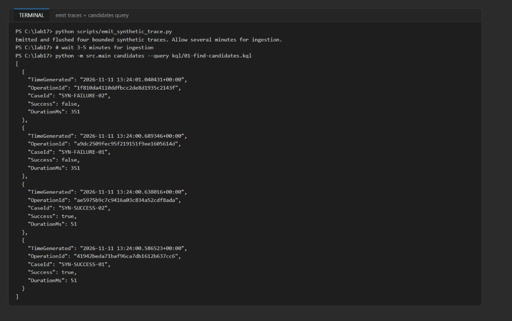

*Figure 8: The candidate query returns both successful and failed synthetic checkouts*

> **Note:** If the query returns `[]` or fewer than four rows, ingestion is still in progress. Wait a minute and run step 2 again. Do not rerun the emitter, or you will get duplicate cases.

**Capture, analyze, and replay**

3. Capture the trace detail as a sanitized snapshot (saved locally and uploaded to `trace-snapshots`):

```powershell
python -m src.main capture --operation-id $op --query kql/02-trace-detail.kql
```

**Expected result:** `local_snapshot: reports\<op>.snapshot.json` and `blob: <op>.snapshot.json`.

4. Evaluate the hypotheses against the snapshot:

```powershell
python -m src.analysis --snapshot reports/$op.snapshot.json --hypotheses assets/hypotheses.json
```

**Expected result:** The output is also saved to `reports/hypothesis-results.json`. `pricing_model_version_regression` is `supported` (observed `synthetic-pricing-v2`, `SyntheticPriceFormatError`, and `success: false`). The other four hypotheses are `rejected` with `missing: []`.

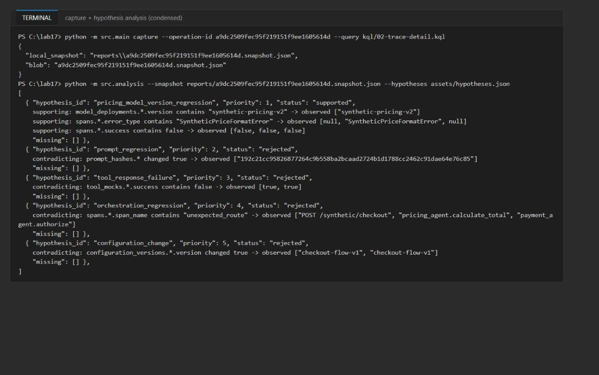

*Figure 9: Snapshot captured; only the pricing model-version hypothesis is supported*

5. Reconstruct the trace without side effects:

```powershell
python -m src.replay --snapshot reports/$op.snapshot.json --output reports/replay-comparison.json
```

**Expected result:** `side_effects_enabled: false`, one prompt check with `matches: true`, three steps with `status: false` (two of them with mock responses), and `comparison_metrics` of `prompt_match_rate 1.0`, `tool_step_count 2`, `tool_mock_response_count 2`, `failed_step_count 3`, `divergence_count 0`.

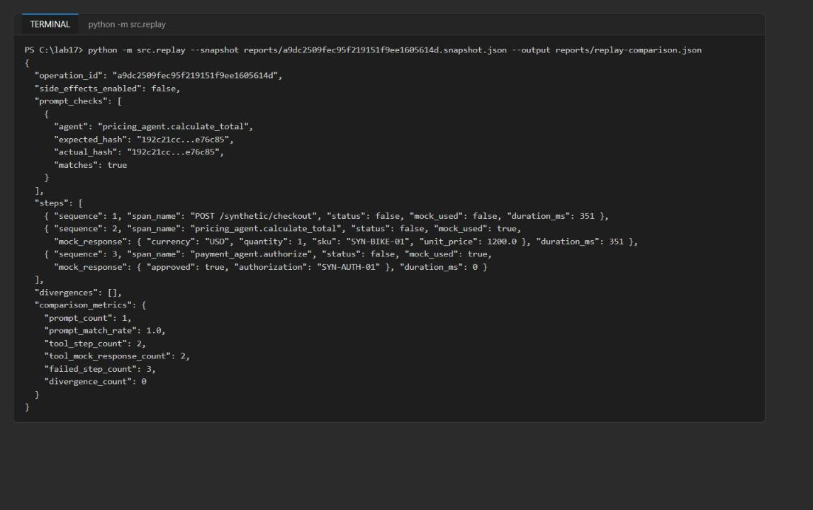

*Figure 10: Safe replay preserves failed steps and reports mock coverage*

**Remediation and postmortem**

6. The alert rule evaluates every minute. About 5-10 minutes after you emitted the traces, it fires and the Action Group sends a common-schema alert to Event Hubs. Check that it fired in the portal (**Monitor > Alerts**, look for `Adventure Works synthetic pricing failure`) or wait until the Event Hubs namespace shows an incoming message:

```powershell
$ehId = az eventhubs namespace show -g $rg -n $ehNs --query id -o tsv
az monitor metrics list --resource $ehId --metric IncomingMessages --interval PT5M --aggregation Total --offset 1h --query "value[0].timeseries[0].data[?total > ``0``].{time:timeStamp, incoming:total}" -o table
```

7. Run the bounded remediation consumer:

```powershell
python -m src.remediation --max-wait-seconds 30 --max-events 10
```

**Expected result:** It returns after about 30-35 seconds with `processed: 1` (never more than 10) and one `evidence_blobs` entry under `remediation/` in the `incident-reports` container. The receiver starts from the beginning of each partition, records a proposed containment action, and never performs a production write.

> **Note:** If `processed` is `0`, the alert has not fired yet. Wait a few minutes and run step 7 again.

8. Generate the postmortem:

```powershell
python -m src.postmortem --snapshot reports/$op.snapshot.json --analysis reports/hypothesis-results.json --replay reports/replay-comparison.json
```

**Expected result:** `local_report: reports\<op>.postmortem.md` and the same blob name in `incident-reports`. Open the file: the **Root cause** section starts with "Current evidence result: The failed checkout used synthetic-pricing-v2 and the pricing agent produced a SyntheticPriceFormatError. Evidence: ..." and ends with "Replay matched 1 prompt(s), used 2/2 captured tool response(s), and preserved 3 failed step(s)."

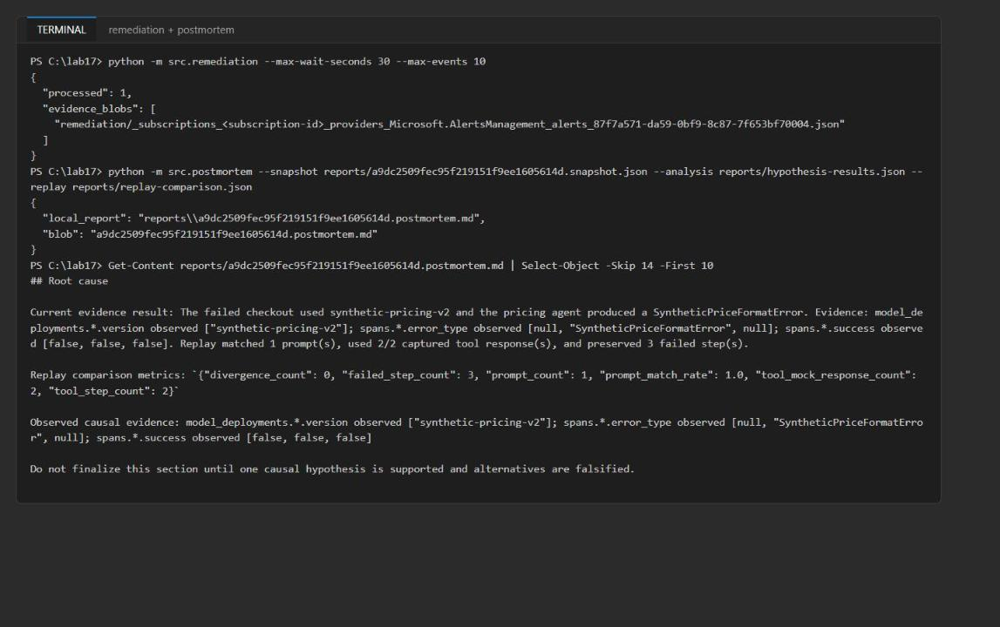

*Figure 11: Bounded remediation and the evidence-linked postmortem root cause*

**Understand the output.** The snapshot holds lowercase span fields, model and configuration versions, prompt hashes, synthetic prompt templates, and mock tool responses. Hypothesis results separate `supporting`, `contradicting`, and `missing` evidence. Replay reports prompt fidelity, failed steps, mock coverage, and divergences with `side_effects_enabled: false`; it is not a behavioral re-execution. `01-find-candidates.kql` is the broad discovery query, `02-trace-detail.kql` filters one operation and projects the fields `sanitize_rows()` consumes, and `03-hypothesis-comparison.kql` compares cohorts so a version difference is not inferred from a single trace.

---

## Task 6: Validate the implementation

**Trace capture**

1. Confirm the candidate query (Task 5 step 2) returned both successful and failed operations.

2. Confirm the trace detail kept parent-child order and durations:

```powershell
(Get-Content reports/$op.snapshot.json -Raw | ConvertFrom-Json).spans | Format-Table time_generated, span_name, span_id, parent_id, duration_ms, success
```

**Expected result:** In time order: `POST /synthetic/checkout` (root, parent is the operation ID, 351 ms), then `pricing_agent.calculate_total` and `payment_agent.authorize`, both with the checkout span as parent.

3. Confirm the snapshot is in Blob Storage, delete the local copy, download it again, and confirm it is still usable:

```powershell
az storage blob list --account-name $acct --container-name trace-snapshots --auth-mode login --query "[].{name:name, size:properties.contentLength}" -o table
Remove-Item reports/$op.snapshot.json
az storage blob download --account-name $acct --container-name trace-snapshots --name "$op.snapshot.json" --file "reports/$op.snapshot.json" --auth-mode login --output none
python -m src.replay --snapshot reports/$op.snapshot.json
```

**Expected result:** The blob is listed (about 3 KB), and replay on the downloaded file gives the same `comparison_metrics` as before.

**Hypotheses and replay**

4. Open `reports/hypothesis-results.json` and record, for each hypothesis, its supporting, contradicting, and missing evidence.

5. Open `reports/<op>.snapshot.json` and confirm it contains `configuration_versions`, `model_deployments`, lowercase span `success`, `prompts`, `prompt_hashes`, and `tool_mocks` (`catalog_lookup` and `payment_gateway`) with real response objects and `success: true`.

6. Confirm the pricing model-version statement is supported from the observed `synthetic-pricing-v2`, `SyntheticPriceFormatError`, and `success: false` values, and that the other hypotheses have no missing paths.

7. Confirm replay preserved `status: false` and reported failed-step and mock-response coverage (Task 5 step 5).

8. Change the prompt text in a copy of the snapshot and confirm the hash divergence:

```powershell
@'
import json, sys
src = f"reports/{sys.argv[1]}.snapshot.json"
snap = json.load(open(src, encoding="utf-8"))
agent = next(iter(snap["prompts"]))
snap["prompts"][agent] += " Apply an unapproved discount."
json.dump(snap, open("reports/prompt-changed.snapshot.json", "w", encoding="utf-8"), indent=2)
print("changed prompt for", agent)
'@ | python - $op
python -m src.replay --snapshot reports/prompt-changed.snapshot.json
```

**Expected result:** One entry in `divergences` with different `expected_hash` and `actual_hash`, `prompt_match_rate: 0.0`, and `divergence_count: 1`. (If you ran the postmortem on this replay, the root cause would fall back to "Replay detected 1 prompt divergence(s) ... remains bounded to the observed comparison evidence.")

**Compare trace cohorts**

9. Run the cohort comparison query (the `candidates` command runs any KQL file):

```powershell
python -m src.main candidates --query kql/03-hypothesis-comparison.kql
```

**Expected result:** The failed cohort (`CheckoutSuccess: false`) reports `ModelVersions ["synthetic-pricing-v2"]`, `ErrorTypes ["SyntheticPriceFormatError"]`, `PricingFailureRate 1`, and about 350 ms. The successful cohort reports `synthetic-pricing-v1`, no error types, and failure rate 0.

10. Optional: run the same query in the portal. Open the Log Analytics workspace `aw-incident-<token>`, select **Logs**, switch to **KQL mode**, paste the contents of `kql/03-hypothesis-comparison.kql`, and select **Run**.

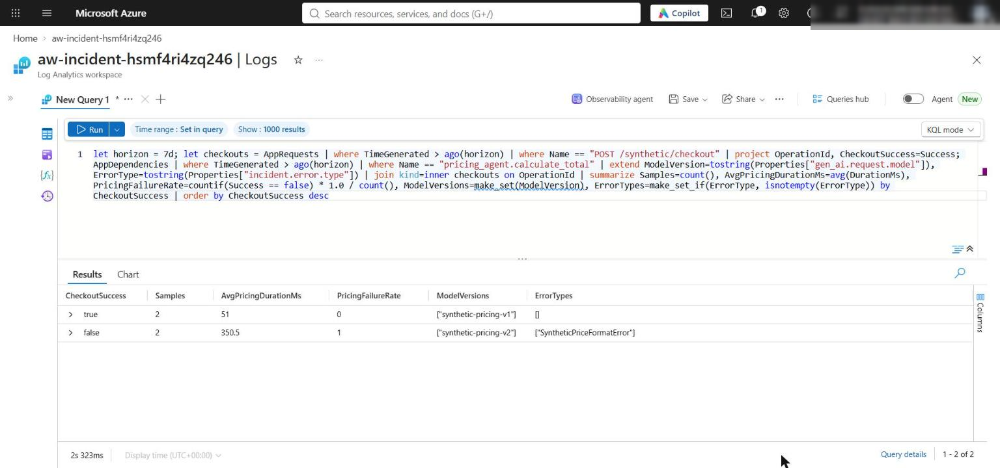

*Figure 12: Cohort comparison in Log Analytics: v2 plus SyntheticPriceFormatError only in the failed cohort*

**Alert remediation**

11. Confirm the alert rule and Action Group configuration:

```powershell
az monitor scheduled-query show -g $rg -n aw-synthetic-pricing-failure --query "{enabled:enabled, evaluationFrequency:evaluationFrequency, windowSize:windowSize, severity:severity, actionGroups:actions.actionGroups}"
az monitor action-group show -g $rg -n aw-incident-response --query "{enabled:enabled, receivers:eventHubReceivers[].{name:name, namespace:eventHubNameSpace, hub:eventHubName, commonSchema:useCommonAlertSchema}}"
```

**Expected result:** `enabled: true`, `evaluationFrequency: PT1M`, `windowSize: PT15M`, severity 2, the `aw-incident-response` action group, and one Event Hub receiver `remediation-handler` targeting `incident-alerts` with the common schema.

> **Note:** The first `az monitor scheduled-query` call may ask to install the `scheduled-query` extension. Answer **Y**, or run `az extension add --name scheduled-query` first.

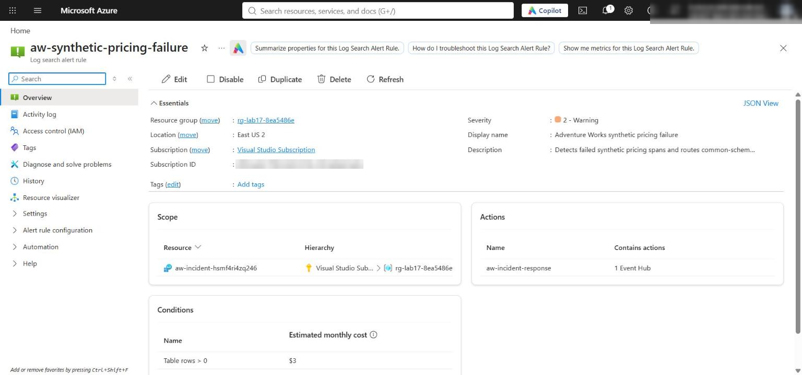

*Figure 13: The scheduled query rule is enabled and routes to the incident Action Group*

12. Confirm Event Hubs received the alert (Task 5 step 6 metric query shows at least 1 incoming message), that the remediation consumer returned after the configured wait with `processed` no greater than `--max-events`, and that it wrote one evidence blob per processed event:

```powershell
az storage blob list --account-name $acct --container-name incident-reports --auth-mode login --query "[].{name:name, size:properties.contentLength}" -o table
```

**Expected result:** The postmortem (`<op>.postmortem.md`) and one `remediation/..._alerts_<alert-id>.json` blob whose content shows `status: evidence_recorded` and `side_effects_enabled: false`.

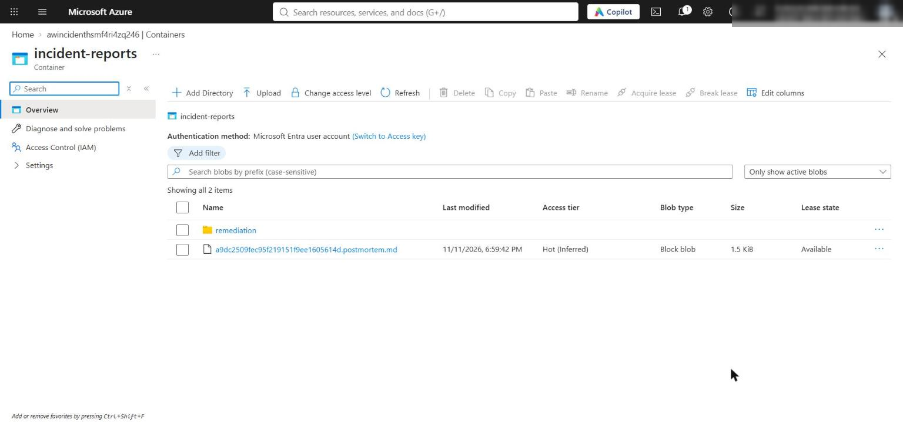

*Figure 14: incident-reports holds the postmortem and the remediation folder with the alert evidence blob*

**Durable checkpoints (reasoning)**

13. The lab's receiver is bounded and uses the `$Default` consumer group with no checkpoint store. A production consumer should use `EventProcessorClient` with a Blob checkpoint store: one dedicated checkpoint container per consumer group, with the storage account in the same region as the Event Hubs namespace.

14. Checkpoints are per partition, so after a restart partitions resume at different positions. If trace fragments span partitions, reconstruction can be incomplete until the slower partitions catch up. Design for duplicates, late fragments, and partition-local progress: persist idempotent evidence (keyed by alert ID, as `persist_evidence()` does) before advancing that partition's checkpoint. See [Troubleshoot Blob Storage checkpoint store issues](https://learn.microsoft.com/azure/event-hubs/troubleshoot-checkpoint-store-issues) and [Partition load balancing](https://learn.microsoft.com/azure/event-hubs/event-processor-balance-partition-load).

**Postmortem**

15. Open `reports/<op>.postmortem.md` and the matching blob in `incident-reports`. Confirm the root cause uses the highest-priority supported statement, cites its observed predicate values, includes the prompt-match, failed-step, and tool-response replay metrics, and never infers cause from a hypothesis ID or event name.

**Azure resources**

16. In the portal, confirm the resource group contains only the Log Analytics workspace, Application Insights component, Storage account (with `trace-snapshots` and `incident-reports`), Event Hubs namespace and `incident-alerts` hub, the scheduled query rule, and the Action Group. No Foundry resources are provisioned.

**Acceptance criteria**

| Objective | Evidence | Passing outcome |
|---|---|---|
| Query traces and latency | Candidate, detail, and cohort results | Both outcomes appear; the selected trace keeps parent-child order and durations |
| Capture replay artifacts | Local and Blob snapshots | Versions, hashes, spans, and synthetic mocks present; downloaded copy replays identically; no sensitive content |
| Test competing hypotheses | `reports/hypothesis-results.json` | Every predicate is supported, contradicted, or explicitly missing; only the pricing model-version hypothesis is supported |
| Prompt fidelity | Changed-prompt replay | `divergence_count: 1` |
| Detection through remediation | Alert rule, Event Hubs metric, remediation output | Alert fired; `processed` 1 (<= 10); one evidence blob; side effects disabled |
| Postmortem | `reports/<op>.postmortem.md` and blob | Root cause cites observed values and replay metrics |

---

## Optional challenge: Falsify a competing hypothesis

Add a hypothesis that explains one symptom (the payment span failed) but not the whole trace, and show that the evidence rejects it.

1. Create `assets/hypotheses-challenge.json` with the five shipped hypotheses plus a `payment_gateway_outage` hypothesis at priority 0 (so it would win if it were supported):

```powershell
$h = Get-Content assets/hypotheses.json -Raw | ConvertFrom-Json
$challenge = [pscustomobject]@{
  id = 'payment_gateway_outage'
  statement = 'The payment gateway tool failed and caused the checkout failure.'
  priority = 0
  predicates = @(
    [pscustomobject]@{ path = 'spans.*.success'; operator = 'contains'; expected = $false },
    [pscustomobject]@{ path = 'tool_mocks.payment_gateway.success'; operator = 'contains'; expected = $false },
    [pscustomobject]@{ path = 'spans.*.duration_ms'; operator = 'greater_than'; expected = 300 }
  )
}
$h.hypotheses = @($h.hypotheses) + $challenge
[IO.File]::WriteAllText("$PWD/assets/hypotheses-challenge.json", ($h | ConvertTo-Json -Depth 10))
```

2. Evaluate it, keep the result under its own name, and restore the main results:

```powershell
python -m src.analysis --snapshot reports/$op.snapshot.json --hypotheses assets/hypotheses-challenge.json | Out-Null
Copy-Item reports/hypothesis-results.json reports/hypothesis-results-challenge.json
python -m src.analysis --snapshot reports/$op.snapshot.json --hypotheses assets/hypotheses.json | Out-Null
(Get-Content reports/hypothesis-results-challenge.json -Raw | ConvertFrom-Json) | ForEach-Object { "{0} {1} -> {2}; contradicted by: {3}" -f $_.priority, $_.hypothesis_id, $_.status, (($_.contradicting | ForEach-Object { "$($_.path)=$($_.observed | ConvertTo-Json -Compress)" }) -join ', ') }
```

**Expected result:** `0 payment_gateway_outage -> rejected; contradicted by: tool_mocks.payment_gateway.success=[true]`. The captured payment response was approved, so the payment failure is a downstream symptom of the bad pricing output. `pricing_model_version_regression` stays the only supported hypothesis, so a postmortem built from the challenge results still selects the pricing statement:

```powershell
python -m src.postmortem --snapshot reports/$op.snapshot.json --analysis reports/hypothesis-results-challenge.json --replay reports/replay-comparison.json
```

3. Failure investigation (optional): add a misleading synthetic symptom, then use the three KQL stages (candidates -> trace detail -> cohort comparison) to show that only the pricing span differs between cohorts.

---

## Task 7: Review the design

**Which observable failure differed most between successful and failed cohorts?** The pricing span. In the cohort query, the failed cohort has `PricingFailureRate = 1`, model `synthetic-pricing-v2`, error `SyntheticPriceFormatError`, and about 350 ms; the successful cohort has failure rate 0, `synthetic-pricing-v1`, no errors, and about 51 ms. The payment span also fails, but it is downstream and its captured tool response is `approved: true, success: true`, so it is a symptom.

**What evidence would falsify the leading hypothesis?** A failed checkout whose pricing span ran `synthetic-pricing-v1`, or a successful checkout on `synthetic-pricing-v2`; a failed trace without `SyntheticPriceFormatError`; a prompt-hash divergence in replay or a tool mock with `success: false` (pointing to a prompt or tool cause); or several `configuration_versions` in the failed operation. The lab showed the prompt case: editing the prompt gives `divergence_count = 1` and the postmortem stops claiming the model-version cause.

**Which preventive action changes the system rather than only treating the symptom?** Gate model-version rollouts: pin the pricing agent's deployment version, add a contract test that validates each candidate version's output format against the payment amount schema using replayed snapshots, and ship new versions through a canary that rolls back automatically when the version-split pricing failure rate rises. Retrying payments or muting the alert only treats the symptom.

---

## Troubleshooting

| Problem | Cause | Fix |
|---|---|---|
| `learner_code_complete: not ready` | A `# LAB PLACEHOLDER` comment remains in `src/` | Delete every placeholder comment after pasting |
| `IndentationError` after pasting | The official lab snippets use 2-space indentation | Use the 4-space code in this guide |
| `app_insights_connection: not ready` or the emitter fails with a missing connection string | `.env` was written without `APPLICATIONINSIGHTS_CONNECTION_STRING` (some helper scripts skip `*_CONNECTION_STRING` outputs) | Re-run the Task 3 `.env` block, which writes every deployment output, or add it from `az deployment group show -g <rg> -n lab17-main --query properties.outputs.APPLICATIONINSIGHTS_CONNECTION_STRING.value -o tsv` |
| `candidates` returns `[]` | Telemetry ingestion takes a few minutes | Wait 3-5 minutes and rerun; don't re-emit |
| 403 from Logs, Blob, or Event Hubs | Role assignments still propagating | Wait 1-5 minutes and retry |
| `remediation` prints `processed: 0` | The alert has not fired yet (it needs ingested data and a 1-minute evaluation) | Check **Monitor > Alerts**, wait, and rerun |
| Boundary check throws "Expected one Event Hubs Data Receiver assignment" | Role propagation, or you ran it with a different signed-in user | Wait and rerun; make sure `$principalId` is your object ID |
| Boundary check throws "must not inherit Event Hubs Data Sender or Data Owner" | Someone granted a broader Event Hubs data role on the hub | Remove that assignment; the receiver needs only Data Receiver |
| Downloaded snapshot hash differs from the original | Windows writes the local file with CRLF; the blob was uploaded with LF | Expected; the JSON content and replay metrics are identical |
| `az` commands in Git Bash mangle `/subscriptions/...` scopes | MSYS path conversion | Use PowerShell, or prefix the command with `MSYS_NO_PATHCONV=1` |

---

## Clean up (optional)

Log Analytics and Application Insights ingestion keep billing while the resources exist.

1. Delete the resource group:

```powershell
az group delete --name <your-resource-group> --yes --no-wait
```

2. Remove `.env` and the generated snapshots and reports unless your instructor needs them:

```powershell
Remove-Item .env
Remove-Item reports/*.snapshot.json, reports/*.postmortem.md
```

3. Deactivate the virtual environment in every terminal that shows `(.venv)`:

```powershell
deactivate
```

